# Database: Prisma and PostgreSQL

## Purpose and governance

This document describes the current models in `schema.prisma`, their fields, types, keys, relationships, and constraints. Only the Database team modifies the schema and migrations. Business rules belong in the module README files under `docs/<module>/`. Radar changes requiring approval are listed in the [standards alignment request](../../docs/radar-integration/database-change-request.md).

## Reading conventions

- Prisma uses singular model names and camelCase fields; `@@map` identifies the PostgreSQL table and `@map` identifies the column. When a mapping is absent, the physical name matches the declared name; this document records the current schema rather than assuming compliance.
- `?` indicates nullability; `[]` represents a collection on the 1:N or N:M side. A relation field is not a stored column: its `fields` are foreign keys and `references` identifies the target model and field.
- `@id`/`@@id` define primary keys; `@unique`/`@@unique` define uniqueness; `@@index` defines an index. Composite indexes and their ordering are listed as well.
- `String @db.Uuid` identifies UUID values. `@db.VarChar(n)` limits length; `@db.Timestamptz(6)` stores date and time with a time zone; `@db.Date` stores dates; `@db.Time(6)` stores times. Without a native annotation, Prisma's default PostgreSQL mapping applies.
- `@default` describes initial value generation, while `@updatedAt` describes Prisma-managed updates. `deletedAt` records soft deletion where present.
- `Cascade` deletes dependent rows; `Restrict`/`NoAction` prevents deleting active references; `SetNull` preserves traceability without the reference. Undeclared actions are marked implicit and require review where the standard requires explicit behavior.
- `@@ignore` identifies a model omitted from the generated client; it does not mean its table can be deleted. Repositories may retain parameterized SQL for these tables.

## Radar relationships

```mermaid
erDiagram
  JobApplication ||--o{ RadarApplicationConsent : application
  UserCvFile ||--o{ RadarCvEvidence : cv
  User ||--o{ RadarCvEvidence : owner
  User o|--o{ RadarCvEvidence : reviewer
  RadarCvExtractionStatus ||--o{ RadarCvEvidence : extractionState
  RadarCvReviewStatus ||--o{ RadarCvEvidence : reviewState
  User ||--o{ RadarScoreSnapshot : user
  User ||--o{ RadarAuditEvent : subject
  User o|--o{ RadarAuditEvent : actor
  Company ||--o{ RadarCompanyAccess : company
  User ||--o{ RadarCompanyAccess : user
  JobOffer ||--o{ RadarJobApplication : jobOffer
  User ||--o{ RadarJobApplication : user
  User o|--o{ RadarJobApplication : decider
  User ||--o{ RadarDocumentVerification : owner
  User o|--o{ RadarDocumentVerification : reviewer
  RadarDocumentStatus ||--o{ RadarDocumentVerification : statusEntry
  RadarDocumentSourceType ||--o{ RadarDocumentVerification : sourceTypeEntry
```

## Relationships and foreign keys

Each foreign key has N:1 cardinality; a unique foreign key restricts the relationship to 1:1. Relation nullability indicates whether the parent endpoint is optional.

| Model and relation | Local FK | Reference | Optional | onDelete |
| --- | --- | --- | --- | --- |
| User.company | companyId | Company.id | Yes | SetNull |
| User.city | cityId | City.id | Yes | SetNull |
| UserRole.user | userId | User.id | No | Cascade |
| UserRole.role | roleId | Role.id | No | Restrict |
| Education.user | userId | User.id | No | Cascade |
| WorkExperience.user | userId | User.id | No | Cascade |
| WorkExperience.company | companyId | Company.id | No | Restrict |
| Skill.area | areaId | RadarArea.id | Yes | SetNull |
| JobOfferSkill.jobOffer | jobOfferId | JobOffer.id | No | Cascade |
| JobOfferSkill.skill | skillId | Skill.id | No | Restrict |
| UserSkill.user | userId | User.id | No | Cascade |
| UserSkill.skill | skillId | Skill.id | No | Restrict |
| Certification.user | userId | User.id | No | Cascade |
| UserCvFile.user | userId | User.id | No | Cascade |
| ProfileSkillProcessingState.user | userId | User.id | No | Cascade |
| MentorTechnicalArea.mentor | mentorId | User.id | No | Cascade |
| MentorTechnicalArea.technicalArea | technicalAreaId | TechnicalArea.id | No | Restrict |
| MentorOrientationType.mentor | mentorId | User.id | No | Cascade |
| MentorOrientationType.orientationType | orientationTypeId | OrientationType.id | No | Restrict |
| AvailabilityBlock.mentor | mentorId | User.id | No | Cascade |
| BlockedDate.mentor | mentorId | User.id | No | Cascade |
| Appointment.block | blockId | AvailabilityBlock.id | Yes | SetNull |
| Appointment.mentor | mentorId | User.id | No | Restrict |
| Appointment.student | studentId | User.id | No | Restrict |
| Appointment.status | statusId | AppointmentStatus.id | No | Restrict |
| Appointment.orientationType | orientationTypeId | OrientationType.id | Yes | SetNull |
| Appointment.cancelledBy | cancelledById | User.id | Yes | SetNull |
| AppointmentDocument.appointment | appointmentId | Appointment.id | No | Cascade |
| TimeProposal.appointment | appointmentId | Appointment.id | No | Cascade |
| TimeProposal.proposedBlock | proposedBlockId | AvailabilityBlock.id | No | Cascade |
| TimeProposal.status | statusId | ProposalStatus.id | No | Restrict |
| AppointmentHistory.appointment | appointmentId | Appointment.id | No | Cascade |
| AppointmentHistory.previousStatus | previousStatusId | AppointmentStatus.id | Yes | SetNull |
| AppointmentHistory.newStatus | newStatusId | AppointmentStatus.id | No | Restrict |
| AppointmentHistory.changedBy | changedById | User.id | Yes | SetNull |
| Event.category | categoryId | EventCategory.id | No | Restrict |
| Event.modality | modalityId | EventModality.id | No | Restrict |
| Event.origin | originId | EventOrigin.id | No | Restrict |
| Event.status | statusId | EventStatus.id | No | Restrict |
| Event.createdBy | createdById | User.id | No | Restrict |
| Event.moderatedBy | moderatedById | User.id | Yes | SetNull |
| EventRegistration.event | eventId | Event.id | No | Cascade |
| EventRegistration.user | userId | User.id | No | Cascade |
| EventRegistration.status | statusId | RegistrationStatus.id | No | Restrict |
| EventAttendance.registration | registrationId | EventRegistration.id | No | Cascade |
| EventAttendance.checkedInBy | checkedInById | User.id | Yes | SetNull |
| JobOffer.company | companyId | Company.id | No | Cascade |
| JobOffer.modality | modalityId | JobOfferModality.id | No | Restrict |
| JobOffer.contractType | contractTypeId | JobOfferContractType.id | No | Restrict |
| JobOffer.status | statusId | JobOfferStatus.id | No | Restrict |
| AdminExportHistory.user | userId | User.id | No | Cascade |
| AccessRequest.status | statusId | AccessRequestStatus.id | No | Restrict |
| AccessRequest.documentType | documentTypeId | AccessRequestDocumentType.id | Yes | Restrict |
| AccessRequest.documentFile | documentFileId | File.id | Yes | SetNull |
| AccessRequest.openedBy | openedById | User.id | Yes | SetNull |
| AccessRequest.reviewedBy | reviewedById | User.id | Yes | SetNull |
| AccessRequest.approvedUser | approvedUserId | User.id | Yes | SetNull |
| AccessRequest.career | careerId | Career.id | No | Restrict |
| MentorParticipationRequest.user | userId | User.id | No | Restrict |
| MentorParticipationRequest.statusCatalog | statusId | MentorParticipationStatus.id | No | Restrict |
| MentorSlotOffer.user | userId | User.id | No | Restrict |
| MentorSlotOffer.request | requestId | MentorParticipationRequest.id | Yes | Restrict |
| MentorSlotOffer.statusCatalog | statusId | MentorOfferStatus.id | No | Restrict |
| ActivationOtp.accessRequest | accessRequestId | AccessRequest.id | No | Cascade |
| Conversation.userA | userAId | User.id | Yes | Cascade |
| Conversation.userB | userBId | User.id | Yes | Cascade |
| Conversation.event | eventId | Event.id | Yes | Cascade |
| ConversationParticipant.conversation | conversationId | Conversation.id | No | Cascade |
| ConversationParticipant.user | userId | User.id | No | Cascade |
| Message.conversation | conversationId | Conversation.id | No | Cascade |
| Message.sender | senderId | User.id | No | Cascade |
| Message.status | statusId | MessageStatus.id | No | Restrict |
| MessageAttachment.message | messageId | Message.id | No | Cascade |
| MessageAttachment.type | typeId | AttachmentType.id | No | Restrict |
| ChatUserBlock.blocker | blockerId | User.id | No | Cascade |
| ChatUserBlock.blocked | blockedId | User.id | No | Cascade |
| ConnectionRequest.sender | senderId | User.id | No | Cascade |
| ConnectionRequest.receiver | receiverId | User.id | No | Cascade |
| ConnectionRequest.status | statusId | ConnectionRequestStatus.id | No | Restrict |
| UserPresence.user | userId | User.id | No | Cascade |
| PasswordResetOtp.user | userId | User.id | No | Cascade |
| MentorParticipationAttemptLimit.user | userId | User.id | No | Cascade |
| JobApplication.jobOffer | jobOfferId | JobOffer.id | No | Cascade |
| JobApplication.user | userId | User.id | No | Cascade |
| JobApplication.status | statusId | JobApplicationStatus.id | No | Restrict |
| RadarApplicationConsent.application | applicationId | JobApplication.id | No | Cascade |
| Survey.career | careerId | Career.id | Yes | Restrict |
| Survey.status | statusId | SurveyStatus.id | No | Restrict |
| Survey.targetAudience | targetAudienceId | SurveyTargetAudience.id | Yes | Restrict |
| Survey.createdBy | createdById | User.id | No | Restrict |
| SurveyQuestion.survey | surveyId | Survey.id | No | Cascade |
| SurveyQuestion.type | typeId | SurveyQuestionType.id | No | Restrict |
| SurveyQuestionOption.question | questionId | SurveyQuestion.id | No | Cascade |
| SurveyResponse.survey | surveyId | Survey.id | No | Cascade |
| SurveyResponse.respondent | respondentId | User.id | No | Restrict |
| SurveyAnswer.response | responseId | SurveyResponse.id | No | Cascade |
| SurveyAnswer.question | questionId | SurveyQuestion.id | No | Cascade |
| SurveyAnswer.option | optionId | SurveyQuestionOption.id | Yes | Cascade |
| AuditEvent.accessRequest | accessRequestId | AccessRequest.id | No | Restrict |
| AuditEvent.action | actionId | AuditAction.id | No | Restrict |
| AuditEvent.actor | actorId | User.id | Yes | SetNull |
| AuditEvent.evidenceFile | evidenceFileId | File.id | Yes | Restrict |
| DocumentValidation.accessRequest | accessRequestId | AccessRequest.id | No | Cascade |
| DocumentValidation.revertedBy | revertedById | User.id | Yes | SetNull |
| MentorIntakeAttempt.intakeOperation | operationId | MentorIntakeOperation.id | No | Restrict |
| MentorIntakeAttempt.user | userId | User.id | No | Restrict |
| MentorParticipationSanction.user | userId | User.id | No | Restrict |
| MentorParticipationSanction.triggerAttempt | triggerAttemptId | MentorIntakeAttempt.id | Yes | Restrict |
| RadarCvEvidence.cv | cvId | UserCvFile.id | No | Cascade |
| RadarCvEvidence.owner | userId | User.id | No | Cascade |
| RadarCvEvidence.reviewer | reviewerId | User.id | Yes | SetNull |
| RadarCvEvidence.extractionState | extractionStatusId | RadarCvExtractionStatus.id | No | Restrict |
| RadarCvEvidence.reviewState | reviewStatusId | RadarCvReviewStatus.id | No | Restrict |
| RadarScoreSnapshot.user | userId | User.id | No | Cascade |
| RadarAuditEvent.subject | userId | User.id | No | Cascade |
| RadarAuditEvent.actor | actorId | User.id | Yes | SetNull |
| RadarCompanyAccess.company | companyId | Company.id | No | Cascade |
| RadarCompanyAccess.user | userId | User.id | No | Cascade |
| RadarJobApplication.jobOffer | jobOfferId | JobOffer.id | No | Cascade |
| RadarJobApplication.user | userId | User.id | No | Cascade |
| RadarJobApplication.decider | decidedBy | User.id | Yes | NoAction |
| RadarDocumentVerification.owner | userId | User.id | No | Cascade |
| RadarDocumentVerification.reviewer | reviewerId | User.id | Yes | SetNull |
| RadarDocumentVerification.statusEntry | statusId | RadarDocumentStatus.id | No | Restrict |
| RadarDocumentVerification.sourceTypeEntry | sourceTypeId | RadarDocumentSourceType.id | No | Restrict |
| UserSocialAccount.user | userId | User.id | No | Cascade |
| UserSocialAccount.provider | providerId | PortfolioProvider.id | No | Restrict |
| UserPortfolioProject.user | userId | User.id | No | Cascade |
| UserPortfolioProject.socialAccount | socialAccountId | UserSocialAccount.id | Yes | SetNull |
| UserPortfolioProject.provider | providerId | PortfolioProvider.id | No | Restrict |
| Notification.recipient | recipientId | User.id | No | Cascade |
| Notification.actor | actorId | User.id | Yes | SetNull |
| Notification.type | typeId | NotificationType.id | No | Restrict |
| PushSubscription.user | userId | User.id | No | Cascade |
| NotificationPreference.user | userId | User.id | No | Cascade |

## Model dictionary

The definition column preserves schema attributes so defaults, precision, indexes, and mappings can be reviewed without inference.

### AppointmentStatus

Table: `appointment_statuses`.

| Field | Prisma type | Column or relation | Definition and constraints |
| --- | --- | --- | --- |
| id | `String` | id | `@id @default(uuid()) @db.Uuid` |
| title | `String` | title | `@unique @db.VarChar(100)` |
| description | `String?` | description | `No explicit attributes` |
| createdAt | `DateTime` | created_at | `@default(now()) @map("created_at") @db.Timestamptz(6)` |
| updatedAt | `DateTime` | updated_at | `@updatedAt @map("updated_at") @db.Timestamptz(6)` |
| appointments | `Appointment[]` | Relation: Appointment[] | `No explicit attributes` |
| previousAppointmentHistories | `AppointmentHistory[]` | Relation: AppointmentHistory[] | `@relation("PreviousAppointmentStatus")` |
| newAppointmentHistories | `AppointmentHistory[]` | Relation: AppointmentHistory[] | `@relation("NewAppointmentStatus")` |

Model constraints:

- `@@map("appointment_statuses")`

### ProposalStatus

Table: `proposal_statuses`.

| Field | Prisma type | Column or relation | Definition and constraints |
| --- | --- | --- | --- |
| id | `String` | id | `@id @default(uuid()) @db.Uuid` |
| title | `String` | title | `@unique @db.VarChar(100)` |
| description | `String?` | description | `No explicit attributes` |
| createdAt | `DateTime` | created_at | `@default(now()) @map("created_at") @db.Timestamptz(6)` |
| updatedAt | `DateTime` | updated_at | `@updatedAt @map("updated_at") @db.Timestamptz(6)` |
| proposals | `TimeProposal[]` | Relation: TimeProposal[] | `No explicit attributes` |

Model constraints:

- `@@map("proposal_statuses")`

### EventModality

Table: `event_modalities`.

| Field | Prisma type | Column or relation | Definition and constraints |
| --- | --- | --- | --- |
| id | `String` | id | `@id @default(uuid()) @db.Uuid` |
| title | `String` | title | `@unique @db.VarChar(100)` |
| description | `String?` | description | `No explicit attributes` |
| createdAt | `DateTime` | created_at | `@default(now()) @map("created_at") @db.Timestamptz(6)` |
| updatedAt | `DateTime` | updated_at | `@updatedAt @map("updated_at") @db.Timestamptz(6)` |
| events | `Event[]` | Relation: Event[] | `No explicit attributes` |

Model constraints:

- `@@map("event_modalities")`

### EventOrigin

Table: `event_origins`.

| Field | Prisma type | Column or relation | Definition and constraints |
| --- | --- | --- | --- |
| id | `String` | id | `@id @default(uuid()) @db.Uuid` |
| title | `String` | title | `@unique @db.VarChar(100)` |
| description | `String?` | description | `No explicit attributes` |
| createdAt | `DateTime` | created_at | `@default(now()) @map("created_at") @db.Timestamptz(6)` |
| updatedAt | `DateTime` | updated_at | `@updatedAt @map("updated_at") @db.Timestamptz(6)` |
| events | `Event[]` | Relation: Event[] | `No explicit attributes` |

Model constraints:

- `@@map("event_origins")`

### EventStatus

Table: `event_statuses`.

| Field | Prisma type | Column or relation | Definition and constraints |
| --- | --- | --- | --- |
| id | `String` | id | `@id @default(uuid()) @db.Uuid` |
| title | `String` | title | `@unique @db.VarChar(100)` |
| description | `String?` | description | `No explicit attributes` |
| createdAt | `DateTime` | created_at | `@default(now()) @map("created_at") @db.Timestamptz(6)` |
| updatedAt | `DateTime` | updated_at | `@updatedAt @map("updated_at") @db.Timestamptz(6)` |
| events | `Event[]` | Relation: Event[] | `No explicit attributes` |

Model constraints:

- `@@map("event_statuses")`

### RegistrationStatus

Table: `registration_statuses`.

| Field | Prisma type | Column or relation | Definition and constraints |
| --- | --- | --- | --- |
| id | `String` | id | `@id @default(uuid()) @db.Uuid` |
| title | `String` | title | `@unique @db.VarChar(100)` |
| description | `String?` | description | `No explicit attributes` |
| createdAt | `DateTime` | created_at | `@default(now()) @map("created_at") @db.Timestamptz(6)` |
| updatedAt | `DateTime` | updated_at | `@updatedAt @map("updated_at") @db.Timestamptz(6)` |
| eventRegistrations | `EventRegistration[]` | Relation: EventRegistration[] | `No explicit attributes` |

Model constraints:

- `@@map("registration_statuses")`

### City

Table: `cities`.

| Field | Prisma type | Column or relation | Definition and constraints |
| --- | --- | --- | --- |
| id | `String` | id | `@id @default(uuid()) @db.Uuid` |
| title | `String` | title | `@unique @db.VarChar(100)` |
| description | `String?` | description | `No explicit attributes` |
| createdAt | `DateTime` | created_at | `@default(now()) @map("created_at") @db.Timestamptz(6)` |
| updatedAt | `DateTime` | updated_at | `@updatedAt @map("updated_at") @db.Timestamptz(6)` |
| users | `User[]` | Relation: User[] | `No explicit attributes` |

Model constraints:

- `@@map("cities")`

### Company

Table: `companies`.

| Field | Prisma type | Column or relation | Definition and constraints |
| --- | --- | --- | --- |
| id | `String` | id | `@id @default(uuid()) @db.Uuid` |
| title | `String` | title | `@unique @db.VarChar(100)` |
| description | `String?` | description | `No explicit attributes` |
| createdAt | `DateTime` | created_at | `@default(now()) @map("created_at") @db.Timestamptz(6)` |
| updatedAt | `DateTime` | updated_at | `@updatedAt @map("updated_at") @db.Timestamptz(6)` |
| recruiters | `User[]` | Relation: User[] | `No explicit attributes` |
| workExperiences | `WorkExperience[]` | Relation: WorkExperience[] | `No explicit attributes` |
| jobOffers | `JobOffer[]` | Relation: JobOffer[] | `No explicit attributes` |
| radarCompanyAccess | `RadarCompanyAccess[]` | Relation: RadarCompanyAccess[] | `@ignore` |

Model constraints:

- `@@map("companies")`

### User

Table: `users`.

| Field | Prisma type | Column or relation | Definition and constraints |
| --- | --- | --- | --- |
| mentorIntakeAttempts | `MentorIntakeAttempt[]` | Relation: MentorIntakeAttempt[] | `No explicit attributes` |
| mentorParticipationSanctions | `MentorParticipationSanction[]` | Relation: MentorParticipationSanction[] | `No explicit attributes` |
| id | `String` | id | `@id @default(uuid()) @db.Uuid` |
| firstName | `String` | first_name | `@map("first_name") @db.VarChar(100)` |
| lastName | `String` | last_name | `@map("last_name") @db.VarChar(100)` |
| email | `String` | email | `@unique @db.VarChar(150)` |
| password | `String?` | password | `@db.VarChar(255)` |
| isActive | `Boolean` | is_active | `@default(true) @map("is_active")` |
| isAvailableForMentoring | `Boolean` | is_available_for_mentoring | `@default(false) @map("is_available_for_mentoring")` |
| photoUrl | `Bytes?` | photo_url | `@map("photo_url")` |
| cityId | `String?` | city_id | `@map("city_id") @db.Uuid` |
| companyId | `String?` | company_id | `@map("company_id") @db.Uuid` |
| company | `Company?` | Relation: Company? | `@relation(fields: [companyId], references: [id], onDelete: SetNull)` |
| phone | `String?` | phone | `No explicit attributes` |
| personalEmail | `String?` | personal_email | `@map("personal_email")` |
| headline | `String?` | headline | `No explicit attributes` |
| aboutMe | `String?` | about_me | `@map("about_me")` |
| createdAt | `DateTime` | created_at | `@default(now()) @map("created_at") @db.Timestamptz(6)` |
| updatedAt | `DateTime` | updated_at | `@updatedAt @map("updated_at") @db.Timestamptz(6)` |
| city | `City?` | Relation: City? | `@relation(fields: [cityId], references: [id], onDelete: SetNull)` |
| roles | `UserRole[]` | Relation: UserRole[] | `No explicit attributes` |
| educations | `Education[]` | Relation: Education[] | `No explicit attributes` |
| workExperiences | `WorkExperience[]` | Relation: WorkExperience[] | `No explicit attributes` |
| userSkills | `UserSkill[]` | Relation: UserSkill[] | `No explicit attributes` |
| certifications | `Certification[]` | Relation: Certification[] | `No explicit attributes` |
| cvFiles | `UserCvFile[]` | Relation: UserCvFile[] | `No explicit attributes` |
| skillProcessingState | `ProfileSkillProcessingState?` | Relation: ProfileSkillProcessingState? | `No explicit attributes` |
| mentorTechnicalAreas | `MentorTechnicalArea[]` | Relation: MentorTechnicalArea[] | `No explicit attributes` |
| mentorOrientationTypes | `MentorOrientationType[]` | Relation: MentorOrientationType[] | `No explicit attributes` |
| availabilityBlocks | `AvailabilityBlock[]` | Relation: AvailabilityBlock[] | `No explicit attributes` |
| blockedDates | `BlockedDate[]` | Relation: BlockedDate[] | `No explicit attributes` |
| mentorAppointments | `Appointment[]` | Relation: Appointment[] | `@relation("AppointmentMentor")` |
| studentAppointments | `Appointment[]` | Relation: Appointment[] | `@relation("AppointmentStudent")` |
| cancelledAppointments | `Appointment[]` | Relation: Appointment[] | `@relation("AppointmentCancelledBy")` |
| appointmentChanges | `AppointmentHistory[]` | Relation: AppointmentHistory[] | `No explicit attributes` |
| createdEvents | `Event[]` | Relation: Event[] | `@relation("EventCreatedBy")` |
| moderatedEvents | `Event[]` | Relation: Event[] | `@relation("EventModeratedBy")` |
| eventRegistrations | `EventRegistration[]` | Relation: EventRegistration[] | `No explicit attributes` |
| checkedInAttendances | `EventAttendance[]` | Relation: EventAttendance[] | `No explicit attributes` |
| exportHistories | `AdminExportHistory[]` | Relation: AdminExportHistory[] | `@relation("AdminExportHistories")` |
| openedAccessRequests | `AccessRequest[]` | Relation: AccessRequest[] | `@relation("AccessRequestOpenedBy")` |
| reviewedAccessRequests | `AccessRequest[]` | Relation: AccessRequest[] | `@relation("AccessRequestReviewedBy")` |
| approvedAccessRequest | `AccessRequest?` | Relation: AccessRequest? | `@relation("ApprovedGraduateAccount")` |
| mentorSlotOffers | `MentorSlotOffer[]` | Relation: MentorSlotOffer[] | `No explicit attributes` |
| mentorParticipationRequests | `MentorParticipationRequest[]` | Relation: MentorParticipationRequest[] | `No explicit attributes` |
| mentorParticipationAttemptLimit | `MentorParticipationAttemptLimit?` | Relation: MentorParticipationAttemptLimit? | `No explicit attributes` |
| createdSurveys | `Survey[]` | Relation: Survey[] | `@relation("SurveyCreatedBy")` |
| surveyResponses | `SurveyResponse[]` | Relation: SurveyResponse[] | `@relation("SurveyRespondent")` |
| conversationsAsUserA | `Conversation[]` | Relation: Conversation[] | `@relation("UserAConversations")` |
| conversationsAsUserB | `Conversation[]` | Relation: Conversation[] | `@relation("UserBConversations")` |
| chatMessages | `Message[]` | Relation: Message[] | `No explicit attributes` |
| chatParticipants | `ConversationParticipant[]` | Relation: ConversationParticipant[] | `No explicit attributes` |
| presence | `UserPresence?` | Relation: UserPresence? | `No explicit attributes` |
| chatBlocksMade | `ChatUserBlock[]` | Relation: ChatUserBlock[] | `@relation("ChatBlocker")` |
| chatBlocksReceived | `ChatUserBlock[]` | Relation: ChatUserBlock[] | `@relation("ChatBlocked")` |
| sentRequests | `ConnectionRequest[]` | Relation: ConnectionRequest[] | `@relation("SentConnectionRequests")` |
| receivedRequests | `ConnectionRequest[]` | Relation: ConnectionRequest[] | `@relation("ReceivedConnectionRequests")` |
| passwordResetOtps | `PasswordResetOtp[]` | Relation: PasswordResetOtp[] | `No explicit attributes` |
| auditEvents | `AuditEvent[]` | Relation: AuditEvent[] | `@relation("AuditEventActor")` |
| revertedValidations | `DocumentValidation[]` | Relation: DocumentValidation[] | `@relation("DocumentValidationRevertedBy")` |
| jobApplications | `JobApplication[]` | Relation: JobApplication[] | `No explicit attributes` |
| radarCvOwned | `RadarCvEvidence[]` | Relation: RadarCvEvidence[] | `@relation("RadarCvOwner")` |
| radarCvReviewed | `RadarCvEvidence[]` | Relation: RadarCvEvidence[] | `@relation("RadarCvReviewer")` |
| radarSnapshots | `RadarScoreSnapshot[]` | Relation: RadarScoreSnapshot[] | `No explicit attributes` |
| documentVerifications | `RadarDocumentVerification[]` | Relation: RadarDocumentVerification[] | `@relation("VerifiedDocumentOwner")` |
| reviewedDocuments | `RadarDocumentVerification[]` | Relation: RadarDocumentVerification[] | `@relation("VerifiedDocumentReviewer")` |
| radarAuditSubjects | `RadarAuditEvent[]` | Relation: RadarAuditEvent[] | `@relation("RadarAuditSubject")` |
| radarAuditActors | `RadarAuditEvent[]` | Relation: RadarAuditEvent[] | `@relation("RadarAuditActor")` |
| radarCompanyAccess | `RadarCompanyAccess[]` | Relation: RadarCompanyAccess[] | `@ignore` |
| radarApplications | `RadarJobApplication[]` | Relation: RadarJobApplication[] | `@relation("RadarApplicant") @ignore` |
| radarDecisions | `RadarJobApplication[]` | Relation: RadarJobApplication[] | `@relation("RadarDecision") @ignore` |
| socialAccounts | `UserSocialAccount[]` | Relation: UserSocialAccount[] | `No explicit attributes` |
| portfolioProjects | `UserPortfolioProject[]` | Relation: UserPortfolioProject[] | `No explicit attributes` |
| notificationPreferences | `NotificationPreference?` | Relation: NotificationPreference? | `No explicit attributes` |
| receivedNotifications | `Notification[]` | Relation: Notification[] | `@relation("ReceivedNotifications")` |
| triggeredNotifications | `Notification[]` | Relation: Notification[] | `@relation("TriggeredNotifications")` |
| pushSubscriptions | `PushSubscription[]` | Relation: PushSubscription[] | `No explicit attributes` |

Model constraints:

- `@@index([cityId])`
- `@@index([companyId])`
- `@@map("users")`

### Role

Table: `roles`.

| Field | Prisma type | Column or relation | Definition and constraints |
| --- | --- | --- | --- |
| id | `String` | id | `@id @default(uuid()) @db.Uuid` |
| name | `String` | name | `@unique @db.VarChar(50)` |
| createdAt | `DateTime` | created_at | `@default(now()) @map("created_at") @db.Timestamptz(6)` |
| updatedAt | `DateTime` | updated_at | `@updatedAt @map("updated_at") @db.Timestamptz(6)` |
| userRoles | `UserRole[]` | Relation: UserRole[] | `No explicit attributes` |

Model constraints:

- `@@map("roles")`

### UserRole

Table: `user_roles`.

| Field | Prisma type | Column or relation | Definition and constraints |
| --- | --- | --- | --- |
| id | `String` | id | `@id @default(uuid()) @db.Uuid` |
| userId | `String` | user_id | `@map("user_id") @db.Uuid` |
| roleId | `String` | role_id | `@map("role_id") @db.Uuid` |
| startAt | `DateTime` | start_at | `@default(now()) @map("start_at") @db.Timestamptz(6)` |
| deletedAt | `DateTime?` | deleted_at | `@map("deleted_at") @db.Timestamptz(6)` |
| createdAt | `DateTime` | created_at | `@default(now()) @map("created_at") @db.Timestamptz(6)` |
| updatedAt | `DateTime` | updated_at | `@updatedAt @map("updated_at") @db.Timestamptz(6)` |
| user | `User` | Relation: User | `@relation(fields: [userId], references: [id], onDelete: Cascade)` |
| role | `Role` | Relation: Role | `@relation(fields: [roleId], references: [id], onDelete: Restrict)` |

Model constraints:

- `@@unique([userId, roleId, startAt])`
- `@@index([roleId])`
- `@@index([userId])`
- `@@map("user_roles")`

### Education

Table: `educations`.

| Field | Prisma type | Column or relation | Definition and constraints |
| --- | --- | --- | --- |
| id | `String` | id | `@id @default(uuid()) @db.Uuid` |
| userId | `String` | user_id | `@map("user_id") @db.Uuid` |
| institution | `String` | institution | `No explicit attributes` |
| degree | `String` | degree | `No explicit attributes` |
| startDate | `DateTime` | start_date | `@map("start_date") @db.Date` |
| endDate | `DateTime?` | end_date | `@map("end_date") @db.Date` |
| description | `String?` | description | `No explicit attributes` |
| createdAt | `DateTime` | created_at | `@default(now()) @map("created_at") @db.Timestamptz(6)` |
| updatedAt | `DateTime` | updated_at | `@updatedAt @map("updated_at") @db.Timestamptz(6)` |
| user | `User` | Relation: User | `@relation(fields: [userId], references: [id], onDelete: Cascade)` |

Model constraints:

- `@@index([userId])`
- `@@map("educations")`

### WorkExperience

Table: `work_experiences`.

| Field | Prisma type | Column or relation | Definition and constraints |
| --- | --- | --- | --- |
| id | `String` | id | `@id @default(uuid()) @db.Uuid` |
| userId | `String` | user_id | `@map("user_id") @db.Uuid` |
| companyId | `String` | company_id | `@map("company_id") @db.Uuid` |
| position | `String` | position | `No explicit attributes` |
| startDate | `DateTime` | start_date | `@map("start_date") @db.Date` |
| endDate | `DateTime?` | end_date | `@map("end_date") @db.Date` |
| isCurrent | `Boolean` | is_current | `@default(false) @map("is_current")` |
| description | `String?` | description | `No explicit attributes` |
| createdAt | `DateTime` | created_at | `@default(now()) @map("created_at") @db.Timestamptz(6)` |
| updatedAt | `DateTime` | updated_at | `@updatedAt @map("updated_at") @db.Timestamptz(6)` |
| user | `User` | Relation: User | `@relation(fields: [userId], references: [id], onDelete: Cascade)` |
| company | `Company` | Relation: Company | `@relation(fields: [companyId], references: [id], onDelete: Restrict)` |

Model constraints:

- `@@index([userId])`
- `@@index([companyId])`
- `@@map("work_experiences")`

### RadarArea

Table: `radar_areas`.

| Field | Prisma type | Column or relation | Definition and constraints |
| --- | --- | --- | --- |
| id | `String` | id | `@id @db.VarChar(50)` |
| name | `String` | name | `@unique @db.VarChar(80)` |
| description | `String?` | description | `No explicit attributes` |
| createdAt | `DateTime` | created_at | `@default(now()) @map("created_at") @db.Timestamptz(6)` |
| updatedAt | `DateTime` | updated_at | `@updatedAt @map("updated_at") @db.Timestamptz(6)` |
| skills | `Skill[]` | Relation: Skill[] | `No explicit attributes` |

Model constraints:

- `@@map("radar_areas")`

### Skill

Table: `skills`.

| Field | Prisma type | Column or relation | Definition and constraints |
| --- | --- | --- | --- |
| id | `String` | id | `@id @default(uuid()) @db.Uuid` |
| name | `String` | name | `@unique` |
| isCustom | `Boolean` | is_custom | `@default(false) @map("is_custom")` |
| areaId | `String?` | area_id | `@map("area_id") @db.VarChar(50)` |
| createdAt | `DateTime` | created_at | `@default(now()) @map("created_at") @db.Timestamptz(6)` |
| updatedAt | `DateTime` | updated_at | `@updatedAt @map("updated_at") @db.Timestamptz(6)` |
| area | `RadarArea?` | Relation: RadarArea? | `@relation(fields: [areaId], references: [id], onDelete: SetNull)` |
| userSkills | `UserSkill[]` | Relation: UserSkill[] | `No explicit attributes` |
| jobOfferSkills | `JobOfferSkill[]` | Relation: JobOfferSkill[] | `No explicit attributes` |

Model constraints:

- `@@index([areaId])`
- `@@map("skills")`

### JobOfferSkill

Table: `job_offer_skills`.

| Field | Prisma type | Column or relation | Definition and constraints |
| --- | --- | --- | --- |
| id | `String` | id | `@id @default(uuid()) @db.Uuid` |
| jobOfferId | `String` | job_offer_id | `@map("job_offer_id") @db.Uuid` |
| skillId | `String` | skill_id | `@map("skill_id") @db.Uuid` |
| createdAt | `DateTime` | created_at | `@default(now()) @map("created_at") @db.Timestamptz(6)` |
| updatedAt | `DateTime` | updated_at | `@updatedAt @map("updated_at") @db.Timestamptz(6)` |
| jobOffer | `JobOffer` | Relation: JobOffer | `@relation(fields: [jobOfferId], references: [id], onDelete: Cascade)` |
| skill | `Skill` | Relation: Skill | `@relation(fields: [skillId], references: [id], onDelete: Restrict)` |

Model constraints:

- `@@unique([jobOfferId, skillId])`
- `@@index([skillId])`
- `@@map("job_offer_skills")`

### UserSkill

Table: `user_skills`.

| Field | Prisma type | Column or relation | Definition and constraints |
| --- | --- | --- | --- |
| radarAutoVerified | `Boolean` | radar_auto_verified | `@default(false) @map("radar_auto_verified")` |
| id | `String` | id | `@id @default(uuid()) @db.Uuid` |
| userId | `String` | user_id | `@map("user_id") @db.Uuid` |
| skillId | `String` | skill_id | `@map("skill_id") @db.Uuid` |
| source | `String` | source | `@default("manual") @db.VarChar(20)` |
| verificationStatus | `String` | verification_status | `@default("pending") @map("verification_status") @db.VarChar(20)` |
| isHighRelevance | `Boolean` | is_high_relevance | `@default(false) @map("is_high_relevance")` |
| evidenceRefs | `Json?` | evidence_refs | `@default("[]") @map("evidence_refs")` |
| createdAt | `DateTime` | created_at | `@default(now()) @map("created_at") @db.Timestamptz(6)` |
| updatedAt | `DateTime` | updated_at | `@updatedAt @map("updated_at") @db.Timestamptz(6)` |
| user | `User` | Relation: User | `@relation(fields: [userId], references: [id], onDelete: Cascade)` |
| skill | `Skill` | Relation: Skill | `@relation(fields: [skillId], references: [id], onDelete: Restrict)` |

Model constraints:

- `@@unique([userId, skillId])`
- `@@index([skillId])`
- `@@map("user_skills")`

### Certification

Table: `certifications`.

| Field | Prisma type | Column or relation | Definition and constraints |
| --- | --- | --- | --- |
| id | `String` | id | `@id @default(uuid()) @db.Uuid` |
| userId | `String` | user_id | `@map("user_id") @db.Uuid` |
| name | `String` | name | `No explicit attributes` |
| issuingOrganization | `String` | issuing_organization | `@map("issuing_organization")` |
| issueDate | `DateTime` | issue_date | `@map("issue_date") @db.Date` |
| documentUrl | `Bytes?` | document_url | `@map("document_url")` |
| createdAt | `DateTime` | created_at | `@default(now()) @map("created_at") @db.Timestamptz(6)` |
| updatedAt | `DateTime` | updated_at | `@updatedAt @map("updated_at") @db.Timestamptz(6)` |
| user | `User` | Relation: User | `@relation(fields: [userId], references: [id], onDelete: Cascade)` |

Model constraints:

- `@@index([userId])`
- `@@map("certifications")`

### UserCvFile

Table: `user_cv_file`.

| Field | Prisma type | Column or relation | Definition and constraints |
| --- | --- | --- | --- |
| id | `String` | id | `@id @default(dbgenerated("gen_random_uuid()")) @db.Uuid` |
| userId | `String` | user_id | `@map("user_id") @db.Uuid` |
| cvFileName | `String?` | cv_file_name | `@map("cv_file_name") @db.VarChar` |
| cvUploadedAt | `DateTime?` | cv_uploaded_at | `@map("cv_uploaded_at") @db.Timestamptz(6)` |
| cvPdfData | `String?` | cv_pdf_data | `@map("cv_pdf_data")` |
| user | `User` | Relation: User | `@relation(fields: [userId], references: [id], onDelete: Cascade)` |
| radarEvidence | `RadarCvEvidence?` | Relation: RadarCvEvidence? | `No explicit attributes` |
| createdAt | `DateTime` | created_at | `@default(now()) @map("created_at") @db.Timestamptz(6)` |
| updatedAt | `DateTime` | updated_at | `@default(now()) @updatedAt @map("updated_at") @db.Timestamptz(6)` |

Model constraints:

- `@@index([userId])`
- `@@map("user_cv_file")`

### ProfileSkillProcessingState

Table: `profile_skill_processing_states`.

| Field | Prisma type | Column or relation | Definition and constraints |
| --- | --- | --- | --- |
| userId | `String` | user_id | `@id @map("user_id") @db.Uuid` |
| status | `String` | status | `@default("pending") @db.VarChar(20)` |
| inputRevision | `Int` | input_revision | `@default(0) @map("input_revision")` |
| processedRevision | `Int?` | processed_revision | `@map("processed_revision")` |
| resultVersion | `Int` | result_version | `@default(0) @map("result_version")` |
| updatedAt | `DateTime` | updated_at | `@default(now()) @updatedAt @map("updated_at") @db.Timestamptz(6)` |
| dictionaryVersion | `String?` | dictionary_version | `@map("dictionary_version") @db.VarChar(64)` |
| user | `User` | Relation: User | `@relation(fields: [userId], references: [id], onDelete: Cascade)` |

Model constraints:

- `@@map("profile_skill_processing_states")`

### TechnicalArea

Table: `technical_areas`.

| Field | Prisma type | Column or relation | Definition and constraints |
| --- | --- | --- | --- |
| id | `String` | id | `@id @default(uuid()) @db.Uuid` |
| name | `String` | name | `@unique @db.VarChar(80)` |
| description | `String?` | description | `No explicit attributes` |
| createdAt | `DateTime` | created_at | `@default(now()) @map("created_at") @db.Timestamptz(6)` |
| updatedAt | `DateTime` | updated_at | `@updatedAt @map("updated_at") @db.Timestamptz(6)` |
| mentors | `MentorTechnicalArea[]` | Relation: MentorTechnicalArea[] | `No explicit attributes` |

Model constraints:

- `@@map("technical_areas")`

### OrientationType

Table: `orientation_types`.

| Field | Prisma type | Column or relation | Definition and constraints |
| --- | --- | --- | --- |
| id | `String` | id | `@id @default(uuid()) @db.Uuid` |
| name | `String` | name | `@unique @db.VarChar(60)` |
| description | `String?` | description | `No explicit attributes` |
| isActive | `Boolean` | is_active | `@default(true) @map("is_active")` |
| createdAt | `DateTime` | created_at | `@default(now()) @map("created_at") @db.Timestamptz(6)` |
| updatedAt | `DateTime` | updated_at | `@updatedAt @map("updated_at") @db.Timestamptz(6)` |
| mentors | `MentorOrientationType[]` | Relation: MentorOrientationType[] | `No explicit attributes` |
| appointments | `Appointment[]` | Relation: Appointment[] | `No explicit attributes` |

Model constraints:

- `@@map("orientation_types")`

### MentorTechnicalArea

Table: `mentor_technical_areas`.

| Field | Prisma type | Column or relation | Definition and constraints |
| --- | --- | --- | --- |
| id | `String` | id | `@id @default(uuid()) @db.Uuid` |
| mentorId | `String` | mentor_id | `@map("mentor_id") @db.Uuid` |
| technicalAreaId | `String` | technical_area_id | `@map("technical_area_id") @db.Uuid` |
| createdAt | `DateTime` | created_at | `@default(now()) @map("created_at") @db.Timestamptz(6)` |
| updatedAt | `DateTime` | updated_at | `@updatedAt @map("updated_at") @db.Timestamptz(6)` |
| mentor | `User` | Relation: User | `@relation(fields: [mentorId], references: [id], onDelete: Cascade)` |
| technicalArea | `TechnicalArea` | Relation: TechnicalArea | `@relation(fields: [technicalAreaId], references: [id], onDelete: Restrict)` |

Model constraints:

- `@@unique([mentorId, technicalAreaId])`
- `@@index([technicalAreaId])`
- `@@map("mentor_technical_areas")`

### MentorOrientationType

Table: `mentor_orientation_types`.

| Field | Prisma type | Column or relation | Definition and constraints |
| --- | --- | --- | --- |
| id | `String` | id | `@id @default(uuid()) @db.Uuid` |
| mentorId | `String` | mentor_id | `@map("mentor_id") @db.Uuid` |
| orientationTypeId | `String` | orientation_type_id | `@map("orientation_type_id") @db.Uuid` |
| createdAt | `DateTime` | created_at | `@default(now()) @map("created_at") @db.Timestamptz(6)` |
| updatedAt | `DateTime` | updated_at | `@updatedAt @map("updated_at") @db.Timestamptz(6)` |
| mentor | `User` | Relation: User | `@relation(fields: [mentorId], references: [id], onDelete: Cascade)` |
| orientationType | `OrientationType` | Relation: OrientationType | `@relation(fields: [orientationTypeId], references: [id], onDelete: Restrict)` |

Model constraints:

- `@@unique([mentorId, orientationTypeId])`
- `@@index([orientationTypeId])`
- `@@map("mentor_orientation_types")`

### AvailabilityBlock

Table: `availability_blocks`.

| Field | Prisma type | Column or relation | Definition and constraints |
| --- | --- | --- | --- |
| id | `String` | id | `@id @default(uuid()) @db.Uuid` |
| mentorId | `String` | mentor_id | `@map("mentor_id") @db.Uuid` |
| startAt | `DateTime` | start_at | `@map("start_at") @db.Timestamptz(6)` |
| endAt | `DateTime` | end_at | `@map("end_at") @db.Timestamptz(6)` |
| seriesId | `String?` | series_id | `@map("series_id") @db.Uuid` |
| repeatUntil | `DateTime?` | repeat_until | `@map("repeat_until") @db.Date` |
| createdAt | `DateTime` | created_at | `@default(now()) @map("created_at") @db.Timestamptz(6)` |
| updatedAt | `DateTime` | updated_at | `@updatedAt @map("updated_at") @db.Timestamptz(6)` |
| mentor | `User` | Relation: User | `@relation(fields: [mentorId], references: [id], onDelete: Cascade)` |
| appointments | `Appointment[]` | Relation: Appointment[] | `No explicit attributes` |
| proposals | `TimeProposal[]` | Relation: TimeProposal[] | `No explicit attributes` |

Model constraints:

- `@@index([mentorId, startAt])`
- `@@index([seriesId])`
- `@@map("availability_blocks")`

### BlockedDate

Table: `blocked_dates`.

| Field | Prisma type | Column or relation | Definition and constraints |
| --- | --- | --- | --- |
| id | `String` | id | `@id @default(uuid()) @db.Uuid` |
| mentorId | `String` | mentor_id | `@map("mentor_id") @db.Uuid` |
| blockedOn | `DateTime` | blocked_on | `@map("blocked_on") @db.Date` |
| reason | `String?` | reason | `@db.VarChar(100)` |
| createdAt | `DateTime` | created_at | `@default(now()) @map("created_at") @db.Timestamptz(6)` |
| updatedAt | `DateTime` | updated_at | `@updatedAt @map("updated_at") @db.Timestamptz(6)` |
| mentor | `User` | Relation: User | `@relation(fields: [mentorId], references: [id], onDelete: Cascade)` |

Model constraints:

- `@@unique([mentorId, blockedOn])`
- `@@map("blocked_dates")`

### Appointment

Table: `appointments`.

| Field | Prisma type | Column or relation | Definition and constraints |
| --- | --- | --- | --- |
| id | `String` | id | `@id @default(uuid()) @db.Uuid` |
| blockId | `String?` | block_id | `@map("block_id") @db.Uuid` |
| mentorId | `String` | mentor_id | `@map("mentor_id") @db.Uuid` |
| studentId | `String` | student_id | `@map("student_id") @db.Uuid` |
| startAt | `DateTime` | start_at | `@map("start_at") @db.Timestamptz(6)` |
| endAt | `DateTime` | end_at | `@map("end_at") @db.Timestamptz(6)` |
| statusId | `String` | status_id | `@map("status_id") @db.Uuid` |
| orientationTypeId | `String?` | orientation_type_id | `@map("orientation_type_id") @db.Uuid` |
| message | `String?` | message | `@db.VarChar(300)` |
| rejectionReason | `String?` | rejection_reason | `@map("rejection_reason") @db.VarChar(300)` |
| meetingUrl | `String?` | meeting_url | `@map("meeting_url") @db.VarChar(255)` |
| cancelledById | `String?` | cancelled_by_id | `@map("cancelled_by_id") @db.Uuid` |
| requestedAt | `DateTime` | requested_at | `@default(now()) @map("requested_at") @db.Timestamptz(6)` |
| respondedAt | `DateTime?` | responded_at | `@map("responded_at") @db.Timestamptz(6)` |
| createdAt | `DateTime` | created_at | `@default(now()) @map("created_at") @db.Timestamptz(6)` |
| updatedAt | `DateTime` | updated_at | `@updatedAt @map("updated_at") @db.Timestamptz(6)` |
| block | `AvailabilityBlock?` | Relation: AvailabilityBlock? | `@relation(fields: [blockId], references: [id], onDelete: SetNull)` |
| mentor | `User` | Relation: User | `@relation("AppointmentMentor", fields: [mentorId], references: [id], onDelete: Restrict)` |
| student | `User` | Relation: User | `@relation("AppointmentStudent", fields: [studentId], references: [id], onDelete: Restrict)` |
| status | `AppointmentStatus` | Relation: AppointmentStatus | `@relation(fields: [statusId], references: [id], onDelete: Restrict)` |
| orientationType | `OrientationType?` | Relation: OrientationType? | `@relation(fields: [orientationTypeId], references: [id], onDelete: SetNull)` |
| cancelledBy | `User?` | Relation: User? | `@relation("AppointmentCancelledBy", fields: [cancelledById], references: [id], onDelete: SetNull)` |
| proposals | `TimeProposal[]` | Relation: TimeProposal[] | `No explicit attributes` |
| history | `AppointmentHistory[]` | Relation: AppointmentHistory[] | `No explicit attributes` |
| document | `AppointmentDocument?` | Relation: AppointmentDocument? | `No explicit attributes` |

Model constraints:

- `@@index([mentorId, startAt])`
- `@@index([studentId, startAt])`
- `@@index([statusId])`
- `@@index([blockId])`
- `@@index([cancelledById])`
- `@@index([orientationTypeId])`
- `@@map("appointments")`

### AppointmentDocument

Table: `appointment_documents`.

| Field | Prisma type | Column or relation | Definition and constraints |
| --- | --- | --- | --- |
| id | `String` | id | `@id @default(uuid()) @db.Uuid` |
| appointmentId | `String` | appointment_id | `@unique @map("appointment_id") @db.Uuid` |
| fileName | `String` | file_name | `@map("file_name") @db.VarChar(255)` |
| mimeType | `String` | mime_type | `@map("mime_type") @db.VarChar(50)` |
| sizeBytes | `Int` | size_bytes | `@map("size_bytes")` |
| data | `Bytes` | data | `No explicit attributes` |
| uploadedAt | `DateTime` | uploaded_at | `@default(now()) @map("uploaded_at") @db.Timestamptz(6)` |
| appointment | `Appointment` | Relation: Appointment | `@relation(fields: [appointmentId], references: [id], onDelete: Cascade)` |
| createdAt | `DateTime` | created_at | `@default(now()) @map("created_at") @db.Timestamptz(6)` |
| updatedAt | `DateTime` | updated_at | `@default(now()) @updatedAt @map("updated_at") @db.Timestamptz(6)` |

Model constraints:

- `@@map("appointment_documents")`

### TimeProposal

Table: `time_proposals`.

| Field | Prisma type | Column or relation | Definition and constraints |
| --- | --- | --- | --- |
| id | `String` | id | `@id @default(uuid()) @db.Uuid` |
| appointmentId | `String` | appointment_id | `@map("appointment_id") @db.Uuid` |
| proposedBlockId | `String` | proposed_block_id | `@map("proposed_block_id") @db.Uuid` |
| message | `String?` | message | `@db.VarChar(300)` |
| statusId | `String` | status_id | `@map("status_id") @db.Uuid` |
| createdAt | `DateTime` | created_at | `@default(now()) @map("created_at") @db.Timestamptz(6)` |
| respondedAt | `DateTime?` | responded_at | `@map("responded_at") @db.Timestamptz(6)` |
| updatedAt | `DateTime` | updated_at | `@updatedAt @map("updated_at") @db.Timestamptz(6)` |
| appointment | `Appointment` | Relation: Appointment | `@relation(fields: [appointmentId], references: [id], onDelete: Cascade)` |
| proposedBlock | `AvailabilityBlock` | Relation: AvailabilityBlock | `@relation(fields: [proposedBlockId], references: [id], onDelete: Cascade)` |
| status | `ProposalStatus` | Relation: ProposalStatus | `@relation(fields: [statusId], references: [id], onDelete: Restrict)` |

Model constraints:

- `@@index([appointmentId])`
- `@@index([proposedBlockId])`
- `@@index([statusId])`
- `@@map("time_proposals")`

### AppointmentHistory

Table: `appointment_histories`.

| Field | Prisma type | Column or relation | Definition and constraints |
| --- | --- | --- | --- |
| id | `String` | id | `@id @default(uuid()) @db.Uuid` |
| appointmentId | `String` | appointment_id | `@map("appointment_id") @db.Uuid` |
| previousStatusId | `String?` | previous_status_id | `@map("previous_status_id") @db.Uuid` |
| newStatusId | `String` | new_status_id | `@map("new_status_id") @db.Uuid` |
| changedById | `String?` | changed_by_id | `@map("changed_by_id") @db.Uuid` |
| changedAt | `DateTime` | changed_at | `@default(now()) @map("changed_at") @db.Timestamptz(6)` |
| note | `String?` | note | `@db.VarChar(300)` |
| createdAt | `DateTime` | created_at | `@default(now()) @map("created_at") @db.Timestamptz(6)` |
| updatedAt | `DateTime` | updated_at | `@updatedAt @map("updated_at") @db.Timestamptz(6)` |
| appointment | `Appointment` | Relation: Appointment | `@relation(fields: [appointmentId], references: [id], onDelete: Cascade)` |
| previousStatus | `AppointmentStatus?` | Relation: AppointmentStatus? | `@relation("PreviousAppointmentStatus", fields: [previousStatusId], references: [id], onDelete: SetNull)` |
| newStatus | `AppointmentStatus` | Relation: AppointmentStatus | `@relation("NewAppointmentStatus", fields: [newStatusId], references: [id], onDelete: Restrict)` |
| changedBy | `User?` | Relation: User? | `@relation(fields: [changedById], references: [id], onDelete: SetNull)` |

Model constraints:

- `@@index([appointmentId, changedAt])`
- `@@index([previousStatusId])`
- `@@index([newStatusId])`
- `@@index([changedById])`
- `@@map("appointment_histories")`

### EventCategory

Table: `event_categories`.

| Field | Prisma type | Column or relation | Definition and constraints |
| --- | --- | --- | --- |
| id | `String` | id | `@id @default(uuid()) @db.Uuid` |
| name | `String` | name | `@unique @db.VarChar(50)` |
| createdAt | `DateTime` | created_at | `@default(now()) @map("created_at") @db.Timestamptz(6)` |
| updatedAt | `DateTime` | updated_at | `@updatedAt @map("updated_at") @db.Timestamptz(6)` |
| events | `Event[]` | Relation: Event[] | `No explicit attributes` |

Model constraints:

- `@@map("event_categories")`

### Event

Table: `events`.

| Field | Prisma type | Column or relation | Definition and constraints |
| --- | --- | --- | --- |
| coverData | `Bytes?` | cover_data | `@map("cover_data")` |
| coverMimeType | `String?` | cover_mime_type | `@map("cover_mime_type") @db.VarChar(30)` |
| proposalKey | `String?` | proposal_key | `@map("proposal_key") @db.VarChar(36)` |
| proposalHash | `String?` | proposal_hash | `@map("proposal_hash") @db.VarChar(64)` |
| id | `String` | id | `@id @default(uuid()) @db.Uuid` |
| title | `String` | title | `@db.VarChar(150)` |
| description | `String?` | description | `No explicit attributes` |
| categoryId | `String` | category_id | `@map("category_id") @db.Uuid` |
| instructorName | `String?` | instructor_name | `@map("instructor_name") @db.VarChar(120)` |
| eventDate | `DateTime` | event_date | `@map("event_date") @db.Date` |
| startTime | `DateTime` | start_time | `@map("start_time") @db.Time(6)` |
| endTime | `DateTime` | end_time | `@map("end_time") @db.Time(6)` |
| modalityId | `String` | modality_id | `@map("modality_id") @db.Uuid` |
| location | `String?` | location | `No explicit attributes` |
| capacity | `Int?` | capacity | `No explicit attributes` |
| originId | `String` | origin_id | `@map("origin_id") @db.Uuid` |
| statusId | `String` | status_id | `@map("status_id") @db.Uuid` |
| supportThreshold | `Int?` | support_threshold | `@map("support_threshold")` |
| votingDeadline | `DateTime?` | voting_deadline | `@map("voting_deadline") @db.Timestamptz(6)` |
| moderatedById | `String?` | moderated_by_id | `@map("moderated_by_id") @db.Uuid` |
| moderationReason | `String?` | moderation_reason | `@map("moderation_reason")` |
| createdById | `String` | created_by_id | `@map("created_by_id") @db.Uuid` |
| createdAt | `DateTime` | created_at | `@default(now()) @map("created_at") @db.Timestamptz(6)` |
| updatedAt | `DateTime` | updated_at | `@updatedAt @map("updated_at") @db.Timestamptz(6)` |
| category | `EventCategory` | Relation: EventCategory | `@relation(fields: [categoryId], references: [id], onDelete: Restrict)` |
| modality | `EventModality` | Relation: EventModality | `@relation(fields: [modalityId], references: [id], onDelete: Restrict)` |
| origin | `EventOrigin` | Relation: EventOrigin | `@relation(fields: [originId], references: [id], onDelete: Restrict)` |
| status | `EventStatus` | Relation: EventStatus | `@relation(fields: [statusId], references: [id], onDelete: Restrict)` |
| createdBy | `User` | Relation: User | `@relation("EventCreatedBy", fields: [createdById], references: [id], onDelete: Restrict)` |
| moderatedBy | `User?` | Relation: User? | `@relation("EventModeratedBy", fields: [moderatedById], references: [id], onDelete: SetNull)` |
| registrations | `EventRegistration[]` | Relation: EventRegistration[] | `No explicit attributes` |
| chatRoom | `Conversation?` | Relation: Conversation? | `No explicit attributes` |

Model constraints:

- `@@unique([createdById, proposalKey])`
- `@@index([categoryId])`
- `@@index([modalityId])`
- `@@index([originId])`
- `@@index([statusId])`
- `@@index([eventDate])`
- `@@index([moderatedById])`
- `@@map("events")`

### EventRegistration

Table: `event_registrations`.

| Field | Prisma type | Column or relation | Definition and constraints |
| --- | --- | --- | --- |
| id | `String` | id | `@id @default(uuid()) @db.Uuid` |
| eventId | `String` | event_id | `@map("event_id") @db.Uuid` |
| userId | `String` | user_id | `@map("user_id") @db.Uuid` |
| statusId | `String` | status_id | `@map("status_id") @db.Uuid` |
| qrToken | `String` | qr_token | `@unique @map("qr_token") @db.VarChar(64)` |
| registeredAt | `DateTime` | registered_at | `@default(now()) @map("registered_at") @db.Timestamptz(6)` |
| cancelledAt | `DateTime?` | cancelled_at | `@map("cancelled_at") @db.Timestamptz(6)` |
| createdAt | `DateTime` | created_at | `@default(now()) @map("created_at") @db.Timestamptz(6)` |
| updatedAt | `DateTime` | updated_at | `@updatedAt @map("updated_at") @db.Timestamptz(6)` |
| event | `Event` | Relation: Event | `@relation(fields: [eventId], references: [id], onDelete: Cascade)` |
| user | `User` | Relation: User | `@relation(fields: [userId], references: [id], onDelete: Cascade)` |
| status | `RegistrationStatus` | Relation: RegistrationStatus | `@relation(fields: [statusId], references: [id], onDelete: Restrict)` |
| attendance | `EventAttendance?` | Relation: EventAttendance? | `No explicit attributes` |

Model constraints:

- `@@unique([eventId, userId])`
- `@@index([userId])`
- `@@index([statusId])`
- `@@map("event_registrations")`

### EventAttendance

Table: `event_attendances`.

| Field | Prisma type | Column or relation | Definition and constraints |
| --- | --- | --- | --- |
| id | `String` | id | `@id @default(uuid()) @db.Uuid` |
| registrationId | `String` | registration_id | `@unique @map("registration_id") @db.Uuid` |
| checkedInAt | `DateTime` | checked_in_at | `@map("checked_in_at") @db.Timestamptz(6)` |
| checkedInById | `String?` | checked_in_by_id | `@map("checked_in_by_id") @db.Uuid` |
| checkedInOffline | `Boolean` | checked_in_offline | `@default(false) @map("checked_in_offline")` |
| syncedAt | `DateTime?` | synced_at | `@map("synced_at") @db.Timestamptz(6)` |
| createdAt | `DateTime` | created_at | `@default(now()) @map("created_at") @db.Timestamptz(6)` |
| updatedAt | `DateTime` | updated_at | `@updatedAt @map("updated_at") @db.Timestamptz(6)` |
| registration | `EventRegistration` | Relation: EventRegistration | `@relation(fields: [registrationId], references: [id], onDelete: Cascade)` |
| checkedInBy | `User?` | Relation: User? | `@relation(fields: [checkedInById], references: [id], onDelete: SetNull)` |

Model constraints:

- `@@index([checkedInById])`
- `@@map("event_attendances")`

### JobOffer

Table: `job_offers`.

| Field | Prisma type | Column or relation | Definition and constraints |
| --- | --- | --- | --- |
| id | `String` | id | `@id @default(uuid()) @db.Uuid` |
| title | `String` | title | `@db.VarChar(60)` |
| description | `String` | description | `No explicit attributes` |
| companyId | `String` | company_id | `@map("company_id") @db.Uuid` |
| modalityId | `String` | modality_id | `@map("modality_id") @db.Uuid` |
| contractTypeId | `String` | contract_type_id | `@map("contract_type_id") @db.Uuid` |
| statusId | `String` | status_id | `@map("status_id") @db.Uuid` |
| category | `String` | category | `No explicit attributes` |
| positionsAvailable | `Int` | positions_available | `@default(1) @map("positions_available")` |
| salaryRange | `String` | salary_range | `@map("salary_range")` |
| languages | `String` | languages | `No explicit attributes` |
| locationUrl | `String` | location_url | `@map("location_url")` |
| requiredCareers | `String[]` | required_careers | `@default([]) @map("required_careers")` |
| minExperienceYears | `Int?` | min_experience_years | `@map("min_experience_years")` |
| otherRequirements | `String[]` | other_requirements | `@default([]) @map("other_requirements")` |
| expiresAt | `DateTime?` | expires_at | `@map("expires_at") @db.Timestamptz(6)` |
| publishedAt | `DateTime` | published_at | `@default(now()) @map("published_at") @db.Timestamptz(6)` |
| createdAt | `DateTime` | created_at | `@default(now()) @map("created_at") @db.Timestamptz(6)` |
| updatedAt | `DateTime` | updated_at | `@updatedAt @map("updated_at") @db.Timestamptz(6)` |
| company | `Company` | Relation: Company | `@relation(fields: [companyId], references: [id], onDelete: Cascade)` |
| modality | `JobOfferModality` | Relation: JobOfferModality | `@relation(fields: [modalityId], references: [id], onDelete: Restrict)` |
| contractType | `JobOfferContractType` | Relation: JobOfferContractType | `@relation(fields: [contractTypeId], references: [id], onDelete: Restrict)` |
| status | `JobOfferStatus` | Relation: JobOfferStatus | `@relation(fields: [statusId], references: [id], onDelete: Restrict)` |
| skills | `JobOfferSkill[]` | Relation: JobOfferSkill[] | `No explicit attributes` |
| applications | `JobApplication[]` | Relation: JobApplication[] | `No explicit attributes` |
| radarApplications | `RadarJobApplication[]` | Relation: RadarJobApplication[] | `@ignore` |

Model constraints:

- `@@index([companyId])`
- `@@index([modalityId])`
- `@@index([contractTypeId])`
- `@@index([statusId])`
- `@@map("job_offers")`

### JobOfferModality

Table: `job_offer_modalities`.

| Field | Prisma type | Column or relation | Definition and constraints |
| --- | --- | --- | --- |
| id | `String` | id | `@id @default(uuid()) @db.Uuid` |
| title | `String` | title | `@unique @db.VarChar(100)` |
| createdAt | `DateTime` | created_at | `@default(now()) @map("created_at") @db.Timestamptz(6)` |
| updatedAt | `DateTime` | updated_at | `@updatedAt @map("updated_at") @db.Timestamptz(6)` |
| jobOffers | `JobOffer[]` | Relation: JobOffer[] | `No explicit attributes` |

Model constraints:

- `@@map("job_offer_modalities")`

### JobOfferContractType

Table: `job_offer_contract_types`.

| Field | Prisma type | Column or relation | Definition and constraints |
| --- | --- | --- | --- |
| id | `String` | id | `@id @default(uuid()) @db.Uuid` |
| title | `String` | title | `@unique @db.VarChar(100)` |
| createdAt | `DateTime` | created_at | `@default(now()) @map("created_at") @db.Timestamptz(6)` |
| updatedAt | `DateTime` | updated_at | `@updatedAt @map("updated_at") @db.Timestamptz(6)` |
| jobOffers | `JobOffer[]` | Relation: JobOffer[] | `No explicit attributes` |

Model constraints:

- `@@map("job_offer_contract_types")`

### JobOfferStatus

Table: `job_offer_statuses`.

| Field | Prisma type | Column or relation | Definition and constraints |
| --- | --- | --- | --- |
| id | `String` | id | `@id @default(uuid()) @db.Uuid` |
| title | `String` | title | `@unique @db.VarChar(100)` |
| createdAt | `DateTime` | created_at | `@default(now()) @map("created_at") @db.Timestamptz(6)` |
| updatedAt | `DateTime` | updated_at | `@updatedAt @map("updated_at") @db.Timestamptz(6)` |
| jobOffers | `JobOffer[]` | Relation: JobOffer[] | `No explicit attributes` |

Model constraints:

- `@@map("job_offer_statuses")`

### AdminExportHistory

Table: `admin_export_histories`.

| Field | Prisma type | Column or relation | Definition and constraints |
| --- | --- | --- | --- |
| id | `String` | id | `@id @default(uuid()) @db.Uuid` |
| userId | `String` | user_id | `@map("user_id") @db.Uuid` |
| createdAt | `DateTime` | created_at | `@default(now()) @map("created_at") @db.Timestamptz(6)` |
| reportName | `String` | report_name | `@map("report_name") @db.VarChar(255)` |
| reportType | `String` | report_type | `@map("report_type") @db.VarChar(100)` |
| user | `User` | Relation: User | `@relation("AdminExportHistories", fields: [userId], references: [id], onDelete: Cascade)` |

Model constraints:

- `@@unique([userId, createdAt])`
- `@@map("admin_export_histories")`

### AccessRequestStatus

Table: `access_request_statuses`.

| Field | Prisma type | Column or relation | Definition and constraints |
| --- | --- | --- | --- |
| id | `String` | id | `@id @default(uuid()) @db.Uuid` |
| title | `String` | title | `@unique @db.VarChar(100)` |
| description | `String?` | description | `No explicit attributes` |
| createdAt | `DateTime` | created_at | `@default(now()) @map("created_at") @db.Timestamptz(6)` |
| updatedAt | `DateTime` | updated_at | `@updatedAt @map("updated_at") @db.Timestamptz(6)` |
| accessRequests | `AccessRequest[]` | Relation: AccessRequest[] | `No explicit attributes` |

Model constraints:

- `@@map("access_request_statuses")`

### AccessRequestDocumentType

Table: `access_request_document_types`.

| Field | Prisma type | Column or relation | Definition and constraints |
| --- | --- | --- | --- |
| id | `String` | id | `@id @default(uuid()) @db.Uuid` |
| title | `String` | title | `@unique @db.VarChar(100)` |
| description | `String?` | description | `No explicit attributes` |
| createdAt | `DateTime` | created_at | `@default(now()) @map("created_at") @db.Timestamptz(6)` |
| updatedAt | `DateTime` | updated_at | `@updatedAt @map("updated_at") @db.Timestamptz(6)` |
| accessRequests | `AccessRequest[]` | Relation: AccessRequest[] | `No explicit attributes` |

Model constraints:

- `@@map("access_request_document_types")`

### File

Table: `files`.

| Field | Prisma type | Column or relation | Definition and constraints |
| --- | --- | --- | --- |
| id | `String` | id | `@id @default(uuid()) @db.Uuid` |
| name | `String` | name | `@db.VarChar(255)` |
| extension | `String` | extension | `@db.VarChar(10)` |
| mimeType | `String` | mime_type | `@map("mime_type") @db.VarChar(100)` |
| size | `Int` | size | `No explicit attributes` |
| content | `Bytes` | content | `No explicit attributes` |
| createdAt | `DateTime` | created_at | `@default(now()) @map("created_at") @db.Timestamptz(6)` |
| updatedAt | `DateTime` | updated_at | `@updatedAt @map("updated_at") @db.Timestamptz(6)` |
| accessRequest | `AccessRequest?` | Relation: AccessRequest? | `No explicit attributes` |
| auditEvents | `AuditEvent[]` | Relation: AuditEvent[] | `@relation("AuditEventEvidence")` |

Model constraints:

- `@@map("files")`

### Career

Table: `careers`.

| Field | Prisma type | Column or relation | Definition and constraints |
| --- | --- | --- | --- |
| id | `String` | id | `@id @default(uuid()) @db.Uuid` |
| title | `String` | title | `@unique @db.VarChar(100)` |
| description | `String?` | description | `No explicit attributes` |
| createdAt | `DateTime` | created_at | `@default(now()) @map("created_at") @db.Timestamptz(6)` |
| updatedAt | `DateTime` | updated_at | `@updatedAt @map("updated_at") @db.Timestamptz(6)` |
| accessRequests | `AccessRequest[]` | Relation: AccessRequest[] | `No explicit attributes` |
| surveys | `Survey[]` | Relation: Survey[] | `No explicit attributes` |

Model constraints:

- `@@map("careers")`

### AccessRequest

Table: `access_requests`.

| Field | Prisma type | Column or relation | Definition and constraints |
| --- | --- | --- | --- |
| id | `String` | id | `@id @default(uuid()) @db.Uuid` |
| requestCode | `String?` | request_code | `@unique @map("request_code") @db.VarChar(20)` |
| firstName | `String` | first_name | `@map("first_name") @db.VarChar(100)` |
| lastName | `String` | last_name | `@map("last_name") @db.VarChar(100)` |
| idCardNumber | `String` | id_card_number | `@map("id_card_number") @db.VarChar(20)` |
| idCardIssuedIn | `String` | id_card_issued_in | `@map("id_card_issued_in") @db.VarChar(2)` |
| sisCode | `String` | sis_code | `@map("sis_code") @db.VarChar(20)` |
| email | `String` | email | `@db.VarChar(150)` |
| phone | `String?` | phone | `@db.VarChar(8)` |
| birthDate | `DateTime` | birth_date | `@map("birth_date") @db.Date` |
| graduationYear | `Int` | graduation_year | `@map("graduation_year") @db.SmallInt` |
| careerId | `String` | career_id | `@map("career_id") @db.Uuid` |
| statusId | `String` | status_id | `@map("status_id") @db.Uuid` |
| documentTypeId | `String?` | document_type_id | `@map("document_type_id") @db.Uuid` |
| documentFileId | `String?` | document_file_id | `@unique @map("document_file_id") @db.Uuid` |
| submittedAt | `DateTime?` | submitted_at | `@map("submitted_at") @db.Timestamptz(6)` |
| openedById | `String?` | opened_by_id | `@map("opened_by_id") @db.Uuid` |
| openedAt | `DateTime?` | opened_at | `@map("opened_at") @db.Timestamptz(6)` |
| reviewedById | `String?` | reviewed_by_id | `@map("reviewed_by_id") @db.Uuid` |
| approvedUserId | `String?` | approved_user_id | `@unique @map("approved_user_id") @db.Uuid` |
| reviewedAt | `DateTime?` | reviewed_at | `@map("reviewed_at") @db.Timestamptz(6)` |
| rejectionReason | `String?` | rejection_reason | `@map("rejection_reason") @db.VarChar(500)` |
| createdAt | `DateTime` | created_at | `@default(now()) @map("created_at") @db.Timestamptz(6)` |
| updatedAt | `DateTime` | updated_at | `@updatedAt @map("updated_at") @db.Timestamptz(6)` |
| status | `AccessRequestStatus` | Relation: AccessRequestStatus | `@relation(fields: [statusId], references: [id], onDelete: Restrict)` |
| documentType | `AccessRequestDocumentType?` | Relation: AccessRequestDocumentType? | `@relation(fields: [documentTypeId], references: [id], onDelete: Restrict)` |
| documentFile | `File?` | Relation: File? | `@relation(fields: [documentFileId], references: [id], onDelete: SetNull)` |
| openedBy | `User?` | Relation: User? | `@relation("AccessRequestOpenedBy", fields: [openedById], references: [id], onDelete: SetNull)` |
| reviewedBy | `User?` | Relation: User? | `@relation("AccessRequestReviewedBy", fields: [reviewedById], references: [id], onDelete: SetNull)` |
| approvedUser | `User?` | Relation: User? | `@relation("ApprovedGraduateAccount", fields: [approvedUserId], references: [id], onDelete: SetNull)` |
| career | `Career` | Relation: Career | `@relation(fields: [careerId], references: [id], onDelete: Restrict)` |
| activationOtps | `ActivationOtp[]` | Relation: ActivationOtp[] | `No explicit attributes` |
| auditEvents | `AuditEvent[]` | Relation: AuditEvent[] | `No explicit attributes` |
| documentValidation | `DocumentValidation?` | Relation: DocumentValidation? | `No explicit attributes` |

Model constraints:

- `@@index([statusId])`
- `@@index([careerId])`
- `@@index([sisCode])`
- `@@index([idCardNumber])`
- `@@index([email])`
- `@@index([documentTypeId])`
- `@@index([openedById])`
- `@@index([reviewedById])`
- `@@map("access_requests")`

### MentorParticipationRequest

Table: `mentor_participation_requests`.

| Field | Prisma type | Column or relation | Definition and constraints |
| --- | --- | --- | --- |
| id | `String` | id | `@id @default(uuid()) @db.Uuid` |
| userId | `String` | user_id | `@map("user_id") @db.Uuid` |
| status | `String` | status | `@default("PENDING") @db.VarChar(20)` |
| queuedAt | `DateTime` | queued_at | `@default(now()) @map("queued_at") @db.Timestamptz(6)` |
| createdAt | `DateTime` | created_at | `@default(now()) @map("created_at") @db.Timestamptz(6)` |
| technicalAreaIds | `String[]` | technical_area_ids | `@map("technical_area_ids") @db.Uuid` |
| orientationTypeIds | `String[]` | orientation_type_ids | `@map("orientation_type_ids") @db.Uuid` |
| user | `User` | Relation: User | `@relation(fields: [userId], references: [id], onDelete: Restrict)` |
| offer | `MentorSlotOffer?` | Relation: MentorSlotOffer? | `No explicit attributes` |
| updatedAt | `DateTime` | updated_at | `@default(now()) @updatedAt @map("updated_at") @db.Timestamptz(6)` |
| statusId | `String` | status_id | `@default(dbgenerated("mentor_participation_status('PENDING'::text)")) @map("status_id") @db.Uuid` |
| statusCatalog | `MentorParticipationStatus` | Relation: MentorParticipationStatus | `@relation(fields: [statusId], references: [id], onDelete: Restrict, onUpdate: Restrict)` |

Model constraints:

- `@@index([status, queuedAt, id])`
- `@@index([userId])`
- `@@index([statusId])`
- `@@map("mentor_participation_requests")`

### MentorSlotOffer

Table: `mentor_slot_offers`.

| Field | Prisma type | Column or relation | Definition and constraints |
| --- | --- | --- | --- |
| id | `String` | id | `@id @default(uuid()) @db.Uuid` |
| userId | `String` | user_id | `@map("user_id") @db.Uuid` |
| status | `String` | status | `@default("OFFERED") @db.VarChar(20)` |
| offeredAt | `DateTime` | offered_at | `@default(now()) @map("offered_at") @db.Timestamptz(6)` |
| expiresAt | `DateTime` | expires_at | `@map("expires_at") @db.Timestamptz(6)` |
| requestId | `String?` | request_id | `@unique @map("request_id") @db.Uuid` |
| confirmedAt | `DateTime?` | confirmed_at | `@map("confirmed_at") @db.Timestamptz(6)` |
| user | `User` | Relation: User | `@relation(fields: [userId], references: [id], onDelete: Restrict)` |
| request | `MentorParticipationRequest?` | Relation: MentorParticipationRequest? | `@relation(fields: [requestId], references: [id], onDelete: Restrict)` |
| createdAt | `DateTime` | created_at | `@default(now()) @map("created_at") @db.Timestamptz(6)` |
| updatedAt | `DateTime` | updated_at | `@default(now()) @updatedAt @map("updated_at") @db.Timestamptz(6)` |
| statusId | `String` | status_id | `@default(dbgenerated("mentor_offer_status('OFFERED'::text)")) @map("status_id") @db.Uuid` |
| statusCatalog | `MentorOfferStatus` | Relation: MentorOfferStatus | `@relation(fields: [statusId], references: [id], onDelete: Restrict, onUpdate: Restrict)` |

Model constraints:

- `@@index([status, expiresAt])`
- `@@index([userId])`
- `@@index([statusId])`
- `@@map("mentor_slot_offers")`

### ActivationOtp

Table: `activation_otps`.

| Field | Prisma type | Column or relation | Definition and constraints |
| --- | --- | --- | --- |
| id | `String` | id | `@id @default(uuid()) @db.Uuid` |
| accessRequestId | `String` | access_request_id | `@map("access_request_id") @db.Uuid` |
| codeHash | `String` | code_hash | `@map("code_hash") @db.VarChar(255)` |
| expiresAt | `DateTime` | expires_at | `@map("expires_at") @db.Timestamptz(6)` |
| attempts | `Int` | attempts | `@default(0)` |
| usedAt | `DateTime?` | used_at | `@map("used_at") @db.Timestamptz(6)` |
| createdAt | `DateTime` | created_at | `@default(now()) @map("created_at") @db.Timestamptz(6)` |
| updatedAt | `DateTime` | updated_at | `@updatedAt @map("updated_at") @db.Timestamptz(6)` |
| accessRequest | `AccessRequest` | Relation: AccessRequest | `@relation(fields: [accessRequestId], references: [id], onDelete: Cascade)` |

Model constraints:

- `@@index([accessRequestId])`
- `@@map("activation_otps")`

### MessageStatus

Table: `message_statuses`.

| Field | Prisma type | Column or relation | Definition and constraints |
| --- | --- | --- | --- |
| id | `String` | id | `@id @default(uuid()) @db.Uuid` |
| title | `String` | title | `@unique @db.VarChar(30)` |
| description | `String?` | description | `No explicit attributes` |
| createdAt | `DateTime` | created_at | `@default(now()) @map("created_at") @db.Timestamptz(6)` |
| updatedAt | `DateTime` | updated_at | `@updatedAt @map("updated_at") @db.Timestamptz(6)` |
| messages | `Message[]` | Relation: Message[] | `No explicit attributes` |

Model constraints:

- `@@map("message_statuses")`

### ConnectionRequestStatus

Table: `connection_request_statuses`.

| Field | Prisma type | Column or relation | Definition and constraints |
| --- | --- | --- | --- |
| id | `String` | id | `@id @default(uuid()) @db.Uuid` |
| title | `String` | title | `@unique @db.VarChar(30)` |
| description | `String?` | description | `No explicit attributes` |
| createdAt | `DateTime` | created_at | `@default(now()) @map("created_at") @db.Timestamptz(6)` |
| updatedAt | `DateTime` | updated_at | `@updatedAt @map("updated_at") @db.Timestamptz(6)` |
| connectionRequests | `ConnectionRequest[]` | Relation: ConnectionRequest[] | `No explicit attributes` |

Model constraints:

- `@@map("connection_request_statuses")`

### AttachmentType

Table: `attachment_types`.

| Field | Prisma type | Column or relation | Definition and constraints |
| --- | --- | --- | --- |
| id | `String` | id | `@id @default(uuid()) @db.Uuid` |
| title | `String` | title | `@unique @db.VarChar(30)` |
| description | `String?` | description | `No explicit attributes` |
| createdAt | `DateTime` | created_at | `@default(now()) @map("created_at") @db.Timestamptz(6)` |
| updatedAt | `DateTime` | updated_at | `@updatedAt @map("updated_at") @db.Timestamptz(6)` |
| messageAttachments | `MessageAttachment[]` | Relation: MessageAttachment[] | `No explicit attributes` |

Model constraints:

- `@@map("attachment_types")`

### Conversation

Table: `conversations`.

| Field | Prisma type | Column or relation | Definition and constraints |
| --- | --- | --- | --- |
| id | `String` | id | `@id @default(uuid()) @db.Uuid` |
| userAId | `String?` | user_a_id | `@map("user_a_id") @db.Uuid` |
| userBId | `String?` | user_b_id | `@map("user_b_id") @db.Uuid` |
| lastMessageId | `String?` | last_message_id | `@map("last_message_id") @db.Uuid` |
| lastMessageAt | `DateTime?` | last_message_at | `@map("last_message_at") @db.Timestamptz(6)` |
| eventId | `String?` | event_id | `@unique @map("event_id") @db.Uuid` |
| contextType | `String?` | context_type | `@map("context_type") @db.VarChar(50)` |
| contextId | `String?` | context_id | `@unique @map("context_id") @db.Uuid` |
| createdAt | `DateTime` | created_at | `@default(now()) @map("created_at") @db.Timestamptz(6)` |
| updatedAt | `DateTime` | updated_at | `@updatedAt @map("updated_at") @db.Timestamptz(6)` |
| userA | `User?` | Relation: User? | `@relation("UserAConversations", fields: [userAId], references: [id], onDelete: Cascade)` |
| userB | `User?` | Relation: User? | `@relation("UserBConversations", fields: [userBId], references: [id], onDelete: Cascade)` |
| event | `Event?` | Relation: Event? | `@relation(fields: [eventId], references: [id], onDelete: Cascade)` |
| participants | `ConversationParticipant[]` | Relation: ConversationParticipant[] | `No explicit attributes` |
| messages | `Message[]` | Relation: Message[] | `@relation("ConversationMessages")` |

Model constraints:

- `@@index([userAId, lastMessageAt(sort: Desc)])`
- `@@index([userBId, lastMessageAt(sort: Desc)])`
- `@@index([userAId, userBId])`
- `@@index([contextType, contextId])`
- `@@map("conversations")`

### ConversationParticipant

Table: `conversation_participants`.

| Field | Prisma type | Column or relation | Definition and constraints |
| --- | --- | --- | --- |
| id | `String` | id | `@id @default(uuid()) @db.Uuid` |
| conversationId | `String` | conversation_id | `@map("conversation_id") @db.Uuid` |
| userId | `String` | user_id | `@map("user_id") @db.Uuid` |
| lastReadAt | `DateTime` | last_read_at | `@map("last_read_at") @db.Timestamptz(6)` |
| isMuted | `Boolean` | is_muted | `@default(false) @map("is_muted")` |
| createdAt | `DateTime` | created_at | `@default(now()) @map("created_at") @db.Timestamptz(6)` |
| updatedAt | `DateTime` | updated_at | `@updatedAt @map("updated_at") @db.Timestamptz(6)` |
| conversation | `Conversation` | Relation: Conversation | `@relation(fields: [conversationId], references: [id], onDelete: Cascade)` |
| user | `User` | Relation: User | `@relation(fields: [userId], references: [id], onDelete: Cascade)` |

Model constraints:

- `@@unique([conversationId, userId])`
- `@@index([userId])`
- `@@map("conversation_participants")`

### Message

Table: `messages`.

| Field | Prisma type | Column or relation | Definition and constraints |
| --- | --- | --- | --- |
| id | `String` | id | `@id @default(uuid()) @db.Uuid` |
| conversationId | `String` | conversation_id | `@map("conversation_id") @db.Uuid` |
| senderId | `String` | sender_id | `@map("sender_id") @db.Uuid` |
| content | `String?` | content | `@db.VarChar(4000)` |
| statusId | `String` | status_id | `@map("status_id") @db.Uuid` |
| sentAt | `DateTime` | sent_at | `@default(now()) @map("sent_at") @db.Timestamptz(6)` |
| deliveredAt | `DateTime?` | delivered_at | `@map("delivered_at") @db.Timestamptz(6)` |
| readAt | `DateTime?` | read_at | `@map("read_at") @db.Timestamptz(6)` |
| createdAt | `DateTime` | created_at | `@default(now()) @map("created_at") @db.Timestamptz(6)` |
| updatedAt | `DateTime` | updated_at | `@updatedAt @map("updated_at") @db.Timestamptz(6)` |
| conversation | `Conversation` | Relation: Conversation | `@relation("ConversationMessages", fields: [conversationId], references: [id], onDelete: Cascade)` |
| sender | `User` | Relation: User | `@relation(fields: [senderId], references: [id], onDelete: Cascade)` |
| status | `MessageStatus` | Relation: MessageStatus | `@relation(fields: [statusId], references: [id], onDelete: Restrict)` |
| attachments | `MessageAttachment[]` | Relation: MessageAttachment[] | `No explicit attributes` |

Model constraints:

- `@@index([conversationId, sentAt(sort: Desc)])`
- `@@index([senderId])`
- `@@index([statusId])`
- `@@map("messages")`

### MessageAttachment

Table: `message_attachments`.

| Field | Prisma type | Column or relation | Definition and constraints |
| --- | --- | --- | --- |
| id | `String` | id | `@id @default(uuid()) @db.Uuid` |
| messageId | `String` | message_id | `@map("message_id") @db.Uuid` |
| typeId | `String` | type_id | `@map("type_id") @db.Uuid` |
| fileName | `String` | file_name | `@map("file_name") @db.VarChar(255)` |
| mimeType | `String` | mime_type | `@map("mime_type") @db.VarChar(100)` |
| fileSize | `Int` | file_size | `@map("file_size")` |
| fileData | `Bytes?` | file_data | `@map("file_data")` |
| url | `String?` | url | `@db.VarChar(1000)` |
| thumbnailUrl | `String?` | thumbnail_url | `@map("thumbnail_url") @db.VarChar(1000)` |
| createdAt | `DateTime` | created_at | `@default(now()) @map("created_at") @db.Timestamptz(6)` |
| updatedAt | `DateTime` | updated_at | `@updatedAt @map("updated_at") @db.Timestamptz(6)` |
| message | `Message` | Relation: Message | `@relation(fields: [messageId], references: [id], onDelete: Cascade)` |
| type | `AttachmentType` | Relation: AttachmentType | `@relation(fields: [typeId], references: [id], onDelete: Restrict)` |

Model constraints:

- `@@index([messageId])`
- `@@index([typeId])`
- `@@map("message_attachments")`

### ChatUserBlock

Table: `chat_user_blocks`.

| Field | Prisma type | Column or relation | Definition and constraints |
| --- | --- | --- | --- |
| id | `String` | id | `@id @default(uuid()) @db.Uuid` |
| blockerId | `String` | blocker_id | `@map("blocker_id") @db.Uuid` |
| blockedId | `String` | blocked_id | `@map("blocked_id") @db.Uuid` |
| createdAt | `DateTime` | created_at | `@default(now()) @map("created_at") @db.Timestamptz(6)` |
| updatedAt | `DateTime` | updated_at | `@updatedAt @map("updated_at") @db.Timestamptz(6)` |
| blocker | `User` | Relation: User | `@relation("ChatBlocker", fields: [blockerId], references: [id], onDelete: Cascade)` |
| blocked | `User` | Relation: User | `@relation("ChatBlocked", fields: [blockedId], references: [id], onDelete: Cascade)` |

Model constraints:

- `@@unique([blockerId, blockedId])`
- `@@index([blockedId])`
- `@@map("chat_user_blocks")`

### ConnectionRequest

Table: `connection_requests`.

| Field | Prisma type | Column or relation | Definition and constraints |
| --- | --- | --- | --- |
| id | `String` | id | `@id @default(uuid()) @db.Uuid` |
| senderId | `String` | sender_id | `@map("sender_id") @db.Uuid` |
| receiverId | `String` | receiver_id | `@map("receiver_id") @db.Uuid` |
| statusId | `String` | status_id | `@map("status_id") @db.Uuid` |
| createdAt | `DateTime` | created_at | `@default(now()) @map("created_at") @db.Timestamptz(6)` |
| updatedAt | `DateTime` | updated_at | `@updatedAt @map("updated_at") @db.Timestamptz(6)` |
| sender | `User` | Relation: User | `@relation("SentConnectionRequests", fields: [senderId], references: [id], onDelete: Cascade)` |
| receiver | `User` | Relation: User | `@relation("ReceivedConnectionRequests", fields: [receiverId], references: [id], onDelete: Cascade)` |
| status | `ConnectionRequestStatus` | Relation: ConnectionRequestStatus | `@relation(fields: [statusId], references: [id], onDelete: Restrict)` |

Model constraints:

- `@@index([senderId])`
- `@@index([receiverId])`
- `@@index([receiverId, statusId])`
- `@@index([statusId])`
- `@@map("connection_requests")`

### UserPresence

Table: `user_presences`.

| Field | Prisma type | Column or relation | Definition and constraints |
| --- | --- | --- | --- |
| userId | `String` | user_id | `@id @map("user_id") @db.Uuid` |
| isOnline | `Boolean` | is_online | `@default(false) @map("is_online")` |
| lastSeenAt | `DateTime` | last_seen_at | `@default(now()) @map("last_seen_at") @db.Timestamptz(6)` |
| updatedAt | `DateTime` | updated_at | `@updatedAt @map("updated_at") @db.Timestamptz(6)` |
| user | `User` | Relation: User | `@relation(fields: [userId], references: [id], onDelete: Cascade)` |

Model constraints:

- `@@map("user_presences")`

### PasswordResetOtp

Table: `password_reset_otps`.

| Field | Prisma type | Column or relation | Definition and constraints |
| --- | --- | --- | --- |
| id | `String` | id | `@id @default(uuid()) @db.Uuid` |
| userId | `String` | user_id | `@map("user_id") @db.Uuid` |
| codeHash | `String` | code_hash | `@map("code_hash") @db.VarChar(255)` |
| expiresAt | `DateTime` | expires_at | `@map("expires_at") @db.Timestamptz(6)` |
| attempts | `Int` | attempts | `@default(0) @db.SmallInt` |
| usedAt | `DateTime?` | used_at | `@map("used_at") @db.Timestamptz(6)` |
| createdAt | `DateTime` | created_at | `@default(now()) @map("created_at") @db.Timestamptz(6)` |
| updatedAt | `DateTime` | updated_at | `@updatedAt @map("updated_at") @db.Timestamptz(6)` |
| user | `User` | Relation: User | `@relation(fields: [userId], references: [id], onDelete: Cascade)` |

Model constraints:

- `@@index([userId])`
- `@@index([expiresAt])`
- `@@map("password_reset_otps")`

### MentorParticipationAttemptLimit

Table: `mentor_participation_attempt_limits`.

| Field | Prisma type | Column or relation | Definition and constraints |
| --- | --- | --- | --- |
| userId | `String` | user_id | `@id @map("user_id") @db.Uuid` |
| attemptCount | `Int` | attempt_count | `@default(0) @map("attempt_count")` |
| windowStartedAt | `DateTime?` | window_started_at | `@map("window_started_at") @db.Timestamptz(6)` |
| blockedUntil | `DateTime?` | blocked_until | `@map("blocked_until") @db.Timestamptz(6)` |
| user | `User` | Relation: User | `@relation(fields: [userId], references: [id], onDelete: Cascade)` |

Model constraints:

- `@@map("mentor_participation_attempt_limits")`

### JobApplicationStatus

Table: `job_application_statuses`.

| Field | Prisma type | Column or relation | Definition and constraints |
| --- | --- | --- | --- |
| id | `String` | id | `@id @default(uuid()) @db.Uuid` |
| title | `String` | title | `@unique @db.VarChar(100)` |
| createdAt | `DateTime` | created_at | `@default(now()) @map("created_at") @db.Timestamptz(6)` |
| updatedAt | `DateTime` | updated_at | `@updatedAt @map("updated_at") @db.Timestamptz(6)` |
| applications | `JobApplication[]` | Relation: JobApplication[] | `No explicit attributes` |

Model constraints:

- `@@map("job_application_statuses")`

### JobApplication

Table: `job_applications`.

| Field | Prisma type | Column or relation | Definition and constraints |
| --- | --- | --- | --- |
| id | `String` | id | `@id @default(uuid()) @db.Uuid` |
| jobOfferId | `String` | job_offer_id | `@map("job_offer_id") @db.Uuid` |
| userId | `String` | user_id | `@map("user_id") @db.Uuid` |
| statusId | `String` | status_id | `@map("status_id") @db.Uuid` |
| appliedAt | `DateTime` | applied_at | `@default(now()) @map("applied_at") @db.Timestamptz(6)` |
| createdAt | `DateTime` | created_at | `@default(now()) @map("created_at") @db.Timestamptz(6)` |
| updatedAt | `DateTime` | updated_at | `@updatedAt @map("updated_at") @db.Timestamptz(6)` |
| jobOffer | `JobOffer` | Relation: JobOffer | `@relation(fields: [jobOfferId], references: [id], onDelete: Cascade)` |
| user | `User` | Relation: User | `@relation(fields: [userId], references: [id], onDelete: Cascade)` |
| status | `JobApplicationStatus` | Relation: JobApplicationStatus | `@relation(fields: [statusId], references: [id], onDelete: Restrict)` |
| radarConsent | `RadarApplicationConsent?` | Relation: RadarApplicationConsent? | `No explicit attributes` |

Model constraints:

- `@@unique([jobOfferId, userId])`
- `@@index([userId])`
- `@@index([statusId])`
- `@@map("job_applications")`

### RadarApplicationConsent

Table: `radar_application_consents`.

| Field | Prisma type | Column or relation | Definition and constraints |
| --- | --- | --- | --- |
| id | `String` | id | `@id @default(dbgenerated("gen_random_uuid()")) @db.Uuid` |
| applicationId | `String` | application_id | `@unique @map("application_id") @db.Uuid` |
| consentToRecruiter | `Boolean` | consent_to_recruiter | `@default(false) @map("consent_to_recruiter")` |
| consentToCv | `Boolean` | consent_to_cv | `@default(false) @map("consent_to_cv")` |
| consentToContact | `Boolean` | consent_to_contact | `@default(false) @map("consent_to_contact")` |
| createdAt | `DateTime` | created_at | `@default(now()) @map("created_at") @db.Timestamptz(6)` |
| updatedAt | `DateTime` | updated_at | `@default(now()) @updatedAt @map("updated_at") @db.Timestamptz(6)` |
| application | `JobApplication` | Relation: JobApplication | `@relation(fields: [applicationId], references: [id], onDelete: Cascade)` |

Model constraints:

- `@@map("radar_application_consents")`

### SurveyStatus

Table: `survey_statuses`.

| Field | Prisma type | Column or relation | Definition and constraints |
| --- | --- | --- | --- |
| id | `String` | id | `@id @default(uuid()) @db.Uuid` |
| title | `String` | title | `@unique @db.VarChar(100)` |
| description | `String?` | description | `No explicit attributes` |
| createdAt | `DateTime` | created_at | `@default(now()) @map("created_at") @db.Timestamptz(6)` |
| updatedAt | `DateTime` | updated_at | `@updatedAt @map("updated_at") @db.Timestamptz(6)` |
| surveys | `Survey[]` | Relation: Survey[] | `No explicit attributes` |

Model constraints:

- `@@map("survey_statuses")`

### SurveyQuestionType

Table: `survey_question_types`.

| Field | Prisma type | Column or relation | Definition and constraints |
| --- | --- | --- | --- |
| id | `String` | id | `@id @default(uuid()) @db.Uuid` |
| title | `String` | title | `@unique @db.VarChar(100)` |
| description | `String?` | description | `No explicit attributes` |
| createdAt | `DateTime` | created_at | `@default(now()) @map("created_at") @db.Timestamptz(6)` |
| updatedAt | `DateTime` | updated_at | `@updatedAt @map("updated_at") @db.Timestamptz(6)` |
| questions | `SurveyQuestion[]` | Relation: SurveyQuestion[] | `No explicit attributes` |

Model constraints:

- `@@map("survey_question_types")`

### SurveyTargetAudience

Table: `survey_target_audiences`.

| Field | Prisma type | Column or relation | Definition and constraints |
| --- | --- | --- | --- |
| id | `String` | id | `@id @default(uuid()) @db.Uuid` |
| title | `String` | title | `@unique @db.VarChar(100)` |
| description | `String?` | description | `No explicit attributes` |
| createdAt | `DateTime` | created_at | `@default(now()) @map("created_at") @db.Timestamptz(6)` |
| updatedAt | `DateTime` | updated_at | `@updatedAt @map("updated_at") @db.Timestamptz(6)` |
| surveys | `Survey[]` | Relation: Survey[] | `No explicit attributes` |

Model constraints:

- `@@map("survey_target_audiences")`

### Survey

Table: `surveys`.

| Field | Prisma type | Column or relation | Definition and constraints |
| --- | --- | --- | --- |
| id | `String` | id | `@id @default(uuid()) @db.Uuid` |
| title | `String` | title | `@db.VarChar(150)` |
| description | `String?` | description | `@db.VarChar(500)` |
| careerId | `String?` | career_id | `@map("career_id") @db.Uuid` |
| targetsAllCareers | `Boolean` | targets_all_careers | `@default(false) @map("targets_all_careers")` |
| academicPeriod | `String?` | academic_period | `@map("academic_period") @db.VarChar(7)` |
| targetAudienceId | `String?` | target_audience_id | `@map("target_audience_id") @db.Uuid` |
| opensAt | `DateTime?` | opens_at | `@map("opens_at") @db.Timestamptz(6)` |
| closesAt | `DateTime?` | closes_at | `@map("closes_at") @db.Timestamptz(6)` |
| statusId | `String` | status_id | `@map("status_id") @db.Uuid` |
| createdById | `String` | created_by_id | `@map("created_by_id") @db.Uuid` |
| createdAt | `DateTime` | created_at | `@default(now()) @map("created_at") @db.Timestamptz(6)` |
| updatedAt | `DateTime` | updated_at | `@updatedAt @map("updated_at") @db.Timestamptz(6)` |
| career | `Career?` | Relation: Career? | `@relation(fields: [careerId], references: [id], onDelete: Restrict)` |
| status | `SurveyStatus` | Relation: SurveyStatus | `@relation(fields: [statusId], references: [id], onDelete: Restrict)` |
| targetAudience | `SurveyTargetAudience?` | Relation: SurveyTargetAudience? | `@relation(fields: [targetAudienceId], references: [id], onDelete: Restrict)` |
| createdBy | `User` | Relation: User | `@relation("SurveyCreatedBy", fields: [createdById], references: [id], onDelete: Restrict)` |
| questions | `SurveyQuestion[]` | Relation: SurveyQuestion[] | `No explicit attributes` |
| responses | `SurveyResponse[]` | Relation: SurveyResponse[] | `No explicit attributes` |

Model constraints:

- `@@index([careerId, academicPeriod])`
- `@@index([createdById])`
- `@@index([statusId])`
- `@@index([targetAudienceId])`
- `@@map("surveys")`

### SurveyQuestion

Table: `survey_questions`.

| Field | Prisma type | Column or relation | Definition and constraints |
| --- | --- | --- | --- |
| id | `String` | id | `@id @default(uuid()) @db.Uuid` |
| surveyId | `String` | survey_id | `@map("survey_id") @db.Uuid` |
| position | `Int` | position | `No explicit attributes` |
| statement | `String` | statement | `@db.VarChar(250)` |
| typeId | `String` | type_id | `@map("type_id") @db.Uuid` |
| isRequired | `Boolean` | is_required | `@default(true) @map("is_required")` |
| createdAt | `DateTime` | created_at | `@default(now()) @map("created_at") @db.Timestamptz(6)` |
| updatedAt | `DateTime` | updated_at | `@updatedAt @map("updated_at") @db.Timestamptz(6)` |
| survey | `Survey` | Relation: Survey | `@relation(fields: [surveyId], references: [id], onDelete: Cascade)` |
| type | `SurveyQuestionType` | Relation: SurveyQuestionType | `@relation(fields: [typeId], references: [id], onDelete: Restrict)` |
| options | `SurveyQuestionOption[]` | Relation: SurveyQuestionOption[] | `No explicit attributes` |
| answers | `SurveyAnswer[]` | Relation: SurveyAnswer[] | `No explicit attributes` |

Model constraints:

- `@@unique([surveyId, position])`
- `@@index([typeId])`
- `@@map("survey_questions")`

### SurveyQuestionOption

Table: `survey_question_options`.

| Field | Prisma type | Column or relation | Definition and constraints |
| --- | --- | --- | --- |
| id | `String` | id | `@id @default(uuid()) @db.Uuid` |
| questionId | `String` | question_id | `@map("question_id") @db.Uuid` |
| position | `Int` | position | `No explicit attributes` |
| label | `String` | label | `@db.VarChar(100)` |
| createdAt | `DateTime` | created_at | `@default(now()) @map("created_at") @db.Timestamptz(6)` |
| updatedAt | `DateTime` | updated_at | `@updatedAt @map("updated_at") @db.Timestamptz(6)` |
| question | `SurveyQuestion` | Relation: SurveyQuestion | `@relation(fields: [questionId], references: [id], onDelete: Cascade)` |
| answers | `SurveyAnswer[]` | Relation: SurveyAnswer[] | `No explicit attributes` |

Model constraints:

- `@@unique([questionId, position])`
- `@@map("survey_question_options")`

### SurveyResponse

Table: `survey_responses`.

| Field | Prisma type | Column or relation | Definition and constraints |
| --- | --- | --- | --- |
| id | `String` | id | `@id @default(uuid()) @db.Uuid` |
| surveyId | `String` | survey_id | `@map("survey_id") @db.Uuid` |
| respondentId | `String` | respondent_id | `@map("respondent_id") @db.Uuid` |
| submittedAt | `DateTime` | submitted_at | `@default(now()) @map("submitted_at") @db.Timestamptz(6)` |
| createdAt | `DateTime` | created_at | `@default(now()) @map("created_at") @db.Timestamptz(6)` |
| updatedAt | `DateTime` | updated_at | `@updatedAt @map("updated_at") @db.Timestamptz(6)` |
| survey | `Survey` | Relation: Survey | `@relation(fields: [surveyId], references: [id], onDelete: Cascade)` |
| respondent | `User` | Relation: User | `@relation("SurveyRespondent", fields: [respondentId], references: [id], onDelete: Restrict)` |
| answers | `SurveyAnswer[]` | Relation: SurveyAnswer[] | `No explicit attributes` |

Model constraints:

- `@@unique([surveyId, respondentId])`
- `@@index([respondentId])`
- `@@map("survey_responses")`

### SurveyAnswer

Table: `survey_answers`.

| Field | Prisma type | Column or relation | Definition and constraints |
| --- | --- | --- | --- |
| id | `String` | id | `@id @default(uuid()) @db.Uuid` |
| responseId | `String` | response_id | `@map("response_id") @db.Uuid` |
| questionId | `String` | question_id | `@map("question_id") @db.Uuid` |
| optionId | `String?` | option_id | `@map("option_id") @db.Uuid` |
| textValue | `String?` | text_value | `@map("text_value") @db.Text` |
| createdAt | `DateTime` | created_at | `@default(now()) @map("created_at") @db.Timestamptz(6)` |
| updatedAt | `DateTime` | updated_at | `@updatedAt @map("updated_at") @db.Timestamptz(6)` |
| response | `SurveyResponse` | Relation: SurveyResponse | `@relation(fields: [responseId], references: [id], onDelete: Cascade)` |
| question | `SurveyQuestion` | Relation: SurveyQuestion | `@relation(fields: [questionId], references: [id], onDelete: Cascade)` |
| option | `SurveyQuestionOption?` | Relation: SurveyQuestionOption? | `@relation(fields: [optionId], references: [id], onDelete: Cascade)` |

Model constraints:

- `@@index([responseId])`
- `@@index([optionId])`
- `@@index([questionId, optionId])`
- `@@map("survey_answers")`

### AuditAction

Table: `audit_actions`.

| Field | Prisma type | Column or relation | Definition and constraints |
| --- | --- | --- | --- |
| id | `String` | id | `@id @default(uuid()) @db.Uuid` |
| title | `String` | title | `@unique @db.VarChar(100)` |
| description | `String?` | description | `No explicit attributes` |
| createdAt | `DateTime` | created_at | `@default(now()) @map("created_at") @db.Timestamptz(6)` |
| updatedAt | `DateTime` | updated_at | `@updatedAt @map("updated_at") @db.Timestamptz(6)` |
| auditEvents | `AuditEvent[]` | Relation: AuditEvent[] | `No explicit attributes` |

Model constraints:

- `@@map("audit_actions")`

### AuditEvent

Table: `audit_events`.

| Field | Prisma type | Column or relation | Definition and constraints |
| --- | --- | --- | --- |
| id | `String` | id | `@id @default(uuid()) @db.Uuid` |
| number | `Int` | number | `@unique @default(autoincrement())` |
| accessRequestId | `String` | access_request_id | `@map("access_request_id") @db.Uuid` |
| requestCode | `String` | request_code | `@map("request_code") @db.VarChar(20)` |
| applicantName | `String` | applicant_name | `@map("applicant_name") @db.VarChar(201)` |
| applicantCareer | `String` | applicant_career | `@map("applicant_career") @db.VarChar(100)` |
| actionId | `String` | action_id | `@map("action_id") @db.Uuid` |
| actorId | `String?` | actor_id | `@map("actor_id") @db.Uuid` |
| actorName | `String` | actor_name | `@map("actor_name") @db.VarChar(201)` |
| actorRole | `String` | actor_role | `@map("actor_role") @db.VarChar(50)` |
| detail | `String?` | detail | `@db.VarChar(500)` |
| evidenceFileId | `String?` | evidence_file_id | `@map("evidence_file_id") @db.Uuid` |
| occurredAt | `DateTime` | occurred_at | `@default(now()) @map("occurred_at") @db.Timestamptz(6)` |
| createdAt | `DateTime` | created_at | `@default(now()) @map("created_at") @db.Timestamptz(6)` |
| updatedAt | `DateTime` | updated_at | `@updatedAt @map("updated_at") @db.Timestamptz(6)` |
| accessRequest | `AccessRequest` | Relation: AccessRequest | `@relation(fields: [accessRequestId], references: [id], onDelete: Restrict)` |
| action | `AuditAction` | Relation: AuditAction | `@relation(fields: [actionId], references: [id], onDelete: Restrict)` |
| actor | `User?` | Relation: User? | `@relation("AuditEventActor", fields: [actorId], references: [id], onDelete: SetNull)` |
| evidenceFile | `File?` | Relation: File? | `@relation("AuditEventEvidence", fields: [evidenceFileId], references: [id], onDelete: Restrict)` |

Model constraints:

- `@@index([occurredAt(sort: Desc), number(sort: Desc)])`
- `@@index([accessRequestId, occurredAt])`
- `@@index([actionId])`
- `@@index([actorId])`
- `@@index([evidenceFileId])`
- `@@map("audit_events")`

### DocumentValidation

Table: `document_validations`.

| Field | Prisma type | Column or relation | Definition and constraints |
| --- | --- | --- | --- |
| id | `String` | id | `@id @default(uuid()) @db.Uuid` |
| accessRequestId | `String` | access_request_id | `@unique @map("access_request_id") @db.Uuid` |
| result | `String` | result | `@db.VarChar(30)` |
| matchScore | `Int?` | match_score | `@map("match_score") @db.SmallInt` |
| reason | `String?` | reason | `@db.VarChar(200)` |
| fieldResults | `Json?` | field_results | `@map("field_results")` |
| queuedAt | `DateTime` | queued_at | `@default(now()) @map("queued_at") @db.Timestamptz(6)` |
| readAt | `DateTime?` | read_at | `@map("read_at") @db.Timestamptz(6)` |
| revertedAt | `DateTime?` | reverted_at | `@map("reverted_at") @db.Timestamptz(6)` |
| revertedById | `String?` | reverted_by_id | `@map("reverted_by_id") @db.Uuid` |
| createdAt | `DateTime` | created_at | `@default(now()) @map("created_at") @db.Timestamptz(6)` |
| updatedAt | `DateTime` | updated_at | `@updatedAt @map("updated_at") @db.Timestamptz(6)` |
| accessRequest | `AccessRequest` | Relation: AccessRequest | `@relation(fields: [accessRequestId], references: [id], onDelete: Cascade)` |
| revertedBy | `User?` | Relation: User? | `@relation("DocumentValidationRevertedBy", fields: [revertedById], references: [id], onDelete: SetNull)` |

Model constraints:

- `@@index([result])`
- `@@index([revertedById])`
- `@@map("document_validations")`

### MentorIntakeAttempt

Table: `mentor_intake_attempts`.

| Field | Prisma type | Column or relation | Definition and constraints |
| --- | --- | --- | --- |
| operationId | `String` | operation_id | `@default(dbgenerated("mentor_intake_operation('LEGACY'::text)")) @map("operation_id") @db.Uuid` |
| intakeOperation | `MentorIntakeOperation` | Relation: MentorIntakeOperation | `@relation(fields: [operationId], references: [id], onDelete: Restrict, onUpdate: NoAction)` |
| id | `String` | id | `@id @default(dbgenerated("gen_random_uuid()")) @db.Uuid` |
| userId | `String` | user_id | `@map("user_id") @db.Uuid` |
| operation | `String` | operation | `@db.VarChar(20)` |
| idempotencyKey | `String` | idempotency_key | `@map("idempotency_key") @db.Uuid` |
| payloadHash | `String` | payload_hash | `@map("payload_hash") @db.VarChar(64)` |
| occurredAt | `DateTime` | occurred_at | `@default(dbgenerated("clock_timestamp()")) @map("occurred_at") @db.Timestamptz(6)` |
| counted | `Boolean` | counted | `@default(true)` |
| responseStatus | `Int` | response_status | `@map("response_status")` |
| responseData | `Json` | response_data | `@map("response_data")` |
| user | `User` | Relation: User | `@relation(fields: [userId], references: [id], onDelete: Restrict, onUpdate: NoAction)` |
| sanction | `MentorParticipationSanction?` | Relation: MentorParticipationSanction? | `No explicit attributes` |

Model constraints:

- `@@unique([userId, operation, idempotencyKey], map: "mentor_intake_attempts_identity")`
- `@@index([operationId])`
- `@@map("mentor_intake_attempts")`

### MentorParticipationSanction

Table: `mentor_participation_sanctions`.

| Field | Prisma type | Column or relation | Definition and constraints |
| --- | --- | --- | --- |
| id | `String` | id | `@id @default(dbgenerated("gen_random_uuid()")) @db.Uuid` |
| userId | `String` | user_id | `@map("user_id") @db.Uuid` |
| triggerAttemptId | `String?` | trigger_attempt_id | `@unique @map("trigger_attempt_id") @db.Uuid` |
| startedAt | `DateTime` | started_at | `@map("started_at") @db.Timestamptz(6)` |
| endsAt | `DateTime` | ends_at | `@map("ends_at") @db.Timestamptz(6)` |
| user | `User` | Relation: User | `@relation(fields: [userId], references: [id], onDelete: Restrict, onUpdate: NoAction)` |
| triggerAttempt | `MentorIntakeAttempt?` | Relation: MentorIntakeAttempt? | `@relation(fields: [triggerAttemptId], references: [id], onDelete: Restrict, onUpdate: NoAction)` |

Model constraints:

- `@@index([userId, endsAt], map: "mentor_participation_sanctions_active")`
- `@@map("mentor_participation_sanctions")`

### MentorIntakeOperation

Table: `mentor_intake_operations`.

| Field | Prisma type | Column or relation | Definition and constraints |
| --- | --- | --- | --- |
| id | `String` | id | `@id @default(uuid()) @db.Uuid` |
| title | `String` | title | `@unique @db.VarChar(30)` |
| description | `String?` | description | `No explicit attributes` |
| createdAt | `DateTime` | created_at | `@default(now()) @map("created_at") @db.Timestamptz(6)` |
| updatedAt | `DateTime` | updated_at | `@default(now()) @updatedAt @map("updated_at") @db.Timestamptz(6)` |
| attempts | `MentorIntakeAttempt[]` | Relation: MentorIntakeAttempt[] | `No explicit attributes` |

Model constraints:

- `@@map("mentor_intake_operations")`

### RadarCvEvidence

Table: `radar_cv_evidence`.

| Field | Prisma type | Column or relation | Definition and constraints |
| --- | --- | --- | --- |
| id | `String` | id | `@id @default(dbgenerated("gen_random_uuid()")) @db.Uuid` |
| cvId | `String` | cv_id | `@unique @map("cv_id") @db.Uuid` |
| userId | `String` | user_id | `@map("user_id") @db.Uuid` |
| extractedText | `String` | extracted_text | `@default("") @map("extracted_text") @db.Text` |
| submittedAt | `DateTime` | submitted_at | `@default(now()) @map("submitted_at") @db.Timestamptz(6)` |
| decidedAt | `DateTime?` | decided_at | `@map("decided_at") @db.Timestamptz(6)` |
| reviewerId | `String?` | reviewer_id | `@map("reviewer_id") @db.Uuid` |
| extractionStatusId | `String` | extraction_status_id | `@map("extraction_status_id") @db.Uuid` |
| reviewStatusId | `String` | review_status_id | `@map("review_status_id") @db.Uuid` |
| createdAt | `DateTime` | created_at | `@default(now()) @map("created_at") @db.Timestamptz(6)` |
| updatedAt | `DateTime` | updated_at | `@default(now()) @updatedAt @map("updated_at") @db.Timestamptz(6)` |
| cv | `UserCvFile` | Relation: UserCvFile | `@relation(fields: [cvId], references: [id], onDelete: Cascade, onUpdate: NoAction)` |
| owner | `User` | Relation: User | `@relation("RadarCvOwner", fields: [userId], references: [id], onDelete: Cascade, onUpdate: NoAction)` |
| reviewer | `User?` | Relation: User? | `@relation("RadarCvReviewer", fields: [reviewerId], references: [id], onDelete: SetNull)` |
| extractionState | `RadarCvExtractionStatus` | Relation: RadarCvExtractionStatus | `@relation(fields: [extractionStatusId], references: [id], onDelete: Restrict, onUpdate: Restrict)` |
| reviewState | `RadarCvReviewStatus` | Relation: RadarCvReviewStatus | `@relation(fields: [reviewStatusId], references: [id], onDelete: Restrict, onUpdate: Restrict)` |

Model constraints:

- `@@index([reviewStatusId, submittedAt], map: "radar_cv_evidence_review_idx")`
- `@@index([userId], map: "radar_cv_evidence_user_idx")`
- `@@index([reviewerId], map: "radar_cv_evidence_reviewer_idx")`
- `@@index([extractionStatusId], map: "radar_cv_evidence_extraction_status_idx")`
- `@@index([reviewStatusId], map: "radar_cv_evidence_review_status_idx")`
- `@@map("radar_cv_evidence")`

### RadarScoreSnapshot

Table: `radar_score_snapshots`.

| Field | Prisma type | Column or relation | Definition and constraints |
| --- | --- | --- | --- |
| id | `String` | id | `@id @default(dbgenerated("gen_random_uuid()")) @db.Uuid` |
| userId | `String` | user_id | `@map("user_id") @db.Uuid` |
| version | `Int` | version | `No explicit attributes` |
| rubricVersion | `String` | rubric_version | `@map("rubric_version") @db.VarChar(80)` |
| fingerprint | `String` | fingerprint | `@db.VarChar(64)` |
| scores | `Json` | scores | `No explicit attributes` |
| evidence | `Json` | evidence | `No explicit attributes` |
| averageScore | `Decimal` | average_score | `@map("average_score") @db.Decimal(5, 2)` |
| createdAt | `DateTime` | created_at | `@default(now()) @map("created_at") @db.Timestamptz(6)` |
| updatedAt | `DateTime` | updated_at | `@default(now()) @updatedAt @map("updated_at") @db.Timestamptz(6)` |
| user | `User` | Relation: User | `@relation(fields: [userId], references: [id], onDelete: Cascade, onUpdate: NoAction)` |

Model constraints:

- `@@unique([userId, version], map: "radar_score_snapshots_user_version_key")`
- `@@index([userId], map: "radar_score_snapshots_user_idx")`
- `@@map("radar_score_snapshots")`

### RadarAuditEvent

Table: `radar_audit_events`.

| Field | Prisma type | Column or relation | Definition and constraints |
| --- | --- | --- | --- |
| id | `String` | id | `@id @default(dbgenerated("gen_random_uuid()")) @db.Uuid` |
| userId | `String` | user_id | `@map("user_id") @db.Uuid` |
| actorId | `String?` | actor_id | `@map("actor_id") @db.Uuid` |
| eventType | `String` | event_type | `@map("event_type") @db.VarChar(80)` |
| targetId | `String?` | target_id | `@map("target_id") @db.Uuid` |
| details | `Json` | details | `@default("{}")` |
| occurredAt | `DateTime` | occurred_at | `@default(now()) @map("occurred_at") @db.Timestamptz(6)` |
| createdAt | `DateTime` | created_at | `@default(now()) @map("created_at") @db.Timestamptz(6)` |
| updatedAt | `DateTime` | updated_at | `@default(now()) @updatedAt @map("updated_at") @db.Timestamptz(6)` |
| subject | `User` | Relation: User | `@relation("RadarAuditSubject", fields: [userId], references: [id], onDelete: Cascade, onUpdate: NoAction)` |
| actor | `User?` | Relation: User? | `@relation("RadarAuditActor", fields: [actorId], references: [id], onDelete: SetNull)` |

Model constraints:

- `@@index([userId, occurredAt(sort: Desc)], map: "radar_audit_user_idx")`
- `@@index([userId], map: "radar_audit_subject_idx")`
- `@@index([actorId], map: "radar_audit_actor_idx")`
- `@@map("radar_audit_events")`

### RadarCvExtractionStatus

Table: `radar_cv_extraction_statuses`.

| Field | Prisma type | Column or relation | Definition and constraints |
| --- | --- | --- | --- |
| id | `String` | id | `@id @default(dbgenerated("gen_random_uuid()")) @db.Uuid` |
| title | `String` | title | `@unique @db.VarChar(24)` |
| description | `String?` | description | `No explicit attributes` |
| createdAt | `DateTime` | created_at | `@default(now()) @map("created_at") @db.Timestamptz(6)` |
| updatedAt | `DateTime` | updated_at | `@default(now()) @updatedAt @map("updated_at") @db.Timestamptz(6)` |
| evidences | `RadarCvEvidence[]` | Relation: RadarCvEvidence[] | `No explicit attributes` |

Model constraints:

- `@@map("radar_cv_extraction_statuses")`

### RadarCvReviewStatus

Table: `radar_cv_review_statuses`.

| Field | Prisma type | Column or relation | Definition and constraints |
| --- | --- | --- | --- |
| id | `String` | id | `@id @default(dbgenerated("gen_random_uuid()")) @db.Uuid` |
| title | `String` | title | `@unique @db.VarChar(24)` |
| description | `String?` | description | `No explicit attributes` |
| createdAt | `DateTime` | created_at | `@default(now()) @map("created_at") @db.Timestamptz(6)` |
| updatedAt | `DateTime` | updated_at | `@default(now()) @updatedAt @map("updated_at") @db.Timestamptz(6)` |
| evidences | `RadarCvEvidence[]` | Relation: RadarCvEvidence[] | `No explicit attributes` |

Model constraints:

- `@@map("radar_cv_review_statuses")`

### RadarCompanyAccess

Table: `radar_company_access`.

| Field | Prisma type | Column or relation | Definition and constraints |
| --- | --- | --- | --- |
| companyId | `String` | company_id | `@map("company_id") @db.Uuid` |
| userId | `String` | user_id | `@map("user_id") @db.Uuid` |
| company | `Company` | Relation: Company | `@relation(fields: [companyId], references: [id], onDelete: Cascade, onUpdate: NoAction)` |
| user | `User` | Relation: User | `@relation(fields: [userId], references: [id], onDelete: Cascade, onUpdate: NoAction)` |

Model constraints:

- `@@id([companyId, userId])`
- `@@map("radar_company_access")`
- `@@ignore`

### RadarJobApplication

Table: `radar_job_applications`.

| Field | Prisma type | Column or relation | Definition and constraints |
| --- | --- | --- | --- |
| id | `String` | id | `@id @default(dbgenerated("gen_random_uuid()")) @db.Uuid` |
| jobOfferId | `String` | job_offer_id | `@map("job_offer_id") @db.Uuid` |
| userId | `String` | user_id | `@map("user_id") @db.Uuid` |
| consentToRecruiter | `Boolean` | consent_to_recruiter | `@default(false) @map("consent_to_recruiter")` |
| consentToCv | `Boolean` | consent_to_cv | `@default(false) @map("consent_to_cv")` |
| consentToContact | `Boolean` | consent_to_contact | `@default(false) @map("consent_to_contact")` |
| state | `String` | state | `@default("applied") @db.VarChar(24)` |
| appliedAt | `DateTime` | applied_at | `@default(now()) @map("applied_at") @db.Timestamptz(6)` |
| decidedAt | `DateTime?` | decided_at | `@map("decided_at") @db.Timestamptz(6)` |
| decidedBy | `String?` | decided_by | `@map("decided_by") @db.Uuid` |
| jobOffer | `JobOffer` | Relation: JobOffer | `@relation(fields: [jobOfferId], references: [id], onDelete: Cascade, onUpdate: NoAction)` |
| user | `User` | Relation: User | `@relation("RadarApplicant", fields: [userId], references: [id], onDelete: Cascade, onUpdate: NoAction)` |
| decider | `User?` | Relation: User? | `@relation("RadarDecision", fields: [decidedBy], references: [id], onDelete: NoAction, onUpdate: NoAction)` |

Model constraints:

- `@@unique([jobOfferId, userId])`
- `@@index([jobOfferId, appliedAt(sort: Desc)], map: "radar_job_applications_vacancy_idx")`
- `@@map("radar_job_applications")`
- `@@ignore`

### MentorParticipationStatus

Table: `mentor_request_statuses`.

| Field | Prisma type | Column or relation | Definition and constraints |
| --- | --- | --- | --- |
| id | `String` | id | `@id @default(dbgenerated("gen_random_uuid()")) @db.Uuid` |
| title | `String` | title | `@unique @db.VarChar(20)` |
| description | `String?` | description | `No explicit attributes` |
| createdAt | `DateTime` | created_at | `@default(now()) @map("created_at") @db.Timestamptz(6)` |
| updatedAt | `DateTime` | updated_at | `@default(now()) @updatedAt @map("updated_at") @db.Timestamptz(6)` |
| records | `MentorParticipationRequest[]` | Relation: MentorParticipationRequest[] | `No explicit attributes` |

Model constraints:

- `@@map("mentor_request_statuses")`

### MentorOfferStatus

Table: `mentor_offer_statuses`.

| Field | Prisma type | Column or relation | Definition and constraints |
| --- | --- | --- | --- |
| id | `String` | id | `@id @default(dbgenerated("gen_random_uuid()")) @db.Uuid` |
| title | `String` | title | `@unique @db.VarChar(20)` |
| description | `String?` | description | `No explicit attributes` |
| createdAt | `DateTime` | created_at | `@default(now()) @map("created_at") @db.Timestamptz(6)` |
| updatedAt | `DateTime` | updated_at | `@default(now()) @updatedAt @map("updated_at") @db.Timestamptz(6)` |
| records | `MentorSlotOffer[]` | Relation: MentorSlotOffer[] | `No explicit attributes` |

Model constraints:

- `@@map("mentor_offer_statuses")`

### RadarDocumentVerification

Table: `radar_document_verifications`.

| Field | Prisma type | Column or relation | Definition and constraints |
| --- | --- | --- | --- |
| id | `String` | id | `@id @default(dbgenerated("gen_random_uuid()")) @db.Uuid` |
| userId | `String` | user_id | `@map("user_id") @db.Uuid` |
| sourceTypeId | `String` | source_type_id | `@map("source_type_id") @db.Uuid` |
| sourceId | `String` | source_id | `@map("source_id") @db.Uuid` |
| filename | `String` | filename | `No explicit attributes` |
| mime | `String` | mime | `No explicit attributes` |
| content | `Bytes?` | content | `No explicit attributes` |
| sizeBytes | `Int` | size_bytes | `@map("size_bytes")` |
| active | `Boolean` | active | `@default(true)` |
| digest | `String` | digest | `No explicit attributes` |
| statusId | `String` | status_id | `@default(dbgenerated("'a0000000-0000-4000-8000-000000000001'::uuid")) @map("status_id") @db.Uuid` |
| confidence | `Float?` | confidence | `No explicit attributes` |
| reason | `String` | reason | `@default("")` |
| skills | `Json` | skills | `@default("[]")` |
| createdAt | `DateTime` | created_at | `@default(dbgenerated("clock_timestamp()")) @map("created_at") @db.Timestamptz(6)` |
| updatedAt | `DateTime` | updated_at | `@default(dbgenerated("clock_timestamp()")) @updatedAt @map("updated_at") @db.Timestamptz(6)` |
| decidedAt | `DateTime?` | decided_at | `@map("decided_at") @db.Timestamptz(6)` |
| reviewerId | `String?` | reviewer_id | `@map("reviewer_id") @db.Uuid` |
| noticeRead | `Boolean` | notice_read | `@default(false) @map("notice_read")` |
| publishedIds | `Json` | published_ids | `@default("[]") @map("published_ids")` |
| radarVersion | `Int?` | radar_version | `@map("radar_version")` |
| synced | `Boolean` | synced | `@default(false)` |
| lease | `String?` | lease | `@db.Uuid` |
| retryAt | `DateTime` | retry_at | `@default(now()) @map("retry_at") @db.Timestamptz(6)` |
| owner | `User` | Relation: User | `@relation("VerifiedDocumentOwner", fields:[userId],references:[id],onDelete:Cascade,onUpdate:NoAction)` |
| reviewer | `User?` | Relation: User? | `@relation("VerifiedDocumentReviewer",fields:[reviewerId],references:[id],onDelete:SetNull,onUpdate:NoAction)` |
| statusEntry | `RadarDocumentStatus` | Relation: RadarDocumentStatus | `@relation(fields:[statusId], references:[id], onDelete:Restrict, onUpdate:Cascade, map:"radar_document_status_fk")` |
| sourceTypeEntry | `RadarDocumentSourceType` | Relation: RadarDocumentSourceType | `@relation(fields:[sourceTypeId], references:[id], onDelete:Restrict, onUpdate:Cascade, map:"radar_document_source_type_fk")` |

Model constraints:

- `@@index([userId,createdAt(sort:Desc)],map:"radar_doc_owner_date")`
- `@@map("radar_document_verifications")`
- `@@index([reviewerId],map:"radar_doc_reviewer")`
- `@@index([statusId],map:"radar_doc_status")`
- `@@index([sourceTypeId],map:"radar_doc_source_type")`

### PortfolioProvider

Table: `portfolio_providers`.

| Field | Prisma type | Column or relation | Definition and constraints |
| --- | --- | --- | --- |
| id | `String` | id | `@id @default(uuid()) @db.Uuid` |
| name | `String` | name | `@unique @db.VarChar(50)` |
| description | `String?` | description | `@db.VarChar(150)` |
| createdAt | `DateTime` | created_at | `@default(now()) @map("created_at") @db.Timestamptz(6)` |
| updatedAt | `DateTime` | updated_at | `@updatedAt @map("updated_at") @db.Timestamptz(6)` |
| socialAccounts | `UserSocialAccount[]` | Relation: UserSocialAccount[] | `No explicit attributes` |
| portfolioProjects | `UserPortfolioProject[]` | Relation: UserPortfolioProject[] | `No explicit attributes` |

Model constraints:

- `@@map("portfolio_providers")`

### UserSocialAccount

Table: `user_social_accounts`.

| Field | Prisma type | Column or relation | Definition and constraints |
| --- | --- | --- | --- |
| id | `String` | id | `@id @default(uuid()) @db.Uuid` |
| userId | `String` | user_id | `@map("user_id") @db.Uuid` |
| providerId | `String` | provider_id | `@map("provider_id") @db.Uuid` |
| externalId | `String` | external_id | `@map("external_id") @db.VarChar(100)` |
| username | `String` | username | `@db.VarChar(100)` |
| profileUrl | `String?` | profile_url | `@map("profile_url") @db.VarChar(500)` |
| createdAt | `DateTime` | created_at | `@default(now()) @map("created_at") @db.Timestamptz(6)` |
| updatedAt | `DateTime` | updated_at | `@updatedAt @map("updated_at") @db.Timestamptz(6)` |
| user | `User` | Relation: User | `@relation(fields: [userId], references: [id], onDelete: Cascade)` |
| provider | `PortfolioProvider` | Relation: PortfolioProvider | `@relation(fields: [providerId], references: [id], onDelete: Restrict)` |
| portfolioProjects | `UserPortfolioProject[]` | Relation: UserPortfolioProject[] | `No explicit attributes` |

Model constraints:

- `@@unique([userId, providerId])`
- `@@unique([providerId, externalId])`
- `@@index([providerId])`
- `@@map("user_social_accounts")`

### UserPortfolioProject

Table: `user_portfolio_projects`.

| Field | Prisma type | Column or relation | Definition and constraints |
| --- | --- | --- | --- |
| id | `String` | id | `@id @default(uuid()) @db.Uuid` |
| userId | `String` | user_id | `@map("user_id") @db.Uuid` |
| socialAccountId | `String?` | social_account_id | `@map("social_account_id") @db.Uuid` |
| providerId | `String` | provider_id | `@map("provider_id") @db.Uuid` |
| repoName | `String` | repo_name | `@map("repo_name") @db.VarChar(150)` |
| repoUrl | `String` | repo_url | `@map("repo_url") @db.VarChar(500)` |
| description | `String?` | description | `@db.Text` |
| language | `String?` | language | `@db.VarChar(60)` |
| starsCount | `Int` | stars_count | `@default(0) @map("stars_count")` |
| isOwner | `Boolean` | is_owner | `@default(true) @map("is_owner")` |
| displayOrder | `Int` | display_order | `@default(0) @map("display_order") @db.SmallInt` |
| createdAt | `DateTime` | created_at | `@default(now()) @map("created_at") @db.Timestamptz(6)` |
| updatedAt | `DateTime` | updated_at | `@updatedAt @map("updated_at") @db.Timestamptz(6)` |
| user | `User` | Relation: User | `@relation(fields: [userId], references: [id], onDelete: Cascade)` |
| socialAccount | `UserSocialAccount?` | Relation: UserSocialAccount? | `@relation(fields: [socialAccountId], references: [id], onDelete: SetNull)` |
| provider | `PortfolioProvider` | Relation: PortfolioProvider | `@relation(fields: [providerId], references: [id], onDelete: Restrict)` |

Model constraints:

- `@@unique([userId, providerId, repoName])`
- `@@index([userId, displayOrder])`
- `@@index([socialAccountId])`
- `@@index([providerId])`
- `@@map("user_portfolio_projects")`

### NotificationType

Table: `notification_types`.

| Field | Prisma type | Column or relation | Definition and constraints |
| --- | --- | --- | --- |
| id | `String` | id | `@id @default(uuid()) @db.Uuid` |
| code | `String` | code | `@unique @db.VarChar(50)` |
| name | `String` | name | `@db.VarChar(100)` |
| sendsPush | `Boolean` | sends_push | `@default(false) @map("sends_push")` |
| sendsEmail | `Boolean` | sends_email | `@default(false) @map("sends_email")` |
| createdAt | `DateTime` | created_at | `@default(now()) @map("created_at") @db.Timestamptz(6)` |
| updatedAt | `DateTime` | updated_at | `@updatedAt @map("updated_at") @db.Timestamptz(6)` |
| notifications | `Notification[]` | Relation: Notification[] | `No explicit attributes` |

Model constraints:

- `@@map("notification_types")`

### Notification

Table: `notifications`.

| Field | Prisma type | Column or relation | Definition and constraints |
| --- | --- | --- | --- |
| id | `String` | id | `@id @default(uuid()) @db.Uuid` |
| recipientId | `String` | recipient_id | `@map("recipient_id") @db.Uuid` |
| actorId | `String?` | actor_id | `@map("actor_id") @db.Uuid` |
| typeId | `String` | type_id | `@map("type_id") @db.Uuid` |
| title | `String` | title | `@db.VarChar(120)` |
| body | `String` | body | `@db.VarChar(255)` |
| link | `String` | link | `@db.VarChar(500)` |
| groupKey | `String?` | group_key | `@map("group_key") @db.VarChar(100)` |
| readAt | `DateTime?` | read_at | `@map("read_at") @db.Timestamptz(6)` |
| createdAt | `DateTime` | created_at | `@default(now()) @map("created_at") @db.Timestamptz(6)` |
| updatedAt | `DateTime` | updated_at | `@updatedAt @map("updated_at") @db.Timestamptz(6)` |
| recipient | `User` | Relation: User | `@relation("ReceivedNotifications", fields: [recipientId], references: [id], onDelete: Cascade)` |
| actor | `User?` | Relation: User? | `@relation("TriggeredNotifications", fields: [actorId], references: [id], onDelete: SetNull)` |
| type | `NotificationType` | Relation: NotificationType | `@relation(fields: [typeId], references: [id], onDelete: Restrict)` |

Model constraints:

- `@@index([recipientId, readAt])`
- `@@index([recipientId, createdAt(sort: Desc)])`
- `@@index([actorId])`
- `@@index([typeId])`
- `@@map("notifications")`

### PushSubscription

Table: `push_subscriptions`.

| Field | Prisma type | Column or relation | Definition and constraints |
| --- | --- | --- | --- |
| id | `String` | id | `@id @default(uuid()) @db.Uuid` |
| userId | `String` | user_id | `@map("user_id") @db.Uuid` |
| endpoint | `String` | endpoint | `@unique @db.VarChar(500)` |
| p256dh | `String` | p256dh | `@db.VarChar(255)` |
| auth | `String` | auth | `@db.VarChar(255)` |
| userAgent | `String?` | user_agent | `@map("user_agent") @db.VarChar(255)` |
| lastUsedAt | `DateTime?` | last_used_at | `@map("last_used_at") @db.Timestamptz(6)` |
| createdAt | `DateTime` | created_at | `@default(now()) @map("created_at") @db.Timestamptz(6)` |
| updatedAt | `DateTime` | updated_at | `@updatedAt @map("updated_at") @db.Timestamptz(6)` |
| user | `User` | Relation: User | `@relation(fields: [userId], references: [id], onDelete: Cascade)` |

Model constraints:

- `@@index([userId])`
- `@@map("push_subscriptions")`

### NotificationPreference

Table: `notification_preferences`.

| Field | Prisma type | Column or relation | Definition and constraints |
| --- | --- | --- | --- |
| userId | `String` | user_id | `@id @map("user_id") @db.Uuid` |
| pushEnabled | `Boolean` | push_enabled | `@default(false) @map("push_enabled")` |
| emailEnabled | `Boolean` | email_enabled | `@default(true) @map("email_enabled")` |
| inAppEnabled | `Boolean` | in_app_enabled | `@default(true) @map("in_app_enabled")` |
| createdAt | `DateTime` | created_at | `@default(now()) @map("created_at") @db.Timestamptz(6)` |
| updatedAt | `DateTime` | updated_at | `@updatedAt @map("updated_at") @db.Timestamptz(6)` |
| user | `User` | Relation: User | `@relation(fields: [userId], references: [id], onDelete: Cascade)` |

Model constraints:

- `@@map("notification_preferences")`

### RadarDocumentStatus

Table: `radar_document_statuses`.

| Field | Prisma type | Column or relation | Definition and constraints |
| --- | --- | --- | --- |
| id | `String` | id | `@id @default(dbgenerated("gen_random_uuid()")) @db.Uuid` |
| title | `String` | title | `@unique` |
| description | `String` | description | `No explicit attributes` |
| createdAt | `DateTime` | created_at | `@default(dbgenerated("clock_timestamp()")) @map("created_at") @db.Timestamptz(6)` |
| updatedAt | `DateTime` | updated_at | `@default(dbgenerated("clock_timestamp()")) @updatedAt @map("updated_at") @db.Timestamptz(6)` |
| documents | `RadarDocumentVerification[]` | Relation: RadarDocumentVerification[] | `No explicit attributes` |

Model constraints:

- `@@map("radar_document_statuses")`

### RadarDocumentSourceType

Table: `radar_document_source_types`.

| Field | Prisma type | Column or relation | Definition and constraints |
| --- | --- | --- | --- |
| id | `String` | id | `@id @default(dbgenerated("gen_random_uuid()")) @db.Uuid` |
| title | `String` | title | `@unique` |
| description | `String` | description | `No explicit attributes` |
| createdAt | `DateTime` | created_at | `@default(dbgenerated("clock_timestamp()")) @map("created_at") @db.Timestamptz(6)` |
| updatedAt | `DateTime` | updated_at | `@default(dbgenerated("clock_timestamp()")) @updatedAt @map("updated_at") @db.Timestamptz(6)` |
| documents | `RadarDocumentVerification[]` | Relation: RadarDocumentVerification[] | `No explicit attributes` |

Model constraints:

- `@@map("radar_document_source_types")`

## Sprint History

### Sprint 3

- Radar publications, audit events, and CV evidence.
- HU5: document versions, status and source type catalogs, and publication synchronization.
- Consent integration for recruitment queries.
- Inventory of models, relationships, keys, and indexes in the combined schema. Outstanding standards adjustments are requested from the owning team before migrations are changed.
