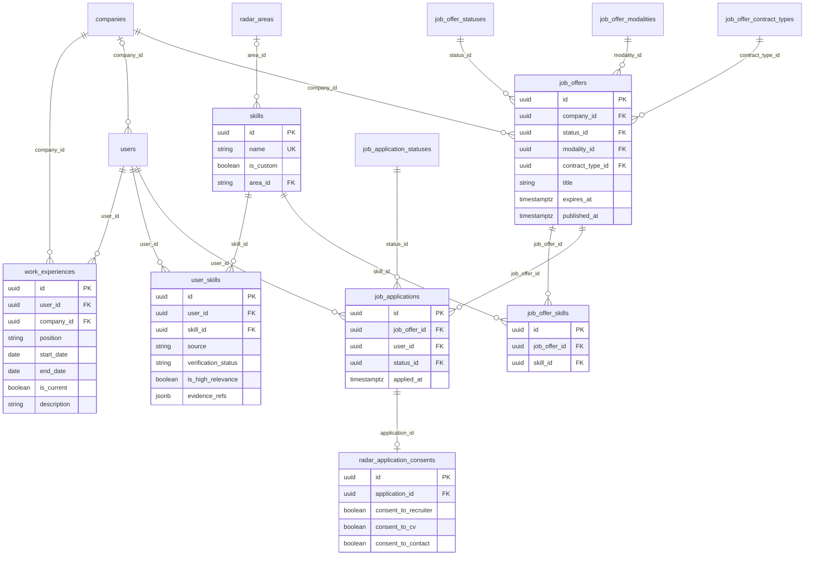
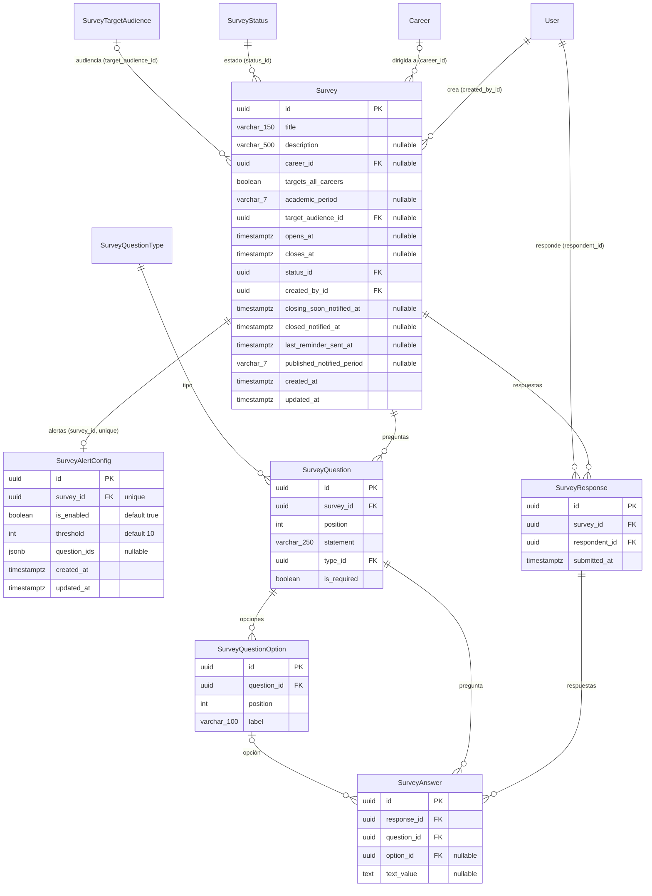
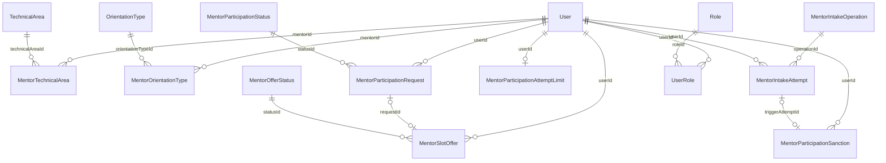
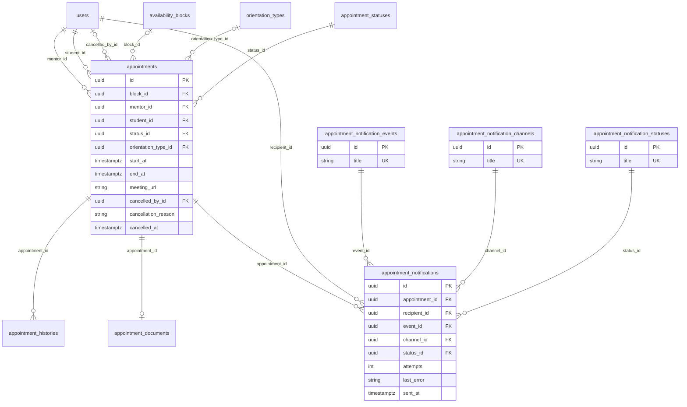

```mermaid
erDiagram
  JobApplication ||--o{ RadarApplicationConsent : application
  UserCvFile ||--o{ RadarCvEvidence : cv
  User ||--o{ RadarCvEvidence : owner
  User o|--o{ RadarCvEvidence : reviewer
  RadarCvExtractionStatus ||--o{ RadarCvEvidence : extractionState
  RadarCvReviewStatus ||--o{ RadarCvEvidence : reviewState
  User ||--o{ RadarScoreSnapshot : user
  User ||--o{ RadarAuditEvent : subject
  User o|--o{ RadarAuditEvent : actor
  Company ||--o{ RadarCompanyAccess : company
  User ||--o{ RadarCompanyAccess : user
  JobOffer ||--o{ RadarJobApplication : jobOffer
  User ||--o{ RadarJobApplication : user
  User o|--o{ RadarJobApplication : decider
  User ||--o{ RadarDocumentVerification : owner
  User o|--o{ RadarDocumentVerification : reviewer
  RadarDocumentStatus ||--o{ RadarDocumentVerification : statusEntry
  RadarDocumentSourceType ||--o{ RadarDocumentVerification : sourceTypeEntry
```

# Database

PostgreSQL schema managed with Prisma (`schema.prisma` and `migrations/`). Only the Database team changes this folder (CODEOWNERS); other teams request changes through issues. Migrations run automatically when the backend container starts. The rules for naming, types, catalogs, relations and auditing are in [backend/standard.md, section 2](../standard.md).

This README is organized by feature area. Each area documents the tables its modules use, and teams can add their own sections between the conventions and the **Sprint History**.

## Conventions used in this document

- Primary keys are `uuid` generated by the application (`@default(uuid())`) and foreign keys to them are `uuid` too. The exceptions in the tables below are `radar_areas.id` (a readable `varchar(50)` key) and `radar_application_consents.id` (generated by the database).
- Tables use plural `snake_case` names (`@@map`), columns use `snake_case` (`@map`), and timestamps are `timestamptz(6)`.
- Tables carry `created_at` and `updated_at`.
- Values that rarely change (statuses, modalities, contract types) are catalog tables with a unique `title`, and the code refers to them through TypeScript enums of the module.
- "Restrict", "Cascade" and "Set null" describe what happens to the row that holds the foreign key when the referenced row is deleted.

## Matching and Applications

Tables used by the modules [applications](../../docs/applications/README.md), [matching](../../docs/matching/README.md), [job-offers](../../docs/job-offers/README.md), [vacancies](../../docs/vacancies/README.md), [work-experience](../../docs/work-experience/README.md) and [skills](../../docs/skills/README.md).

### Relationship diagram

Tables that this section only references (`users`, `companies`, `radar_areas`) are owned by other modules and are described briefly at the end of the section.

### `work_experiences`

A job held by a person. Module: work-experience. Prisma model `WorkExperience`.

| Column                     | Type           | Null | Notes                                                                                            |
| -------------------------- | -------------- | ---- | ------------------------------------------------------------------------------------------------ |
| `id`                       | uuid           | no   | Primary key                                                                                      |
| `user_id`                  | uuid           | no   | FK to `users.id`, cascade                                                                        |
| `company_id`               | uuid           | no   | FK to `companies.id`, restrict. The company is found or created by name                          |
| `position`                 | text           | no   | Up to 150 characters, enforced by the application                                                |
| `start_date`               | date           | no   |                                                                                                  |
| `end_date`                 | date           | yes  | Null when `is_current` is true                                                                   |
| `is_current`               | boolean        | no   | Default `false`                                                                                  |
| `description`              | text           | yes  | Duties; main text source of skill detection (up to 5000 characters, enforced by the application) |
| `created_at`, `updated_at` | timestamptz(6) | no   |                                                                                                  |

Relationships: many experiences per user (1:N) and many experiences per company (1:N). Indexes: `user_id`, `company_id`.

### `skills`

Catalog of skills, shared by profiles and vacancies. Prisma model `Skill`.

| Column                     | Type           | Null | Notes                                                                                                        |
| -------------------------- | -------------- | ---- | ------------------------------------------------------------------------------------------------------------ |
| `id`                       | uuid           | no   | Primary key                                                                                                  |
| `name`                     | text           | no   | Unique                                                                                                       |
| `is_custom`                | boolean        | no   | Default `false`. Custom skills (created by a person) are excluded from the public catalog and from detection |
| `area_id`                  | varchar(50)    | yes  | FK to `radar_areas.id`, set null. Radar area used by the radar chart                                         |
| `created_at`, `updated_at` | timestamptz(6) | no   |                                                                                                              |

Relationships: belongs to one optional radar area (N:1); has many `user_skills` and many `job_offer_skills` (1:N). Index: `area_id`.

### `user_skills`

A skill in a person's profile. Prisma model `UserSkill`.

| Column                     | Type           | Null | Notes                                                                                                                                                                                        |
| -------------------------- | -------------- | ---- | -------------------------------------------------------------------------------------------------------------------------------------------------------------------------------------------- |
| `id`                       | uuid           | no   | Primary key                                                                                                                                                                                  |
| `user_id`                  | uuid           | no   | FK to `users.id`, cascade                                                                                                                                                                    |
| `skill_id`                 | uuid           | no   | FK to `skills.id`, restrict                                                                                                                                                                  |
| `source`                   | varchar(20)    | no   | Default `manual`. Values used by the code: `manual`, `nlp`                                                                                                                                   |
| `verification_status`      | varchar(20)    | no   | Default `pending`. Values used by the code: `pending`, `approved`                                                                                                                            |
| `is_high_relevance`        | boolean        | no   | Default `false`. True when the skill has evidence                                                                                                                                            |
| `evidence_refs`            | jsonb          | yes  | Default `[]`. List of references to what supports the skill (a work experience, the CV, ...). The origins shown to the user (manual, experience, CV) are derived from `source` and this list |
| `created_at`, `updated_at` | timestamptz(6) | no   |                                                                                                                                                                                              |

Constraints: unique `(user_id, skill_id)`, so a person has a skill once. Index: `skill_id`. `source` and `verification_status` are short text columns, not catalog tables.

### `job_offers`

A vacancy published by a company. Prisma model `JobOffer`.

| Column                     | Type           | Null | Notes                                               |
| -------------------------- | -------------- | ---- | --------------------------------------------------- |
| `id`                       | uuid           | no   | Primary key                                         |
| `title`                    | varchar(60)    | no   |                                                     |
| `description`              | text           | no   | Up to 3000 characters, enforced by the application  |
| `company_id`               | uuid           | no   | FK to `companies.id`, cascade                       |
| `modality_id`              | uuid           | no   | FK to `job_offer_modalities.id`, restrict           |
| `contract_type_id`         | uuid           | no   | FK to `job_offer_contract_types.id`, restrict       |
| `status_id`                | uuid           | no   | FK to `job_offer_statuses.id`, restrict             |
| `category`                 | text           | no   |                                                     |
| `positions_available`      | integer        | no   | Default 1                                           |
| `salary_range`             | text           | no   | Salary already formatted as text by the application |
| `languages`                | text           | no   |                                                     |
| `location_url`             | text           | no   | Google Maps link                                    |
| `required_careers`         | text[]         | no   | Default empty                                       |
| `min_experience_years`     | integer        | yes  |                                                     |
| `other_requirements`       | text[]         | no   | Default empty                                       |
| `expires_at`               | timestamptz(6) | yes  | Null means it does not expire                       |
| `published_at`             | timestamptz(6) | no   | Default now; reset when a vacancy is reopened       |
| `created_at`, `updated_at` | timestamptz(6) | no   |                                                     |

Relationships: belongs to one company, one modality, one contract type and one status (N:1 each); has many `job_offer_skills` and many `job_applications` (1:N). Indexes: `company_id`, `modality_id`, `contract_type_id`, `status_id`. A vacancy is visible to applicants when its status is `Publicada` and `expires_at` is null or in the future.

### `job_offer_skills`

Join table between vacancies and skills. Prisma model `JobOfferSkill`.

| Column                     | Type           | Null | Notes                          |
| -------------------------- | -------------- | ---- | ------------------------------ |
| `id`                       | uuid           | no   | Primary key                    |
| `job_offer_id`             | uuid           | no   | FK to `job_offers.id`, cascade |
| `skill_id`                 | uuid           | no   | FK to `skills.id`, restrict    |
| `created_at`, `updated_at` | timestamptz(6) | no   |                                |

Constraints: unique `(job_offer_id, skill_id)`. Index: `skill_id`. The application limits a vacancy to 10 skills.

### `job_applications`

A person's application to a vacancy. Prisma model `JobApplication`.

| Column                     | Type           | Null | Notes                                                  |
| -------------------------- | -------------- | ---- | ------------------------------------------------------ |
| `id`                       | uuid           | no   | Primary key                                            |
| `job_offer_id`             | uuid           | no   | FK to `job_offers.id`, cascade                         |
| `user_id`                  | uuid           | no   | FK to `users.id`, cascade                              |
| `status_id`                | uuid           | no   | FK to `job_application_statuses.id`, restrict          |
| `applied_at`               | timestamptz(6) | no   | Default now; reset when the application is reactivated |
| `created_at`, `updated_at` | timestamptz(6) | no   |                                                        |

Constraints: unique `(job_offer_id, user_id)`: one application per person and vacancy, and a withdrawn one is reused when the person applies again. Indexes: `user_id`, `status_id`.

### `radar_application_consents`

Consents given when applying. Prisma model `RadarApplicationConsent`.

| Column                     | Type           | Null | Notes                                                        |
| -------------------------- | -------------- | ---- | ------------------------------------------------------------ |
| `id`                       | uuid           | no   | Primary key, generated by the database (`gen_random_uuid()`) |
| `application_id`           | uuid           | no   | FK to `job_applications.id`, cascade. Unique                 |
| `consent_to_recruiter`     | boolean        | no   | Default `false`                                              |
| `consent_to_cv`            | boolean        | no   | Default `false`                                              |
| `consent_to_contact`       | boolean        | no   | Default `false`                                              |
| `created_at`, `updated_at` | timestamptz(6) | no   |                                                              |

Relationship: 1:1 with the application (`application_id` is unique). The row is written by the radar-integration module when the application is created, after the matching module has checked that the three consents were given.

### Catalog tables

All of them have `id`, a unique `title` (varchar(100)), `created_at` and `updated_at`. Rows are inserted by migrations or seeds; the code refers to them through enums.

| Table                      | Used by                       | Values                                                                 |
| -------------------------- | ----------------------------- | ---------------------------------------------------------------------- |
| `job_application_statuses` | `job_applications.status_id`  | `En revisión`, `Entrevista`, `Aceptada`, `No seleccionado`, `Retirada` |
| `job_offer_statuses`       | `job_offers.status_id`        | `Publicada`, `Cerrada`, `Eliminada`                                    |
| `job_offer_modalities`     | `job_offers.modality_id`      | `Presencial`, `Remoto`, `Híbrido`                                      |
| `job_offer_contract_types` | `job_offers.contract_type_id` | `Tiempo completo`, `Medio tiempo`, `Pasantía`                          |

### Referenced tables owned by other modules

| Table         | Why it is used here                                                                                                                             |
| ------------- | ----------------------------------------------------------------------------------------------------------------------------------------------- |
| `users`       | Owner of experiences, skills and applications. `users.company_id` (optional, FK to `companies.id`, set null) links a recruiter to their company |
| `companies`   | Employer of a work experience and publisher of a vacancy. `title` is unique                                                                     |
| `radar_areas` | Area of a skill, for the radar chart                                                                                                            |

### Rules enforced by the database and by the application

| Rule                                                                                                                                                         | Where                                 |
| ------------------------------------------------------------------------------------------------------------------------------------------------------------ | ------------------------------------- |
| One skill per person; one skill per vacancy; one application per person and vacancy                                                                          | Unique constraints                    |
| A person's data disappears with the person                                                                                                                   | Cascade from `users`                  |
| A skill, status, modality, contract type or company of an experience cannot be deleted while in use                                                          | Restrict                              |
| A vacancy removes its skills and applications when deleted for good                                                                                          | Cascade from `job_offers`             |
| Vacancy deletion by a company is logical (`Eliminada`)                                                                                                       | Application                           |
| Dates of experiences between 1950-01-01 and today (Bolivia time)                                                                                             | Application                           |
| Limits of text lengths, 10 skills per vacancy, salary range                                                                                                  | Application                           |
| An application can be withdrawn only from `En revisión` or `Entrevista`; reactivated only from `Retirada` and while the vacancy is published and not expired | Application, with conditional updates |

### Migrations

| Migration                                              | What it does                                                                  |
| ------------------------------------------------------ | ----------------------------------------------------------------------------- |
| `20261012020907_add_job_offers`                        | Vacancies, statuses, modalities and contract types                            |
| `20261021230000_add_job_applications`                  | Applications and their statuses                                               |
| `20261023003219_add_radar_areas_and_user_skill_fields` | Radar areas and the origin, verification and evidence fields of `user_skills` |
| `20261024120000_add_job_offer_requirements`            | Required careers, minimum experience and other requirements                   |
| `20261029120000_add_withdrawn_application_status`      | `Retirada` status                                                             |
| `20261103120000_add_job_offer_published_at`            | `published_at` of vacancies                                                   |
| `20261106000000_add_radar_application_consents`        | Consents of an application                                                    |

## Radar and document verification

Tables supporting versioned radar publications, document verification, review decisions, audit events, and recruitment consent. Business flows are documented in [radar-integration](../../docs/radar-integration/README.md).

### Relationship diagram

### RadarArea
Table: `radar_areas`.

| Field | Prisma type | Column or relation | Definition and constraints |
| --- | --- | --- | --- |
| id | `String` | id | `@id @db.VarChar(50)` |
| name | `String` | name | `@unique @db.VarChar(80)` |
| description | `String?` | description | `No explicit attributes` |
| createdAt | `DateTime` | created_at | `@default(now()) @map("created_at") @db.Timestamptz(6)` |
| updatedAt | `DateTime` | updated_at | `@updatedAt @map("updated_at") @db.Timestamptz(6)` |
| skills | `Skill[]` | Relation: Skill[] | `No explicit attributes` |

Model constraints:

- `@@map("radar_areas")`

### RadarApplicationConsent
Table: `radar_application_consents`.

| Field | Prisma type | Column or relation | Definition and constraints |
| --- | --- | --- | --- |
| id | `String` | id | `@id @default(dbgenerated("gen_random_uuid()")) @db.Uuid` |
| applicationId | `String` | application_id | `@unique @map("application_id") @db.Uuid` |
| consentToRecruiter | `Boolean` | consent_to_recruiter | `@default(false) @map("consent_to_recruiter")` |
| consentToCv | `Boolean` | consent_to_cv | `@default(false) @map("consent_to_cv")` |
| consentToContact | `Boolean` | consent_to_contact | `@default(false) @map("consent_to_contact")` |
| createdAt | `DateTime` | created_at | `@default(now()) @map("created_at") @db.Timestamptz(6)` |
| updatedAt | `DateTime` | updated_at | `@default(now()) @updatedAt @map("updated_at") @db.Timestamptz(6)` |
| application | `JobApplication` | Relation: JobApplication | `@relation(fields: [applicationId], references: [id], onDelete: Cascade)` |

Model constraints:

- `@@map("radar_application_consents")`

### RadarCvEvidence
Table: `radar_cv_evidence`.

| Field | Prisma type | Column or relation | Definition and constraints |
| --- | --- | --- | --- |
| id | `String` | id | `@id @default(dbgenerated("gen_random_uuid()")) @db.Uuid` |
| cvId | `String` | cv_id | `@unique @map("cv_id") @db.Uuid` |
| userId | `String` | user_id | `@map("user_id") @db.Uuid` |
| extractedText | `String` | extracted_text | `@default("") @map("extracted_text") @db.Text` |
| submittedAt | `DateTime` | submitted_at | `@default(now()) @map("submitted_at") @db.Timestamptz(6)` |
| decidedAt | `DateTime?` | decided_at | `@map("decided_at") @db.Timestamptz(6)` |
| reviewerId | `String?` | reviewer_id | `@map("reviewer_id") @db.Uuid` |
| extractionStatusId | `String` | extraction_status_id | `@map("extraction_status_id") @db.Uuid` |
| reviewStatusId | `String` | review_status_id | `@map("review_status_id") @db.Uuid` |
| createdAt | `DateTime` | created_at | `@default(now()) @map("created_at") @db.Timestamptz(6)` |
| updatedAt | `DateTime` | updated_at | `@default(now()) @updatedAt @map("updated_at") @db.Timestamptz(6)` |
| cv | `UserCvFile` | Relation: UserCvFile | `@relation(fields: [cvId], references: [id], onDelete: Cascade, onUpdate: NoAction)` |
| owner | `User` | Relation: User | `@relation("RadarCvOwner", fields: [userId], references: [id], onDelete: Cascade, onUpdate: NoAction)` |
| reviewer | `User?` | Relation: User? | `@relation("RadarCvReviewer", fields: [reviewerId], references: [id], onDelete: SetNull)` |
| extractionState | `RadarCvExtractionStatus` | Relation: RadarCvExtractionStatus | `@relation(fields: [extractionStatusId], references: [id], onDelete: Restrict, onUpdate: Restrict)` |
| reviewState | `RadarCvReviewStatus` | Relation: RadarCvReviewStatus | `@relation(fields: [reviewStatusId], references: [id], onDelete: Restrict, onUpdate: Restrict)` |

Model constraints:

- `@@index([reviewStatusId, submittedAt], map: "radar_cv_evidence_review_idx")`
- `@@index([userId], map: "radar_cv_evidence_user_idx")`
- `@@index([reviewerId], map: "radar_cv_evidence_reviewer_idx")`
- `@@index([extractionStatusId], map: "radar_cv_evidence_extraction_status_idx")`
- `@@index([reviewStatusId], map: "radar_cv_evidence_review_status_idx")`
- `@@map("radar_cv_evidence")`

### RadarScoreSnapshot
Table: `radar_score_snapshots`.

| Field | Prisma type | Column or relation | Definition and constraints |
| --- | --- | --- | --- |
| id | `String` | id | `@id @default(dbgenerated("gen_random_uuid()")) @db.Uuid` |
| userId | `String` | user_id | `@map("user_id") @db.Uuid` |
| version | `Int` | version | `No explicit attributes` |
| rubricVersion | `String` | rubric_version | `@map("rubric_version") @db.VarChar(80)` |
| fingerprint | `String` | fingerprint | `@db.VarChar(64)` |
| scores | `Json` | scores | `No explicit attributes` |
| evidence | `Json` | evidence | `No explicit attributes` |
| averageScore | `Decimal` | average_score | `@map("average_score") @db.Decimal(5, 2)` |
| createdAt | `DateTime` | created_at | `@default(now()) @map("created_at") @db.Timestamptz(6)` |
| updatedAt | `DateTime` | updated_at | `@default(now()) @updatedAt @map("updated_at") @db.Timestamptz(6)` |
| user | `User` | Relation: User | `@relation(fields: [userId], references: [id], onDelete: Cascade, onUpdate: NoAction)` |

Model constraints:

- `@@unique([userId, version], map: "radar_score_snapshots_user_version_key")`
- `@@index([userId], map: "radar_score_snapshots_user_idx")`
- `@@map("radar_score_snapshots")`

### RadarAuditEvent
Table: `radar_audit_events`.

| Field | Prisma type | Column or relation | Definition and constraints |
| --- | --- | --- | --- |
| id | `String` | id | `@id @default(dbgenerated("gen_random_uuid()")) @db.Uuid` |
| userId | `String` | user_id | `@map("user_id") @db.Uuid` |
| actorId | `String?` | actor_id | `@map("actor_id") @db.Uuid` |
| eventType | `String` | event_type | `@map("event_type") @db.VarChar(80)` |
| targetId | `String?` | target_id | `@map("target_id") @db.Uuid` |
| details | `Json` | details | `@default("{}")` |
| occurredAt | `DateTime` | occurred_at | `@default(now()) @map("occurred_at") @db.Timestamptz(6)` |
| createdAt | `DateTime` | created_at | `@default(now()) @map("created_at") @db.Timestamptz(6)` |
| updatedAt | `DateTime` | updated_at | `@default(now()) @updatedAt @map("updated_at") @db.Timestamptz(6)` |
| subject | `User` | Relation: User | `@relation("RadarAuditSubject", fields: [userId], references: [id], onDelete: Cascade, onUpdate: NoAction)` |
| actor | `User?` | Relation: User? | `@relation("RadarAuditActor", fields: [actorId], references: [id], onDelete: SetNull)` |

Model constraints:

- `@@index([userId, occurredAt(sort: Desc)], map: "radar_audit_user_idx")`
- `@@index([userId], map: "radar_audit_subject_idx")`
- `@@index([actorId], map: "radar_audit_actor_idx")`
- `@@map("radar_audit_events")`

### RadarCvExtractionStatus
Table: `radar_cv_extraction_statuses`.

| Field | Prisma type | Column or relation | Definition and constraints |
| --- | --- | --- | --- |
| id | `String` | id | `@id @default(dbgenerated("gen_random_uuid()")) @db.Uuid` |
| title | `String` | title | `@unique @db.VarChar(24)` |
| description | `String?` | description | `No explicit attributes` |
| createdAt | `DateTime` | created_at | `@default(now()) @map("created_at") @db.Timestamptz(6)` |
| updatedAt | `DateTime` | updated_at | `@default(now()) @updatedAt @map("updated_at") @db.Timestamptz(6)` |
| evidences | `RadarCvEvidence[]` | Relation: RadarCvEvidence[] | `No explicit attributes` |

Model constraints:

- `@@map("radar_cv_extraction_statuses")`

### RadarCvReviewStatus
Table: `radar_cv_review_statuses`.

| Field | Prisma type | Column or relation | Definition and constraints |
| --- | --- | --- | --- |
| id | `String` | id | `@id @default(dbgenerated("gen_random_uuid()")) @db.Uuid` |
| title | `String` | title | `@unique @db.VarChar(24)` |
| description | `String?` | description | `No explicit attributes` |
| createdAt | `DateTime` | created_at | `@default(now()) @map("created_at") @db.Timestamptz(6)` |
| updatedAt | `DateTime` | updated_at | `@default(now()) @updatedAt @map("updated_at") @db.Timestamptz(6)` |
| evidences | `RadarCvEvidence[]` | Relation: RadarCvEvidence[] | `No explicit attributes` |

Model constraints:

- `@@map("radar_cv_review_statuses")`

### RadarCompanyAccess
Table: `radar_company_access`.

| Field | Prisma type | Column or relation | Definition and constraints |
| --- | --- | --- | --- |
| companyId | `String` | company_id | `@map("company_id") @db.Uuid` |
| userId | `String` | user_id | `@map("user_id") @db.Uuid` |
| company | `Company` | Relation: Company | `@relation(fields: [companyId], references: [id], onDelete: Cascade, onUpdate: NoAction)` |
| user | `User` | Relation: User | `@relation(fields: [userId], references: [id], onDelete: Cascade, onUpdate: NoAction)` |

Model constraints:

- `@@id([companyId, userId])`
- `@@map("radar_company_access")`
- `@@ignore`

### RadarJobApplication
Table: `radar_job_applications`.

| Field | Prisma type | Column or relation | Definition and constraints |
| --- | --- | --- | --- |
| id | `String` | id | `@id @default(dbgenerated("gen_random_uuid()")) @db.Uuid` |
| jobOfferId | `String` | job_offer_id | `@map("job_offer_id") @db.Uuid` |
| userId | `String` | user_id | `@map("user_id") @db.Uuid` |
| consentToRecruiter | `Boolean` | consent_to_recruiter | `@default(false) @map("consent_to_recruiter")` |
| consentToCv | `Boolean` | consent_to_cv | `@default(false) @map("consent_to_cv")` |
| consentToContact | `Boolean` | consent_to_contact | `@default(false) @map("consent_to_contact")` |
| state | `String` | state | `@default("applied") @db.VarChar(24)` |
| appliedAt | `DateTime` | applied_at | `@default(now()) @map("applied_at") @db.Timestamptz(6)` |
| decidedAt | `DateTime?` | decided_at | `@map("decided_at") @db.Timestamptz(6)` |
| decidedBy | `String?` | decided_by | `@map("decided_by") @db.Uuid` |
| jobOffer | `JobOffer` | Relation: JobOffer | `@relation(fields: [jobOfferId], references: [id], onDelete: Cascade, onUpdate: NoAction)` |
| user | `User` | Relation: User | `@relation("RadarApplicant", fields: [userId], references: [id], onDelete: Cascade, onUpdate: NoAction)` |
| decider | `User?` | Relation: User? | `@relation("RadarDecision", fields: [decidedBy], references: [id], onDelete: NoAction, onUpdate: NoAction)` |

Model constraints:

- `@@unique([jobOfferId, userId])`
- `@@index([jobOfferId, appliedAt(sort: Desc)], map: "radar_job_applications_vacancy_idx")`
- `@@map("radar_job_applications")`
- `@@ignore`

### RadarDocumentVerification
Table: `radar_document_verifications`.

| Field | Prisma type | Column or relation | Definition and constraints |
| --- | --- | --- | --- |
| id | `String` | id | `@id @default(dbgenerated("gen_random_uuid()")) @db.Uuid` |
| userId | `String` | user_id | `@map("user_id") @db.Uuid` |
| sourceTypeId | `String` | source_type_id | `@map("source_type_id") @db.Uuid` |
| sourceId | `String` | source_id | `@map("source_id") @db.Uuid` |
| filename | `String` | filename | `No explicit attributes` |
| mime | `String` | mime | `No explicit attributes` |
| content | `Bytes?` | content | `No explicit attributes` |
| sizeBytes | `Int` | size_bytes | `@map("size_bytes")` |
| active | `Boolean` | active | `@default(true)` |
| digest | `String` | digest | `No explicit attributes` |
| statusId | `String` | status_id | `@default(dbgenerated("'a0000000-0000-4000-8000-000000000001'::uuid")) @map("status_id") @db.Uuid` |
| confidence | `Float?` | confidence | `No explicit attributes` |
| reason | `String` | reason | `@default("")` |
| skills | `Json` | skills | `@default("[]")` |
| createdAt | `DateTime` | created_at | `@default(dbgenerated("clock_timestamp()")) @map("created_at") @db.Timestamptz(6)` |
| updatedAt | `DateTime` | updated_at | `@default(dbgenerated("clock_timestamp()")) @updatedAt @map("updated_at") @db.Timestamptz(6)` |
| decidedAt | `DateTime?` | decided_at | `@map("decided_at") @db.Timestamptz(6)` |
| reviewerId | `String?` | reviewer_id | `@map("reviewer_id") @db.Uuid` |
| noticeRead | `Boolean` | notice_read | `@default(false) @map("notice_read")` |
| publishedIds | `Json` | published_ids | `@default("[]") @map("published_ids")` |
| radarVersion | `Int?` | radar_version | `@map("radar_version")` |
| synced | `Boolean` | synced | `@default(false)` |
| lease | `String?` | lease | `@db.Uuid` |
| retryAt | `DateTime` | retry_at | `@default(now()) @map("retry_at") @db.Timestamptz(6)` |
| owner | `User` | Relation: User | `@relation("VerifiedDocumentOwner", fields:[userId],references:[id],onDelete:Cascade,onUpdate:NoAction)` |
| reviewer | `User?` | Relation: User? | `@relation("VerifiedDocumentReviewer",fields:[reviewerId],references:[id],onDelete:SetNull,onUpdate:NoAction)` |
| statusEntry | `RadarDocumentStatus` | Relation: RadarDocumentStatus | `@relation(fields:[statusId], references:[id], onDelete:Restrict, onUpdate:Cascade, map:"radar_document_status_fk")` |
| sourceTypeEntry | `RadarDocumentSourceType` | Relation: RadarDocumentSourceType | `@relation(fields:[sourceTypeId], references:[id], onDelete:Restrict, onUpdate:Cascade, map:"radar_document_source_type_fk")` |

Model constraints:

- `@@index([userId,createdAt(sort:Desc)],map:"radar_doc_owner_date")`
- `@@map("radar_document_verifications")`
- `@@index([reviewerId],map:"radar_doc_reviewer")`
- `@@index([statusId],map:"radar_doc_status")`
- `@@index([sourceTypeId],map:"radar_doc_source_type")`

### RadarDocumentStatus
Table: `radar_document_statuses`.

| Field | Prisma type | Column or relation | Definition and constraints |
| --- | --- | --- | --- |
| id | `String` | id | `@id @default(dbgenerated("gen_random_uuid()")) @db.Uuid` |
| title | `String` | title | `@unique` |
| description | `String` | description | `No explicit attributes` |
| createdAt | `DateTime` | created_at | `@default(dbgenerated("clock_timestamp()")) @map("created_at") @db.Timestamptz(6)` |
| updatedAt | `DateTime` | updated_at | `@default(dbgenerated("clock_timestamp()")) @updatedAt @map("updated_at") @db.Timestamptz(6)` |
| documents | `RadarDocumentVerification[]` | Relation: RadarDocumentVerification[] | `No explicit attributes` |

Model constraints:

- `@@map("radar_document_statuses")`

### RadarDocumentSourceType
Table: `radar_document_source_types`.

| Field | Prisma type | Column or relation | Definition and constraints |
| --- | --- | --- | --- |
| id | `String` | id | `@id @default(dbgenerated("gen_random_uuid()")) @db.Uuid` |
| title | `String` | title | `@unique` |
| description | `String` | description | `No explicit attributes` |
| createdAt | `DateTime` | created_at | `@default(dbgenerated("clock_timestamp()")) @map("created_at") @db.Timestamptz(6)` |
| updatedAt | `DateTime` | updated_at | `@default(dbgenerated("clock_timestamp()")) @updatedAt @map("updated_at") @db.Timestamptz(6)` |
| documents | `RadarDocumentVerification[]` | Relation: RadarDocumentVerification[] | `No explicit attributes` |

Model constraints:

- `@@map("radar_document_source_types")`

## Dominio de encuestas

Tablas usadas por los módulos [surveys](../../docs/surveys/README.md), [analytics](../../docs/analytics/README.md) y [notifications](../../docs/notifications/README.md). Los nombres de modelo y campo son los de Prisma; entre paréntesis se indica la tabla o columna física (`@@map` / `@map`).

### Diagrama de relaciones

### `Survey` (`surveys`)

Encuesta de empleabilidad creada por un administrativo.

| Campo | Columna | Tipo | Nulo | Por defecto | Descripción |
| --- | --- | --- | --- | --- | --- |
| `id` | `id` | `UUID` | No | `uuid()` | PK |
| `title` | `title` | `VARCHAR(150)` | No | | Título |
| `description` | `description` | `VARCHAR(500)` | Sí | | Descripción |
| `careerId` | `career_id` | `UUID` | Sí | | FK → `Career.id` |
| `targetsAllCareers` | `targets_all_careers` | `BOOLEAN` | No | `false` | Dirigida a todas las carreras |
| `academicPeriod` | `academic_period` | `VARCHAR(7)` | Sí | | Gestión objetivo (`AAAA` o `Todas`) |
| `targetAudienceId` | `target_audience_id` | `UUID` | Sí | | FK → `SurveyTargetAudience.id` |
| `opensAt` | `opens_at` | `TIMESTAMPTZ(6)` | Sí | | Apertura |
| `closesAt` | `closes_at` | `TIMESTAMPTZ(6)` | Sí | | Cierre |
| `statusId` | `status_id` | `UUID` | No | | FK → `SurveyStatus.id` |
| `createdById` | `created_by_id` | `UUID` | No | | FK → `User.id` (creador) |
| `closingSoonNotifiedAt` | `closing_soon_notified_at` | `TIMESTAMPTZ(6)` | Sí | | Momento en que se avisó al creador del cierre próximo. `NULL` = aún no avisado |
| `closedNotifiedAt` | `closed_notified_at` | `TIMESTAMPTZ(6)` | Sí | | Momento en que se avisó al creador del cierre (y se evaluaron las variaciones). `NULL` = aún no avisado |
| `lastReminderSentAt` | `last_reminder_sent_at` | `TIMESTAMPTZ(6)` | Sí | | Último recordatorio manual entregado a la audiencia pendiente |
| `publishedNotifiedPeriod` | `published_notified_period` | `VARCHAR(7)` | Sí | | Semestre (`I-AAAA` o `II-AAAA`) en que se avisó a la audiencia de la publicación (`SURVEY_PUBLISHED`). Garantiza un solo aviso por encuesta y semestre. `NULL` = aún no avisado |
| `createdAt` | `created_at` | `TIMESTAMPTZ(6)` | No | `now()` | Alta |
| `updatedAt` | `updated_at` | `TIMESTAMPTZ(6)` | No | `@updatedAt` | Última modificación |

| Relación | Cardinalidad | FK | Al borrar el referenciado |
| --- | --- | --- | --- |
| `career` → `Career` | N:0..1 | `career_id` → `Career.id` | `Restrict` |
| `status` → `SurveyStatus` | N:1 | `status_id` → `SurveyStatus.id` | `Restrict` |
| `targetAudience` → `SurveyTargetAudience` | N:0..1 | `target_audience_id` → `SurveyTargetAudience.id` | `Restrict` |
| `createdBy` → `User` (`SurveyCreatedBy`) | N:1 | `created_by_id` → `User.id` | `Restrict` |
| `alertConfig` ← `SurveyAlertConfig` | 1:0..1 | `survey_alert_configs.survey_id` | `Cascade` (se borra con la encuesta) |
| `questions` ← `SurveyQuestion` | 1:N | `survey_questions.survey_id` | `Cascade` |
| `responses` ← `SurveyResponse` | 1:N | `survey_responses.survey_id` | `Cascade` |

Índices: PK `id`; `@@index([careerId, academicPeriod])`, `@@index([createdById])`, `@@index([statusId])`, `@@index([targetAudienceId])`. Todas las FK usan `ON UPDATE CASCADE`.

### `SurveyAlertConfig` (`survey_alert_configs`)

Configuración opcional de las alertas de variación de una encuesta. Cuando la encuesta cierra, el worker de ciclo de vida compara los porcentajes por opción con el semestre anterior y avisa al creador si alguna diferencia alcanza el umbral. Si una encuesta no tiene fila, se aplican los valores por defecto (`is_enabled = true`, `threshold = 10`, todas las preguntas).

| Campo | Columna | Tipo | Nulo | Por defecto | Descripción |
| --- | --- | --- | --- | --- | --- |
| `id` | `id` | `UUID` | No | `uuid()` | PK |
| `surveyId` | `survey_id` | `UUID` | No | | FK → `Survey.id`. Único |
| `isEnabled` | `is_enabled` | `BOOLEAN` | No | `true` | Activa o desactiva la evaluación al cierre |
| `threshold` | `threshold` | `INTEGER` | No | `10` | Umbral en puntos porcentuales. La API admite enteros de 1 a 50 |
| `questionIds` | `question_ids` | `JSONB` | Sí | | Arreglo JSON de ids (`SurveyQuestion.id`) a vigilar. `NULL` o `[]` = todas las preguntas. No es FK: los ids no se validan en la base |
| `createdAt` | `created_at` | `TIMESTAMPTZ(6)` | No | `CURRENT_TIMESTAMP` | Alta |
| `updatedAt` | `updated_at` | `TIMESTAMPTZ(6)` | No | `@updatedAt` | Última modificación (la gestiona Prisma) |

| Elemento | Definición |
| --- | --- |
| PK | `survey_alert_configs_pkey` sobre `id` |
| FK | `survey_alert_configs_survey_id_fkey`: `survey_id` → `surveys.id` (`Survey.id`), `ON DELETE CASCADE`, `ON UPDATE CASCADE` |
| Único / índice | `survey_alert_configs_survey_id_key` (índice único sobre `survey_id`) |
| Cardinalidad | `Survey` 1 : 0..1 `SurveyAlertConfig`. El índice único garantiza como máximo una configuración por encuesta; la aplicación la crea o actualiza con `upsert` por `survey_id` |
| Borrado | Al eliminar la encuesta se elimina su configuración. Borrar una pregunta no limpia `question_ids` |

### Tablas relacionadas del dominio

| Modelo (tabla) | Claves y restricciones | Borrado |
| --- | --- | --- |
| `SurveyStatus` (`survey_statuses`) | PK `id`; `title` único (`draft`, `published`) | Restrict desde `Survey` |
| `SurveyTargetAudience` (`survey_target_audiences`) | PK `id`; `title` único (`all`, `graduates`, `students`, `mentors`) | Restrict desde `Survey` |
| `SurveyQuestionType` (`survey_question_types`) | PK `id`; `title` único (`single_choice`, `multiple_choice`, `dropdown`) | Restrict desde `SurveyQuestion` |
| `SurveyQuestion` (`survey_questions`) | FK `survey_id` → `Survey.id`, FK `type_id` → `SurveyQuestionType.id`; único (`survey_id`, `position`); índice `type_id` | Cascade con la encuesta |
| `SurveyQuestionOption` (`survey_question_options`) | FK `question_id` → `SurveyQuestion.id`; único (`question_id`, `position`) | Cascade con la pregunta |
| `SurveyResponse` (`survey_responses`) | FK `survey_id` → `Survey.id`, FK `respondent_id` → `User.id`; único (`survey_id`, `respondent_id`); índice `respondent_id` | Cascade con la encuesta; Restrict desde `User` |
| `SurveyAnswer` (`survey_answers`) | FK `response_id` → `SurveyResponse.id`, `question_id` → `SurveyQuestion.id`, `option_id` → `SurveyQuestionOption.id` (nullable); índices `response_id`, `option_id`, (`question_id`, `option_id`) | Cascade con respuesta, pregunta u opción |

## Catálogo de notificaciones

`NotificationType` (`notification_types`): PK `id`, `code` `VARCHAR(50)` único, `name` `VARCHAR(100)`, `sends_push` y `sends_email` `BOOLEAN` (por defecto `false`). Lo referencia `Notification.typeId`. La semilla del catálogo hace upsert por `code`.

## Mentor network

Prisma optional fields use `?`; arrays use `[]`. Scalar fields below list PostgreSQL types and exact Prisma attributes, including mapped column names, PK, defaults and uniqueness. `uuid()` is generated by Prisma; `dbgenerated` expressions run in PostgreSQL. `@updatedAt` is Prisma-managed, not an implicit database trigger. No audit field is assumed when absent.

The model is not a separate Mentor table: `User` and current `UserRole` rows identify mentors. `User.id` is a UUID PK in `users`; `UserRole.roleId` references `Role.id`. Eligibility additionally reads `AccessRequest.approvedUserId` (nullable unique UUID -> `User.id`, SetNull) and `statusId` (UUID -> `AccessRequestStatus.id`, Restrict). Those are eligibility inputs, not FKs from capacity settings. Profile suggestions read `User.photoUrl` (Bytes/bytea), `aboutMe` (String?/text) and `WorkExperience.userId` (UUID -> User.id, Cascade), without storing suggestions.

### MentorTechnicalArea (`mentor_technical_areas`)

| Field / column                          | Prisma / PostgreSQL           | Definition                                              |
| --------------------------------------- | ----------------------------- | ------------------------------------------------------- |
| `id` / `id`                             | `String` / `uuid`             | `@id @default(uuid()) @db.Uuid`                         |
| `mentorId` / `mentor_id`                | `String` / `uuid`             | `@map("mentor_id") @db.Uuid`                            |
| `technicalAreaId` / `technical_area_id` | `String` / `uuid`             | `@map("technical_area_id") @db.Uuid`                    |
| `createdAt` / `created_at`              | `DateTime` / `timestamptz(6)` | `@default(now()) @map("created_at") @db.Timestamptz(6)` |
| `updatedAt` / `updated_at`              | `DateTime` / `timestamptz(6)` | `@updatedAt @map("updated_at") @db.Timestamptz(6)`      |

| Relation        | Foreign key                             | Cardinality                                  | Delete / update parent              |
| --------------- | --------------------------------------- | -------------------------------------------- | ----------------------------------- |
| `mentor`        | `mentorId` -> `User.id`                 | 1 parent per child; 0..N children per parent | Cascade / Cascade (Prisma default)  |
| `technicalArea` | `technicalAreaId` -> `TechnicalArea.id` | 1 parent per child; 0..N children per parent | Restrict / Cascade (Prisma default) |

Model indexes and composite constraints: `@@unique([mentorId, technicalAreaId])`; `@@index([technicalAreaId])`.

### MentorOrientationType (`mentor_orientation_types`)

| Field / column                              | Prisma / PostgreSQL           | Definition                                              |
| ------------------------------------------- | ----------------------------- | ------------------------------------------------------- |
| `id` / `id`                                 | `String` / `uuid`             | `@id @default(uuid()) @db.Uuid`                         |
| `mentorId` / `mentor_id`                    | `String` / `uuid`             | `@map("mentor_id") @db.Uuid`                            |
| `orientationTypeId` / `orientation_type_id` | `String` / `uuid`             | `@map("orientation_type_id") @db.Uuid`                  |
| `createdAt` / `created_at`                  | `DateTime` / `timestamptz(6)` | `@default(now()) @map("created_at") @db.Timestamptz(6)` |
| `updatedAt` / `updated_at`                  | `DateTime` / `timestamptz(6)` | `@updatedAt @map("updated_at") @db.Timestamptz(6)`      |

| Relation          | Foreign key                                 | Cardinality                                  | Delete / update parent              |
| ----------------- | ------------------------------------------- | -------------------------------------------- | ----------------------------------- |
| `mentor`          | `mentorId` -> `User.id`                     | 1 parent per child; 0..N children per parent | Cascade / Cascade (Prisma default)  |
| `orientationType` | `orientationTypeId` -> `OrientationType.id` | 1 parent per child; 0..N children per parent | Restrict / Cascade (Prisma default) |

Model indexes and composite constraints: `@@unique([mentorId, orientationTypeId])`; `@@index([orientationTypeId])`.

### MentorParticipationRequest (`mentor_participation_requests`)

| Field / column                                | Prisma / PostgreSQL           | Definition                                                                                         |
| --------------------------------------------- | ----------------------------- | -------------------------------------------------------------------------------------------------- |
| `id` / `id`                                   | `String` / `uuid`             | `@id @default(uuid()) @db.Uuid`                                                                    |
| `userId` / `user_id`                          | `String` / `uuid`             | `@map("user_id") @db.Uuid`                                                                         |
| `status` / `status`                           | `String` / `varchar(20)`      | `@default("PENDING") @db.VarChar(20)`                                                              |
| `queuedAt` / `queued_at`                      | `DateTime` / `timestamptz(6)` | `@default(now()) @map("queued_at") @db.Timestamptz(6)`                                             |
| `createdAt` / `created_at`                    | `DateTime` / `timestamptz(6)` | `@default(now()) @map("created_at") @db.Timestamptz(6)`                                            |
| `technicalAreaIds` / `technical_area_ids`     | `String[]` / `uuid[]`         | `@map("technical_area_ids") @db.Uuid`                                                              |
| `orientationTypeIds` / `orientation_type_ids` | `String[]` / `uuid[]`         | `@map("orientation_type_ids") @db.Uuid`                                                            |
| `updatedAt` / `updated_at`                    | `DateTime` / `timestamptz(6)` | `@default(now()) @updatedAt @map("updated_at") @db.Timestamptz(6)`                                 |
| `statusId` / `status_id`                      | `String` / `uuid`             | `@default(dbgenerated("mentor_participation_status('PENDING'::text)")) @map("status_id") @db.Uuid` |

| Relation        | Foreign key                                  | Cardinality                                  | Delete / update parent              |
| --------------- | -------------------------------------------- | -------------------------------------------- | ----------------------------------- |
| `user`          | `userId` -> `User.id`                        | 1 parent per child; 0..N children per parent | Restrict / Cascade (Prisma default) |
| `statusCatalog` | `statusId` -> `MentorParticipationStatus.id` | 1 parent per child; 0..N children per parent | Restrict / Restrict                 |

Model indexes and composite constraints: `@@index([status, queuedAt, id])`; `@@index([userId])`; `@@index([statusId])`.

### MentorSlotOffer (`mentor_slot_offers`)

| Field / column                 | Prisma / PostgreSQL            | Definition                                                                                 |
| ------------------------------ | ------------------------------ | ------------------------------------------------------------------------------------------ |
| `id` / `id`                    | `String` / `uuid`              | `@id @default(uuid()) @db.Uuid`                                                            |
| `userId` / `user_id`           | `String` / `uuid`              | `@map("user_id") @db.Uuid`                                                                 |
| `status` / `status`            | `String` / `varchar(20)`       | `@default("OFFERED") @db.VarChar(20)`                                                      |
| `offeredAt` / `offered_at`     | `DateTime` / `timestamptz(6)`  | `@default(now()) @map("offered_at") @db.Timestamptz(6)`                                    |
| `expiresAt` / `expires_at`     | `DateTime` / `timestamptz(6)`  | `@map("expires_at") @db.Timestamptz(6)`                                                    |
| `requestId` / `request_id`     | `String?` / `uuid`             | `@unique @map("request_id") @db.Uuid`                                                      |
| `confirmedAt` / `confirmed_at` | `DateTime?` / `timestamptz(6)` | `@map("confirmed_at") @db.Timestamptz(6)`                                                  |
| `createdAt` / `created_at`     | `DateTime` / `timestamptz(6)`  | `@default(now()) @map("created_at") @db.Timestamptz(6)`                                    |
| `updatedAt` / `updated_at`     | `DateTime` / `timestamptz(6)`  | `@default(now()) @updatedAt @map("updated_at") @db.Timestamptz(6)`                         |
| `statusId` / `status_id`       | `String` / `uuid`              | `@default(dbgenerated("mentor_offer_status('OFFERED'::text)")) @map("status_id") @db.Uuid` |

| Relation        | Foreign key                                    | Cardinality                                     | Delete / update parent              |
| --------------- | ---------------------------------------------- | ----------------------------------------------- | ----------------------------------- |
| `user`          | `userId` -> `User.id`                          | 1 parent per child; 0..N children per parent    | Restrict / Cascade (Prisma default) |
| `request`       | `requestId` -> `MentorParticipationRequest.id` | 0..1 parent per child; 0..1 children per parent | Restrict / Cascade (Prisma default) |
| `statusCatalog` | `statusId` -> `MentorOfferStatus.id`           | 1 parent per child; 0..N children per parent    | Restrict / Restrict                 |

Model indexes and composite constraints: `@@index([status, expiresAt])`; `@@index([userId])`; `@@index([statusId])`.

### MentorCapacitySetting (`mentor_capacity_settings`)

| Field / column              | Prisma / PostgreSQL           | Definition                                              |
| --------------------------- | ----------------------------- | ------------------------------------------------------- |
| `id` / `id`                 | `Int` / `integer`             | `@id`                                                   |
| `percentage` / `percentage` | `Int` / `integer`             | `@default(40)`                                          |
| `updatedAt` / `updated_at`  | `DateTime` / `timestamptz(6)` | `@default(now()) @map("updated_at") @db.Timestamptz(6)` |

No outgoing foreign keys.

Model indexes and composite constraints: none beyond the PK and field-level unique constraints listed above.

### MentorParticipationAttemptLimit (`mentor_participation_attempt_limits`)

| Field / column                          | Prisma / PostgreSQL            | Definition                                     |
| --------------------------------------- | ------------------------------ | ---------------------------------------------- |
| `userId` / `user_id`                    | `String` / `uuid`              | `@id @map("user_id") @db.Uuid`                 |
| `attemptCount` / `attempt_count`        | `Int` / `integer`              | `@default(0) @map("attempt_count")`            |
| `windowStartedAt` / `window_started_at` | `DateTime?` / `timestamptz(6)` | `@map("window_started_at") @db.Timestamptz(6)` |
| `blockedUntil` / `blocked_until`        | `DateTime?` / `timestamptz(6)` | `@map("blocked_until") @db.Timestamptz(6)`     |

| Relation | Foreign key           | Cardinality                                  | Delete / update parent             |
| -------- | --------------------- | -------------------------------------------- | ---------------------------------- |
| `user`   | `userId` -> `User.id` | 1 parent per child; 0..1 children per parent | Cascade / Cascade (Prisma default) |

Model indexes and composite constraints: none beyond the PK and field-level unique constraints listed above.

### MentorIntakeAttempt (`mentor_intake_attempts`)

| Field / column                       | Prisma / PostgreSQL           | Definition                                                                                       |
| ------------------------------------ | ----------------------------- | ------------------------------------------------------------------------------------------------ |
| `operationId` / `operation_id`       | `String` / `uuid`             | `@default(dbgenerated("mentor_intake_operation('LEGACY'::text)")) @map("operation_id") @db.Uuid` |
| `id` / `id`                          | `String` / `uuid`             | `@id @default(dbgenerated("gen_random_uuid()")) @db.Uuid`                                        |
| `userId` / `user_id`                 | `String` / `uuid`             | `@map("user_id") @db.Uuid`                                                                       |
| `operation` / `operation`            | `String` / `varchar(20)`      | `@db.VarChar(20)`                                                                                |
| `idempotencyKey` / `idempotency_key` | `String` / `uuid`             | `@map("idempotency_key") @db.Uuid`                                                               |
| `payloadHash` / `payload_hash`       | `String` / `varchar(64)`      | `@map("payload_hash") @db.VarChar(64)`                                                           |
| `occurredAt` / `occurred_at`         | `DateTime` / `timestamptz(6)` | `@default(dbgenerated("clock_timestamp()")) @map("occurred_at") @db.Timestamptz(6)`              |
| `counted` / `counted`                | `Boolean` / `boolean`         | `@default(true)`                                                                                 |
| `responseStatus` / `response_status` | `Int` / `integer`             | `@map("response_status")`                                                                        |
| `responseData` / `response_data`     | `Json` / `jsonb`              | `@map("response_data")`                                                                          |

| Relation          | Foreign key                                 | Cardinality                                  | Delete / update parent |
| ----------------- | ------------------------------------------- | -------------------------------------------- | ---------------------- |
| `intakeOperation` | `operationId` -> `MentorIntakeOperation.id` | 1 parent per child; 0..N children per parent | Restrict / NoAction    |
| `user`            | `userId` -> `User.id`                       | 1 parent per child; 0..N children per parent | Restrict / NoAction    |

Model indexes and composite constraints: `@@unique([userId, operation, idempotencyKey], map: "mentor_intake_attempts_identity")`; `@@index([operationId])`.

### MentorParticipationSanction (`mentor_participation_sanctions`)

| Field / column                            | Prisma / PostgreSQL           | Definition                                                |
| ----------------------------------------- | ----------------------------- | --------------------------------------------------------- |
| `id` / `id`                               | `String` / `uuid`             | `@id @default(dbgenerated("gen_random_uuid()")) @db.Uuid` |
| `userId` / `user_id`                      | `String` / `uuid`             | `@map("user_id") @db.Uuid`                                |
| `triggerAttemptId` / `trigger_attempt_id` | `String?` / `uuid`            | `@unique @map("trigger_attempt_id") @db.Uuid`             |
| `startedAt` / `started_at`                | `DateTime` / `timestamptz(6)` | `@map("started_at") @db.Timestamptz(6)`                   |
| `endsAt` / `ends_at`                      | `DateTime` / `timestamptz(6)` | `@map("ends_at") @db.Timestamptz(6)`                      |

| Relation         | Foreign key                                    | Cardinality                                     | Delete / update parent |
| ---------------- | ---------------------------------------------- | ----------------------------------------------- | ---------------------- |
| `user`           | `userId` -> `User.id`                          | 1 parent per child; 0..N children per parent    | Restrict / NoAction    |
| `triggerAttempt` | `triggerAttemptId` -> `MentorIntakeAttempt.id` | 0..1 parent per child; 0..1 children per parent | Restrict / NoAction    |

Model indexes and composite constraints: `@@index([userId, endsAt], map: "mentor_participation_sanctions_active")`.

### MentorIntakeOperation (`mentor_intake_operations`)

| Field / column                | Prisma / PostgreSQL           | Definition                                                         |
| ----------------------------- | ----------------------------- | ------------------------------------------------------------------ |
| `id` / `id`                   | `String` / `uuid`             | `@id @default(uuid()) @db.Uuid`                                    |
| `title` / `title`             | `String` / `varchar(30)`      | `@unique @db.VarChar(30)`                                          |
| `description` / `description` | `String?` / `text`            | `No explicit default or constraints`                               |
| `createdAt` / `created_at`    | `DateTime` / `timestamptz(6)` | `@default(now()) @map("created_at") @db.Timestamptz(6)`            |
| `updatedAt` / `updated_at`    | `DateTime` / `timestamptz(6)` | `@default(now()) @updatedAt @map("updated_at") @db.Timestamptz(6)` |

No outgoing foreign keys.

Model indexes and composite constraints: none beyond the PK and field-level unique constraints listed above.

### MentorParticipationStatus (`mentor_request_statuses`)

| Field / column                | Prisma / PostgreSQL           | Definition                                                         |
| ----------------------------- | ----------------------------- | ------------------------------------------------------------------ |
| `id` / `id`                   | `String` / `uuid`             | `@id @default(dbgenerated("gen_random_uuid()")) @db.Uuid`          |
| `title` / `title`             | `String` / `varchar(20)`      | `@unique @db.VarChar(20)`                                          |
| `description` / `description` | `String?` / `text`            | `No explicit default or constraints`                               |
| `createdAt` / `created_at`    | `DateTime` / `timestamptz(6)` | `@default(now()) @map("created_at") @db.Timestamptz(6)`            |
| `updatedAt` / `updated_at`    | `DateTime` / `timestamptz(6)` | `@default(now()) @updatedAt @map("updated_at") @db.Timestamptz(6)` |

No outgoing foreign keys.

Model indexes and composite constraints: none beyond the PK and field-level unique constraints listed above.

### MentorOfferStatus (`mentor_offer_statuses`)

| Field / column                | Prisma / PostgreSQL           | Definition                                                         |
| ----------------------------- | ----------------------------- | ------------------------------------------------------------------ |
| `id` / `id`                   | `String` / `uuid`             | `@id @default(dbgenerated("gen_random_uuid()")) @db.Uuid`          |
| `title` / `title`             | `String` / `varchar(20)`      | `@unique @db.VarChar(20)`                                          |
| `description` / `description` | `String?` / `text`            | `No explicit default or constraints`                               |
| `createdAt` / `created_at`    | `DateTime` / `timestamptz(6)` | `@default(now()) @map("created_at") @db.Timestamptz(6)`            |
| `updatedAt` / `updated_at`    | `DateTime` / `timestamptz(6)` | `@default(now()) @updatedAt @map("updated_at") @db.Timestamptz(6)` |

No outgoing foreign keys.

Model indexes and composite constraints: none beyond the PK and field-level unique constraints listed above.

### TechnicalArea (`technical_areas`)

| Field / column                | Prisma / PostgreSQL           | Definition                                              |
| ----------------------------- | ----------------------------- | ------------------------------------------------------- |
| `id` / `id`                   | `String` / `uuid`             | `@id @default(uuid()) @db.Uuid`                         |
| `name` / `name`               | `String` / `varchar(80)`      | `@unique @db.VarChar(80)`                               |
| `description` / `description` | `String?` / `text`            | `No explicit default or constraints`                    |
| `createdAt` / `created_at`    | `DateTime` / `timestamptz(6)` | `@default(now()) @map("created_at") @db.Timestamptz(6)` |
| `updatedAt` / `updated_at`    | `DateTime` / `timestamptz(6)` | `@updatedAt @map("updated_at") @db.Timestamptz(6)`      |

No outgoing foreign keys.

Model indexes and composite constraints: none beyond the PK and field-level unique constraints listed above.

### OrientationType (`orientation_types`)

| Field / column                | Prisma / PostgreSQL           | Definition                                              |
| ----------------------------- | ----------------------------- | ------------------------------------------------------- |
| `id` / `id`                   | `String` / `uuid`             | `@id @default(uuid()) @db.Uuid`                         |
| `name` / `name`               | `String` / `varchar(60)`      | `@unique @db.VarChar(60)`                               |
| `description` / `description` | `String?` / `text`            | `No explicit default or constraints`                    |
| `isActive` / `is_active`      | `Boolean` / `boolean`         | `@default(true) @map("is_active")`                      |
| `createdAt` / `created_at`    | `DateTime` / `timestamptz(6)` | `@default(now()) @map("created_at") @db.Timestamptz(6)` |
| `updatedAt` / `updated_at`    | `DateTime` / `timestamptz(6)` | `@updatedAt @map("updated_at") @db.Timestamptz(6)`      |

No outgoing foreign keys.

Model indexes and composite constraints: none beyond the PK and field-level unique constraints listed above.

### Role (`roles`)

| Field / column             | Prisma / PostgreSQL           | Definition                                              |
| -------------------------- | ----------------------------- | ------------------------------------------------------- |
| `id` / `id`                | `String` / `uuid`             | `@id @default(uuid()) @db.Uuid`                         |
| `name` / `name`            | `String` / `varchar(50)`      | `@unique @db.VarChar(50)`                               |
| `createdAt` / `created_at` | `DateTime` / `timestamptz(6)` | `@default(now()) @map("created_at") @db.Timestamptz(6)` |
| `updatedAt` / `updated_at` | `DateTime` / `timestamptz(6)` | `@updatedAt @map("updated_at") @db.Timestamptz(6)`      |

No outgoing foreign keys.

Model indexes and composite constraints: none beyond the PK and field-level unique constraints listed above.

### UserRole (`user_roles`)

| Field / column             | Prisma / PostgreSQL            | Definition                                              |
| -------------------------- | ------------------------------ | ------------------------------------------------------- |
| `id` / `id`                | `String` / `uuid`              | `@id @default(uuid()) @db.Uuid`                         |
| `userId` / `user_id`       | `String` / `uuid`              | `@map("user_id") @db.Uuid`                              |
| `roleId` / `role_id`       | `String` / `uuid`              | `@map("role_id") @db.Uuid`                              |
| `startAt` / `start_at`     | `DateTime` / `timestamptz(6)`  | `@default(now()) @map("start_at") @db.Timestamptz(6)`   |
| `deletedAt` / `deleted_at` | `DateTime?` / `timestamptz(6)` | `@map("deleted_at") @db.Timestamptz(6)`                 |
| `createdAt` / `created_at` | `DateTime` / `timestamptz(6)`  | `@default(now()) @map("created_at") @db.Timestamptz(6)` |
| `updatedAt` / `updated_at` | `DateTime` / `timestamptz(6)`  | `@updatedAt @map("updated_at") @db.Timestamptz(6)`      |

| Relation | Foreign key           | Cardinality                                  | Delete / update parent              |
| -------- | --------------------- | -------------------------------------------- | ----------------------------------- |
| `user`   | `userId` -> `User.id` | 1 parent per child; 0..N children per parent | Cascade / Cascade (Prisma default)  |
| `role`   | `roleId` -> `Role.id` | 1 parent per child; 0..N children per parent | Restrict / Cascade (Prisma default) |

Model indexes and composite constraints: `@@unique([userId, roleId, startAt])`; `@@index([roleId])`; `@@index([userId])`.

### AccessRequestStatus (`access_request_statuses`)

| Field / column                | Prisma / PostgreSQL           | Definition                                              |
| ----------------------------- | ----------------------------- | ------------------------------------------------------- |
| `id` / `id`                   | `String` / `uuid`             | `@id @default(uuid()) @db.Uuid`                         |
| `title` / `title`             | `String` / `varchar(100)`     | `@unique @db.VarChar(100)`                              |
| `description` / `description` | `String?` / `text`            | `No explicit default or constraints`                    |
| `createdAt` / `created_at`    | `DateTime` / `timestamptz(6)` | `@default(now()) @map("created_at") @db.Timestamptz(6)` |
| `updatedAt` / `updated_at`    | `DateTime` / `timestamptz(6)` | `@updatedAt @map("updated_at") @db.Timestamptz(6)`      |

No outgoing foreign keys.

Model indexes and composite constraints: none beyond the PK and field-level unique constraints listed above.

## Relationships

## SQL constraints, catalogs and audit behavior

- Requests: `mentor_participation_requests_preferences_check` requires both UUID arrays to have positive cardinality. Array elements are not SQL FKs to catalogs; services validate selected IDs and uniqueness. Catalog deactivation does not cascade through these arrays.
- `mentor_participation_requests_one_open_per_user` is unique on `user_id` only for PENDING/OFFERED requests. `mentor_requests_legacy_open` repeats that partial rule for compatibility; `mentor_requests_legacy_fifo` indexes status/queued_at/id.
- Slot offers have a nullable unique `request_id`: a request has zero or one offer; legacy offers can have no request. `mentor_offers_legacy_open` enforces one OFFERED offer per user. SQL also retains `mentor_slot_offers_one_offer_per_user` for the same partial condition. `mentor_slot_offers_expiry_check` requires expires_at > offered_at. Expiry is explicit, not a column default of 24 hours.
- `MentorCapacitySetting` is the existing integer singleton, not a UUID entity. SQL restricts `id = 1` and percentage to 1..100. It has no FK, createdAt, or Prisma `@updatedAt`; updates explicitly set its timestamp. Default percentage is 40.
- Request catalog titles: PENDING, OFFERED, ACTIVE, CANCELLED, EXPIRED, ENDED. Offer catalog titles: OFFERED, CONFIRMED, EXPIRED. `status` remains for SQL compatibility; `statusId` is the real catalog FK. Compatibility triggers synchronize/validate both representations. They are not independent sources of state and there is no PAUSED catalog value.
- `mentor_participation_requests_touch_audit` and `mentor_slot_offers_touch_audit` set updated_at with clock_timestamp() on SQL updates, in addition to Prisma @updatedAt. Catalogs expose createdAt/updatedAt as shown above.
- Additional SQL-only rules: `mentor_intake_attempts_window` indexes (user_id, occurred_at) WHERE counted; response_status is constrained to 200..499; sanctions require ends_at = started_at + 72 hours; the legacy attempt-limit counter requires attempt_count >= 0.
- Intake operation catalog values are ACTIVATE, REQUEST and LEGACY; the operation compatibility trigger keeps operation and operationId synchronized. `mentor_intake_attempts_identity` and its legacy compatibility index enforce user/operation/idempotency-key uniqueness. Sanction and attempt legacy records have the exact time fields listed above, not invented createdAt/updatedAt fields.
- Technical/orientation joins have their own UUID PK and unique mentor/catalog pairs; deleting a user cascades selections, but deleting a referenced catalog is restricted. Current role participation is distinct from availability and requests.

Sources for SQL-only constraints and compatibility: `20261026040000_mentor_fifo_offers`, `20261028010000_mentor_intake_compatibility`, `20261029020000_mentor_intake_catalogs`, `20261104120000_index_uncovered_foreign_keys`, and `20261108160000_complete_document_audit_and_mentor_catalogs`. Also inspected: `20261026030000_mentor_eligibility_capacity`, `20261026190000_mentor_participation_attempt_limits` and `20261116150000_mentor_capacity_setting`.

## Appointments

Tables used by the [appointments](../../docs/appointments/README.md) module (Epic 7): booked sessions, their status history, the delivery record of their notices and the catalogs behind them. Availability blocks belong to the [availability](../../docs/availability/README.md) module and are only referenced here.

### Relationship diagram

### `appointments`

A mentoring session between a mentor and a student. Prisma model `Appointment`.

| Column                     | Type           | Null | Notes                                                                                                     |
| -------------------------- | -------------- | ---- | --------------------------------------------------------------------------------------------------------- |
| `id`                       | uuid           | no   | Primary key                                                                                               |
| `block_id`                 | uuid           | yes  | FK to `availability_blocks.id` (`AvailabilityBlock.id`), set null                                         |
| `mentor_id`                | uuid           | no   | FK to `users.id` (`User.id`), restrict                                                                    |
| `student_id`               | uuid           | no   | FK to `users.id` (`User.id`), restrict. The person who booked; a mentor can also book with another mentor |
| `start_at`, `end_at`       | timestamptz(6) | no   | Copied from the block when booking                                                                        |
| `status_id`                | uuid           | no   | FK to `appointment_statuses.id` (`AppointmentStatus.id`), restrict                                        |
| `orientation_type_id`      | uuid           | yes  | FK to `orientation_types.id` (`OrientationType.id`), set null. Topic of the session                       |
| `message`                  | varchar(300)   | yes  | Message for the mentor; required by the application when booking                                          |
| `rejection_reason`         | varchar(300)   | yes  | Only filled by old seed rows (`RECHAZADA`); bookings are now confirmed directly                           |
| `meeting_url`              | varchar(255)   | yes  | Private Jitsi room `https://meet.jit.si/umssy-<uuid>`, set when booking                                   |
| `cancelled_by_id`          | uuid           | yes  | FK to `users.id` (`User.id`), set null. Participant who cancelled                                         |
| `cancellation_reason`      | varchar(300)   | yes  | **Sprint 3.** Reason given when cancelling; required by the application with less than 24 h to the start  |
| `cancelled_at`             | timestamptz(6) | yes  | **Sprint 3.** When it was cancelled                                                                       |
| `requested_at`             | timestamptz(6) | no   | Default now                                                                                               |
| `responded_at`             | timestamptz(6) | yes  |                                                                                                           |
| `created_at`, `updated_at` | timestamptz(6) | no   |                                                                                                           |

Relationships: belongs to a mentor, a student and a status (N:1 each), and optionally to a block, a topic and a canceller (N:0..1). Has many `appointment_histories` and `appointment_notifications` (1:N) and at most one `appointment_documents` row (1:0..1). Indexes: `(mentor_id, start_at)`, `(student_id, start_at)`, `status_id`, `block_id`, `cancelled_by_id`, `orientation_type_id`.

`cancelled_by_id`, `cancellation_reason` and `cancelled_at` are filled together only when the status changes to `CANCELLED`. The `COMPLETED` status is computed by the application from `end_at`; confirmed rows are not updated when they end.

### `appointment_notifications`

**Sprint 3.** Delivery record of an appointment notice: one row per appointment, recipient, event and channel. Prisma model `AppointmentNotification`.

| Column                     | Type           | Null | Notes                                                                                        |
| -------------------------- | -------------- | ---- | -------------------------------------------------------------------------------------------- |
| `id`                       | uuid           | no   | Primary key                                                                                  |
| `appointment_id`           | uuid           | no   | FK to `appointments.id` (`Appointment.id`), cascade                                          |
| `recipient_id`             | uuid           | no   | FK to `users.id` (`User.id`), cascade                                                        |
| `event_id`                 | uuid           | no   | FK to `appointment_notification_events.id` (`AppointmentNotificationEvent.id`), restrict     |
| `channel_id`               | uuid           | no   | FK to `appointment_notification_channels.id` (`AppointmentNotificationChannel.id`), restrict |
| `status_id`                | uuid           | no   | FK to `appointment_notification_statuses.id` (`AppointmentNotificationStatus.id`), restrict  |
| `attempts`                 | integer        | no   | Default 0. Failed attempts; the application stops at 3                                       |
| `last_error`               | text           | yes  | Error of the last failed attempt                                                             |
| `sent_at`                  | timestamptz(6) | yes  | When the channel delivered it                                                                |
| `created_at`, `updated_at` | timestamptz(6) | no   |                                                                                              |

Relationships: belongs to one appointment, one recipient, one event, one channel and one status (N:1 each). Constraints: unique `(appointment_id, recipient_id, event_id, channel_id)`, so a notice is recorded once per channel. Indexes: `recipient_id`, `event_id`, `channel_id`, `status_id`.

Life of a row: created `PENDING`; `SENT` with `sent_at` when the channel delivers; each failure increments `attempts` and saves `last_error`, and the third one sets `FAILED`. A row for a channel the recipient does not use is deleted.

### Other appointment tables

| Table                   | Prisma model          | Content                                                                                                                                                                                                                                           | Deletion                                                                                                   |
| ----------------------- | --------------------- | ------------------------------------------------------------------------------------------------------------------------------------------------------------------------------------------------------------------------------------------------- | ---------------------------------------------------------------------------------------------------------- |
| `appointment_histories` | `AppointmentHistory`  | Status changes: `appointment_id`, `previous_status_id` (null when booking), `new_status_id`, `changed_by_id`, `changed_at`, `note` (varchar(300)). Indexes `(appointment_id, changed_at)`, `previous_status_id`, `new_status_id`, `changed_by_id` | Cascade with the appointment; set null from the previous status and the user; restrict from the new status |
| `appointment_documents` | `AppointmentDocument` | Document attached by the student: `appointment_id` (unique), `file_name`, `mime_type`, `size_bytes`, `data` (bytea), `uploaded_at`                                                                                                                | Cascade with the appointment                                                                               |

### Catalog tables

All of them have `id`, a unique `title` (varchar(100)), an optional `description`, `created_at` and `updated_at`, and no `deleted_at`. Rows are inserted by the catalog seeds (`catalog-stages.ts`) with `skipDuplicates`; the code refers to them through enums of the appointments module.

| Table                               | Used by                                | Values                                                                                                                       |
| ----------------------------------- | -------------------------------------- | ---------------------------------------------------------------------------------------------------------------------------- |
| `appointment_statuses`              | `appointments.status_id`, histories    | `CONFIRMED`, `CANCELLED`, `COMPLETED`; older seed rows use `CONFIRMADA`, `CANCELADA`, `COMPLETADA`, `PENDIENTE`, `RECHAZADA` |
| `appointment_notification_events`   | `appointment_notifications.event_id`   | **Sprint 3.** `BOOKED` (cita confirmada), `CANCELLED` (cita cancelada)                                                       |
| `appointment_notification_channels` | `appointment_notifications.channel_id` | **Sprint 3.** `IN_APP`, `EMAIL`, `PUSH`                                                                                      |
| `appointment_notification_statuses` | `appointment_notifications.status_id`  | **Sprint 3.** `PENDING`, `SENT`, `FAILED`                                                                                    |

### Rules enforced by the database and by the application

| Rule                                                                                                                   | Where                                                          |
| ---------------------------------------------------------------------------------------------------------------------- | -------------------------------------------------------------- |
| A person or a status cannot be deleted while an appointment uses them                                                  | Restrict                                                       |
| Deleting a block or a topic keeps the appointment with that field null                                                 | Set null                                                       |
| Deleting an appointment removes its history, document and notice records                                               | Cascade from `appointments`                                    |
| Deleting a user removes the notice records addressed to them                                                           | Cascade from `users`                                           |
| One notice record per appointment, recipient, event and channel                                                        | Unique constraint                                              |
| One document per appointment                                                                                           | Unique `appointment_documents.appointment_id`                  |
| Reason of up to 300 characters, required with less than 24 h; only a confirmed, unstarted appointment can be cancelled | Application, inside a transaction that locks both participants |
| No overlapping confirmed appointments per person and at most one booking per person and day (Bolivia time)             | Application, with advisory locks per participant               |

### Migrations

| Migration                                            | What it does                                                                                                 |
| ---------------------------------------------------- | ------------------------------------------------------------------------------------------------------------ |
| `20261104221145_add_appointment_documents`           | `appointment_documents`                                                                                      |
| `20261112020151_add_appointment_cancellation_fields` | **Sprint 3.** Optional `appointments.cancellation_reason` (varchar(300)) and `cancelled_at`                  |
| `20261112030833_add_appointment_notifications`       | **Sprint 3.** The three notice catalogs and `appointment_notifications` with its unique key, indexes and FKs |

Both Sprint 3 migrations only add nullable columns and new tables; they do not change existing rows.

## Sprint History

### Sprint 3

- Documented the tables used by Matching and Applications: work experience, skills, vacancies, applications and consents, with relationships, constraints, indexes and deletion behavior.
- Evidence-based `user_skills` (`source`, `verification_status`, `evidence_refs`) used by the profile, the affinity calculation and the cleanup of detected skills.
- Unique `(job_offer_id, user_id)` on applications, which supports withdrawing and applying again on the same row.
- Documented radar publications, document verification, review catalogs, and audit relationships.
- Migración `20261115120000_add_survey_alert_configs_and_notification_flags`:
  - Nueva tabla `survey_alert_configs` (`SurveyAlertConfig`) con relación 1:0..1 con `surveys`, índice único sobre `survey_id` y borrado en cascada.
  - Nuevas columnas nullable en `surveys`: `closing_soon_notified_at`, `closed_notified_at` y `last_reminder_sent_at`, que permiten un único aviso de cierre próximo y de cierre por encuesta y registran el último recordatorio manual.
- Migración `20261119120000_add_survey_published_notified_period`:
  - Nueva columna nullable `published_notified_period` (`VARCHAR(7)`) en `surveys`. Guarda el semestre en que se notificó la publicación de la encuesta, así se envía un solo aviso `SURVEY_PUBLISHED` por encuesta y semestre. No modifica filas existentes.
- Datos de catálogo en `notification_types`: `SURVEY_REMINDER` (push y correo), `SURVEY_CLOSING_SOON`, `SURVEY_CLOSED` y `SURVEY_VARIATION_ALERT` (solo correo).
- Mentor network (Sprint 3): documented participation models, requests, FIFO offers, capacity, technical selections, catalogs, idempotency, sanctions, indexes, SQL constraints, relationships, and deletion behavior.
- Documented the Appointments tables: `appointments` with the new `cancellation_reason` and `cancelled_at`, `appointment_notifications` and its three catalogs (`appointment_notification_events`, `appointment_notification_channels`, `appointment_notification_statuses`), with keys, relationships, indexes and deletion behavior.
