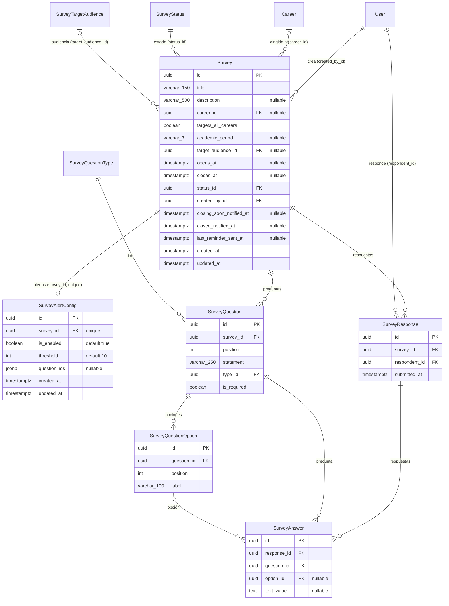

# Base de datos (Prisma)

Documentación de las tablas definidas en `schema.prisma` (PostgreSQL). Los nombres de modelo y campo son los de Prisma; entre paréntesis se indica la tabla o columna física (`@@map` / `@map`).

## Dominio de encuestas

### Diagrama de relaciones

### `Survey` (`surveys`)

Encuesta de empleabilidad creada por un administrativo.

| Campo | Columna | Tipo | Nulo | Por defecto | Descripción |
| --- | --- | --- | --- | --- | --- |
| `id` | `id` | `UUID` | No | `uuid()` | PK |
| `title` | `title` | `VARCHAR(150)` | No | | Título |
| `description` | `description` | `VARCHAR(500)` | Sí | | Descripción |
| `careerId` | `career_id` | `UUID` | Sí | | FK → `Career.id` |
| `targetsAllCareers` | `targets_all_careers` | `BOOLEAN` | No | `false` | Dirigida a todas las carreras |
| `academicPeriod` | `academic_period` | `VARCHAR(7)` | Sí | | Gestión objetivo (`AAAA` o `Todas`) |
| `targetAudienceId` | `target_audience_id` | `UUID` | Sí | | FK → `SurveyTargetAudience.id` |
| `opensAt` | `opens_at` | `TIMESTAMPTZ(6)` | Sí | | Apertura |
| `closesAt` | `closes_at` | `TIMESTAMPTZ(6)` | Sí | | Cierre |
| `statusId` | `status_id` | `UUID` | No | | FK → `SurveyStatus.id` |
| `createdById` | `created_by_id` | `UUID` | No | | FK → `User.id` (creador) |
| `closingSoonNotifiedAt` | `closing_soon_notified_at` | `TIMESTAMPTZ(6)` | Sí | | Momento en que se avisó al creador del cierre próximo. `NULL` = aún no avisado |
| `closedNotifiedAt` | `closed_notified_at` | `TIMESTAMPTZ(6)` | Sí | | Momento en que se avisó al creador del cierre (y se evaluaron las variaciones). `NULL` = aún no avisado |
| `lastReminderSentAt` | `last_reminder_sent_at` | `TIMESTAMPTZ(6)` | Sí | | Último recordatorio manual entregado a la audiencia pendiente |
| `createdAt` | `created_at` | `TIMESTAMPTZ(6)` | No | `now()` | Alta |
| `updatedAt` | `updated_at` | `TIMESTAMPTZ(6)` | No | `@updatedAt` | Última modificación |

| Relación | Cardinalidad | FK | Al borrar el referenciado |
| --- | --- | --- | --- |
| `career` → `Career` | N:0..1 | `career_id` → `Career.id` | `Restrict` |
| `status` → `SurveyStatus` | N:1 | `status_id` → `SurveyStatus.id` | `Restrict` |
| `targetAudience` → `SurveyTargetAudience` | N:0..1 | `target_audience_id` → `SurveyTargetAudience.id` | `Restrict` |
| `createdBy` → `User` (`SurveyCreatedBy`) | N:1 | `created_by_id` → `User.id` | `Restrict` |
| `alertConfig` ← `SurveyAlertConfig` | 1:0..1 | `survey_alert_configs.survey_id` | `Cascade` (se borra con la encuesta) |
| `questions` ← `SurveyQuestion` | 1:N | `survey_questions.survey_id` | `Cascade` |
| `responses` ← `SurveyResponse` | 1:N | `survey_responses.survey_id` | `Cascade` |

Índices: PK `id`; `@@index([careerId, academicPeriod])`, `@@index([createdById])`, `@@index([statusId])`, `@@index([targetAudienceId])`. Todas las FK usan `ON UPDATE CASCADE`.

### `SurveyAlertConfig` (`survey_alert_configs`)

Configuración opcional de las alertas de variación de una encuesta. Cuando la encuesta cierra, el worker de ciclo de vida compara los porcentajes por opción con el semestre anterior y avisa al creador si alguna diferencia alcanza el umbral. Si una encuesta no tiene fila, se aplican los valores por defecto (`is_enabled = true`, `threshold = 10`, todas las preguntas).

| Campo | Columna | Tipo | Nulo | Por defecto | Descripción |
| --- | --- | --- | --- | --- | --- |
| `id` | `id` | `UUID` | No | `uuid()` | PK |
| `surveyId` | `survey_id` | `UUID` | No | | FK → `Survey.id`. Único |
| `isEnabled` | `is_enabled` | `BOOLEAN` | No | `true` | Activa o desactiva la evaluación al cierre |
| `threshold` | `threshold` | `INTEGER` | No | `10` | Umbral en puntos porcentuales. La API admite enteros de 1 a 50 |
| `questionIds` | `question_ids` | `JSONB` | Sí | | Arreglo JSON de ids (`SurveyQuestion.id`) a vigilar. `NULL` o `[]` = todas las preguntas. No es FK: los ids no se validan en la base |
| `createdAt` | `created_at` | `TIMESTAMPTZ(6)` | No | `CURRENT_TIMESTAMP` | Alta |
| `updatedAt` | `updated_at` | `TIMESTAMPTZ(6)` | No | `@updatedAt` | Última modificación (la gestiona Prisma) |

| Elemento | Definición |
| --- | --- |
| PK | `survey_alert_configs_pkey` sobre `id` |
| FK | `survey_alert_configs_survey_id_fkey`: `survey_id` → `surveys.id` (`Survey.id`), `ON DELETE CASCADE`, `ON UPDATE CASCADE` |
| Único / índice | `survey_alert_configs_survey_id_key` (índice único sobre `survey_id`) |
| Cardinalidad | `Survey` 1 : 0..1 `SurveyAlertConfig`. El índice único garantiza como máximo una configuración por encuesta; la aplicación la crea o actualiza con `upsert` por `survey_id` |
| Borrado | Al eliminar la encuesta se elimina su configuración. Borrar una pregunta no limpia `question_ids` |

### Tablas relacionadas del dominio

| Modelo (tabla) | Claves y restricciones | Borrado |
| --- | --- | --- |
| `SurveyStatus` (`survey_statuses`) | PK `id`; `title` único (`draft`, `published`) | Restrict desde `Survey` |
| `SurveyTargetAudience` (`survey_target_audiences`) | PK `id`; `title` único (`all`, `graduates`, `students`, `mentors`) | Restrict desde `Survey` |
| `SurveyQuestionType` (`survey_question_types`) | PK `id`; `title` único (`single_choice`, `multiple_choice`, `dropdown`) | Restrict desde `SurveyQuestion` |
| `SurveyQuestion` (`survey_questions`) | FK `survey_id` → `Survey.id`, FK `type_id` → `SurveyQuestionType.id`; único (`survey_id`, `position`); índice `type_id` | Cascade con la encuesta |
| `SurveyQuestionOption` (`survey_question_options`) | FK `question_id` → `SurveyQuestion.id`; único (`question_id`, `position`) | Cascade con la pregunta |
| `SurveyResponse` (`survey_responses`) | FK `survey_id` → `Survey.id`, FK `respondent_id` → `User.id`; único (`survey_id`, `respondent_id`); índice `respondent_id` | Cascade con la encuesta; Restrict desde `User` |
| `SurveyAnswer` (`survey_answers`) | FK `response_id` → `SurveyResponse.id`, `question_id` → `SurveyQuestion.id`, `option_id` → `SurveyQuestionOption.id` (nullable); índices `response_id`, `option_id`, (`question_id`, `option_id`) | Cascade con respuesta, pregunta u opción |

## Catálogo de notificaciones

`NotificationType` (`notification_types`): PK `id`, `code` `VARCHAR(50)` único, `name` `VARCHAR(100)`, `sends_push` y `sends_email` `BOOLEAN` (por defecto `false`). Lo referencia `Notification.typeId`. La semilla del catálogo hace upsert por `code`.

## Sprint History

### Sprint 3

- Migración `20261115120000_add_survey_alert_configs_and_notification_flags`:
  - Nueva tabla `survey_alert_configs` (`SurveyAlertConfig`) con relación 1:0..1 con `surveys`, índice único sobre `survey_id` y borrado en cascada.
  - Nuevas columnas nullable en `surveys`: `closing_soon_notified_at`, `closed_notified_at` y `last_reminder_sent_at`, que permiten un único aviso de cierre próximo y de cierre por encuesta y registran el último recordatorio manual.
- Datos de catálogo en `notification_types`: `SURVEY_REMINDER` (push y correo), `SURVEY_CLOSING_SOON`, `SURVEY_CLOSED` y `SURVEY_VARIATION_ALERT` (solo correo).
