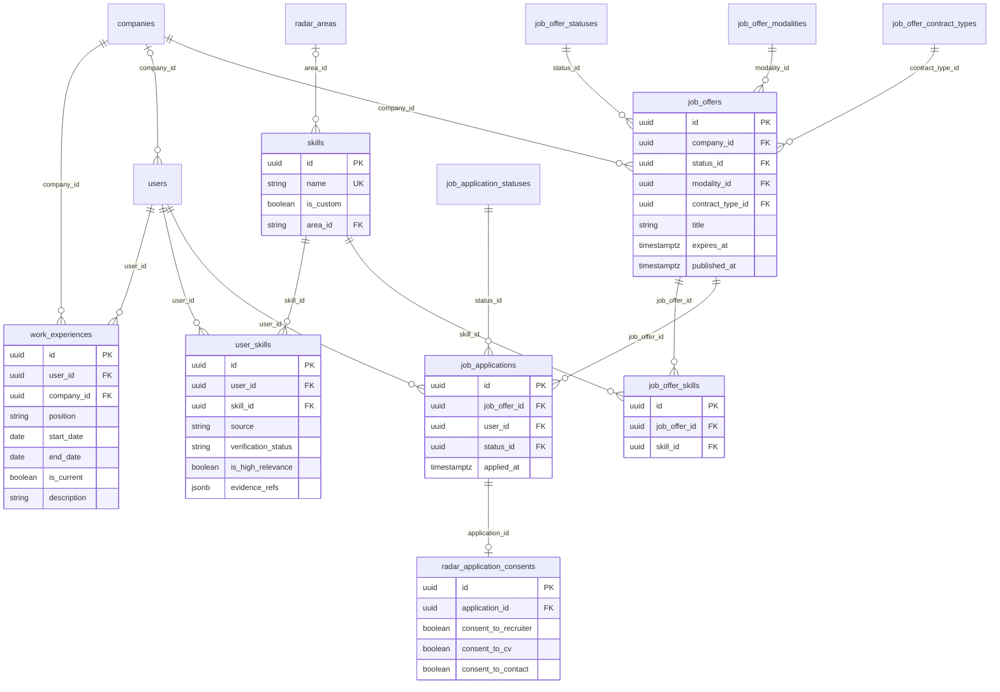

# Database

PostgreSQL schema managed with Prisma (`schema.prisma` and `migrations/`). Only the Database team changes this folder (CODEOWNERS); other teams request changes through issues. Migrations run automatically when the backend container starts. The rules for naming, types, catalogs, relations and auditing are in [backend/standard.md, section 2](../standard.md).

This README is organized by feature area. Each area documents the tables its modules use, and teams can add their own sections between the conventions and the **Sprint History**.

## Conventions used in this document

- Primary keys are `uuid` generated by the application (`@default(uuid())`) and foreign keys to them are `uuid` too. The exceptions in the tables below are `radar_areas.id` (a readable `varchar(50)` key) and `radar_application_consents.id` (generated by the database).
- Tables use plural `snake_case` names (`@@map`), columns use `snake_case` (`@map`), and timestamps are `timestamptz(6)`.
- Tables carry `created_at` and `updated_at`.
- Values that rarely change (statuses, modalities, contract types) are catalog tables with a unique `title`, and the code refers to them through TypeScript enums of the module.
- "Restrict", "Cascade" and "Set null" describe what happens to the row that holds the foreign key when the referenced row is deleted.

## Matching and Applications

Tables used by the modules [applications](../../docs/applications/README.md), [matching](../../docs/matching/README.md), [job-offers](../../docs/job-offers/README.md), [vacancies](../../docs/vacancies/README.md), [work-experience](../../docs/work-experience/README.md) and [skills](../../docs/skills/README.md).

### Relationship diagram

Tables that this section only references (`users`, `companies`, `radar_areas`) are owned by other modules and are described briefly at the end of the section.

### `work_experiences`

A job held by a person. Module: work-experience. Prisma model `WorkExperience`.

| Column                     | Type           | Null | Notes                                                                                            |
| -------------------------- | -------------- | ---- | ------------------------------------------------------------------------------------------------ |
| `id`                       | uuid           | no   | Primary key                                                                                      |
| `user_id`                  | uuid           | no   | FK to `users.id`, cascade                                                                        |
| `company_id`               | uuid           | no   | FK to `companies.id`, restrict. The company is found or created by name                          |
| `position`                 | text           | no   | Up to 150 characters, enforced by the application                                                |
| `start_date`               | date           | no   |                                                                                                  |
| `end_date`                 | date           | yes  | Null when `is_current` is true                                                                   |
| `is_current`               | boolean        | no   | Default `false`                                                                                  |
| `description`              | text           | yes  | Duties; main text source of skill detection (up to 5000 characters, enforced by the application) |
| `created_at`, `updated_at` | timestamptz(6) | no   |                                                                                                  |

Relationships: many experiences per user (1:N) and many experiences per company (1:N). Indexes: `user_id`, `company_id`.

### `skills`

Catalog of skills, shared by profiles and vacancies. Prisma model `Skill`.

| Column                     | Type           | Null | Notes                                                                                                        |
| -------------------------- | -------------- | ---- | ------------------------------------------------------------------------------------------------------------ |
| `id`                       | uuid           | no   | Primary key                                                                                                  |
| `name`                     | text           | no   | Unique                                                                                                       |
| `is_custom`                | boolean        | no   | Default `false`. Custom skills (created by a person) are excluded from the public catalog and from detection |
| `area_id`                  | varchar(50)    | yes  | FK to `radar_areas.id`, set null. Radar area used by the radar chart                                         |
| `created_at`, `updated_at` | timestamptz(6) | no   |                                                                                                              |

Relationships: belongs to one optional radar area (N:1); has many `user_skills` and many `job_offer_skills` (1:N). Index: `area_id`.

### `user_skills`

A skill in a person's profile. Prisma model `UserSkill`.

| Column                     | Type           | Null | Notes                                                                                                                                                                                        |
| -------------------------- | -------------- | ---- | -------------------------------------------------------------------------------------------------------------------------------------------------------------------------------------------- |
| `id`                       | uuid           | no   | Primary key                                                                                                                                                                                  |
| `user_id`                  | uuid           | no   | FK to `users.id`, cascade                                                                                                                                                                    |
| `skill_id`                 | uuid           | no   | FK to `skills.id`, restrict                                                                                                                                                                  |
| `source`                   | varchar(20)    | no   | Default `manual`. Values used by the code: `manual`, `nlp`                                                                                                                                   |
| `verification_status`      | varchar(20)    | no   | Default `pending`. Values used by the code: `pending`, `approved`                                                                                                                            |
| `is_high_relevance`        | boolean        | no   | Default `false`. True when the skill has evidence                                                                                                                                            |
| `evidence_refs`            | jsonb          | yes  | Default `[]`. List of references to what supports the skill (a work experience, the CV, ...). The origins shown to the user (manual, experience, CV) are derived from `source` and this list |
| `created_at`, `updated_at` | timestamptz(6) | no   |                                                                                                                                                                                              |

Constraints: unique `(user_id, skill_id)`, so a person has a skill once. Index: `skill_id`. `source` and `verification_status` are short text columns, not catalog tables.

### `job_offers`

A vacancy published by a company. Prisma model `JobOffer`.

| Column                     | Type           | Null | Notes                                               |
| -------------------------- | -------------- | ---- | --------------------------------------------------- |
| `id`                       | uuid           | no   | Primary key                                         |
| `title`                    | varchar(60)    | no   |                                                     |
| `description`              | text           | no   | Up to 3000 characters, enforced by the application  |
| `company_id`               | uuid           | no   | FK to `companies.id`, cascade                       |
| `modality_id`              | uuid           | no   | FK to `job_offer_modalities.id`, restrict           |
| `contract_type_id`         | uuid           | no   | FK to `job_offer_contract_types.id`, restrict       |
| `status_id`                | uuid           | no   | FK to `job_offer_statuses.id`, restrict             |
| `category`                 | text           | no   |                                                     |
| `positions_available`      | integer        | no   | Default 1                                           |
| `salary_range`             | text           | no   | Salary already formatted as text by the application |
| `languages`                | text           | no   |                                                     |
| `location_url`             | text           | no   | Google Maps link                                    |
| `required_careers`         | text[]         | no   | Default empty                                       |
| `min_experience_years`     | integer        | yes  |                                                     |
| `other_requirements`       | text[]         | no   | Default empty                                       |
| `expires_at`               | timestamptz(6) | yes  | Null means it does not expire                       |
| `published_at`             | timestamptz(6) | no   | Default now; reset when a vacancy is reopened       |
| `created_at`, `updated_at` | timestamptz(6) | no   |                                                     |

Relationships: belongs to one company, one modality, one contract type and one status (N:1 each); has many `job_offer_skills` and many `job_applications` (1:N). Indexes: `company_id`, `modality_id`, `contract_type_id`, `status_id`. A vacancy is visible to applicants when its status is `Publicada` and `expires_at` is null or in the future.

### `job_offer_skills`

Join table between vacancies and skills. Prisma model `JobOfferSkill`.

| Column                     | Type           | Null | Notes                          |
| -------------------------- | -------------- | ---- | ------------------------------ |
| `id`                       | uuid           | no   | Primary key                    |
| `job_offer_id`             | uuid           | no   | FK to `job_offers.id`, cascade |
| `skill_id`                 | uuid           | no   | FK to `skills.id`, restrict    |
| `created_at`, `updated_at` | timestamptz(6) | no   |                                |

Constraints: unique `(job_offer_id, skill_id)`. Index: `skill_id`. The application limits a vacancy to 10 skills.

### `job_applications`

A person's application to a vacancy. Prisma model `JobApplication`.

| Column                     | Type           | Null | Notes                                                  |
| -------------------------- | -------------- | ---- | ------------------------------------------------------ |
| `id`                       | uuid           | no   | Primary key                                            |
| `job_offer_id`             | uuid           | no   | FK to `job_offers.id`, cascade                         |
| `user_id`                  | uuid           | no   | FK to `users.id`, cascade                              |
| `status_id`                | uuid           | no   | FK to `job_application_statuses.id`, restrict          |
| `applied_at`               | timestamptz(6) | no   | Default now; reset when the application is reactivated |
| `created_at`, `updated_at` | timestamptz(6) | no   |                                                        |

Constraints: unique `(job_offer_id, user_id)`: one application per person and vacancy, and a withdrawn one is reused when the person applies again. Indexes: `user_id`, `status_id`.

### `radar_application_consents`

Consents given when applying. Prisma model `RadarApplicationConsent`.

| Column                     | Type           | Null | Notes                                                        |
| -------------------------- | -------------- | ---- | ------------------------------------------------------------ |
| `id`                       | uuid           | no   | Primary key, generated by the database (`gen_random_uuid()`) |
| `application_id`           | uuid           | no   | FK to `job_applications.id`, cascade. Unique                 |
| `consent_to_recruiter`     | boolean        | no   | Default `false`                                              |
| `consent_to_cv`            | boolean        | no   | Default `false`                                              |
| `consent_to_contact`       | boolean        | no   | Default `false`                                              |
| `created_at`, `updated_at` | timestamptz(6) | no   |                                                              |

Relationship: 1:1 with the application (`application_id` is unique). The row is written by the radar-integration module when the application is created, after the matching module has checked that the three consents were given.

### Catalog tables

All of them have `id`, a unique `title` (varchar(100)), `created_at` and `updated_at`. Rows are inserted by migrations or seeds; the code refers to them through enums.

| Table                      | Used by                       | Values                                                                 |
| -------------------------- | ----------------------------- | ---------------------------------------------------------------------- |
| `job_application_statuses` | `job_applications.status_id`  | `En revisión`, `Entrevista`, `Aceptada`, `No seleccionado`, `Retirada` |
| `job_offer_statuses`       | `job_offers.status_id`        | `Publicada`, `Cerrada`, `Eliminada`                                    |
| `job_offer_modalities`     | `job_offers.modality_id`      | `Presencial`, `Remoto`, `Híbrido`                                      |
| `job_offer_contract_types` | `job_offers.contract_type_id` | `Tiempo completo`, `Medio tiempo`, `Pasantía`                          |

### Referenced tables owned by other modules

| Table         | Why it is used here                                                                                                                             |
| ------------- | ----------------------------------------------------------------------------------------------------------------------------------------------- |
| `users`       | Owner of experiences, skills and applications. `users.company_id` (optional, FK to `companies.id`, set null) links a recruiter to their company |
| `companies`   | Employer of a work experience and publisher of a vacancy. `title` is unique                                                                     |
| `radar_areas` | Area of a skill, for the radar chart                                                                                                            |

### Rules enforced by the database and by the application

| Rule                                                                                                                                                         | Where                                 |
| ------------------------------------------------------------------------------------------------------------------------------------------------------------ | ------------------------------------- |
| One skill per person; one skill per vacancy; one application per person and vacancy                                                                          | Unique constraints                    |
| A person's data disappears with the person                                                                                                                   | Cascade from `users`                  |
| A skill, status, modality, contract type or company of an experience cannot be deleted while in use                                                          | Restrict                              |
| A vacancy removes its skills and applications when deleted for good                                                                                          | Cascade from `job_offers`             |
| Vacancy deletion by a company is logical (`Eliminada`)                                                                                                       | Application                           |
| Dates of experiences between 1950-01-01 and today (Bolivia time)                                                                                             | Application                           |
| Limits of text lengths, 10 skills per vacancy, salary range                                                                                                  | Application                           |
| An application can be withdrawn only from `En revisión` or `Entrevista`; reactivated only from `Retirada` and while the vacancy is published and not expired | Application, with conditional updates |

### Migrations

| Migration                                              | What it does                                                                  |
| ------------------------------------------------------ | ----------------------------------------------------------------------------- |
| `20261012020907_add_job_offers`                        | Vacancies, statuses, modalities and contract types                            |
| `20261021230000_add_job_applications`                  | Applications and their statuses                                               |
| `20261023003219_add_radar_areas_and_user_skill_fields` | Radar areas and the origin, verification and evidence fields of `user_skills` |
| `20261024120000_add_job_offer_requirements`            | Required careers, minimum experience and other requirements                   |
| `20261029120000_add_withdrawn_application_status`      | `Retirada` status                                                             |
| `20261103120000_add_job_offer_published_at`            | `published_at` of vacancies                                                   |
| `20261106000000_add_radar_application_consents`        | Consents of an application                                                    |

## Sprint History

### Sprint 3

- Documented the tables used by Matching and Applications: work experience, skills, vacancies, applications and consents, with relationships, constraints, indexes and deletion behavior.
- Evidence-based `user_skills` (`source`, `verification_status`, `evidence_refs`) used by the profile, the affinity calculation and the cleanup of detected skills.
- Unique `(job_offer_id, user_id)` on applications, which supports withdrawing and applying again on the same row.
