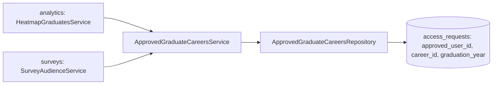
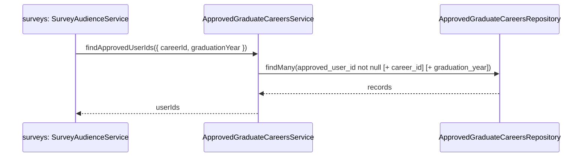

# Access Requests

## Purpose

The `access-requests` module manages graduates' access requests: registration and submission with a document, review and approval or rejection in the backoffice, document correction and account activation. An approved request links the created user (`approved_user_id`) to their career (`career_id`) and graduation year (`graduation_year`), which is why it is the official source of each graduate's cohort.

This document describes the read services the module exposes to other domains in Sprint 3.

## Read services for other domains

`ApprovedGraduateCareersService` (exported by `AccessRequestsModule`) provides cohort data without exposing the `access_requests` table:

| Method | Returns | Consumer |
| --- | --- | --- |
| `findByUserIds(userIds)` | `{ userId, careerId }[]` from the approved requests of those users. With an empty list it does not query the database | [analytics](../analytics/README.md) (career of each graduate in the heatmaps) |
| `findApprovedUserIds({ careerId, graduationYear })` | Ids of users with an approved request, filtered by career and/or graduation year if provided | [surveys](../surveys/README.md) (eligible audience of a survey) |

## Business rules

- Only requests with a non-null `approved_user_id` count (approved and linked to an account).
- The `careerId` and `graduationYear` filters are optional; with both null it returns all approved graduates.
- The services are read-only and have no HTTP endpoint of their own.

## Frontend integration

These services are not consumed directly by the frontend. Request registration lives in `frontend/src/modules/access-request` and review in `frontend/src/modules/request-review`. The cohort they expose is reflected in the survey response rate (`SurveyResponseRateCard`) and in the heatmaps (`frontend/src/modules/heatmaps`).

## Dependencies

| Direction | Module | Usage |
| --- | --- | --- |
| Uses | [mail](../mail/README.md) | Activation code, account activated and rejection emails |
| Used by | [surveys](../surveys/README.md) | Cohort by career and graduation year |
| Used by | [analytics](../analytics/README.md) | Approved career per graduate |

## Data

Table `access_requests` (see [backend/prisma/README.md](../../backend/prisma/README.md)).

## Sprint History

### Sprint 3

- `ApprovedGraduateCareersService` with `findByUserIds` and `findApprovedUserIds` so surveys and analytics can read the cohort of approved graduates.
