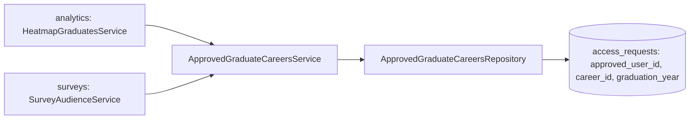
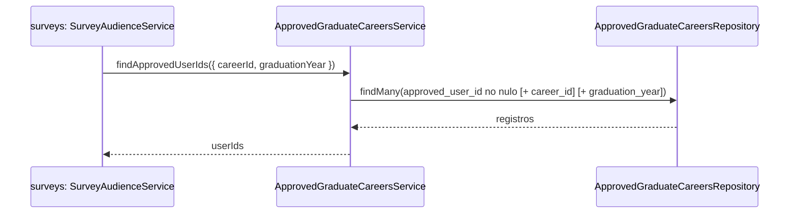

# Access Requests (solicitudes de acceso)

## Propósito

El módulo `access-requests` gestiona las solicitudes de acceso de los titulados: registro y envío con documento, revisión y aprobación o rechazo en el backoffice, corrección de documentos y activación de la cuenta. Una solicitud aprobada vincula al usuario creado (`approved_user_id`) con su carrera (`career_id`) y su año de egreso (`graduation_year`), y por eso es la fuente oficial de la cohorte de cada titulado.

Este documento describe los servicios de lectura que el módulo expone a otros dominios en el Sprint 3.

## Servicios de lectura para otros dominios

`ApprovedGraduateCareersService` (exportado por `AccessRequestsModule`) entrega datos de cohorte sin exponer la tabla `access_requests`:

| Método | Devuelve | Consumidor |
| --- | --- | --- |
| `findByUserIds(userIds)` | `{ userId, careerId }[]` de las solicitudes aprobadas de esos usuarios. Con lista vacía no consulta la base | [analytics](../analytics/README.md) (carrera de cada titulado en los mapas de calor) |
| `findApprovedUserIds({ careerId, graduationYear })` | Ids de usuarios con solicitud aprobada, filtrando por carrera y/o año de egreso si se indican | [surveys](../surveys/README.md) (audiencia elegible de una encuesta) |

## Reglas de negocio

- Solo cuentan solicitudes con `approved_user_id` no nulo (aprobadas y vinculadas a una cuenta).
- Los filtros `careerId` y `graduationYear` son opcionales; con ambos nulos devuelve todos los titulados aprobados.
- Los servicios son de solo lectura y no tienen endpoint HTTP propio.

## Integración con el frontend

Estos servicios no tienen consumo directo desde el frontend. El registro de la solicitud vive en `frontend/src/modules/access-request` y la revisión en `frontend/src/modules/request-review`. La cohorte que exponen se refleja en la tasa de respuesta de las encuestas (`SurveyResponseRateCard`) y en los mapas de calor (`frontend/src/modules/heatmaps`).

## Dependencias

| Dirección | Módulo | Uso |
| --- | --- | --- |
| Usa | [mail](../mail/README.md) | Correos de código de activación, cuenta activada y rechazo |
| Usado por | [surveys](../surveys/README.md) | Cohorte por carrera y año de egreso |
| Usado por | [analytics](../analytics/README.md) | Carrera aprobada por titulado |

## Datos

Tabla `access_requests` (ver [backend/prisma/README.md](../../backend/prisma/README.md)).

## Sprint History

### Sprint 3

- `ApprovedGraduateCareersService` con `findByUserIds` y `findApprovedUserIds` para que surveys y analytics lean la cohorte de los titulados aprobados.
