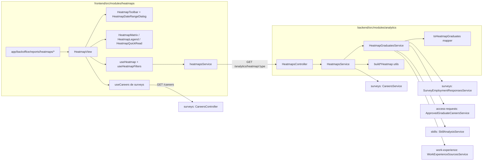
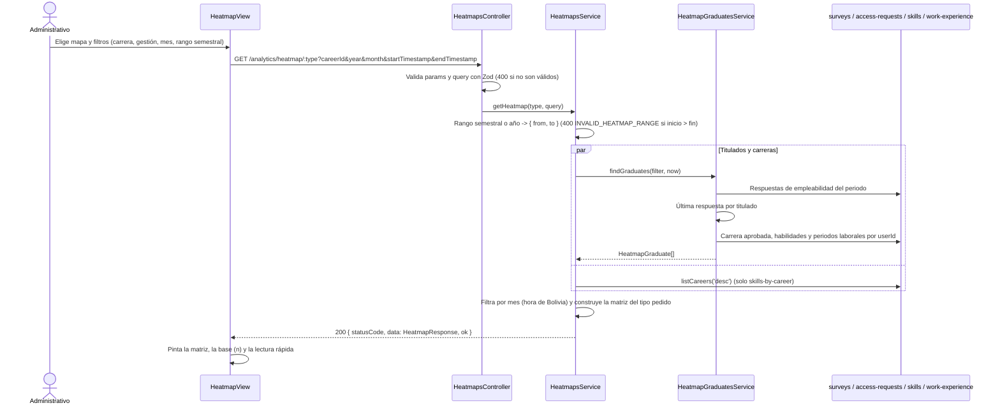
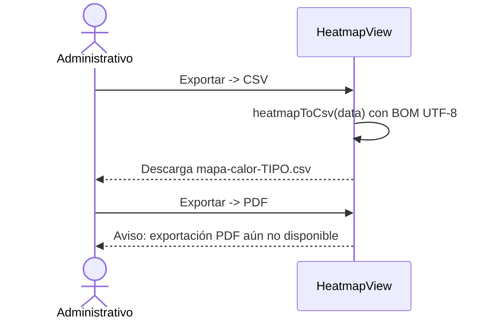

# Analytics (mapas de calor)

## Propósito

El módulo `analytics` genera los mapas de calor de habilidades de los titulados para el personal administrativo. Cruza la última respuesta de cada titulado a la encuesta de empleabilidad con su carrera aprobada, sus habilidades y su experiencia laboral, y devuelve una matriz lista para pintar (filas = habilidades, columnas = carreras, rangos salariales, situaciones laborales o niveles de experiencia).

- Backend: `backend/src/modules/analytics` (controlador, servicios, constructores puros de cada mapa y semilla de datos ficticios).
- Frontend: `frontend/src/modules/heatmaps` (vista común `HeatmapView`, filtros, matriz, leyenda, lectura rápida y exportación).

El módulo no tiene tablas propias: solo lee datos de otros dominios a través de sus servicios públicos.

## Funcionalidad

| Mapa | Tipo (`:type`) | Columnas | Ruta frontend |
| --- | --- | --- | --- |
| Habilidades por carrera | `skills-by-career` | Carreras (Sistemas, Informática) | `/backoffice/reports/heatmaps/skills-by-career` |
| Habilidades NLP vs. rango salarial | `skills-by-salary` | 5 rangos salariales mensuales | `/backoffice/reports/heatmaps/skills-by-salary` |
| Empleabilidad y habilidades | `employability` | 4 situaciones laborales + total y retención laboral | `/backoffice/reports/heatmaps/employability` |
| Habilidades vs. años de experiencia | `skills-by-experience` | Junior, Semi-Senior, Senior + total y mayor adopción | `/backoffice/reports/heatmaps/skills-by-experience` |

`/backoffice/reports/heatmaps` redirige al mapa de habilidades por carrera. El menú lateral tiene la sección propia "Mapas de calor".

## Arquitectura

## Flujos clave

### Consultar un mapa de calor

### Exportar

## Reglas de negocio

- **Acceso.** Solo el rol `administrativo` (`JwtAuthGuard` + `RolesGuard`).
- **Población.** Se consideran respuestas a encuestas que contienen la pregunta de situación laboral (`EMPLOYMENT_STATUS_QUESTION`), de usuarios activos con solicitud de acceso aprobada. Con `careerId` solo entran titulados aprobados en esa carrera. De cada titulado se usa **solo su respuesta más reciente**.
- **Periodo.** `startTimestamp` y `endTimestamp` (ISO 8601 con zona) deben enviarse juntos y tienen prioridad sobre `year`. `year` (2000–2100) se convierte al año calendario en hora de Bolivia. `month` (1–12) filtra después por el mes de respuesta en hora de Bolivia. Sin filtros se usan todas las respuestas.
- **Filas.** Como máximo 10 habilidades (`MAX_HEATMAP_SKILL_ROWS`), las más frecuentes en la base; empate por nombre.
- **Celdas.** `percentage = count / total` de la columna; una columna sin titulados produce celdas `isEmpty: true`.
- **Por carrera.** Base: titulados con al menos una habilidad. Columnas = carreras ordenadas de forma descendente por título (o solo la carrera filtrada); porcentaje con un decimal. La lectura rápida menciona las 2 habilidades con mayor presencia por carrera.
- **Por rango salarial.** Base: titulados con rango salarial respondido y al menos una habilidad de origen `nlp`. Solo se cuentan habilidades NLP. La lectura rápida usa el rango más alto con titulados.
- **Empleabilidad.** Base: titulados con situación laboral reconocida. Cada fila reparte a quienes tienen la habilidad entre las 4 situaciones. "Retención laboral" = empleados en su área, en otra área o independientes. Filas ordenadas por retención y luego por cantidad de titulados.
- **Experiencia.** Los periodos laborales se recortan a la fecha actual, se fusionan si se solapan y se suman (años con un decimal). Niveles: Junior ≤ 2 años, Semi-Senior > 2 y ≤ 5, Senior > 5. Base: titulados con al menos un periodo laboral. Columnas extra: total que la domina y nivel con mayor adopción.
- **Textos.** Las etiquetas de opciones de la encuesta se mapean a ids estables (`EMPLOYMENT_STATUSES`, `SALARY_RANGES`); una etiqueta desconocida deja el dato en `null` y el titulado queda fuera de ese mapa.
- **Frontend.** El filtro de mes solo aparece en el mapa de experiencia. El rango semestral se convierte a timestamps con desfase `-04:00`. La consulta mantiene los datos previos mientras recarga (`keepPreviousData`). Exportar se habilita solo cuando `baseCount > 0`.

## Endpoints

### Expuestos

| Método | Ruta | Roles | Query | Respuesta | Errores |
| --- | --- | --- | --- | --- | --- |
| GET | `/analytics/heatmap/:type` | `administrativo` | `careerId` (uuid), `year`, `month`, `startTimestamp`, `endTimestamp` | 200 `HeatmapResponse` (`heatmapType`, `baseCount`, `baseLabel`, `columns`, `extraColumnsConfig?`, `rows`, `quickReadSummary?`) | 400 validación o `INVALID_HEATMAP_RANGE`, 401, 403, 500 |

Swagger (`/docs`) documenta cada endpoint con `operationId`, Bearer JWT, roles, parámetros y restricciones tomados de los esquemas Zod, ejemplos de éxito con el envoltorio `{ statusCode, ok, detail, data }`, los errores que lanza el código y 401, 403 y 500 declarados de forma explícita. Los ejemplos viven en `constants/*-swagger.constants.ts` del módulo y el esquema de error compartido en `backend/src/common/constants/api-error-swagger.constants.ts`.

### Consumidos

| Módulo | Servicio / endpoint | Uso |
| --- | --- | --- |
| surveys | `SurveyEmploymentResponsesService.findEmploymentResponses` | Situación laboral y rango salarial respondidos |
| surveys | `CareersService.listCareers('desc')`, `GET /careers` (frontend) | Columnas y filtro de carrera |
| access-requests | `ApprovedGraduateCareersService.findByUserIds` | Carrera aprobada de cada titulado |
| skills | `SkillAnalysisService.findSkillSummariesByUserIds` | Habilidades y su origen (`nlp`, manual) |
| work-experience | `WorkExperienceSourcesService.findPeriodsByUserIds` | Periodos laborales para calcular años de experiencia |

## Dependencias

| Dirección | Módulo | Uso |
| --- | --- | --- |
| Usa | [surveys](../surveys/README.md) | Respuestas de empleabilidad y catálogo de carreras |
| Usa | [access-requests](../access-requests/README.md) | Carrera aprobada por titulado |
| Usa | [skills](../skills/README.md) | Resumen de habilidades por usuario (`SkillAnalysisModule`) |
| Usa | [work-experience](../work-experience/README.md) | Periodos laborales (`WorkExperienceSourcesModule`) |
| Usa (frontend) | surveys (`useCareers`), shared (`ExportFormatMenu`, `WorkspacePage`, `downloadFile`) | Filtros, menú de exportación y layout |

## Datos

Sin tablas propias. Lee `survey_responses`, `survey_answers`, `access_requests`, `user_skills`, `skills` y `work_experiences` mediante los servicios anteriores (ver [backend/prisma/README.md](../../backend/prisma/README.md)).

La etapa de fixtures `heatmap_graduates` (`seeds/heatmap-graduates-fixtures.seed.ts`) crea titulados ficticios, sus solicitudes aprobadas, habilidades, experiencias y una encuesta con las preguntas de situación laboral y rango salarial para poder ver los cuatro mapas en desarrollo.

## Sprint History

### Sprint 3

- Endpoint `GET /analytics/heatmap/:type` con los cuatro mapas: habilidades por carrera, habilidades NLP vs. rango salarial, empleabilidad y habilidades, y habilidades vs. años de experiencia.
- Filtros por carrera, gestión, mes y rango semestral, con validación del rango.
- Lectura rápida generada en el backend y columnas extra (total, retención laboral, total que domina, mayor adopción).
- Servicios de lectura expuestos por surveys, access-requests, skills y work-experience para alimentar los mapas sin acceder a sus tablas.
- Frontend `heatmaps`: sección "Mapas de calor" en el backoffice, matriz con escala de color y leyenda, indicador de base, diálogo de rango semestral y exportación CSV.
- Semilla de titulados ficticios para los mapas.
- Contrato Swagger completo de `GET /analytics/heatmap/:type`.
