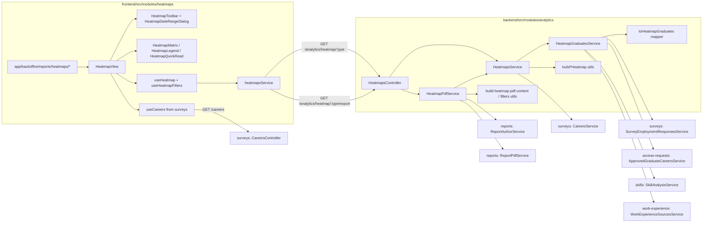
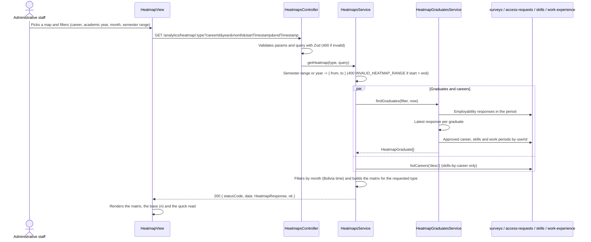

# Analytics (heatmaps)

## Purpose

The `analytics` module builds the graduate skill heatmaps for administrative staff. It crosses each graduate's latest response to the employability survey with their approved career, their skills and their work experience, and returns a matrix ready to render (rows = skills, columns = careers, salary ranges, employment statuses or experience levels).

- Backend: `backend/src/modules/analytics` (controller, services, pure builders for each map and a fake-data seed).
- Frontend: `frontend/src/modules/heatmaps` (shared `HeatmapView`, filters, matrix, legend, quick read and export).

The module has no tables of its own: it only reads data from other domains through their public services.

## Functionality

| Map | Type (`:type`) | Columns | Frontend route |
| --- | --- | --- | --- |
| Skills by career | `skills-by-career` | Careers (Sistemas, Informática) | `/backoffice/reports/heatmaps/skills-by-career` |
| NLP skills vs. salary range | `skills-by-salary` | 5 monthly salary ranges | `/backoffice/reports/heatmaps/skills-by-salary` |
| Employability and skills | `employability` | 4 employment statuses + total and job retention | `/backoffice/reports/heatmaps/employability` |
| Skills vs. years of experience | `skills-by-experience` | Junior, Semi-Senior, Senior + total and highest adoption | `/backoffice/reports/heatmaps/skills-by-experience` |

`/backoffice/reports/heatmaps` redirects to the skills by career map. The sidebar has its own "Mapas de calor" section.

## Architecture



## Key flows

### Query a heatmap



### Export

```mermaid
sequenceDiagram
  actor A as Administrative staff
  participant V as HeatmapView
  participant C as HeatmapsController
  participant P as HeatmapPdfService
  participant R as reports: ReportAuthorService / ReportPdfService
  A->>V: Export -> CSV
  V->>V: heatmapToCsv(data) with UTF-8 BOM
  V-->>A: Downloads mapa-calor-TIPO.csv
  A->>V: Export -> PDF
  V->>C: GET /analytics/heatmap/:type/export?format=pdf&careerId&year&month&startTimestamp&endTimestamp
  C->>C: Validates params and query with Zod (400 if invalid)
  C->>P: export(type, query, userId)
  P->>P: getHeatmap(type, query) + career title for the filters
  P->>R: resolveLabel(userId) (404 REPORT_AUTHOR_NOT_FOUND if the account has no usable name)
  P->>R: render(columns, rows, cell tones, filters, author)
  R-->>C: PDF with the UMSS and UMSSY logos in the header
  C-->>V: 200 application/pdf (Content-Disposition: attachment; filename="mapa-calor-TIPO.pdf")
  V-->>A: Downloads the PDF and shows "PDF generado correctamente."
```

## Business rules

- **Access.** Only the `administrativo` role (`JwtAuthGuard` + `RolesGuard`).
- **Population.** Includes responses to surveys that contain the employment status question (`EMPLOYMENT_STATUS_QUESTION`), from active users with an approved access request. With `careerId`, only graduates approved in that career are included. For each graduate, **only their most recent response** is used.
- **Period.** `startTimestamp` and `endTimestamp` (ISO 8601 with time zone) must be sent together and take precedence over `year`. `year` (2000–2100) is converted to the calendar year in Bolivia time. `month` (1–12) then filters by the response month in Bolivia time. Without filters, all responses are used.
- **Rows.** At most 10 skills (`MAX_HEATMAP_SKILL_ROWS`), the most frequent in the base; ties are broken by name.
- **Cells.** `percentage = count / total` of the column; a column with no graduates produces `isEmpty: true` cells.
- **By career.** Base: graduates with at least one skill. Columns = careers sorted in descending order by title (or only the filtered career); percentage with one decimal. The quick read mentions the 2 most present skills per career.
- **By salary range.** Base: graduates who answered the salary range and have at least one skill with `nlp` origin. Only NLP skills are counted. The quick read uses the highest range with graduates.
- **Employability.** Base: graduates with a recognized employment status. Each row splits those who have the skill across the 4 statuses. "Retención laboral" = employed in their field, in another field or self-employed. Rows are sorted by retention and then by number of graduates.
- **Experience.** Work periods are clipped to the current date, merged when they overlap and summed (years with one decimal). Levels: Junior ≤ 2 years, Semi-Senior > 2 and ≤ 5, Senior > 5. Base: graduates with at least one work period. Extra columns: total that masters it and level with the highest adoption.
- **Texts.** Survey option labels are mapped to stable ids (`EMPLOYMENT_STATUSES`, `SALARY_RANGES`); an unknown label sets the value to `null` and the graduate is left out of that map.
- **PDF export.** Accepts the same filters as the query endpoint and `format=pdf` (default, the only server format; CSV is generated in the client). It reuses `ReportPdfService` from reports, so the document has the same institutional header (UMSS seal and UMSSY logo), applied filters (career, academic year or semester range, month), "Generado por" and total as the other reports. Cells show `count (percentage%)` with a blue tone by percentage (≥ 75, ≥ 50, ≥ 25, ≥ 1).
- **Frontend.** The month filter only appears on the experience map. The semester range is converted to timestamps with a `-04:00` offset. The query keeps the previous data while reloading (`keepPreviousData`). Export is enabled only when `baseCount > 0`.

## Endpoints

### Exposed

| Method | Path | Roles | Query | Response | Errors |
| --- | --- | --- | --- | --- | --- |
| GET | `/analytics/heatmap/:type` | `administrativo` | `careerId` (uuid), `year`, `month`, `startTimestamp`, `endTimestamp` | 200 `HeatmapResponse` (`heatmapType`, `baseCount`, `baseLabel`, `columns`, `extraColumnsConfig?`, `rows`, `quickReadSummary?`) | 400 validation or `INVALID_HEATMAP_RANGE`, 401, 403, 500 |
| GET | `/analytics/heatmap/:type/export` | `administrativo` | `format` (`pdf`, default), `careerId` (uuid), `year`, `month`, `startTimestamp`, `endTimestamp` | 200 `application/pdf` binary, `Content-Disposition: attachment; filename="mapa-calor-TIPO.pdf"` | 400 validation or `INVALID_HEATMAP_RANGE`, 401, 403, 404 `REPORT_AUTHOR_NOT_FOUND`, 500 |

Swagger (`/docs`) documents each endpoint with `operationId`, Bearer JWT, roles, parameters and constraints taken from the Zod schemas, success examples with the `{ statusCode, ok, detail, data }` envelope, the errors thrown by the code, and 401, 403 and 500 declared explicitly. The examples live in the module's `constants/*-swagger.constants.ts` and the shared error schema in `backend/src/common/constants/api-error-swagger.constants.ts`.

### Consumed

| Module | Service / endpoint | Use |
| --- | --- | --- |
| surveys | `SurveyEmploymentResponsesService.findEmploymentResponses` | Answered employment status and salary range |
| surveys | `CareersService.listCareers('desc')`, `GET /careers` (frontend) | Columns and career filter |
| access-requests | `ApprovedGraduateCareersService.findByUserIds` | Approved career of each graduate |
| skills | `SkillAnalysisService.findSkillSummariesByUserIds` | Skills and their origin (`nlp`, manual) |
| work-experience | `WorkExperienceSourcesService.findPeriodsByUserIds` | Work periods to calculate years of experience |
| reports | `ReportAuthorService.resolveLabel`, `ReportPdfService.render` | Author label and PDF rendering with the institutional header |

## Dependencies

| Direction | Module | Use |
| --- | --- | --- |
| Uses | [surveys](../surveys/README.md) | Employability responses and career catalog |
| Uses | [access-requests](../access-requests/README.md) | Approved career per graduate |
| Uses | [skills](../skills/README.md) | Skill summary per user (`SkillAnalysisModule`) |
| Uses | [work-experience](../work-experience/README.md) | Work periods (`WorkExperienceSourcesModule`) |
| Uses | [reports](../reports/README.md) | PDF rendering and author label (`ReportsModule`) |
| Uses (frontend) | surveys (`useCareers`), shared (`ExportFormatMenu`, `WorkspacePage`, `downloadFile`) | Filters, export menu and layout |

## Data

No tables of its own. Reads `survey_responses`, `survey_answers`, `access_requests`, `user_skills`, `skills` and `work_experiences` through the services above (see [backend/prisma/README.md](../../backend/prisma/README.md)).

The `heatmap_graduates` fixtures stage (`seeds/heatmap-graduates-fixtures.seed.ts`) creates fake graduates, their approved requests, skills, experiences and a survey with the employment status and salary range questions so the four maps can be viewed in development.

## Sprint History

### Sprint 3

- `GET /analytics/heatmap/:type` endpoint with the four maps: skills by career, NLP skills vs. salary range, employability and skills, and skills vs. years of experience.
- Filters by career, academic year, month and semester range, with range validation.
- Quick read generated in the backend and extra columns (total, job retention, total that masters it, highest adoption).
- Read services exposed by surveys, access-requests, skills and work-experience to feed the maps without accessing their tables.
- `heatmaps` frontend: "Mapas de calor" section in the backoffice, matrix with color scale and legend, base indicator, semester range dialog and CSV export.
- Fake graduate seed for the maps.
- Full Swagger contract for `GET /analytics/heatmap/:type`.
- `GET /analytics/heatmap/:type/export?format=pdf`: server-side PDF export through `HeatmapPdfService`, reusing `ReportPdfService` (institutional logos, filters, author and blue cell tones), with its Swagger contract (200 binary, 400, 401, 403, 404 `REPORT_AUTHOR_NOT_FOUND`, 500). The frontend downloads it with `useExportHeatmapPdf`.
- "Limpiar filtros" button in the toolbar, "Cancelar" option in the export menu and blue export button.
- Ties in "Mayor adopción en" list every tied level, and the quick read uses "los niveles" when there is a tie.
- Removed the duplicated "Mapas de calor" item from the sidebar section.
