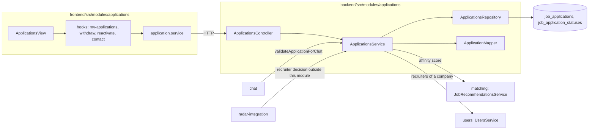
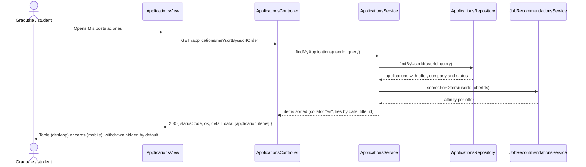
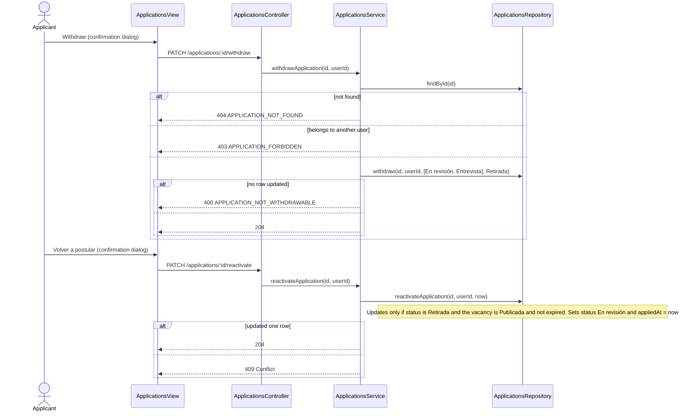
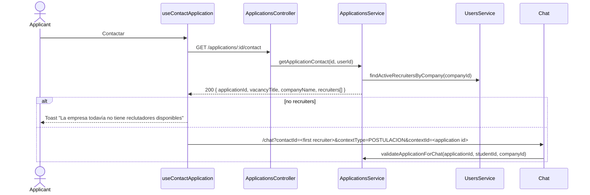

# Applications

## Purpose

Lets a graduate or student follow the job applications they have submitted ("Mis postulaciones"): list them with their affinity percentage, sort them, withdraw an active one, apply again to a vacancy after withdrawing, and open a chat with the company's recruiter. The applicant-facing flow distinguishes active applications (`Postulada`) from withdrawn applications (`Retirada`). Internally, the backend uses `En revisión` for newly submitted and reactivated applications; it also reads other catalog statuses when evaluating withdrawal and contact permissions, without managing recruiter decisions. This module does not dispatch status-change notifications.

Creating an application (the "Postularme" action) belongs to the [matching](../matching/README.md) module. This module starts once the application exists.

## Functionality

| Feature                                                               | Where                                                |
| --------------------------------------------------------------------- | ---------------------------------------------------- |
| List my applications with vacancy, company, affinity, status and date | `GET /applications/me`, `/vacancies/my-applications` |
| Sort by date, vacancy, company or affinity (eight options)            | Client-side sort selector                            |
| Withdraw an application that is in review or in interview             | `PATCH /applications/:id/withdraw`                   |
| Show withdrawn applications only on demand (toggle)                   | Frontend                                             |
| Apply again to a vacancy after withdrawing ("Volver a postular")      | `PATCH /applications/:id/reactivate`                 |
| Contact the recruiter from an application                             | `GET /applications/:id/contact` + chat deep link     |

## Architecture

## Key flows

### List my applications

### Withdraw and apply again

### Contact the recruiter

## Business rules

- The status catalog `job_application_statuses` contains `En revisión`, `Entrevista`, `Aceptada`, `No seleccionado` and `Retirada` (`ApplicationStatus` enum). The applicant-facing view labels non-withdrawn applications as `Postulada` and withdrawn ones as `Retirada`; `Postulada` is a display label, not a catalog status. The applicant-facing module performs transitions to `Retirada` (withdrawal) and back to `En revisión` (reactivation); it does not implement recruiter decisions that assign `Entrevista`, `Aceptada` or `No seleccionado`. Nevertheless, the withdrawal and contact operations must recognize these catalog statuses according to the rules below.
- Only the owner of an application can read, withdraw, reactivate or contact from it. Withdraw/reactivate answer 404 when it does not exist and 403 when it belongs to someone else; contact answers 404 in both cases so it does not reveal other users' applications.
- An application can be withdrawn only from `En revisión` or `Entrevista`. The check is part of the `UPDATE ... WHERE`, so a concurrent status change is rejected instead of overwritten.
- An application can be reactivated only from `Retirada`, only if the vacancy is `Publicada` and has not expired. Reactivating moves it to `En revisión` and resets `appliedAt` to the current time. The `(job_offer_id, user_id)` pair is unique, so the same row is reused.
- Contact is allowed only for `En revisión`, `Entrevista` and `Aceptada`; otherwise 403 `APPLICATION_CONTACT_RESTRICTED`. The chat opens with the first active recruiter of the vacancy's company.
- Chat validation (`validateApplicationForChat`) rejects the conversation when the application does not belong to the student, does not belong to the company, or is rejected, withdrawn or cancelled.
- Affinity is not stored: it is calculated on every request by the matching module (see [matching](../matching/README.md)). When no score is available for a vacancy, the item shows 0.
- This module does not send status-change notifications. Status-change notifications, where applicable, are handled outside the applications module.
- Dates are shown in Bolivia time with the shared `formatBoliviaDate` formatter.

## Endpoints

All endpoints require a valid JWT and the role `titulado` or `estudiante`.

| Method | Path                           | Description                                                                                                                                         | Success                          | Errors                                                                                       |
| ------ | ------------------------------ | --------------------------------------------------------------------------------------------------------------------------------------------------- | -------------------------------- | -------------------------------------------------------------------------------------------- |
| GET    | `/applications/me`             | Own applications. Optional query: `status`, `sortBy`, `sortOrder` (detailed below). The client sorts locally by vacancy, company, affinity or date. | 200 `ApplicationItemResponse[]`  | 400 invalid query                                                                            |
| PATCH  | `/applications/:id/withdraw`   | Withdraws an application                                                                                                                            | 204                              | 400 `APPLICATION_NOT_WITHDRAWABLE`, 403 `APPLICATION_FORBIDDEN`, 404 `APPLICATION_NOT_FOUND` |
| PATCH  | `/applications/:id/reactivate` | Applies again after withdrawing                                                                                                                     | 204                              | 403 `APPLICATION_FORBIDDEN`, 404 `APPLICATION_NOT_FOUND`, 409 not reactivable                |
| GET    | `/applications/:id/contact`    | Recruiters available to chat with                                                                                                                   | 200 `ApplicationContactResponse` | 403 `APPLICATION_CONTACT_RESTRICTED`, 404 `APPLICATION_NOT_FOUND`                            |

### `GET /applications/me` query parameters

All query parameters are optional:

| Parameter   | Accepted values                                                        | Behavior                                                   |
| ----------- | ---------------------------------------------------------------------- | ---------------------------------------------------------- |
| `status`    | `En revisión`, `Entrevista`, `Aceptada`, `No seleccionado`, `Retirada` | Filters by the internal `ApplicationStatus` catalog value. |
| `sortBy`    | `vacancy`, `company`, `affinity`, `status`, `date`                     | Selects the backend sorting field.                         |
| `sortOrder` | `asc`, `desc`                                                          | Sorting direction; defaults to `desc`.                     |

The frontend does not expose the internal status filter or status-based sorting. Its local sort selector provides eight options: ascending and descending order for vacancy, company, affinity and date. The separate withdrawn-applications toggle controls whether withdrawn items appear in the client.

Internal contracts used by other modules (not HTTP) include `validateApplicationForChat`, `findRecruitmentApplicationsByUser`, `findRecruitmentApplicants` and `recordRecruiterDecision`. The recruiter decision endpoint `PATCH /radar-integration/recruiter/applications/:id` belongs to the `radar-integration` module and is not managed by this module.

## Dependencies

| Direction | Module                            | Use                                                                                                 |
| --------- | --------------------------------- | --------------------------------------------------------------------------------------------------- |
| Uses      | [matching](../matching/README.md) | `JobRecommendationsService.scoresForOffers` for the affinity column                                 |
| Uses      | job-offers                        | `JobOffersService` for the vacancy data                                                             |
| Uses      | users                             | `UsersService.findActiveRecruitersByCompany` (the module does not read users or companies directly) |
| Used by   | chat                              | `validateApplicationForChat`                                                                        |
| Used by   | radar-integration                 | recruiter decision and application lookup contracts                                                 |

## Data

Tables `job_applications` and `job_application_statuses` (see [backend/prisma/README.md](../../backend/prisma/README.md)). Vacancy and company fields are read only through the relations of the application (`job_offers`, `companies`); recruiters are read through `UsersService`.

## Frontend

- Route: `/vacancies/my-applications` (`ApplicationsView`).
- Responsive: table on desktop, cards on mobile. Sort selector (eight options), "show withdrawn" toggle and empty/error states with retry.
- Withdraw and reactivate use confirmation dialogs; the reactivation button and dialog use the green `success` color of the design tokens.
- The client uses `canContactApplication` to block contact for `Retirada` applications before calling the API. For other statuses, the backend enforces the full contact rule (`En revisión`, `Entrevista` and `Aceptada` are allowed; otherwise 403 `APPLICATION_CONTACT_RESTRICTED`). Retryable failures (network or 5xx) show a toast with an option to retry.

## Design decisions

- **Status changes are done with a conditional `UPDATE`** (`updateMany` with the allowed previous statuses) instead of read-then-write, to be safe under concurrent clicks.
- **Reactivation reuses the row** because `(job_offer_id, user_id)` is unique; the applicant sees the same application come back to `En revisión` with today's date.
- **Withdrawn applications are hidden by default** and shown only through a dedicated toggle, so the main list shows only live processes.
- **Contact goes through the chat module**: this module only answers who can be contacted and validates the context; messages and delivery belong to chat.
- **Other modules are reached through their services**, never their tables (backend standard), which is why recruiters come from `UsersService`.

## Action styling

Withdrawing an application updates its status through the withdrawal PATCH endpoint. The withdrawal control uses the outlined action style and reactivation remains available through its own confirmation flow.

## Sprint History

### Sprint 3

- "Mis postulaciones" list with affinity, status and date, empty and error states.
- Eight sort options (date, vacancy, company and affinity, each ascending/descending), withdrawn applications behind a toggle, mobile cards.
- Withdraw with confirmation and conflict-safe update.
- Apply again after withdrawing ("Volver a postular") with confirmation.
- Contact the recruiter from an application through the contextual chat.
- Dates unified to Bolivia time with a single formatter.
