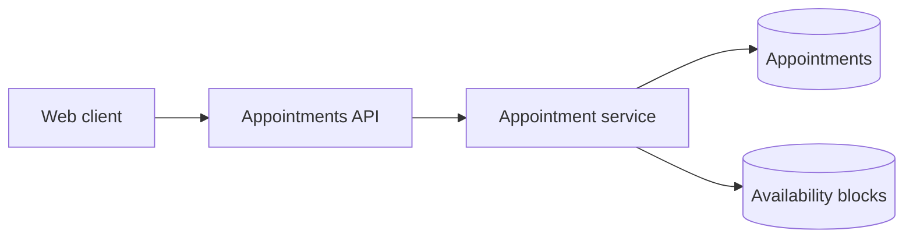

# Appointments

Backend module `backend/src/modules/appointments`. It books mentoring sessions on a mentor's availability blocks, lists and shows a person's appointments, cancels them, shares the video call link and sends the booked and cancelled notices. The tables it uses are described in [backend/prisma/README.md, section Appointments](../../backend/prisma/README.md#appointments).

## Endpoints

All routes require a session (`JwtAuthGuard`) and one of the roles `mentor`, `titulado` or `estudiante` (`RolesGuard`). Responses use the common envelope `{ statusCode, ok, code, detail, data }`. Dates are returned in UTC ISO format.

| Method  | Route                                 | What it does                                                                                |
| ------- | ------------------------------------- | ------------------------------------------------------------------------------------------- |
| `POST`  | `/appointments`                       | Books a free block and returns the appointment already `CONFIRMED` (201)                    |
| `PATCH` | `/appointments/:id/cancel`            | Cancels a confirmed appointment that has not started (body `{ reason? }`)                   |
| `GET`   | `/appointments/me`                    | Pages the caller's appointments: `scope`, `page`, `pageSize`, `q`                           |
| `GET`   | `/appointments/:id`                   | Detail of an appointment, only for its mentor or student; includes the meeting link         |
| `GET`   | `/appointments/:id/counterpart-photo` | Profile photo of the other participant                                                      |
| `POST`  | `/appointments/:id/document`          | The student attaches a PDF, PNG or JPG of up to 5 MB to a confirmed, unfinished appointment |
| `GET`   | `/appointments/:id/document`          | Downloads the attached document (participants only)                                         |

A person who does not take part in the appointment gets `403 APPOINTMENT_NOT_OWNED` before any data is read, mapped or written.

## Statuses

The database keeps three statuses: `CONFIRMED`, `CANCELLED` and `COMPLETED` (catalog `appointment_statuses`). Rows created by older seeds use the Spanish titles `CONFIRMADA`, `CANCELADA` and `COMPLETADA`; responses normalize them to the English titles.

`COMPLETED` is computed when reading, not stored: a `CONFIRMED` appointment is returned as `COMPLETED` from its exact end time (`endAt <= now`). A cancelled appointment stays `CANCELLED` after its time passes.

## Booking (`POST /appointments`)

Body: `blockId`, `orientationTypeId` and `message` (1 to 300 characters after trimming). The service checks these rules before and again inside a transaction that locks both participants (the blocked day, the mentor and the per-person rules are checked inside it):

| Rule                                                                                        | Error                          |
| ------------------------------------------------------------------------------------------- | ------------------------------ |
| The block exists, its day is not blocked and the mentor did not cancel an appointment on it | 409 `SLOT_UNAVAILABLE`         |
| The block has not started                                                                   | 400 `BLOCK_IN_PAST`            |
| The block is not the caller's own                                                           | 403 `OWN_BLOCK`                |
| The block is still free                                                                     | 409 `BLOCK_ALREADY_BOOKED`     |
| The mentor is still available (not paused)                                                  | 403 `MENTOR_UNAVAILABLE`       |
| The mentor offers the chosen topic                                                          | 400 `INVALID_ORIENTATION_TYPE` |
| The caller has no other confirmed appointment that overlaps                                 | 409 `APPOINTMENT_OVERLAP`      |
| The caller has no other booking that day (Bolivia time)                                     | 409 `DAILY_APPOINTMENT_LIMIT`  |

The appointment is created `CONFIRMED` with its Jitsi link, and a row is added to `appointment_histories`. The booked notice is sent after the transaction commits.

## Cancellation (`PATCH /appointments/:id/cancel`)

- Body `{ reason? }`: optional text, trimmed, up to 300 characters (400 if longer). An empty or blank reason is stored as null.
- Only the mentor or the student of the appointment can cancel it (403 otherwise).
- Only a `CONFIRMED` appointment that has not started can be cancelled: 409 `APPOINTMENT_NOT_CANCELLABLE` otherwise.
- If less than 24 hours remain before the start, the reason is required: 400 `CANCEL_REASON_REQUIRED` («Indica el motivo de la cancelación»). With exactly 24 hours or more it is optional.
- Inside a transaction that locks both participants, the status changes to `CANCELLED` and `cancelled_by_id`, `cancelled_at` and `cancellation_reason` are saved, together with a row in `appointment_histories`.
- Cancelling an appointment that is already cancelled returns it unchanged, without a second cancellation or notice.
- If the student cancels, the block becomes free again. If the mentor cancels, the block cannot be booked again (`SLOT_UNAVAILABLE`).

The response and the detail include `cancellation: { cancelledBy: 'MENTOR' | 'STUDENT' | null, cancelledByMe, reason, cancelledAt }` only for cancelled appointments, and `null` for the rest. `cancelledBy` is null when the canceller was not recorded.

## My appointments (`GET /appointments/me`)

| Parameter  | Default    | Rules                                                                                  |
| ---------- | ---------- | -------------------------------------------------------------------------------------- |
| `scope`    | `upcoming` | `upcoming` (end time in the future) or `past` (end time reached)                       |
| `page`     | 1          | Integer from 1. A page after the last one returns the last page                        |
| `pageSize` | 10         | Integer from 1 to 50                                                                   |
| `q`        | none       | Up to 100 characters. Searches the other participant's name, ignoring case and accents |

- `upcoming` lists confirmed and cancelled appointments that have not ended, ordered by start time.
- `past` lists confirmed (returned as `COMPLETED`), completed and cancelled appointments that already ended, ordered by end time, latest first.
- The response is `{ items, total, page, pageSize }`. Every item has the other participant (`counterpart`), the topic, the message, the attached document metadata and the `cancellation` block.

## Meeting link (Jitsi)

- Each booked appointment stores a private room `https://meet.jit.si/umssy-<uuid>` in `meeting_url` (`buildMeetingUrl()`).
- `GET /appointments/:id` returns `meetingUrl` only to the participants, while the appointment is confirmed and has not ended. Otherwise it is null. `GET /appointments/me` never includes it.
- **Known exception to "a GET does not change state":** appointments booked before the link existed have `meeting_url` null. The first `GET /appointments/:id` of such an appointment saves a link with a conditional update (`meeting_url IS NULL`), so two simultaneous requests share the same room. It can be removed once those rows are filled by a migration or seed.

## Notifications

`AppointmentNotificationsService` sends the notices through the `notifications` module and records each delivery in `appointment_notifications`, one row per appointment, recipient, event and channel.

| Event       | Recipients                 | Notification type       | Content                                                                                        |
| ----------- | -------------------------- | ----------------------- | ---------------------------------------------------------------------------------------------- |
| `BOOKED`    | Mentor and student         | `APPOINTMENT_BOOKED`    | Other participant, date and time (Bolivia), topic; text depends on the role                    |
| `CANCELLED` | Only the other participant | `APPOINTMENT_CANCELLED` | Who cancelled, date and time. The email includes the reason if there is one; the push does not |

- Channels: in-app (`IN_APP`), email (`EMAIL`) and push (`PUSH`). Rows start as `PENDING`.
- Up to 3 attempts, 5 seconds apart. Each retry only sends the channels that failed (`notify()` with `channels`). After the third failure the row is `FAILED`. A channel the recipient does not use is removed instead of failing.
- Notices are sent after the appointment is saved. A delivery failure is logged and never undoes the booking or the cancellation.
- Retries run in memory. If the process restarts during them, rows stay `PENDING` (pending: a scheduled job to resend them).
- Email templates are MJML files in `appointments/notification/mjml/` and are rendered with the `renderMail` hook of `notifications`.

### Dependency on `notifications`

- Uses `NotificationsService.notify()` with the optional `channels` parameter, added for these retries; without it the call behaves as before.
- Notification types `APPOINTMENT_BOOKED` (payload with `recipientRole`) and `APPOINTMENT_CANCELLED` from the `notification_types` catalog.
- The appointment module owns the email templates of both types.

## Cancellation flow

```mermaid
sequenceDiagram
  actor U as Participant
  participant C as AppointmentsController
  participant S as AppointmentsService
  participant R as AppointmentsRepository
  participant DB as PostgreSQL
  participant N as AppointmentNotificationsService
  participant NS as NotificationsService

  U->>C: PATCH /appointments/:id/cancel { reason? }
  C->>S: cancel(user, id, reason)
  S->>R: findById(id)
  R->>DB: SELECT appointment
  alt not a participant
    S-->>C: 403 APPOINTMENT_NOT_OWNED
  else already cancelled
    S-->>C: 200 appointment unchanged
  else not confirmed or already started
    S-->>C: 409 APPOINTMENT_NOT_CANCELLABLE
  else less than 24 h and no reason
    S-->>C: 400 CANCEL_REASON_REQUIRED
  else can be cancelled
    S->>DB: BEGIN; lock both participants
    S->>R: re-read and check again
    S->>R: cancelAppointment(CANCELLED, cancelled_by_id, cancelled_at, reason)
    S->>R: createAppointmentHistory(CONFIRMED to CANCELLED)
    S->>DB: COMMIT
    S-->>C: 200 appointment with cancellation
    S-)N: notifyCancelled(appointment, actor)
    N->>DB: insert PENDING rows (IN_APP, EMAIL, PUSH)
    loop up to 3 attempts
      N->>NS: notify(channels still pending)
      N->>DB: mark SENT, or record the error (FAILED on the 3rd)
    end
  end
  C-->>U: response
```

## Appointment screens

The appointments client lists appointments, opens a detail dialog and shows the join action when a confirmed meeting can be joined. Booking starts from available mentor slots. Cancellation opens a confirmation form and sends `PATCH /appointments/:id/cancel` with the reason when supplied. The list reloads after a successful change so the cancelled status is reflected.

## Architecture and data



See the [Prisma schema](../../backend/prisma/schema.prisma) for the model definitions and the [database README](../../backend/prisma/README.md) for database relationships.

## Sprint History

### Sprint 3

- `PATCH /appointments/:id/cancel` with the 24-hour rule and a reason of up to 300 characters; new columns `cancellation_reason` and `cancelled_at`.
- `cancellation` block (who cancelled, whether it was the caller, reason, date) in `GET /appointments/me` and `GET /appointments/:id`; cancelled appointments appear in both tabs.
- private Jitsi link saved when booking and shared in the detail while the appointment is confirmed and not finished.
- booked and cancelled notices by in-app, email and push, with per-channel retries recorded in `appointment_notifications`.
- `COMPLETED` status computed from the end time, without writing it.
- pagination (10 per page, up to 50) and search by name (`q`, up to 100 characters, ignoring accents) in `GET /appointments/me`.
- booking rejects overlaps, rechecks that the mentor is still available and allows one booking per day.
