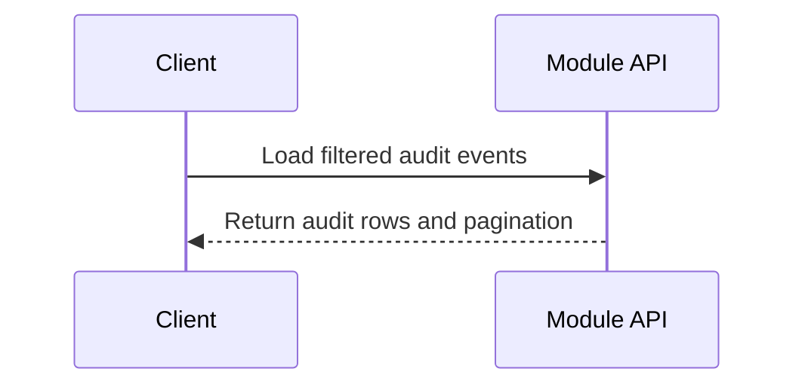

# Audit events

Administrators inspect operational history, filter by responsible user and export results. Supporting documents are retrieved from the event detail.

## Rules and dependencies

The audit log uses the audit API and stored document metadata. List, export and document operations are read-only.

## HTTP contract

- `GET /audit-events`
- `GET /audit-events/responsibles`
- `GET /audit-events/export`
- `GET /audit-events/:id/document`

## Main flow

## Sprint History

### Sprint 3

Administrators inspect operational history, filter by responsible user and export results. Supporting documents are retrieved from the event detail.
