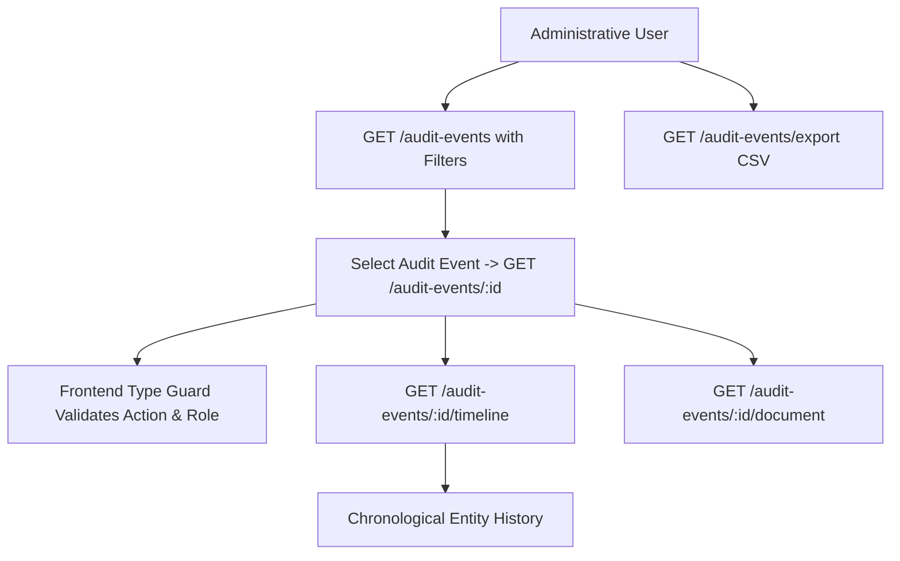

# Audit Events Module

## Overview

The **Audit Events Module** captures, filters, exports, inspects, and traces immutable administrative and identity actions across the platform. It equips backoffice administrators with paginated audit logs, CSV exports, per-event detail inspection, correlated entity timelines, and authenticated access to supporting verification evidence (read-only operations).

## API Endpoints

| Method | Route                         | Role           | Description                                                             |
| ------ | ----------------------------- | -------------- | ----------------------------------------------------------------------- |
| `GET`  | `/audit-events`               | Administrative | Paginated audit event list with date, action, module, and actor filters |
| `GET`  | `/audit-events/responsibles`  | Administrative | List of responsible administrative actors for filter controls           |
| `GET`  | `/audit-events/export`        | Administrative | Exports filtered audit records as CSV                                   |
| `GET`  | `/audit-events/:id`           | Administrative | Returns full metadata, actor, summary, and linked entity for an event   |
| `GET`  | `/audit-events/:id/timeline`  | Administrative | Returns chronological audit trail for the target entity of `:id`        |
| `GET`  | `/audit-events/:id/document`  | Administrative | Streams the supporting document or evidence attached to the audited item|

All endpoints carry full OpenAPI/Swagger documentation (unique `operationId`, parameter/query schemas, response contracts, and standard `400` / `401` / `403` / `404` / `410` error documentation).

## Audit Inspection Flow

## Frontend Structure (`frontend/src/modules/audit-events`)
- **Strict Response Validation**: `isAuditEventDetail` validates payload types as well as known `action` (`AUDIT_ACTION_STYLES`) and actor `role` (`AUDIT_ROLE_LABELS`) values before rendering inspection panels.
- **Views & Components**: Paginated audit table, responsible selector, detail drawer/modal, entity timeline viewer, and authenticated document preview.

## Sprint History

### Sprint 3
- Added complete OpenAPI/Swagger documentation across all six audit-events routes (`auditEvents_list`, `auditEvents_listResponsibles`, `auditEvents_exportCsv`, `auditEvents_getDetail`, `auditEvents_getTimeline`, and `auditEvents_getDocument`) with filter queries, response schemas, and `400`/`401`/`403`/`404`/`410` contracts.
- Hardened frontend `isAuditEventDetail` runtime validation to enforce canonical action and actor role contracts.
