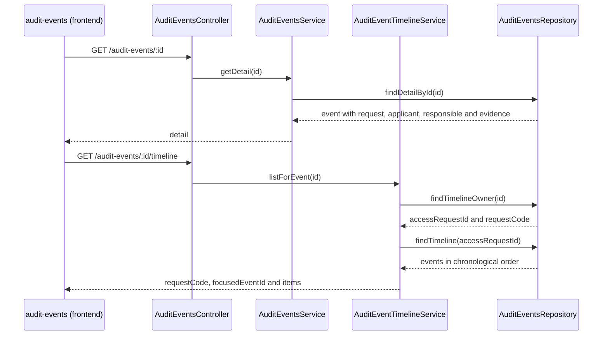
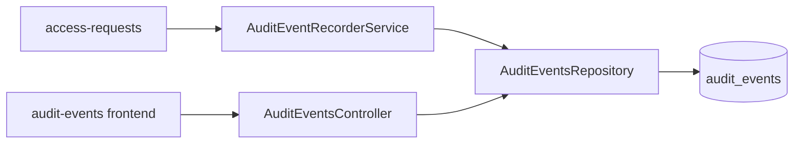

# Audit Events

## Purpose

The `audit-events` module keeps the read-only trail of everything that happens to a graduate access request: who submitted it, who opened it for review, who approved or rejected it, which document was examined and which automatic decisions were taken. Administrative staff consult that trail from the backoffice, open any event to see its full detail and follow the complete history of the request the event belongs to.

The module never creates events from HTTP. Events are written by the domains that own each action through `AuditEventRecorderService`, and this module only exposes them for reading and exporting.

## Key flows

### Reading the log

The log is a paginated table with filters by period, action, responsible and free text over the request code or the applicant name. Every row keeps the action, the Bolivia local time, the request, the responsible and the reviewed document.

### Opening the detail of an event

Clicking the request code of a row opens a side panel over the list. The panel is read-only: it identifies the event with its own code, shows the action, the date and time, the request, the applicant, the responsible, the document type and the evidence, and it offers no control to edit or delete anything. The rejection reason is shown only when the action is a rejection. Closing the panel keeps the filters, the search and the page the table was on, because the opened event lives in a state separate from the list.

### Following the history of the request

Inside the panel, the timeline lists every event of the same request from the oldest to the most recent and highlights the event being viewed, by weight and colour at the same time so the mark survives a black and white print.

### Opening the evidence

The evidence is requested by the identifier of the event, never by the current document of the request, so an old event always shows the file that was reviewed at that moment. The viewer opens over the panel without closing it; when the event has no file the panel states `Sin documento`, and when the file is gone the request answers `410`.

### Exporting

`GET /audit-events/export` streams the filtered log as CSV with the same filters the table is using.

## Business rules

- The log is read-only. The controller exposes `GET` routes only, and the panel offers no editing or deletion.
- Every route requires an authenticated session and the `administrativo` role, applied at controller level.
- Dates are stored in UTC and presented in Bolivia time.
- The timeline belongs to the request, not to the event: it resolves the request behind the event and returns every event of that request.
- An event whose identifier does not exist answers `404`; an identifier that is not a UUID answers a validation error.

## Endpoints

| Method | Route | Purpose |
| --- | --- | --- |
| `GET` | `/audit-events` | Paginated log with its filters |
| `GET` | `/audit-events/responsibles` | Responsibles available in the filter |
| `GET` | `/audit-events/export` | CSV of the filtered log |
| `GET` | `/audit-events/:id` | Detail of one event |
| `GET` | `/audit-events/:id/timeline` | History of the request the event belongs to |
| `GET` | `/audit-events/:id/document` | Evidence reviewed in that event |

## Read services for other domains

`AuditEventRecorderService` (exported by `AuditEventsModule`) is how the other domains write their own events, inside the same transaction that performs the action, so an action and its trail cannot drift apart.

`AuditEventTimelineService.listForRequest(accessRequestId)` is consumed by [access-requests](../access-requests/README.md) to show the history of a request outside the audit log.

## Frontend integration

The frontend lives in `frontend/src/modules/audit-events`. The list, the filters and the pagination keep their own state; the opened event is held apart from it, which is what lets the table survive the panel being closed. Every response is validated before it is used: the detail passes through a guard that checks the whole contract, including that the action and the responsible role belong to the agreed values, so a changed backend contract surfaces as a handled error instead of a broken screen.

## Dependencies

| Direction | Module | Usage |
| --- | --- | --- |
| Uses | [files](../files/README.md) | Evidence reviewed in each event |
| Used by | [access-requests](../access-requests/README.md) | Writes its events and reads the history of a request |

## Data

Tables `audit_events` and `audit_actions` (see [backend/prisma/README.md](../../backend/prisma/README.md)).

## Sprint History

### Sprint 3

- Detail of an audit event: `GET /audit-events/:id` and the read-only side panel over the log.
- History of the request: `GET /audit-events/:id/timeline` and the timeline inside the panel, highlighting the event being viewed.
- The evidence of an event opens without closing the panel, and closing the panel keeps the filters, the search and the page.
