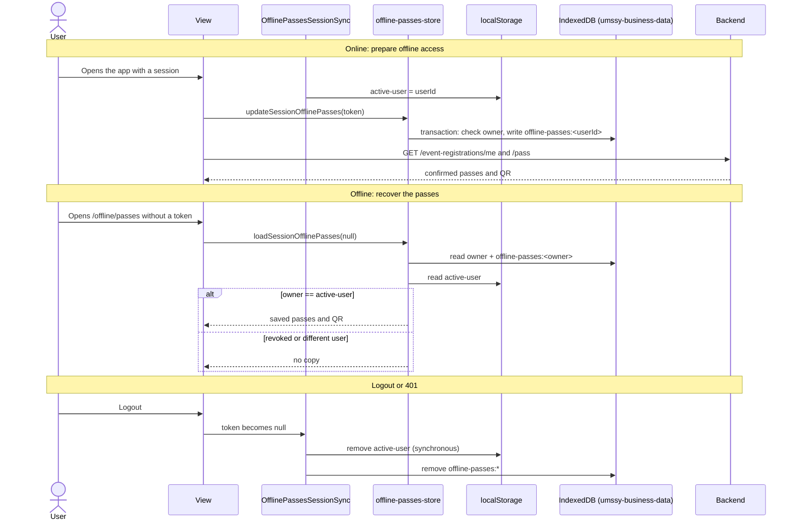

# Auth

## Purpose

The `auth` module starts and ends the user's session in the frontend (`frontend/src/modules/auth`) and keeps the access token shared by every module (`frontend/src/shared/services/storage/access-token-storage.ts`). This document describes how the session keeps working without a connection.

## Offline session

The offline session lets a user who prepared offline access read the data they downloaded, such as the session, workshops, categories and passes, when the browser has no connection. Every copy belongs to a user (`userId`, the `sub` of the access token), never to the token itself, so it works whether the token is persisted (current auth) or kept only in memory (cookie-based auth).

### Where it is stored

Copies live in the IndexedDB database `umssy-business-data`, store `drafts`. The active offline user and the pending pass removals live in `localStorage`.

| Key | Content | Written by |
| --- | --- | --- |
| `umssy:session-draft:offline:<key>` | `{ userId, data }` with the last online response. `<key>` is `auth-session`, `event-categories`, `events:<filters>` or `event:<id>` | `withOfflineSessionCopy` |
| `offline-passes:owner` | `userId` that owns the pass copy on this device | `claimOfflinePasses` |
| `offline-passes:<userId>` | `{ userId, savedAt, passes }` with the QR of the user's confirmed passes | `saveOfflinePass`, `prepareOfflinePasses` |
| `offline-passes:active-user` (`localStorage`) | `userId` of the session that may read the passes without a token | `activateOfflineUser` |
| `offline-passes:pending-removals:<userId>` (`localStorage`) | Ids of cancelled passes whose local copy could not be removed | `removeOfflinePassOrDefer` |

The `umssy_session=1` cookie only marks that a session exists. No copy stores a token.

### How the copy is saved

- While online, `withOfflineSessionCopy` calls the API and stores `{ userId, data }` only if the in-memory token is still the token that made the request, so a late response from another session is never stored.
- Pass copies are written through `updateSessionOfflinePasses`, which marks the user as the active offline session, claims the copy for that user and writes it in the same IndexedDB transaction that checks the owner.
- From the offline preparation (`prepareOfflineAccess`), the session (`GET /auth/session`), workshops, passes and the app shell are downloaded together with `requireStorage`. If any copy cannot be stored, or the session changes meanwhile, the preparation fails and can be retried. It is cancelled after 60 seconds.

### How the copy is recovered

- When `navigator.onLine` is `false`, `withOfflineSessionCopy` returns the data only if the in-memory token is the token of the request and its `userId` matches the copy. Otherwise it throws `Conéctate para descargar estos datos.`
- `loadSessionOfflinePasses` reads the passes:
  - with a token, the copy must belong to that token's user;
  - without a token (the PWA reopened with cookie-based auth), the owner must also be the active offline user;
  - it keeps only valid passes and hides the pending removals.
- Copies saved before this change are kept: a session copy in the `{ token, data }` format is accepted when its token is the current in-memory token and is rewritten as `{ userId, data }`; a pass copy without `offline-passes:owner` is adopted by the user of the current session.

### How the copy is invalidated

`OfflinePassesSessionSync`, mounted in `providers.tsx`, listens to the access token. The active offline user is revoked synchronously when the token becomes `null`, so the passes stop being readable before the IndexedDB cleanup finishes, even if that cleanup fails.

| Event | Effect |
| --- | --- |
| Logout or `401` (token changes from a value to `null`) | Revokes the active offline user at once, then `clearOfflinePasses` removes the owner, the pass copies and the pending removals. `endSession` also removes every `umssy:session-draft:` copy |
| Login of the same user | Keeps the copy and marks the user as active |
| Login of another user | Marks the new user as active and `claimOfflinePasses` removes the previous user's passes |
| The PWA reopens without a token | Nothing changes: there is no transition from a token, so the copy stays readable for the active user |
| Another tab changes the session | The `umssy-session` `BroadcastChannel` makes every tab discard its in-memory token; the listener applies the same rules |
| Cancelled pass | The pass is removed from the local copy. If IndexedDB fails, it stays pending, is hidden, and is removed on the next read without repeating the `DELETE` |

### Sequence diagram

## Sprint History

### Sprint 3

- Offline session:
  - The session, workshops, categories and passes are kept in IndexedDB as copies tied to the user, not to the token, so they work with persisted and in-memory tokens.
  - The active offline user is revoked synchronously on logout or `401`, and the passes are removed afterwards. Another user's login removes the previous passes.
  - Copies saved in the previous format are migrated instead of discarded.
  - A cancelled pass whose local copy cannot be removed is hidden and its cleanup is retried later.
