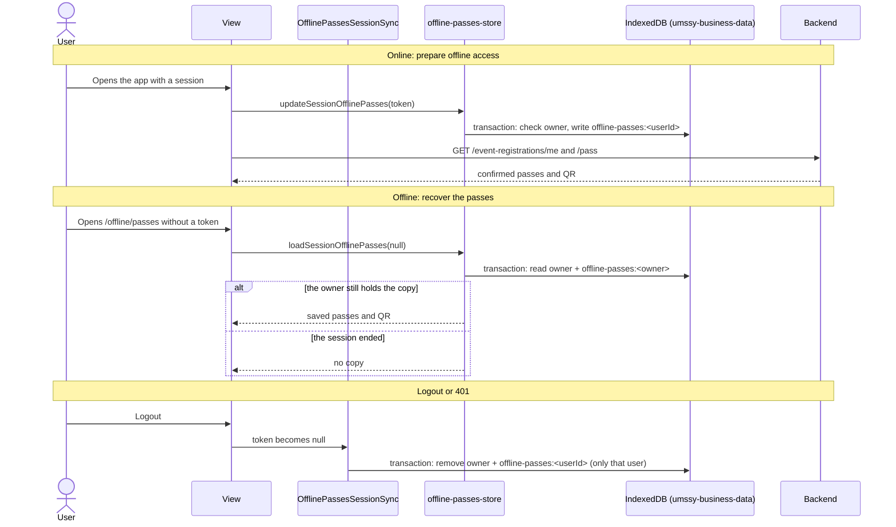
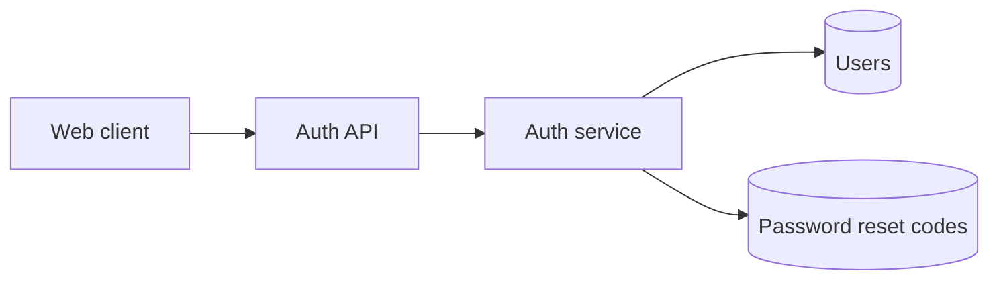

# Auth

## Purpose

The `auth` module starts and ends the user's session in the frontend (`frontend/src/modules/auth`) and keeps the access token shared by every module (`frontend/src/shared/services/storage/access-token-storage.ts`). This document describes how the session keeps working without a connection.

## Offline session

The offline session lets a user who prepared offline access read the data they downloaded when the browser has no connection. Every copy belongs to a user (`userId`, the `sub` of the access token), never to the token itself:

- the session, workshops and categories can be read offline only while a valid token is in memory, so they are not available after the PWA reopens without one;
- the passes have their own read through the owner persisted in IndexedDB, so they can be opened after reopening the PWA without a token.

### Where it is stored

Copies live in the IndexedDB database `umssy-business-data`, store `drafts`. The pending pass removals live in `localStorage`.

| Key | Content | Written by |
| --- | --- | --- |
| `umssy:session-draft:offline:<key>` | `{ userId, data }` with the last online response. `<key>` is `auth-session`, `event-categories`, `events:<filters>` or `event:<id>` | `withOfflineSessionCopy` |
| `offline-passes:owner` | `userId` of the offline session that owns the pass copy on this device | `claimOfflinePasses` |
| `offline-passes:<userId>` | `{ userId, savedAt, passes }` with the QR of the user's confirmed passes | `saveOfflinePass`, `prepareOfflinePasses` |
| `offline-passes:pending-removals:<userId>` (`localStorage`) | Ids of cancelled passes whose local copy could not be removed | `removeOfflinePassOrDefer` |

The `umssy_session=1` cookie only marks that a session exists. No copy stores a token.

### How the copy is saved

- While online, `withOfflineSessionCopy` calls the API and stores `{ userId, data }` only if the in-memory token is still the token that made the request, so a late response from another session is never stored.
- Pass copies are written through `updateSessionOfflinePasses`, which claims the copy for the user of the in-memory token and writes it in the same IndexedDB transaction that checks the owner.
- From the offline preparation (`prepareOfflineAccess`), the session (`GET /auth/session`), workshops, passes and the app shell are downloaded together with `requireStorage`. If any copy cannot be stored, or the session changes meanwhile, the preparation fails and can be retried. It is cancelled after 60 seconds.

### How the copy is recovered

- When `navigator.onLine` is `false`, `withOfflineSessionCopy` returns the data only if the in-memory token is the token of the request and its `userId` matches the copy. Otherwise it throws `Conéctate para descargar estos datos.`
- `loadSessionOfflinePasses` reads the passes:
  - with a token, the copy must belong to that token's user;
  - without a token (the PWA reopened with cookie-based auth), it reads the owner and its copy in one IndexedDB transaction, so a read never returns a copy whose session already ended;
  - it keeps only valid passes and hides the pending removals.
- Copies saved before this change are kept: a session copy in the `{ token, data }` format is accepted when its token is the current in-memory token and is rewritten as `{ userId, data }`; a pass copy without `offline-passes:owner` is adopted by the user of the current session.

### How the copy is invalidated

`OfflinePassesSessionSync`, mounted in `providers.tsx`, listens to the access token. `offline-passes:owner` is the persisted offline session: ending it and removing that user's copy happen in one IndexedDB transaction, and only for the user whose session ended.

The passes stop being shown only once that transaction commits. If it fails (for example, IndexedDB is blocked, full or unavailable), it is rolled back as a whole: neither the owner nor the copy is removed, the error is not retried, and the saved passes stay readable offline on that device. They are removed by the next session change that completes: another user's login replaces them, and a later logout that commits removes them.

| Event | Effect |
| --- | --- |
| Logout or `401` (token changes from a value to `null`) | `endOfflinePassesSession` removes the owner and that user's pass copy in one transaction, only if that user still owns the device, and then its pending removals. A copy saved by another account meanwhile is kept. If the transaction fails, nothing is removed and the passes stay readable offline until the next session change that completes. `endSession` also removes every `umssy:session-draft:` copy |
| Login of the same user | Keeps the copy |
| Login of another user | `claimOfflinePasses` sets the new owner and removes the previous user's passes in one transaction |
| The PWA reopens without a token | Nothing changes: there is no transition from a token, so the passes stay readable for the owner |
| Another tab changes the session | The `umssy-session` `BroadcastChannel` makes every tab discard its in-memory token; the listener applies the same rules |
| Cancelled pass | The pass is removed from the local copy. If IndexedDB fails, it stays pending, is hidden, and is removed on the next read without repeating the `DELETE` |

### Sequence diagram

## Online sign-in and recovery

The login form sends credentials to `POST /auth/login`, and the authenticated client checks its session with `GET /auth/session`. The recovery flow requests a code, verifies the code and resets the password through `POST /auth/forgot-password/request`, `POST /auth/forgot-password/verify` and `POST /auth/forgot-password/reset`. Login and password recovery use institutional primary buttons. Signing out uses a standard confirmation.

## Architecture and data

See the [Prisma schema](../../backend/prisma/schema.prisma) for the model definitions and the [database README](../../backend/prisma/README.md) for database relationships.

## Sprint History

### Sprint 3

- Offline session:
  - The session, workshops, categories and passes are kept in IndexedDB as copies tied to the user, not to the token. The passes can be opened after reopening the PWA without a token; the other copies need a valid token in memory.
  - Logout or `401` ends the offline session and removes only that user's passes in one transaction. Another user's login removes the previous passes.
  - Copies saved in the previous format are migrated instead of discarded.
  - A cancelled pass whose local copy cannot be removed is hidden and its cleanup is retried later.
