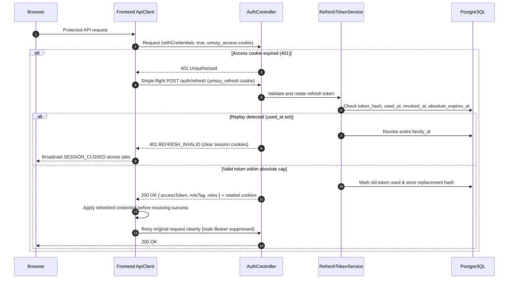

# Auth Module

## Overview

The **Auth Module** provides authentication, cookie-first session management, Google OAuth verification/linking, refresh token rotation with replay detection, password recovery via OTP, password history enforcement, and cross-tab session inactivity protection across backend (`NestJS`) and frontend (`Next.js`).

Browser clients authenticate through **HttpOnly cookies** (`umssy_access`, `umssy_refresh`) paired with a lightweight session presence indicator (`umssy_has_session`), while API clients can also send standard `Authorization: Bearer <jwt>` headers. Sign-in and password recovery use institutional primary buttons with the shared button shape, and signing out uses a standard neutral confirmation.

## API Endpoints

| Method | Route                          | Auth             | Description                                                                        |
| ------ | ------------------------------ | ---------------- | ---------------------------------------------------------------------------------- |
| `GET`  | `/auth/session`                | JWT / Cookie     | Returns active session identity, roles, optional company info, and idle/abs limits |
| `POST` | `/auth/login`                  | Public           | Authenticates credentials, issues session cookies (`umssy_access`, `umssy_refresh`) |
| `POST` | `/auth/google/login`           | Public           | Verifies Google ID token and establishes an authenticated cookie session           |
| `POST` | `/auth/google/link/confirm`    | Public           | Validates the 5-minute `linkToken` from Google login, links the account and opens the session |
| `POST` | `/auth/google/link`            | JWT / Cookie     | Links a Google account to the authenticated user                                   |
| `POST` | `/auth/refresh`                | Cookie / Body    | Rotates refresh token family, rejects reused tokens, sets rotated cookies & returns session credentials |
| `POST` | `/auth/logout`                 | Public / Session | Revokes active refresh token family and clears session cookies                     |
| `POST` | `/auth/forgot-password/request`| Public           | Dispatches password recovery OTP with credential rate-limit enforcement             |
| `POST` | `/auth/forgot-password/verify` | Public           | Verifies recovery OTP code and attempt limits                                      |
| `POST` | `/auth/forgot-password/reset`  | Public           | Resets password, checks recent password history, and revokes active refresh chains |

Account activation (`POST /account-activation`) also sets `umssy_access` and `umssy_refresh` via `AuthSessionCookieService`.

## Session Lifecycle & Refresh Rotation

## Per-Request Session Revocation

Every access token issued by login, Google login, account activation and refresh rotation carries a `sid` claim: the id of its refresh-token family (`refresh_tokens.family_id`). `JwtAuthGuard` and the chat and notification socket handshakes call `SessionService.assertSessionActive(sid)` on every request, which runs one indexed query (`family_id = $1 AND revoked_at IS NOT NULL`) and answers `401` with `SESSION_REVOKED` (or `PASSWORD_CHANGED` when the family was revoked by a password reset). The frontend already turns both codes into the "Tu sesión se cerró" screen.

- A family is revoked by logout, refresh-token reuse, inactive user, removed role and password reset (which revokes every family of the user; recovery is unauthenticated, so no session survives it).
- With a `sid`, an inactive user also answers `401 SESSION_REVOKED`; tokens without `sid` keep the previous `403 USER_INACTIVE`.
- **Transitional:** access tokens issued before this change have no `sid` and are accepted until they expire (at most `JWT_EXPIRES_IN`, 8 hours by default), so nobody is signed out on deploy. A `TODO` in `JwtAuthGuard` marks where to require it.
- `Authorization: Bearer` keeps priority over the cookie. Revocation is shared between browser tabs of the same browser through the cookie and the existing `BroadcastChannel`; other devices find out on their next request.

## Google Link Confirmation

`POST /auth/google/login` no longer links an account on its own.

| Account state | Response |
| --- | --- |
| Already linked (`user_social_accounts`) | Session cookies, as before |
| Active user with an allowed role (`estudiante`, `titulado`, `mentor`) found by email, not linked | `200` without cookies: `{ requiresLinking: true, linkToken, email, emailVerified: true }`; nothing is linked |
| No user, and a submitted access request that is not approved | `401` "Tu solicitud aún no fue aprobada" |
| No user and no request | `401` "No se encontró una cuenta UMSSY asociada a este correo de Google" |

`linkToken` is a JWT signed with the same secret, with `purpose: 'google-link'`, `userId`, `googleSub`, `email` and a 5-minute expiry. It has no `sub` or `roleTag`, so `JwtAuthGuard` never accepts it as a session, and `GoogleLinkTokenService.verify` rejects any token whose `purpose` differs (an access token cannot be used to confirm a link). `POST /auth/google/link/confirm { linkToken, roleTag? }` verifies it (`401 GOOGLE_LINK_TOKEN_EXPIRED` or `GOOGLE_LINK_TOKEN_INVALID`, "Vuelve a iniciar con Google"), re-checks the user, the allowed roles and that the Google subject is not linked to someone else (`409 GOOGLE_ACCOUNT_ALREADY_LINKED`), links it and starts the session with the `sid` claim and cookies. Cancelling is client-side only. `requiresLinking` is not a failed attempt for the login limiter; failed Google logins still count.

The frontend keeps the `linkToken` only in component memory (never in `localStorage` or `sessionStorage`) and shows "Vincula tu cuenta de Google" in both the login view and the OAuth callback view.

## Architecture Notes

### Backend (`backend/src/modules/auth`)
- **Cookie & Bearer Extraction**: REST guards and shared WebSocket gateways (`chat`, `notifications`) extract credentials from `Authorization: Bearer` headers or the `umssy_access` cookie using shared `extractSocketAccessToken` and `SOCKET_CORS_CONFIG`.
- **Single Source Session Timing**: `/auth/session` emits `idleTimeoutSeconds`, `warningSeconds`, and `absoluteExpiresAt` computed from the active refresh family.
- **Security Controls**: Credential attempt tracking enforces per-account temporary cooldowns on login and OTP recovery; `PasswordHistory` prevents reusing recent password hashes.

### Frontend (`frontend/src/modules/auth` & `frontend/src/shared`)
- **Cookie-First Hydration & Session State**: When client storage starts without an in-memory credential or local cookie marker, `SessionGate` invokes `AuthProvider.hydrateSession()` (`GET /auth/session`) before redirecting to `/login`, ensuring browser reloads preserve active `HttpOnly` cookie sessions. `AuthProvider` passes server-computed inactivity limits directly as props to `SessionInactivityGuard`.
- **Unified Single-Flight Refresh**: Auto-refresh, interactive "Seguir conectado" renewal (`useSessionInactivity`), and `apiClient` 401 recovery converge on one shared single-flight refresh operation (`executeSharedRefresh` / `authService.refreshSession`) that applies the refreshed credential before reporting success. If renewal fails, `useSessionInactivity` keeps the warning modal open so the user can retry or close the session.
- **Responsive Warning Dialog**: `SessionTimeoutModal` constrains height via `max-h-editor-dialog overflow-y-auto` so warning text and action buttons remain reachable on low-height mobile landscape screens.
- **UI & Logout Standards**: Login and password recovery use institutional primary buttons (`bg-primary`, without legacy `.institutional-button`), and signing out uses neutral action styling.
- **Browser Storage Discipline**: Non-sensitive session user identity for offline/idempotency isolation is persisted in IndexedDB (`umssy:session:current-user-id`), never `sessionStorage`; JWT secrets are never written to `localStorage` or `IndexedDB`.
- **Cross-Tab Synchronization**: `useSessionInactivity` synchronizes user activity across open tabs via throttled `BroadcastChannel` (`ACTIVITY` events) and `localStorage` (`umssy_last_activity_at` + `storage` listener), preventing premature timeout and dismissing warning modals when another tab is active. Session termination (`SESSION_CLOSED`) logs out all open tabs in lockstep.

See the [Prisma schema](../../backend/prisma/schema.prisma) for the model definitions and the [database README](../../backend/prisma/README.md) for database relationships.

## Sprint History

### Sprint 3
- Unified browser authentication around `HttpOnly` session cookies (`umssy_access`, `umssy_refresh`), WebSocket cookie authentication, single-flight refresh rotation retry in `apiClient`, and IndexedDB session identity isolation.
- Added `AuthProvider.hydrateSession()` probe in `SessionGate` for reload persistence, unified `/auth/refresh` credential application across API retries and `useSessionInactivity`, kept the inactivity warning modal open on refresh failure, and constrained `SessionTimeoutModal` height for landscape viewports.
- Added cross-tab inactivity synchronization via `BroadcastChannel` and `localStorage` (`umssy_last_activity_at`), removed duplicate `/auth/session` polling in `SessionInactivityGuard`, and normalized credential cooldown error handling.
