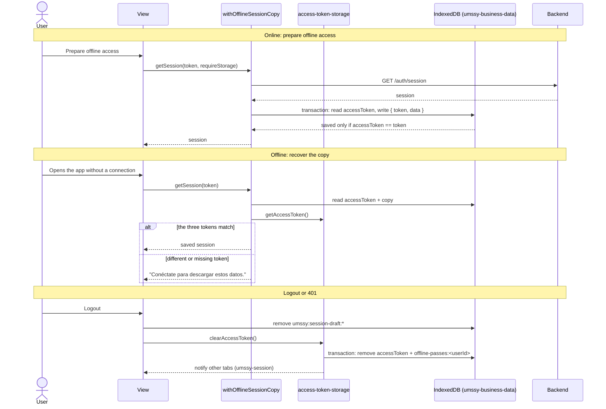

# Auth

## Purpose

The `auth` module starts and ends the user's session in the frontend (`frontend/src/modules/auth`) and keeps the access token shared by every module (`frontend/src/shared/services/storage/access-token-storage.ts`). This document describes how the session keeps working without a connection.

## Offline session

The offline session lets a user who prepared offline access keep their session and read the data they downloaded, such as workshops, categories and passes, when the browser has no connection. Every copy belongs to one token. If the token changes or is removed, the copy stops being usable.

### Where it is stored

Everything lives in the IndexedDB database `umssy-business-data`, store `drafts`, except the pending pass removals.

| Key | Content | Written by |
| --- | --- | --- |
| `accessToken` | Current access token | `saveAccessToken` |
| `umssy:session-draft:offline:<key>` | `{ token, data }` with the last online response. `<key>` is `auth-session`, `event-categories`, `events:<filters>` or `event:<id>` | `withOfflineSessionCopy` |
| `offline-passes:<userId>` | `{ userId, savedAt, passes }` with the QR of the user's confirmed passes | `saveOfflinePass`, `prepareOfflinePasses` |
| `offline-passes:pending-removals:<userId>` (`localStorage`) | Ids of cancelled passes whose local copy could not be removed | `removeOfflinePassOrDefer` |

The `umssy_session=1` cookie only marks that a session exists. It holds no token.

### How the copy is saved

- While online, `withOfflineSessionCopy` calls the API and stores `{ token, data }` in the same IndexedDB transaction that reads the persisted token. It writes only if that token and the in-memory token are both the token that made the request, so a late response from another session is never stored.
- From the offline preparation (`prepareOfflineAccess`), the session (`GET /auth/session`), workshops, passes and the app shell are downloaded together with `requireStorage`. If any copy cannot be stored, or the session changes meanwhile, the preparation fails and can be retried. It is cancelled after 60 seconds.

### How the copy is recovered

- When `navigator.onLine` is `false`, `withOfflineSessionCopy` reads the persisted token and the copy in one transaction.
- It returns the data only if these three tokens all equal the token of the request:
  - the persisted token;
  - the in-memory token;
  - the token saved with the copy.
- Otherwise it throws `Conéctate para descargar estos datos.`
- Offline passes are read with `loadSessionOfflinePasses`, which applies the same session check, keeps only valid passes, and hides the pending removals.

### How the copy is invalidated

| Event | Effect |
| --- | --- |
| Logout (`endSession`) | Removes every `umssy:session-draft:` copy, the token together with the user's passes in one transaction, and the session cookie |
| Login (`startSession`) | Removes the previous copies before saving the new token. If the new token belongs to another user, it also removes the previous user's passes |
| `401` response for the current token | `clearAccessToken` removes the token and the passes. The remaining copies can no longer be used because they do not match any token |
| Another tab changes the session | The `umssy-session` `BroadcastChannel` makes every tab discard its in-memory token and read it again from IndexedDB |
| Cancelled pass | The pass is removed from the local copy. If IndexedDB fails, it stays pending, is hidden, and is removed on the next read without repeating the `DELETE` |

### Sequence diagram

## Sprint History

### Sprint 3

- Offline session:
  - The session, workshops, categories and passes are kept as copies tied to the token in IndexedDB, and can be read without a connection only while that token is still valid.
  - Logout, a new login, a `401` and a session change in another tab invalidate those copies.
  - A cancelled pass whose local copy cannot be removed is hidden and its cleanup is retried later.
