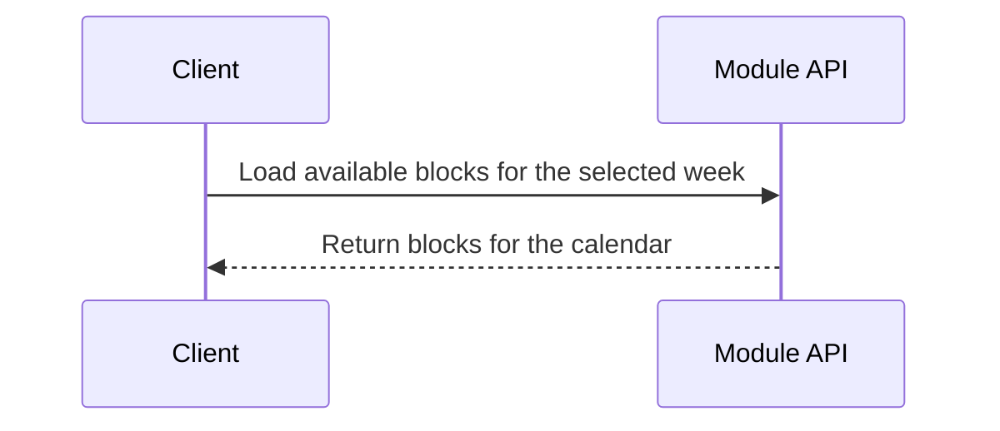

# Mentor availability

Mentors manage weekly time blocks and blocked dates. Appointment booking consumes free blocks from the selected mentor.

## Rules and dependencies

An availability block belongs to a mentor. An appointment references the block. The weekly calendar shows a day list when its container is narrow.

## HTTP contract

- `GET and POST /availability-blocks`
- `PATCH and DELETE /availability-blocks/:id`
- `GET and POST /blocked-dates`
- `DELETE /blocked-dates/:id`
- `GET /mentors/me/availability`
- `GET /mentors/:id/free-blocks`

## Main flow

## Sprint History

### Sprint 3

Mentors manage weekly time blocks and blocked dates. Appointment booking consumes free blocks from the selected mentor.
