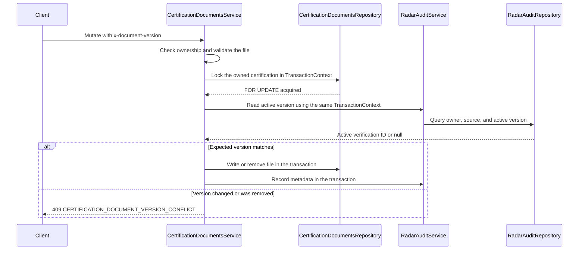

# Certification documents

## Purpose and boundaries

This module stores, downloads, replaces, and removes files attached to certifications. Its repository only accesses certification storage. Radar owns verification records and exposes the current active version through `RadarAuditService`; the consuming `CertificationDocumentsService` decides whether an expected version is still valid.

## Transactional replacement and removal

The lock remains held until the surrounding transaction completes. No file or metadata write and no NLP refresh occurs when version validation fails. Successful mutations refresh analysis after the transaction. Requests without an expected-version header retain their existing behavior. File downloads remain scoped to the authenticated owner.

## API and dependencies

| Method and path | Purpose |
| --- | --- |
| `PUT /certifications/:id/document` | Upload or replace a supporting file; optional `x-document-version` |
| `GET /certifications/:id/document` | Stream an owned file with its detected MIME type |
| `DELETE /certifications/:id/document` | Remove a supporting file; optional `x-document-version` |

The module depends on certification records, shared file validation, transactions, Radar metadata and version reads, and profile skill analysis. Verification processing and administrative decisions are described in [radar-integration](../radar-integration/README.md).

## Validation

Tests cover ownership, file validation, storage, audit failures, a lost or replaced version, lock ordering, and use of the same transaction for reads and writes.

## Sprint History

### Sprint 3

- Certification supporting files and metadata connected to document verification.
- Version validation delegated through the owning Radar service while preserving the certification lock and transaction context.
