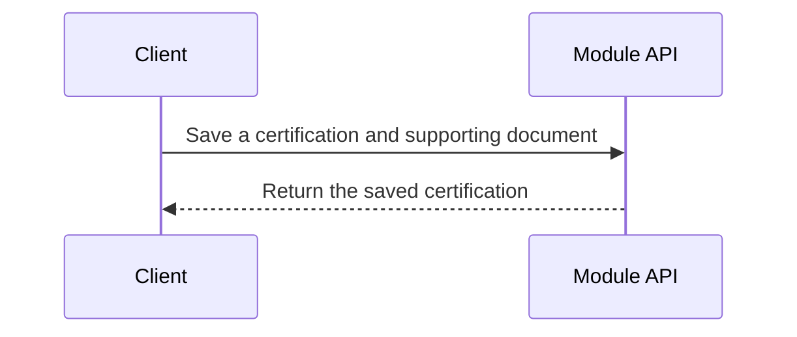

# Certifications

Profile owners create, update and remove certifications and can attach supporting documents.

## Rules and dependencies

Certification records belong to a user. Document-backed saves use the certifications and certification-documents modules.

## HTTP contract

- `GET and POST /certifications`
- `PATCH and DELETE /certifications/:id`
- `POST /certifications/with-document`
- `PATCH /certifications/:id/with-document`

## Main flow

## Sprint History

### Sprint 3

Profile owners create, update and remove certifications and can attach supporting documents.
