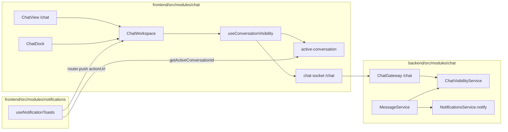
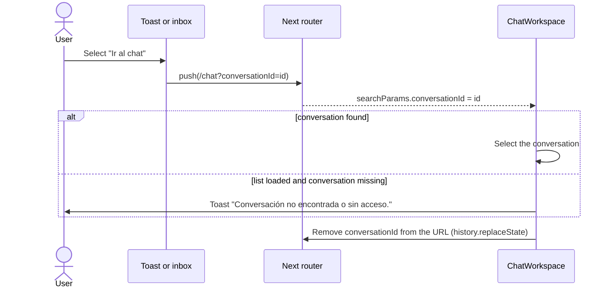
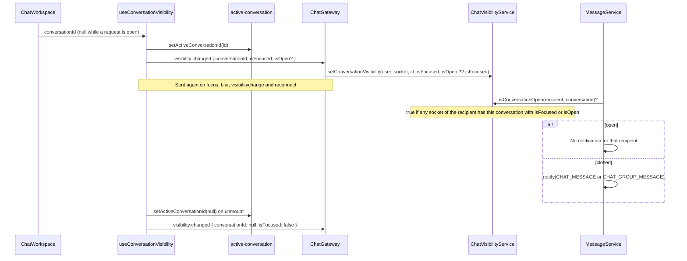

# Chat

## Purpose

The `chat` module lets students and graduates talk one to one after a validated connection, and lets event participants talk in the event room. The backend (`backend/src/modules/chat`) stores conversations, messages and attachments, controls who may write to whom, and delivers messages over WebSocket. The frontend (`frontend/src/modules/chat`) shows the conversation list, the chat room, connection requests and the floating chat dock.

This document focuses on how a conversation is opened from a link and how the app reports which conversation the user is looking at, which decides whether a new message also produces a notification.

## Architecture

## Key flows

### Opening a conversation from a link

The URL is the single input for selecting a conversation. A notification, a toast or the inbox navigates to `/chat?conversationId=<id>` or `/chat?tab=requests`; `ChatWorkspace` reads those values with `useSearchParams()`.

- `tab=requests` opens the first received connection request. If the requests have not loaded yet, the workspace waits for them before handling the parameter.
- After a parameter is handled it is removed from the URL. A later link to the same conversation therefore changes the URL again and is handled again.
- The `contactId`, `contextType` and `contextId` parameters open a contextual conversation (for example, from an application) and are handled separately.

### Reporting the visible conversation

`getActiveConversationId()` is exported from `@/modules/chat`. The notifications toast uses it to skip the toast of the conversation that is already open and visible.

## Business rules

- One-to-one conversations follow the chat role policy (students and graduates), with an accepted connection or a validated application context. A block between the participants prevents writing and notifying.
- A recipient is not notified about a new message when any of their sockets reports that conversation with `isFocused: true` **or** `isOpen: true`. `isOpen` is optional and defaults to the value of `isFocused`; `isFocused` defaults to `visible` and then to `true` when omitted. The web client sends only `isFocused`, so for it the conversation counts as open while it is focused.
- Chat notifications open `/chat?conversationId=<id>` and use the conversation id as `groupKey`, so push notifications of the same conversation replace each other on the device.
- Chat messages never go out by email, even if the notification catalog enables email for the type (see [notifications](../notifications/README.md)).

## Endpoints

### Exposed

| Method | Route                                                  | Description                                   |
| ------ | ------------------------------------------------------ | --------------------------------------------- |
| GET    | `/chat/conversations`                                  | Conversations of the current user             |
| POST   | `/chat/conversations`                                  | Starts or reuses a conversation               |
| GET    | `/chat/conversations/:conversationId/messages`         | Messages of a conversation                    |
| GET    | `/chat/conversations/:conversationId/messages/page`    | Paged messages                                |
| PATCH  | `/chat/conversations/:conversationId/read-state`       | Marks the conversation as read                |
| POST   | `/chat/messages`                                       | Sends a message                               |
| POST   | `/chat/attachments`                                    | Uploads an attachment                         |
| GET    | `/chat/attachments/:id` and `/chat/attachments/:id/file` | Attachment metadata and file                |
| POST   | `/chat/connection-requests`                            | Sends a connection request                    |
| GET    | `/chat/connection-requests/sent`, `/received`, `/accepted` | Connection requests by state              |
| PATCH  | `/chat/connection-requests/:id/accept` and `/reject`   | Answers a connection request                  |
| POST   | `/chat/blocks`                                         | Blocks a user                                 |
| DELETE | `/chat/blocks/:userId`                                 | Unblocks a user                               |
| GET    | `/chat/users/search`                                   | Searches contacts                             |
| GET    | `/chat/link-preview`                                   | Preview of a link in a message                |

### WebSocket (namespace `/chat`)

| Direction       | Event                | Payload                                    |
| --------------- | -------------------- | ------------------------------------------ |
| Client → server | `conversation:join`  | Conversation to join                       |
| Client → server | `message:send`       | New message                                |
| Client → server | `visibility:changed` | `{ conversationId: string \| null, isFocused?: boolean, isOpen?: boolean }`. `isOpen` defaults to `isFocused`; `isFocused` defaults to the legacy `visible` field and then to `true` |
| Client → server | `event_room:join`    | Event room to join                         |
| Server → client | `message:new`        | Message created in a joined conversation   |
| Server → client | `presence:online` and `presence:offline` | Presence of a user     |

## Dependencies

| Direction | Module                                        | Usage                                                         |
| --------- | --------------------------------------------- | ------------------------------------------------------------- |
| Uses      | [notifications](../notifications/README.md)   | `notify()` for `CHAT_MESSAGE` and `CHAT_GROUP_MESSAGE`        |
| Uses      | events                                        | Event room name for group notifications                       |
| Used by   | notifications (frontend)                      | `getActiveConversationId()` to skip the toast of the open chat |

## Action styling

Blocking is a moderation action with a confirmation dialog. Its controls use neutral styling and the dismissal action uses the shared Cancel treatment.

## Sprint History

### Sprint 3

- Conversation selection from links is driven by the navigation state (`useSearchParams`); the `app:navigate` event and the `popstate` listener were removed.
- The open conversation is exposed through the typed `getActiveConversationId()` contract instead of a global `window` property.
- Handled `conversationId` and `tab` parameters are removed from the URL, so repeated links to the same conversation work.
- `visibility:changed` reports the open conversation so the backend does not notify a recipient who is reading it.
