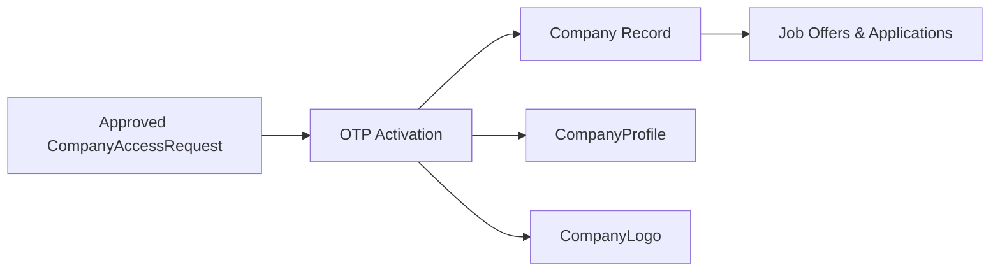

# Companies Module

## Overview

The **Companies Module** exposes company identity and asset resources used across onboarding, recruiter management, vacancy publishing, and local development fixtures. Company profiles (`CompanyProfile`), logos (`CompanyLogo`), and onboarding approvals are provisioned upon activation through the [Company Access Requests Module](../company-access-requests/README.md), while the company fixture seeder provides organization records for local development and seed scenarios.

## Related Flows

## Company profile endpoint

`GET /companies/:companyId/profile` returns the institutional profile of the company of the session: name, description, sector, city, phone, email, website and the logo path relative to the API (`/companies/:companyId/logo`, or `null` without a logo). It requires the `empresa` role and the company of the session (`CompanyOwnershipGuard`). Contact fields are `null` while the company has no `company_profiles` row, an empty website or description is returned as `null`, and a missing company answers `COMPANY_NOT_FOUND`. The [company profile](../company-profile/README.md) screen uses it.

## Key Data Structures
- **`companies`**: Core organization identity record referenced by profiles, logos, experiences, and job offers.
- **`company_profiles`**: Verified corporate contact details (`sector`, `email`, `phone`, `website_url`, `city_id`).
- **`company_logos`**: Persisted binary logo metadata (`file_name`, `mime_type`, `size_bytes`, `data`) served via `/companies/:companyId/logo`.

## Sprint History

### Sprint 3
- Added `CompanyProfile` and `CompanyLogo` provisioning during company onboarding activation, authenticated company logo retrieval endpoints, and local development company fixture seeders.
- Added the read-only company profile endpoint (`GET /companies/:companyId/profile`) for the recruiter company profile screen.
