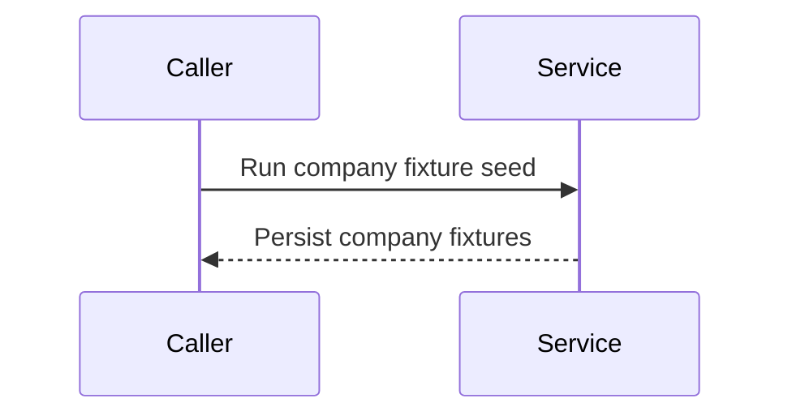

# Companies

The company fixture module provides organization records for local development and seed scenarios.

## Rules and dependencies

The fixture seeder uses Prisma Company records. It provides no standalone controller or frontend screen.

## Main flow

## Sprint History

### Sprint 3

The company fixture module provides organization records for local development and seed scenarios.
