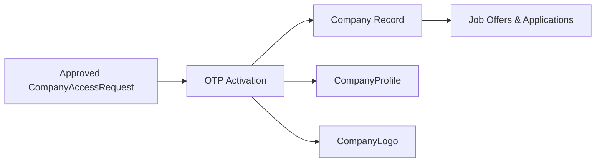

# Companies Module

## Overview

The **Companies Module** exposes company identity and asset resources used across onboarding, recruiter management, vacancy publishing, and local development fixtures. Company profiles (`CompanyProfile`), logos (`CompanyLogo`), and onboarding approvals are provisioned upon activation through the [Company Access Requests Module](../company-access-requests/README.md), while the company fixture seeder provides organization records for local development and seed scenarios.

## Related Flows

## Key Data Structures
- **`companies`**: Core organization identity record referenced by profiles, logos, experiences, and job offers.
- **`company_profiles`**: Verified corporate contact details (`sector`, `email`, `phone`, `website_url`, `city_id`).
- **`company_logos`**: Persisted binary logo metadata (`file_name`, `mime_type`, `size_bytes`, `data`) served via `/companies/:companyId/logo`.

## Sprint History

### Sprint 3
- Added `CompanyProfile` and `CompanyLogo` provisioning during company onboarding activation, authenticated company logo retrieval endpoints, and local development company fixture seeders.
