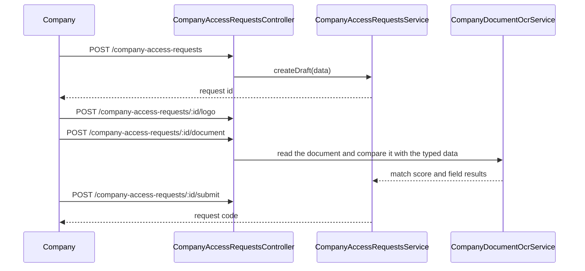
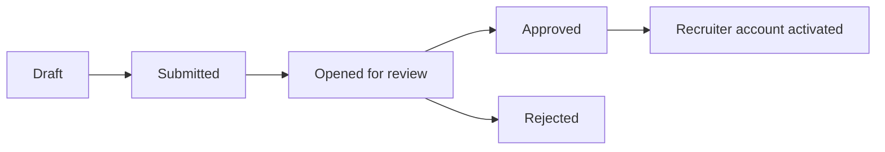

# Company Access Requests

## Purpose

The `company-access-requests` module handles the request a company makes to join UMSSY: the company fills in its data, attaches its logo and its legal document, submits the request, follows its state by code, and once the backoffice approves it, activates its recruiter account. Approving a request creates the company and the recruiter user linked to it.

## Key flows

### Registering and submitting

The request is built in two moments. First a draft is created with the company data, which returns the identifier used to attach the logo and the document. The document is read by OCR when it is attached, and the match between what was read and what was typed is stored with the request. Only once the files are in place is the request submitted, which assigns it a request code and leaves it waiting for review.

### Reviewing in the backoffice

Administrative staff list the requests, open one, read its document and its logo, and resolve it. Opening a request records who opened it and when; resolving it records who reviewed it, when, and the reason when it is a rejection. The OCR reading can be run again on demand when the first attempt was poor.

### Following the request and activating

The company follows its request by code without signing in. When the request is approved, the company receives an activation code, and activating creates the recruiter session. A company that finds wrong data in its own request can report the inconsistency instead of creating a second request.

## Business rules

- The request code is assigned when the request is submitted, not when the draft is created.
- The logo and the document belong to the request: each one is stored once and replacing it replaces the stored file.
- Reviewing requires an authenticated session with the backoffice role; registering, following by code and activating do not.
- An approved request keeps the company and the recruiter it created (`approved_company_id` and `approved_user_id`), each of them unique, so one request cannot create two companies.
- A rejection always carries its reason.
- The city and the status come from catalogs and are restricted on delete, so a status in use cannot disappear.

## Endpoints

| Method | Route | Who |
| --- | --- | --- |
| `GET` | `/cities` | Public, cities for the form |
| `POST` | `/company-access-requests` | Public, creates the draft |
| `POST` | `/company-access-requests/:id/logo` | Public, attaches the logo |
| `POST` | `/company-access-requests/:id/document` | Public, attaches the document and runs the OCR |
| `POST` | `/company-access-requests/:id/submit` | Public, submits the request |
| `GET` | `/company-access-requests/status/:code` | Public, state by code |
| `GET` | `/company-access-requests/activation-status` | Public, state of the activation |
| `POST` | `/company-access-requests/report-inconsistency` | Public, reports wrong data |
| `POST` | `/company-access-requests/activate` | Public, activates the recruiter account |
| `GET` | `/companies/:companyId/logo` | Public, logo of an approved company |
| `GET` | `/company-access-requests` | Backoffice, paginated list |
| `GET` | `/company-access-requests/summary` | Backoffice, counters |
| `GET` | `/company-access-requests/:id` | Backoffice, detail |
| `GET` | `/company-access-requests/:id/document` | Backoffice, attached document |
| `GET` | `/company-access-requests/:id/logo` | Backoffice, attached logo |
| `PATCH` | `/company-access-requests/:id` | Backoffice, opens or resolves the request |
| `POST` | `/company-access-requests/:id/re-evaluate-ocr` | Backoffice, reads the document again |

## Dependencies

| Direction | Module | Usage |
| --- | --- | --- |
| Uses | [files](../files/README.md) | Logo and legal document of the request |
| Uses | [mail](../mail/README.md) | Activation code and resolution notices |
| Uses | [companies](../companies/README.md) | Company created when the request is approved |

## Data

Tables `company_access_requests` and `company_activation_otps` (see [backend/prisma/README.md](../../backend/prisma/README.md)).

## Sprint History

### Sprint 3

- Company registration in two moments: draft with its data, then logo and document, then submission with its request code.
- OCR reading of the legal document when it is attached, with its match score kept on the request and the option to run it again from the backoffice.
- Review in the backoffice: opening, approval and rejection with reason, recording who did it and when.
- Following the request by code, reporting an inconsistency and activating the recruiter account.
