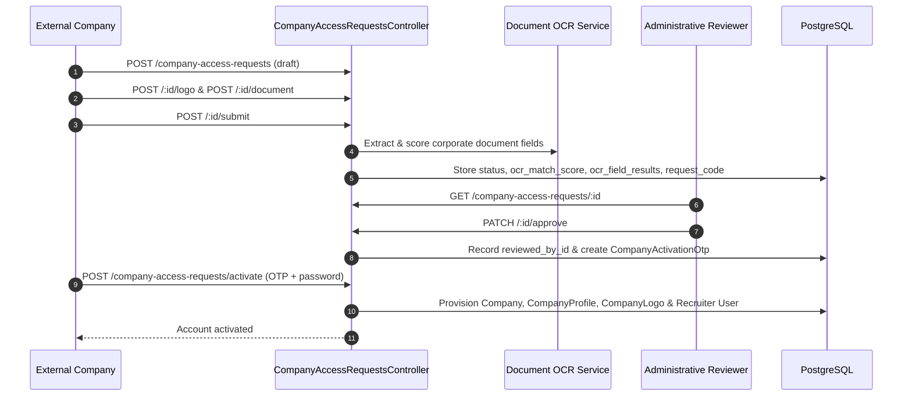

# Company Access Requests Module

## Overview

The **Company Access Requests Module** manages the end-to-end onboarding lifecycle for external companies: draft creation, catalog city lookup, corporate logo and verification document upload with automated OCR scoring, public tracking code status consultation, administrative backoffice review (edit, OCR re-evaluation, correction request, approval, rejection), and one-time OTP activation of the company profile and recruiter account.

## API Endpoints

| Method  | Route                                             | Access         | Description                                                            |
| ------- | ------------------------------------------------- | -------------- | ---------------------------------------------------------------------- |
| `GET`   | `/cities`                                         | Public         | Lists available cities for company registration                        |
| `POST`  | `/company-access-requests`                        | Public         | Creates or updates a draft company onboarding request                  |
| `POST`  | `/company-access-requests/:id/logo`               | Public         | Uploads the company logo file to a draft request                       |
| `POST`  | `/company-access-requests/:id/document`           | Public         | Uploads supporting legal/verification PDF or image document            |
| `POST`  | `/company-access-requests/:id/submit`             | Public         | Submits draft, triggers OCR evaluation, generates tracking code        |
| `GET`   | `/company-access-requests/status/:code`           | Public         | Checks request review status using its public tracking code            |
| `GET`   | `/company-access-requests/activation-status`      | Public         | Verifies whether an approved company request is eligible for activation|
| `POST`  | `/company-access-requests/report-inconsistency`   | Public         | Reports data inconsistency discovered during activation verification   |
| `POST`  | `/company-access-requests/activate`               | Public         | Validates activation OTP and creates the active company & recruiter    |
| `GET`   | `/companies/:companyId/logo`                      | Authenticated  | Streams active persisted `CompanyLogo` binary for an approved company  |
| `GET`   | `/company-access-requests`                        | Administrative | Paginated backoffice list of company access requests                   |
| `GET`   | `/company-access-requests/summary`                | Administrative | Status counts and review queue summary metrics                         |
| `GET`   | `/company-access-requests/:id`                    | Administrative | Full inspection payload including OCR results and reviewer timestamps  |
| `GET`   | `/company-access-requests/:id/document`           | Administrative | Streams uploaded legal verification document                           |
| `GET`   | `/company-access-requests/:id/logo`               | Administrative | Streams uploaded candidate logo prior to activation                    |
| `PATCH` | `/company-access-requests/:id`                    | Administrative | Edits company metadata during backoffice review                        |
| `POST`  | `/company-access-requests/:id/re-evaluate-ocr`    | Administrative | Re-runs automated OCR matching against the uploaded document           |
| `POST`  | `/company-access-requests/:id/request-correction` | Administrative | Sends correction instructions to the applicant                         |
| `PATCH` | `/company-access-requests/:id/approve`            | Administrative | Approves request and issues company activation OTP                     |
| `PATCH` | `/company-access-requests/:id/reject`             | Administrative | Rejects request with administrative reason                             |

## Onboarding & Activation Sequence

## Notifications & OpenAPI Contracts

- **Notification Pipeline**: Administrative resolution emails (`COMPANY_ACCESS_REQUEST_APPROVED`, `COMPANY_ACCESS_REQUEST_OBSERVED`, `COMPANY_ACCESS_REQUEST_REJECTED`) are validated via Zod schemas and rendered from MJML templates under `backend/src/modules/company-access-requests/notification/`, then dispatched exclusively through `NotificationsService.notify()`.
- **OpenAPI Specifications**: All 20 controller endpoints declare unique `operationId`s (`companyAccessRequests_*`), parameter/query/body schemas, security requirements for backoffice routes, and multipart upload limits (`2 MB` for logos; `10 MB` for supporting documents).

## Registration Validation Rules

The create (`POST /company-access-requests`) and update (`PATCH /company-access-requests/:id`) payloads share the same field rules, defined in `requests/create-company-access-request.schema.ts` and `constants/company-registration-rules.constants.ts`. Update accepts any subset of fields, but each field sent must satisfy the same rule.

| Field | Rule |
| --- | --- |
| `companyName` | 4 to 30 characters after trimming; letters, digits, spaces and `& . , - ' ( )`; whitespace-only values are rejected |
| `description` | 10 to 500 characters after trimming |
| `websiteUrl` | Required (empty or whitespace-only is rejected); must start with `http://` or `https://` and contain a domain |
| `phone` | Bolivian mobile number of exactly 8 digits (`^[67]\d{7}$`) |
| `username` | 4 to 20 characters, starts with a letter, only letters, digits and underscore |
| Logo (`POST /:id/logo`) | PNG or JPG only, up to 2 MB; the file signature must match (a PDF renamed to `.png` is rejected) |

## Sprint History

### Sprint 3
- Implemented full company onboarding request lifecycle (draft creation, logo and document upload, OCR verification, public tracking, administrative review, and OTP account activation).
- Migrated approval, correction, and rejection notifications to typed `NotificationsService.notify()` workflows with Zod payload validation and MJML templates, and added complete OpenAPI decorators across all 20 endpoints.
- Aligned `company_access_requests` schema mapping (`access_request_document_type_id`), `SetNull` foreign key rules, and indexes on `opened_by_id`, `reviewed_by_id`, and `access_request_document_type_id`.
- Replaced duplicated frontend file size formatting helper in the company onboarding flow with the shared `formatFileSize` utility.
