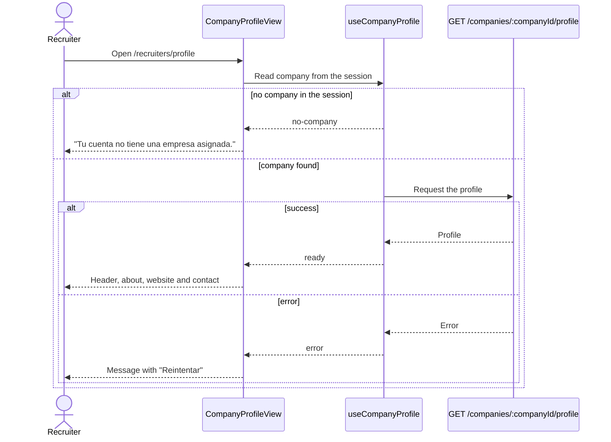

# Company profile

The company profile screen shows the institutional and contact information of the company linked to the recruiter session. It is read only.

## Rules and dependencies

- The screen lives at `/recruiters/profile` and is listed in the company workspace menu as **Perfil de empresa**. Only the `empresa` role can open it.
- The company comes from the session (`useAuth().company`). If the account has no company, the screen says so and does not call the API.
- Data is loaded with TanStack Query from `GET /companies/:companyId/profile` (backend module [companies](../companies/README.md)). The endpoint requires a session with the `empresa` role and only returns the company of that session.
- `logoUrl` comes relative to the API and the service turns it into a full URL. When the company has no logo, or the image fails to load, the header shows a building icon.
- Fields the company did not register come as `null` and are shown as "No registrado". An empty description shows "Sin descripción registrada.".
- The website link only accepts `http` and `https` addresses and opens in a new tab.

## Main flow

## Sprint History

### Sprint 3

- Read-only company profile connected to the backend: name, logo, sector, description, website, city, phone and institutional email, with loading, error and retry states.
