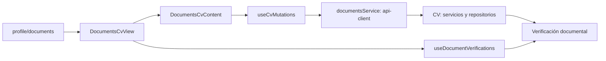
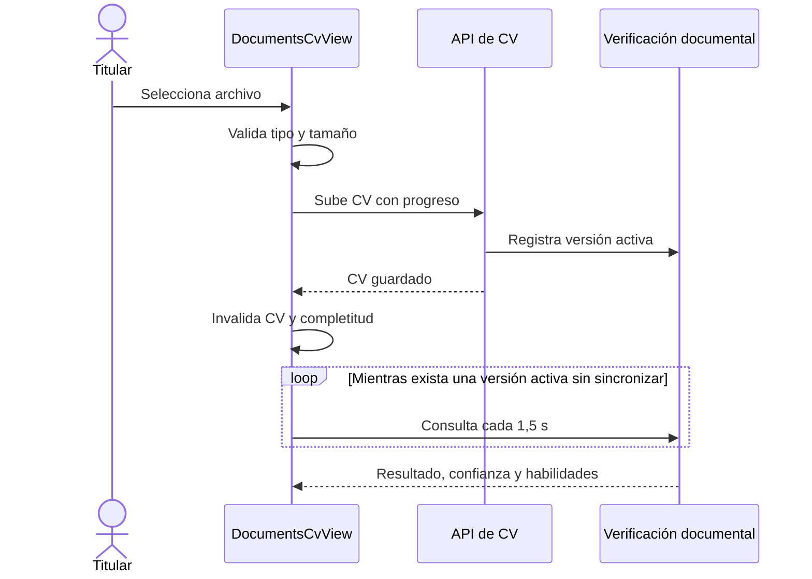

# CV y verificación documental

## Propósito y responsabilidades

El dominio `cv` permite subir, consultar, reemplazar, eliminar, extraer y generar el CV del titular. El backend conserva archivos y ofrece sus fuentes autorizadas. El frontend presenta el contenido y dashboard documental; análisis y decisiones pertenecen a [radar-integration](../radar-integration/README.md).

## Arquitectura y dependencias

El módulo usa TanStack Query y el cliente HTTP centralizado. Integra perfil, certificaciones y radar mediante sus `index.ts`. Las mutaciones actualizan CV y completitud; el dashboard refresca también verificaciones y radar. No abre IndexedDB directamente.

## Flujos y reglas

- El CV vigente procede del servicio propietario, no de una versión antigua aprobada.
- Subir/eliminar cancela consultas en curso para evitar reintroducir datos obsoletos.
- Eliminar requiere confirmación, retira la caché del archivo y actualiza completitud.
- La vista previa libera su URL temporal al cerrar o desmontar.
- La extracción permite revisar datos antes de aplicarlos al perfil; la exportación usa los datos seleccionados.
- El dashboard muestra versiones activas e historial, confianza, motivo y habilidades. No aprueba documentos desde el navegador.
- La consulta está ligada al titular: se actualiza cada 1,5 s durante procesamiento, cada 15 s en reposo y al reconectar.
- Reemplazar o eliminar puede cambiar NLP y radar; la simulación con mentoría no cambia datos persistidos.

## Endpoints

| Método y ruta | Uso |
| --- | --- |
| `GET /profile/me/cvs` | Historial paginado de CV |
| `POST /profile/me/cvs` | Subir CV del titular |
| `DELETE /profile/me/cvs/:id` | Eliminar CV propio |
| `GET /profile/me/cvs/:id/file` | Descargar archivo propio |
| `POST /profile/me/cvs/:id/extraction` | Extraer datos para revisión |
| `POST /profile/cv/generate` | Generar CV con datos seleccionados |
| `GET /profile/me/document-verifications` | Historial de verificaciones |
| `GET /profile/me/document-verifications/:id/file` | Respaldo de la versión propia |
| `PATCH /profile/me/document-verifications/:id/notification` | Reconocer lectura de resultado |

Las decisiones administrativas, permisos y errores figuran en [radar-integration](../radar-integration/README.md).

Los JSON usan `{ statusCode, data, detail, ok }`; los archivos son binarios. Los errores se muestran en español y las consultas fallidas permiten reintento.

## Validación

Las pruebas verifican mutaciones, cancelación y recarga, vista previa, extracción, exportación, historial y sincronización. TypeScript comprueba contratos y ESLint las reglas de nombres/UI. CI valida compilación y cobertura.

## Sprint History

### Sprint 3

- HU5: dashboard OCR/NLP, historial y conexión con radar.
- Vista previa y reconocimiento de resultados por versión.
- Mutaciones compartidas entre vista de CV y dashboard.
- Integración de `documents` a `cv` e importaciones públicas.
