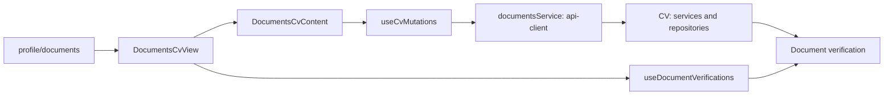
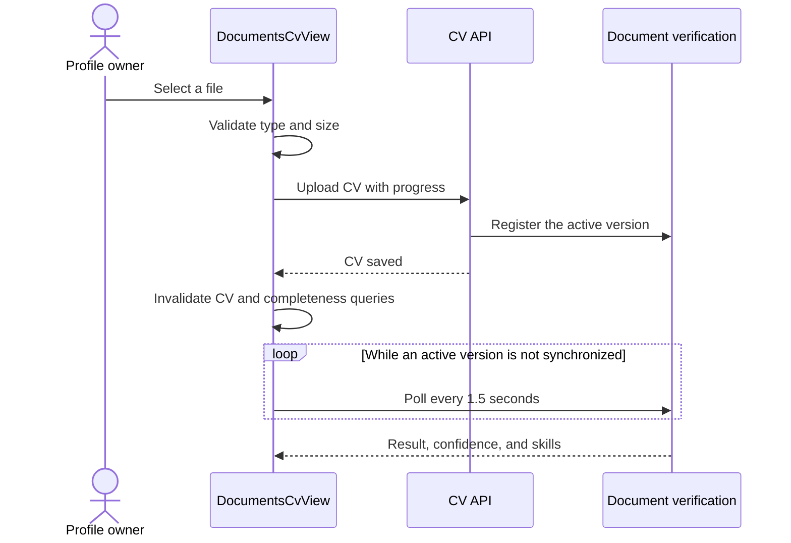
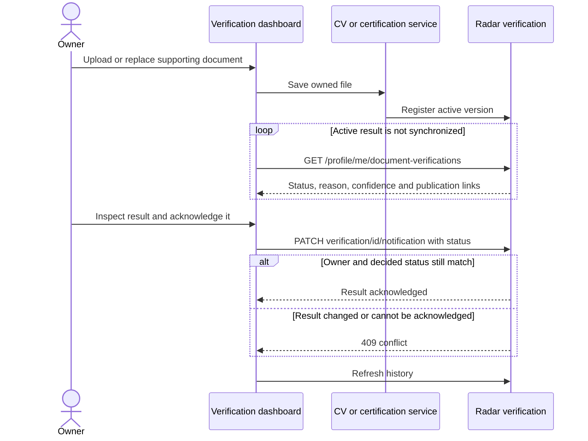

# CV and document verification

## Purpose and responsibilities

The `cv` domain supports uploading, viewing, replacing, deleting, extracting, and generating the owner's CV. The backend stores files and exposes their authorized sources. The frontend presents CV content and the document dashboard; analysis and decisions belong to [radar-integration](../radar-integration/README.md).

## Architecture and dependencies

The module uses TanStack Query and the centralized HTTP client. It integrates profile, certifications, and radar through their `index.ts` files. Mutations update CV data and profile completeness; the dashboard also refreshes verification history and radar data. It does not open IndexedDB directly.

## Flows and rules

- The current CV comes from its owning service, rather than an older approved version.
- Uploading or deleting cancels in-flight queries to prevent stale data from being reintroduced.
- Deletion requires confirmation, removes the cached file, and updates completeness.
- File previews release their temporary URLs when closed or unmounted.
- Extraction lets the user review data before applying it to the profile; export uses the selected data.
- The dashboard shows active versions and history, confidence, reasons, and skills. It does not approve documents in the browser.
- Queries are scoped to the owner: polling runs every 1.5 seconds during processing, every 15 seconds while idle, and on reconnection.
- Replacing or deleting a file may change NLP analysis and the radar; mentorship simulation does not change persisted data.

## Owner verification dashboard

The document dashboard at `/profile/documents` combines CV and certification verifications. The active list shows the file name, size, upload date and analysis progress. Selecting a version shows its result and analysis details; the history dialog also retains replaced versions. Backing-file previews are disabled when `available=false` and release temporary URLs when closed.

| Field                            | Meaning for the owner                                                                                                                                        |
| -------------------------------- | ------------------------------------------------------------------------------------------------------------------------------------------------------------ |
| `status`                         | Processing/review outcome; see the status and action table in [radar-integration](../radar-integration/README.md#verification-results-and-permitted-actions) |
| `confidence`, `reason`, `skills` | Reading confidence, verification explanation and detected catalog skills                                                                                     |
| `active`, `available`            | Whether this is a current source version and whether its backing content can be opened                                                                       |
| `synced`                         | Whether analysis/publication synchronization has completed for the current result                                                                            |
| `radarVersion`, `publishedIds`   | The publication and skills that actually incorporated this evidence; null/empty is possible                                                                  |
| `noticeRead`                     | Whether the owner acknowledged this verification result                                                                                                      |

An approved document and a published skill are separate stages. A decision can be saved while synchronization is still pending; the dashboard must not interpret detected skills alone as confirmation of publication. Results requiring review remain visible with their reasons, while the administrator resolves them in the Radar review panel.

### Upload, replacement and acknowledgement

1. The owner uploads a CV or attaches a backing file to a certification. The owning domain registers the verification version and queues processing.
2. `useDocumentVerifications` polls the authenticated owner's history every 1.5 seconds while any active result is unsynchronized, every 15 seconds otherwise, and on reconnection.
3. The owner can open analysis details and historical results. Replacing a document deactivates the old verification version; deleting or replacing a source can trigger a new analysis and publication.
4. An unread decided result is presented with an **Entendido** action. Acknowledgement sends the displayed version's ID and status, then refreshes history. If the status changed, a 409 requires refreshing the result rather than marking a different decision as read.

Reading this result is independent of reading a RADAR_PUBLISHED notice in the central inbox. The dashboard does not perform administrative approval. Supporting-file requests use the authenticated owner; missing or inaccessible backing content produces an unavailable state without exposing another user's file.

## Endpoints

| Method and path                                             | Purpose                              |
| ----------------------------------------------------------- | ------------------------------------ |
| `GET /profile/me/cvs`                                       | Paginated CV history                 |
| `POST /profile/me/cvs`                                      | Upload the owner's CV                |
| `DELETE /profile/me/cvs/:id`                                | Delete an owned CV                   |
| `GET /profile/me/cvs/:id/file`                              | Download an owned file               |
| `POST /profile/me/cvs/:id/extraction`                       | Extract data for review              |
| `POST /profile/cv/generate`                                 | Generate a CV from selected data     |
| `GET /profile/me/document-verifications`                    | Verification history                 |
| `GET /profile/me/document-verifications/:id/file`           | Supporting file for an owned version |
| `PATCH /profile/me/document-verifications/:id/notification` | Acknowledge a verification result    |

Administrative decisions, permissions, and errors are described in [radar-integration](../radar-integration/README.md).

JSON responses use `{ statusCode, data, detail, ok }`; files are binary responses. Errors appear in Spanish, and failed queries can be retried.

## Validation

Tests verify mutations, cancellation and refresh, previews, extraction, export, history, and synchronization. TypeScript checks contracts, while ESLint checks naming and UI rules. CI validates builds and coverage.

## Sprint History

### Sprint 3

- Document verification: OCR/NLP dashboard, active and replaced versions, analysis reasons and synchronization with published radar skills.
- File preview and acknowledgement of version-specific results.
- Shared mutations between the CV view and dashboard.
- Integration of the `documents` to `cv` rename and public module imports.
