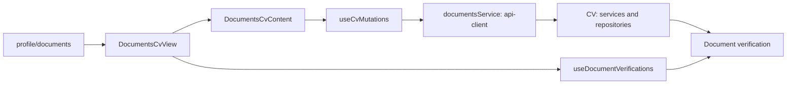
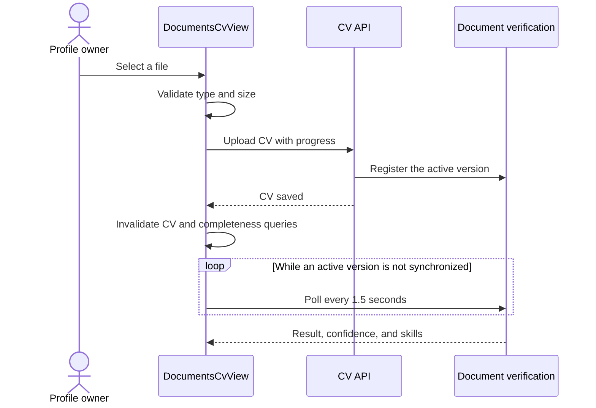

# CV and document verification

## Purpose and responsibilities

The `cv` domain supports uploading, viewing, replacing, deleting, extracting, and generating the owner's CV. The backend stores files and exposes their authorized sources. The frontend presents CV content and the document dashboard; analysis and decisions belong to [radar-integration](../radar-integration/README.md).

## Architecture and dependencies

The module uses TanStack Query and the centralized HTTP client. It integrates profile, certifications, and radar through their `index.ts` files. Mutations update CV data and profile completeness; the dashboard also refreshes verification history and radar data. It does not open IndexedDB directly.

## Flows and rules

- The current CV comes from its owning service, rather than an older approved version.
- Uploading or deleting cancels in-flight queries to prevent stale data from being reintroduced.
- Deletion requires confirmation, removes the cached file, and updates completeness.
- File previews release their temporary URLs when closed or unmounted.
- Extraction lets the user review data before applying it to the profile; export uses the selected data.
- The dashboard shows active versions and history, confidence, reasons, and skills. It does not approve documents in the browser.
- Queries are scoped to the owner: polling runs every 1.5 seconds during processing, every 15 seconds while idle, and on reconnection.
- Replacing or deleting a file may change NLP analysis and the radar; mentorship simulation does not change persisted data.

## Endpoints

| Method and path | Purpose |
| --- | --- |
| `GET /profile/me/cvs` | Paginated CV history |
| `POST /profile/me/cvs` | Upload the owner's CV |
| `DELETE /profile/me/cvs/:id` | Delete an owned CV |
| `GET /profile/me/cvs/:id/file` | Download an owned file |
| `POST /profile/me/cvs/:id/extraction` | Extract data for review |
| `POST /profile/cv/generate` | Generate a CV from selected data |
| `GET /profile/me/document-verifications` | Verification history |
| `GET /profile/me/document-verifications/:id/file` | Supporting file for an owned version |
| `PATCH /profile/me/document-verifications/:id/notification` | Acknowledge a verification result |

Administrative decisions, permissions, and errors are described in [radar-integration](../radar-integration/README.md).

JSON responses use `{ statusCode, data, detail, ok }`; files are binary responses. Errors appear in Spanish, and failed queries can be retried.

## Validation

Tests verify mutations, cancellation and refresh, previews, extraction, export, history, and synchronization. TypeScript checks contracts, while ESLint checks naming and UI rules. CI validates builds and coverage.

## Sprint History

### Sprint 3

- HU5: OCR/NLP dashboard, verification history, and radar integration.
- File preview and acknowledgement of version-specific results.
- Shared mutations between the CV view and dashboard.
- Integration of the `documents` to `cv` rename and public module imports.
