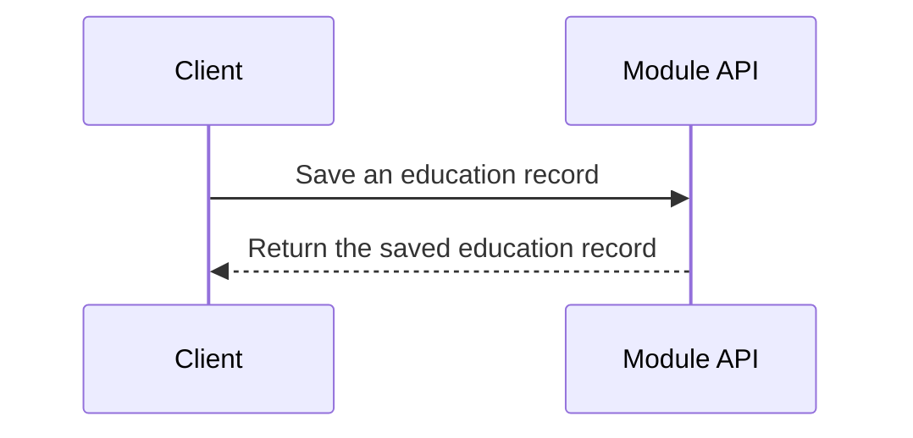

# Education

Profile owners manage education history and select degree and institution values from the available catalogs.

## Rules and dependencies

An education record belongs to its profile owner. The backend handles mutations and exposes the catalogs separately.

## HTTP contract

- `GET and POST /educations`
- `PATCH and DELETE /educations/:id`
- `GET /educations/degrees`
- `GET /educations/institutions`

## Main flow

## Sprint History

### Sprint 3

Profile owners manage education history and select degree and institution values from the available catalogs.
