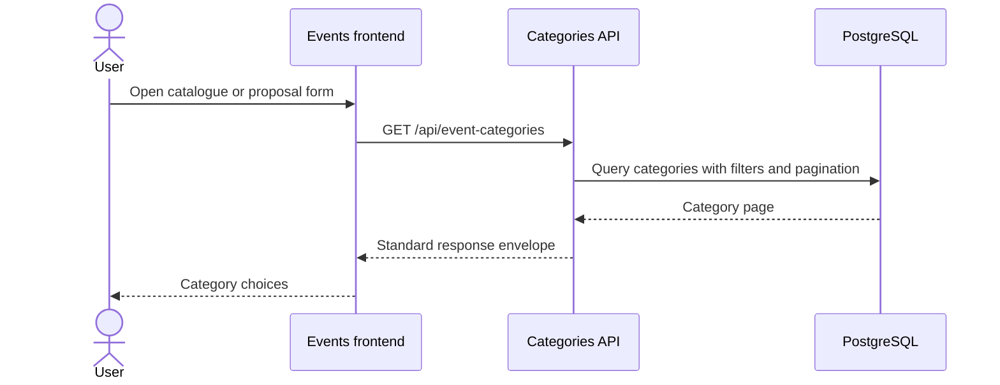
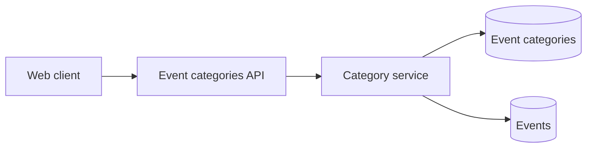

# Event categories

## Purpose and responsibilities

The backend exposes the category catalogue used to classify and filter workshops. The frontend retrieves categories for the events catalogue and proposal form. Category records are managed as catalogue data rather than by this module's public UI.

## Main flow and business rules

`GET /api/event-categories` returns a paginated list. It accepts `page`, `limit` and an optional case-insensitive partial `search` on category name. The request schema rejects invalid query values. Category selection does not authorize a user to create or manage a workshop.

## Dependencies

The events module consumes category IDs for workshop classification and filters. Prisma stores the catalogue; the shared response interceptor wraps the API result.

## API

| Method | Path | Current use |
| --- | --- | --- |
| GET | `/api/event-categories` | Paginated category list; optional `page`, `limit` and `search`. |

## Architecture and data

See the [Prisma schema](../../backend/prisma/schema.prisma) for the model definitions and the [database README](../../backend/prisma/README.md) for database relationships.

## Sprint History

### Sprint 3

The existing category catalogue continues to support workshop browsing and proposal creation. The sprint planning does not assign a separate category feature; this module is documented because the events flows depend on it.
