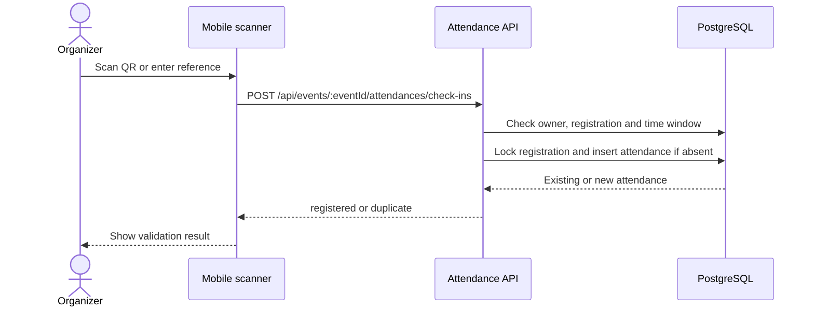

# Event registrations

## Purpose and responsibilities

The backend manages workshop registrations, cancellation, proposal support, private passes, the user's registration lists and attendance check-in. The frontend displays current passes and finished-workshop history, supports cancellation, saves previously viewed passes for offline display and provides the online attendance scanner inside events screens.

## Main flows and business rules

- A `titulado` can register for an eligible published workshop. Cancellation is logical, not deletion. Reactivation keeps the registration ID and issues a new QR token, invalidating the old one.
- The default `GET /event-registrations/me` scope lists current confirmed registrations. `scope=finished` returns finished registrations as a paginated history. Finished workshops leave the current-pass view at closing time; history does not claim the participant attended.
- A pass can be viewed offline only after it was loaded and saved online. Registration, cancellation and attendance check-in require a network connection.
- The authenticated `titulado` who created a published workshop may check in participants. The backend validates role, ownership, workshop, confirmed registration, cancellation state and server-side time window. It accepts a `v1:` QR token, the 64-character token or a registration UUID as a manual reference. A short manual code is not implemented.
- The current server window starts at the workshop's start time inclusive and closes at its end time exclusive, using Bolivia time (UTC−4). The server stores `checkedInById` and `checkedInAt`. Repeated check-in returns `duplicate` without adding an attendance row.

## Dependencies

- Authentication provides the actor's identity and role. Events provides workshop ownership, publication and schedule data.
- Prisma persists registrations and unique attendance records. The frontend uses IndexedDB for previously loaded offline passes; the backend remains the authority for check-in.
- The shared API client handles authenticated requests and session invalidation on HTTP 401.

## API

| Method | Path | Current use |
| --- | --- | --- |
| GET | `/api/events/:eventId/registrations/me` | Read the user's registration for one workshop, including cancellation state. |
| POST | `/api/event-registrations` | Register the authenticated `titulado`. |
| DELETE | `/api/event-registrations/:id` | Logically cancel the user's registration. |
| GET | `/api/event-registrations/me` | Current passes or paginated finished history with `scope=finished`. |
| GET | `/api/event-registrations/:id/pass` | Retrieve the user's private pass for an active published workshop. |
| POST | `/api/events/:eventId/supports` | Support a proposal as an authenticated `titulado`. |
| POST | `/api/events/:eventId/attendances/check-ins` | Online check-in for the published workshop's creator; returns `registered` or `duplicate`. |

Check-in errors distinguish malformed input (400), missing session (401), forbidden role or ownership (403), closed window (409), and invalid or cancelled pass (422). Responses do not list participants or expose the submitted reference.

## Sprint History

### Sprint 3

- Current passes leave the active view when their workshops finish; finished registrations are available in a separate paginated history.
- The pass screen supports offline viewing of a previously saved QR. Check-in remains online.
- The attendance endpoint validates ownership, pass status and the workshop window, and stores an idempotent attendance record. The frontend supplies camera scanning, manual entry and result states.
