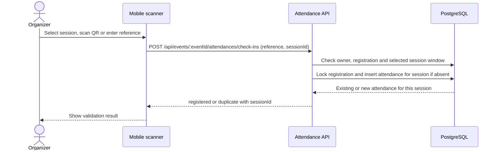
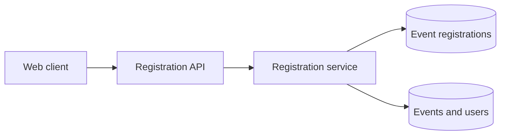

# Event registrations

## Purpose and responsibilities

The backend manages workshop registrations, cancellation, proposal support, private passes, the user's registration lists and attendance check-in. The frontend displays current passes and finished-workshop history, supports cancellation, saves previously viewed passes for offline display and provides the online attendance scanner inside events screens.

## Main flows and business rules

- A `titulado` can register for an eligible published workshop. Cancellation is logical, not deletion. Reactivation keeps the registration ID and issues a new QR token, invalidating the old one.
- Cancellation from the workshop detail or My Passes uses the same registration mutation. After a successful server response, the client removes the saved QR from the current account's IndexedDB snapshot before reporting success and invalidates the related queries.
- The default `GET /event-registrations/me` scope lists current confirmed registrations. `scope=finished` returns finished registrations as a paginated history. Finished workshops leave the current-pass view at closing time; history does not claim the participant attended.
- A pass can be viewed offline only after it was loaded and saved online. Registration, cancellation and attendance check-in require a network connection.
- The authenticated `titulado` who created a published workshop may check in participants. The backend validates role, ownership, workshop, confirmed registration, cancellation state and server-side time window. It accepts a `v1:` QR token, the 64-character token or a registration UUID as a manual reference. A short manual code is not implemented.
- Each session opens at its start time inclusive and closes at its end time exclusive, using Bolivia time (UTC−4). The scanner selects a session for multi-session workshops; if omitted, the server resolves the session in progress. Legacy workshops without session rows use their event date and time. The server stores `sessionId`, `checkedInById` and `checkedInAt`. Repeated check-in for the same registration and session returns `duplicate` without adding an attendance row.
- Registration conflict checks compare every session of both workshops. Workshops without session rows use their original date and time columns.

## Dependencies

- Authentication provides the actor's identity and role. Events provides workshop ownership, publication and schedule data.
- Prisma persists registrations and unique attendance records. The frontend uses IndexedDB for previously loaded offline passes; the backend remains the authority for check-in.
- The shared API client handles authenticated requests and session invalidation on HTTP 401.

## API

| Method | Path | Current use |
| --- | --- | --- |
| GET | `/api/events/:eventId/registrations/me` | Read the user's registration for one workshop, including cancellation state. |
| POST | `/api/event-registrations` | Register the authenticated `titulado`. |
| DELETE | `/api/event-registrations/:id` | Logically cancel the user's registration. |
| GET | `/api/event-registrations/me` | Current passes or paginated finished history with `scope=finished`. |
| GET | `/api/event-registrations/:id/pass` | Retrieve the user's private pass for an active published workshop. |
| POST | `/api/events/:eventId/supports` | Support a proposal as an authenticated `titulado`. |
| POST | `/api/events/:eventId/attendances/check-ins` | Online check-in for the published workshop's creator; returns `registered` (201) or `duplicate` (200), both with nullable `sessionId`. |

Check-in errors distinguish malformed input (400), missing session (401), forbidden role or ownership (403), closed window (409), and invalid or cancelled pass (422). Responses do not list participants or expose the submitted reference.

## Registration listing performance and acceptance evidence

A local benchmark used PostgreSQL 18.6, Node 22.23.3, Nest HTTP and real repositories with 60 registrations: 5 current, 50 finished and 5 cancelled. Each query was sampled 20 times after 3 warmups, sequentially without compression. The test replaces JWT/session lookup with a controlled actor, so these figures exclude authentication, proxy, external network and concurrent traffic. They are not staging or production latency guarantees.

| Query | Before: rows / JSON bytes / p50 / p95 | After: rows / JSON bytes / p50 / p95 |
| --- | --- | --- |
| Current registrations | 55 / 18,758 / 3.993 ms / 5.745 ms | 5 / 1,762 / 3.082 ms / 4.808 ms |
| Finished history, first page | 10 / 3,534 / 4.698 ms / 5.583 ms | 10 / 3,534 / 5.350 ms / 6.657 ms |

The current-list query now filters published, unfinished workshops in the database before materializing registrations. This reduced materialized current-list rows by 90.9% and JSON bytes by 90.6% in the local fixture. History behavior was retained; its timing variation is not evidence of an improvement. The benchmark is `backend/test/registrations-performance.e2e-spec.ts` and requires an explicitly enabled fresh temporary database. It does not run by default.

Local acceptance checks covered exact current and history IDs, ordering and pagination, a workshop reaching its closing instant, QR stability, cancellation, another user's data, and frontend loading, empty and error states. The recorded run passed 594 frontend tests, 318 backend tests and 3 PostgreSQL-backed tests. No staging deployment or staging measurement was performed for that run.

## Architecture and data

See the [Prisma schema](../../backend/prisma/schema.prisma) for the model definitions and the [database README](../../backend/prisma/README.md) for database relationships.

## Sprint History

### Sprint 3

- Current passes leave the active view when their workshops finish; finished registrations are available in a separate paginated history.
- The pass screen supports offline viewing of a previously saved QR. Check-in remains online.
- The attendance endpoint validates ownership, pass status and the workshop window, and stores an idempotent attendance record. The frontend supplies camera scanning, manual entry and result states.
- Current and finished passes expose session schedules. The scanner selects the session and check-in is idempotent per registration and session; legacy workshops still have a single workshop window.
