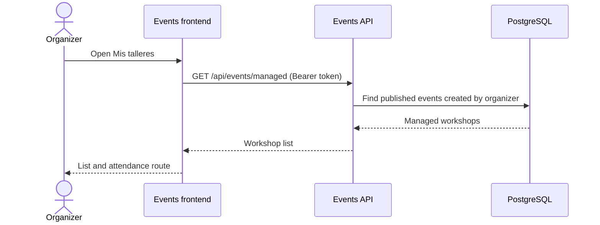
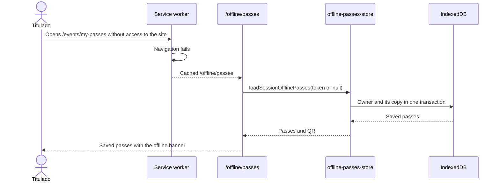

# Events

## Purpose and responsibilities

The backend owns the workshop catalogue, proposal creation, cover images, managed-workshop lookup and automatic proposal expiry. The frontend owns catalogue and detail screens, the proposal form, the organizer's workshop list and the desktop-to-mobile attendance handoff. Registrations and attendance persistence belong to [event-registrations](../event-registrations/README.md); categories belong to [event-categories](../event-categories/README.md).

## Main flows and business rules

- An authenticated `titulado` submits a workshop proposal with an optional cover and idempotency key. Creating it does not immediately publish it.
- The public catalogue and detail display the state returned by the server.
- An online visit to `/events/my-passes` without the session marker redirects to `/login` with the requested path in `next`.
- The service worker precaches `/events/my-passes` with `credentials: 'omit'` and `X-UMSSY-Offline-Shell: 1`. This keeps PWA installation and access to previously saved passes available offline. Client-side session checks still protect private data.
- `Mis talleres` lists only published workshops whose `createdById` equals the current user ID. A new unpublished proposal does not appear. Other responsible users are not assigned by the current implementation.
- `EventsCronService` calls `EventsService.expireOverdueProposals` every five minutes; published proposals are not expired by this job.
- The organizer opens an attendance route from a listed workshop. On desktop, the screen renders a QR containing that route; the phone requires an authorized session. Check-in belongs to the registration module.
- A `titulado` can show their saved passes without a connection at `/offline/passes`, a static route outside `SessionGate`:
  - the service worker precaches it and serves it when the navigation to `Mis inscripciones` (`/events/my-passes`) fails, or when the browser is offline; if the network is only slow, it keeps the normal route;
  - it shows the passes and QR saved on the device with the banner `Sin conexión. Estás viendo tus pases guardados.`, also when the browser reports a connection but the site cannot be reached;
  - without a session token it shows only the copy of the user who owns the offline session on the device;
  - after logout, a `401` or another user's login, it shows `No hay pases guardados en este dispositivo.` once the IndexedDB transaction that ends the offline session commits. If that transaction fails, nothing is removed and the saved passes are still shown on that device until the next session change that completes;
  - while online it also offers a link to `Mis inscripciones`. Access and cleanup rules are described in [Auth](../auth/README.md#offline-session).

## Dependencies

- Authentication supplies the session and `titulado` role. Server-side ownership checks authorize attendance; frontend route rules control navigation.
- Event categories supply catalogue classification and filters.
- Event registrations supplies proposal support, passes and attendance validation.
- Prisma stores events, statuses and cover metadata. Proposal expiry uses the NestJS scheduler.

## API

| Method | Path | Current use |
| --- | --- | --- |
| GET | `/api/events` | Catalogue with pagination and filters. |
| GET | `/api/events/:id` | Workshop or proposal detail. |
| POST | `/api/event-proposals` | Submit a proposal as an authenticated `titulado`; multipart form with optional cover and idempotency key. |
| GET | `/api/events/:id/cover` | Retrieve a stored cover image. |
| GET | `/api/events/managed` | Published workshops created by the authenticated `titulado`. |

Successful JSON responses use the shared API envelope. The cover endpoint returns an image stream.

## Sprint History

### Sprint 3

- Proposal expiry gained a periodic five-minute backend job independent of catalogue reads.
- The organizer flow gained `Mis talleres`, its published-owner lookup and a desktop QR link to the mobile attendance screen.
- Saved passes gained the `/offline/passes` route, served by the service worker when `Mis inscripciones` cannot load, and readable only by the user who owns the offline session.
- Attendance validation remains online and is documented with the registration module.
