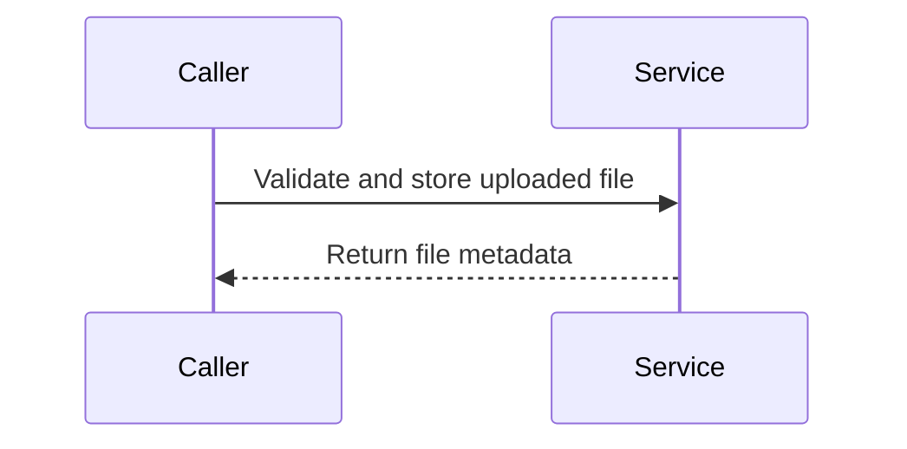

# Files

This internal backend module validates, persists and retrieves files for business modules that handle uploads.

## Rules and dependencies

FilesService applies the configured size and type rules. FilesRepository stores file information through Prisma. Feature controllers own the public HTTP routes.

## Main flow

## Sprint History

### Sprint 3

This internal backend module validates, persists and retrieves files for business modules that handle uploads.
