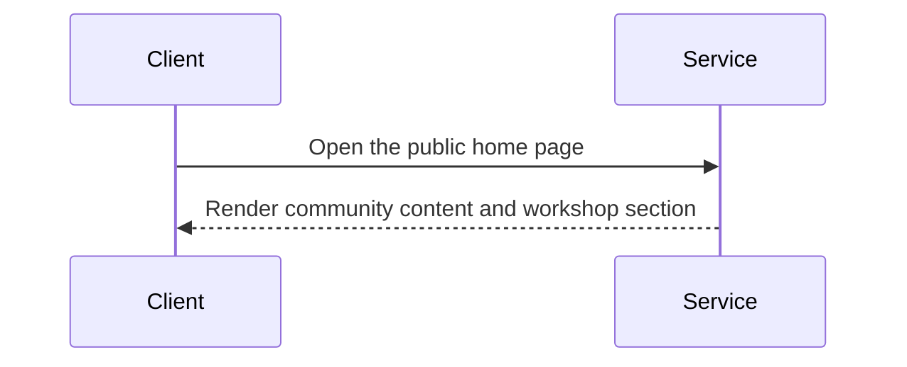

# Home

The public landing page presents the community, workshops and access links. The authenticated dashboard provides navigation to areas available to the current role.

## Rules and dependencies

The landing page delegates workshop loading to events. The dashboard uses the authenticated app shell and role navigation. Access and workshop calls to action use institutional styling.

## Main flow

## Sprint History

### Sprint 3

The public landing page presents the community, workshops and access links. The authenticated dashboard provides navigation to areas available to the current role.
