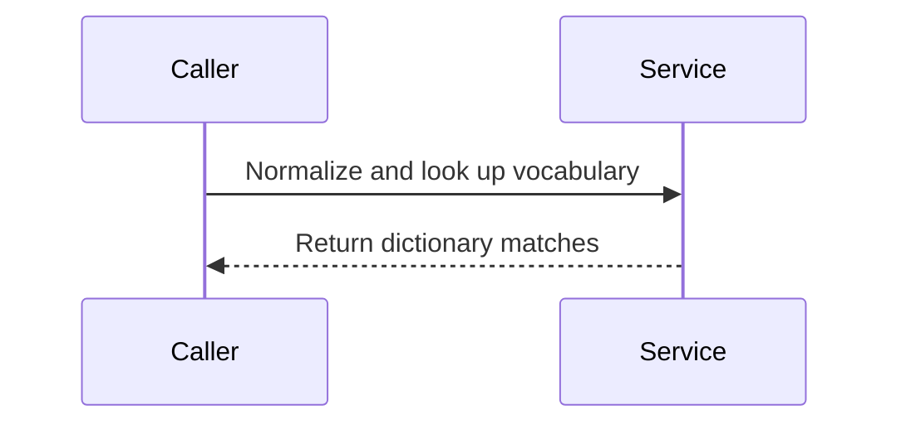

# Job Connect

The backend dictionary supplies institutional and skills vocabulary for analysis.

## Rules and dependencies

SkillDictionaryService normalizes terms and reads the configured dictionaries. Consuming modules call the service directly. This module has no standalone HTTP controller.

## Main flow

## Sprint History

### Sprint 3

The backend dictionary supplies institutional and skills vocabulary for analysis.
