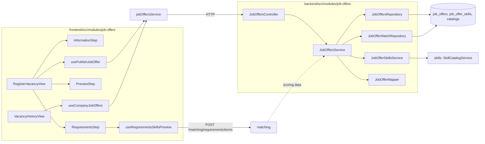
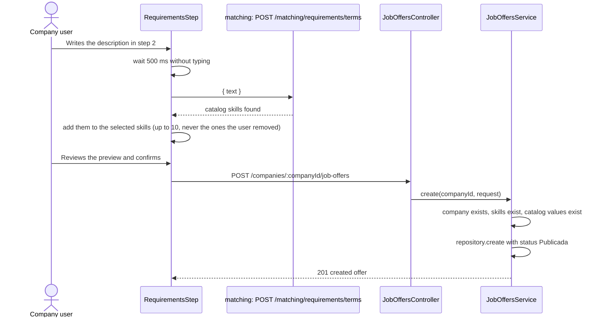
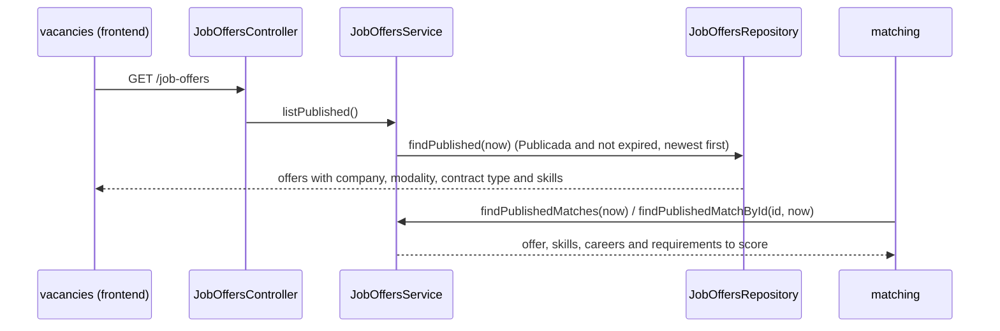

# Job offers

## Purpose

Owns the job offers (vacancies) that companies publish. It has two faces:

- **Applicant side** (used by group 5): the list of published vacancies, the skill catalog used by vacancies, and the data that [matching](../matching/README.md) needs to score a vacancy. The applicant screens live in the frontend module [vacancies](../vacancies/README.md).
- **Company side**: publishing, editing, listing, reopening and deleting the vacancies of a company, and the history screen. This part is shared with the recruiters/companies team; it is described here so the module has one complete README, and that team can complete or correct it.

Group 5 contribution: published listing, skill selection and real-time skill detection in the requirements step, dates of the vacancies, and the match data source.

## Functionality

| Feature                                                         | Where                                                                                  |
| --------------------------------------------------------------- | -------------------------------------------------------------------------------------- |
| List published and not expired vacancies                        | `GET /job-offers`                                                                      |
| Skill catalog for the vacancy form                              | `GET /job-offers/skills`                                                               |
| Publish a vacancy (3 steps: information, requirements, preview) | `POST /companies/:companyId/job-offers`, `/recruiters/job-offers/new`                  |
| Edit a vacancy                                                  | `PUT /companies/:companyId/job-offers/:jobOfferId`, `/recruiters/job-offers/[id]/edit` |
| History of the company's vacancies with filters and sorting     | `GET /companies/:companyId/job-offers`, `/recruiters/history`                          |
| Reopen a closed vacancy, delete a vacancy                       | `PATCH .../reopen`, `DELETE .../:jobOfferId`                                           |
| Detect required skills while the company writes the description | `POST /matching/requirements/terms` (from [matching](../matching/README.md))           |

## Architecture

## Key flows

### Publish a vacancy with skill detection

### Published listing and match source

## Business rules

- **Visibility.** A vacancy is visible to applicants only when its status is `Publicada` and it has no expiry date or the expiry is in the future. Statuses are the catalog `job_offer_statuses`: `Publicada`, `Cerrada`, `Eliminada`.
- **Fields on publish or edit.** Title: required, up to 60 characters, letters, digits and spaces. Description: required, up to 3000 characters. Modality (`Presencial`, `Remoto`, `Híbrido`) and contract type (`Tiempo completo`, `Medio tiempo`, `Pasantía`) come from catalogs. Category up to 100 characters, languages up to 100, positions between 1 and 500.
- **Salary.** Whole numbers from 1 to 999 999 999 (9 digits). The minimum is required, except for an internship where both can be omitted. The minimum cannot be greater than the maximum.
- **Location.** Must be a Google Maps link (full place URL or a `maps.app.goo.gl` / `goo.gl/maps` short link), up to 2048 characters.
- **Skills.** At least 1 and at most 10, all of them must exist in the catalog and none repeated. The errors are 422 `JOB_OFFER_SKILL_NOT_FOUND`, `DUPLICATE_JOB_OFFER_SKILLS` and `TOO_MANY_JOB_OFFER_SKILLS`.
- **Other requirements.** Optional lists of required careers and other requirements (up to 10 items of 120 characters each) and minimum years of experience between 0 and 40.
- **Ownership.** Company endpoints require the role `empresa` and the `CompanyOwnershipGuard`, so a company can only manage its own vacancies. A vacancy that does not belong to the company answers 404.
- **Reopen** works only on `Cerrada` vacancies (409 `JOB_OFFER_NOT_REOPENABLE`) and puts them back in `Publicada` with a new publication date.
- **Delete** is logical: the status changes to `Eliminada`. The company history still lists and can read it, but it cannot be edited, reopened or deleted again (404).
- **History filters.** By modality, contract type, publication date range (Bolivia time, both days included), text in the title (up to 60 characters, case-insensitive), and sorting by publication date or by number of applicants (ties broken by date), ascending or descending (default newest first).
- **Detection while writing.** After 500 ms without typing, the description is analyzed and the recognized catalog skills are added to the selection until the limit of 10 is reached. Once the person removes a skill, it is not added again. Detection only starts after the person types, so an existing vacancy opened for editing keeps its skills.
- **Scoring data.** The match repository exposes only what scoring needs (title, description, dates, company, modality, skills, careers, minimum experience and other requirements).

## Endpoints

| Method | Path                                                  | Roles           | Description                                                                                        | Success                           | Errors                                                                |
| ------ | ----------------------------------------------------- | --------------- | -------------------------------------------------------------------------------------------------- | --------------------------------- | --------------------------------------------------------------------- |
| GET    | `/job-offers`                                         | public          | Published vacancies                                                                                | 200 `PublishedJobOfferResponse[]` | -                                                                     |
| GET    | `/job-offers/skills`                                  | public          | Skill catalog for the form                                                                         | 200 `JobOfferSkillResponse[]`     | -                                                                     |
| POST   | `/companies/:companyId/job-offers`                    | empresa (owner) | Publishes a vacancy                                                                                | 201                               | 400 validation, 404 `COMPANY_NOT_FOUND`, 422 skills or catalog values |
| GET    | `/companies/:companyId/job-offers`                    | empresa (owner) | History with filters `modality`, `contractType`, `dateFrom`, `dateTo`, `search`, `sortBy`, `order` | 200 `JobOfferResponse[]`          | 400 invalid filter                                                    |
| GET    | `/companies/:companyId/job-offers/:jobOfferId`        | empresa (owner) | One vacancy, including deleted ones                                                                | 200 `JobOfferResponse`            | 404 `JOB_OFFER_NOT_FOUND`                                             |
| PUT    | `/companies/:companyId/job-offers/:jobOfferId`        | empresa (owner) | Edits a vacancy                                                                                    | 200 `JobOfferResponse`            | 400, 404, 422                                                         |
| PATCH  | `/companies/:companyId/job-offers/:jobOfferId/reopen` | empresa (owner) | Reopens a closed vacancy                                                                           | 200 `JobOfferResponse`            | 404, 409 `JOB_OFFER_NOT_REOPENABLE`                                   |
| DELETE | `/companies/:companyId/job-offers/:jobOfferId`        | empresa (owner) | Deletes (logical)                                                                                  | 204                               | 404 `JOB_OFFER_NOT_FOUND`                                             |

`JobOfferResponse` contains `id`, `title`, `description`, `category`, `modality`, `contractType`, `status`, `positionsAvailable`, `salaryRange`, `languages`, `locationUrl`, `expiresAt`, `publishedAt`, `createdAt`, `company { id, name }`, `skills[]` and `applicantsCount`. The published version has no `applicantsCount`.

## Dependencies

| Direction | Module                                         | Use                                                                                       |
| --------- | ---------------------------------------------- | ----------------------------------------------------------------------------------------- |
| Uses      | skills                                         | `SkillCatalogService` to list and validate the skills of a vacancy                        |
| Used by   | [matching](../matching/README.md)              | `findPublishedMatches`, `findPublishedMatchById`, `findScoringOffers`, `findCompanyOffer` |
| Used by   | [applications](../applications/README.md)      | Vacancy data of an application                                                            |
| Used by   | [vacancies](../vacancies/README.md) (frontend) | `GET /job-offers` and `getSafeMapsUrl`                                                    |

## Data

Tables `job_offers`, `job_offer_skills` and the catalogs `job_offer_statuses`, `job_offer_modalities` and `job_offer_contract_types` (see [backend/prisma/README.md](../../backend/prisma/README.md)).

## Frontend

- Routes: `/recruiters/job-offers/new` and `/recruiters/job-offers/[id]/edit` (`RegisterVacancyView`), `/recruiters/history` (`VacancyHistoryView`).
- The wizard has a stepper, field-level validation, a preview step, a confirmation when leaving with unsaved changes (`useLeaveGuard`) and a success screen.
- The company id comes from the session (`useCurrentCompany`); without a company the form shows an error instead of sending the request.
- Pagination, filters dialog, reopen and delete actions in the history.

## Design decisions

- **Applicant and company views are different modules in the frontend** (`vacancies` and `job-offers`) over one backend module, because the data is the same but the permissions and screens are not.
- **Skills come only from the catalog.** The vacancy stores `job_offer_skills` rows, never free text, so affinity can compare skills by identity.
- **Detection is a helper, not an authority.** It suggests skills while the company writes, and the company keeps the final say (it can remove any suggestion and add others).
- **Logical delete** keeps the history and the applications that reference the vacancy; the status is what hides it from applicants.
- **A separate repository for scoring** (`JobOfferMatchRepository`) selects only the columns matching needs, so the scoring code does not depend on the company-side shape of the offer.

## Sprint History

### Sprint 3

- Published vacancies listing with publication and expiry dates.
- Skill catalog endpoint for the vacancy form.
- Real-time detection of required skills while the description is written, with debounce and limits.
- Source of vacancies for the affinity calculation and recommendations.
- Company side (shared): publish, edit, history with filters, reopen and delete.
