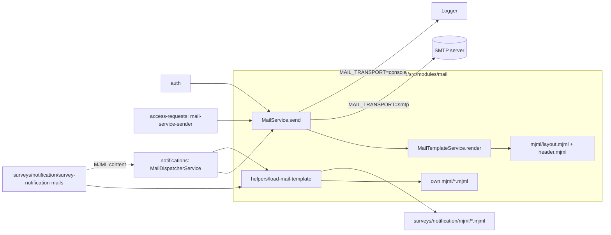
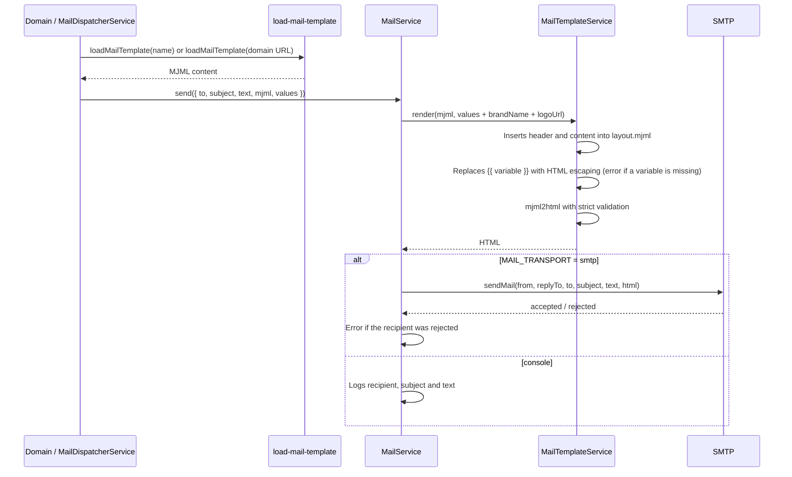

# Mail (email delivery)

## Purpose

The `mail` module is the email delivery infrastructure. It receives the MJML content of an email and its values, wraps it with the institutional layout and header, compiles it to HTML and delivers it over SMTP (or logs it to the console in local environments). It knows no business rules: each domain decides what content it sends and to whom.

It has no HTTP endpoints and no frontend interface.

## Architecture

## Key flow

## Business rules

- **Transport.** `MAIL_TRANSPORT` = `console` (default) or `smtp`. With `smtp`, `SMTP_HOST` is required. Connection timeout 10 s and socket timeout 30 s; the transport does not read files or URLs from the content.
- **Sender.** `MAIL_FROM_NAME`, `MAIL_FROM_ADDRESS` and optional `MAIL_REPLY_TO`. `MAIL_LOGO_URL` shows the logo in the header; without it the image is removed.
- **Templates.** All emails share `layout.mjml` and `header.mjml`. Values are HTML-escaped and a missing variable throws an error, so incomplete emails are never sent.
- **`mail`'s own templates.** `activation-code`, `account-activated`, `access-request-rejection`, `password-reset-email` and `notification` (generic, for notifications without their own content), typed in `MailTemplateName`.
- **Domain templates.** A domain stores its templates as `.mjml` files in `backend/src/modules/<module>/notification/mjml/` and reads them with `loadMailTemplate`, passing the file `URL` instead of a `MailTemplateName`. The survey templates (`survey-reminder`, `survey-closing-soon`, `survey-closed` and `survey-variation-alert`) live in `backend/src/modules/surveys/notification/mjml/` and reach `mail` through `notifications` (`renderMail` returns a promise with `mjml`).
- **Copying templates to the build.** `.mjml` files are not compiled by TypeScript, so they are copied to `dist`: `pnpm run build` runs `scripts/copy-mail-templates.ts`, which copies `mail/mjml/` and every `modules/*/notification/mjml/`, and `nest start` copies them through the `assets` in `nest-cli.json`.

## Public API (Nest module)

| Export | Usage |
| --- | --- |
| `MailModule` | Import in the consuming module |
| `MailService.send(payload: SendMailPayload)` | Send an email (`to`, `subject`, `text`, `mjml`, `values`) |
| `MailTemplateName` | Names of `mail`'s own templates |
| `loadMailTemplate(template)` | Read one of `mail`'s own MJML templates by `MailTemplateName` or a domain template by `URL` (`helpers/load-mail-template.ts`) |

## Dependencies

| Direction | Module | Usage |
| --- | --- | --- |
| Uses | config | `parseMailConfig` (`MAIL_*` and `SMTP_*` variables) |
| Used by | auth | Password reset email |
| Used by | [access-requests](../access-requests/README.md) | Activation code, account activated and rejection; `buildFrontendUrl` for their links |
| Used by | [notifications](../notifications/README.md) | Email for each notification (including those from [surveys](../surveys/README.md)) |
| Used by | [appointments](../appointments/README.md) | `buildFrontendUrl` for the links of appointment emails |

## Frontend integration

No interface of its own. Email links point to frontend routes. `mail/helpers/frontend-url.ts` exports `frontendBaseUrl()`, which resolves the frontend origin from `FRONTEND_URL` or, when it is not set, from the first `CORS_ORIGIN` (default `http://localhost:3000`), and `buildFrontendUrl(path, query)`, which builds an absolute link on that origin. Notifications, access requests and appointments use them to build email links.

## Sprint History

### Sprint 3

- Support for domain MJML content: `notifications` passes to `MailService` the MJML returned by the domain (`NotificationMailContent.mjml`). The `survey-*` templates are removed from `mail/mjml/` and from `MailTemplateName`.
- Survey emails (reminder, closing soon, closed and variation alert) with their `.mjml` templates in `surveys/notification/mjml/`; `mail` provides the layout and header.
- `loadMailTemplate` accepts the `URL` of a domain template, and the build copies the templates from `modules/*/notification/mjml/` to `dist`.
- The frontend URL resolver (`frontendBaseUrl`, `buildFrontendUrl`) lives in the mail module, so every domain builds email links from the same origin. The `MAIL_APP_URL` variable was removed.
