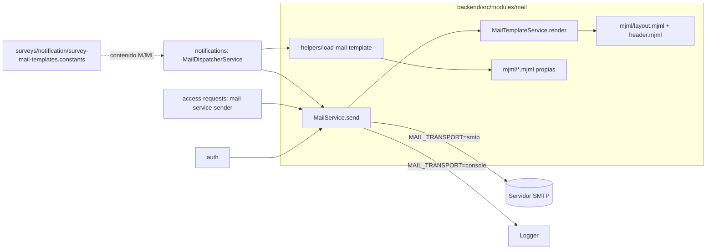
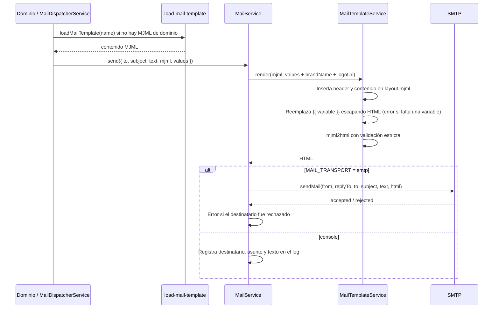

# Mail (envío de correo)

## Propósito

El módulo `mail` es la infraestructura de envío de correo. Recibe el contenido MJML de un correo y sus valores, lo envuelve con el layout y la cabecera institucional, lo compila a HTML y lo entrega por SMTP (o lo registra en consola en entornos locales). No conoce reglas de negocio: cada dominio decide qué contenido envía y a quién.

No tiene endpoints HTTP ni interfaz en el frontend.

## Arquitectura

## Flujo clave

## Reglas de negocio

- **Transporte.** `MAIL_TRANSPORT` = `console` (por defecto) o `smtp`. Con `smtp`, `SMTP_HOST` es obligatorio. Tiempos de espera de conexión 10 s y de socket 30 s; el transporte no lee archivos ni URLs del contenido.
- **Remitente.** `MAIL_FROM_NAME`, `MAIL_FROM_ADDRESS` y `MAIL_REPLY_TO` opcional. `MAIL_LOGO_URL` muestra el logo en la cabecera; sin él se quita la imagen.
- **Plantillas.** Todos los correos comparten `layout.mjml` y `header.mjml`. Los valores se escapan como HTML y una variable faltante lanza error, de modo que no se envían correos incompletos.
- **Plantillas propias de `mail`.** `activation-code`, `account-activated`, `access-request-rejection`, `password-reset-email` y `notification` (genérica para notificaciones sin contenido propio), tipadas en `MailTemplateName`.
- **Plantillas de dominio.** Un dominio puede declarar su contenido MJML junto a su código. Las plantillas de encuestas (recordatorio, cierre próximo, cierre y alerta de variación) viven como constantes en `backend/src/modules/surveys/notification/survey-mail-templates.constants.ts` y llegan a `mail` a través de `notifications` (`renderMail` devuelve `mjml`). Al ser código TypeScript se compilan a `dist` sin pasos de copia adicionales.

## API pública (módulo Nest)

| Export | Uso |
| --- | --- |
| `MailModule` | Importar en el módulo consumidor |
| `MailService.send(payload: SendMailPayload)` | Enviar un correo (`to`, `subject`, `text`, `mjml`, `values`) |
| `MailTemplateName` | Nombres de las plantillas propias de `mail` |
| `loadMailTemplate(name)`, `mailTemplateUrl(name)`, `loadMjmlTemplate(url)` | Resolver y leer plantillas MJML (`helpers/load-mail-template.ts`) |

## Dependencias

| Dirección | Módulo | Uso |
| --- | --- | --- |
| Usa | config | `parseMailConfig` (variables `MAIL_*` y `SMTP_*`) |
| Usado por | auth | Correo de restablecimiento de contraseña |
| Usado por | [access-requests](../access-requests/README.md) | Código de activación, cuenta activada y rechazo |
| Usado por | [notifications](../notifications/README.md) | Correo de cada notificación (incluye las de [surveys](../surveys/README.md)) |

## Sprint History

### Sprint 3

- Soporte de plantillas MJML de dominio: los helpers resuelven una plantilla por URL (`mailTemplateUrl`, `loadMjmlTemplate`) además de por nombre, y `notifications` puede enviar contenido MJML que vive fuera de `mail`.
- Correos de encuestas (recordatorio, cierre próximo, cierre y alerta de variación) con su contenido MJML ubicado en `surveys/notification/`; `mail` aporta el layout y la cabecera.
