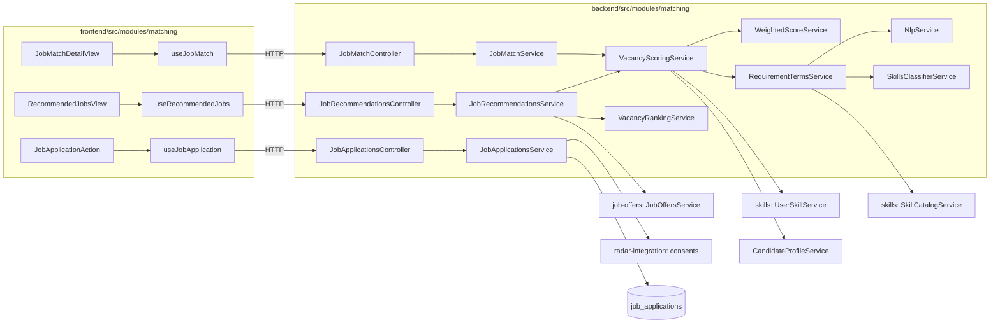
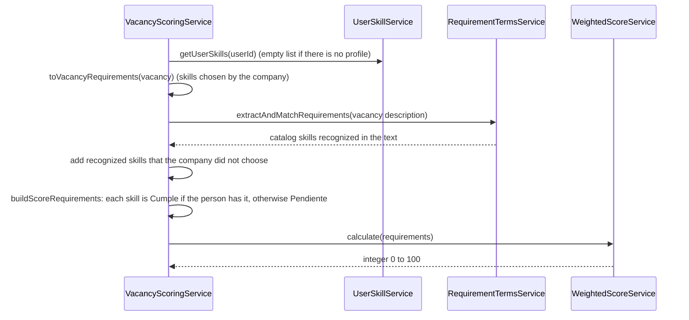
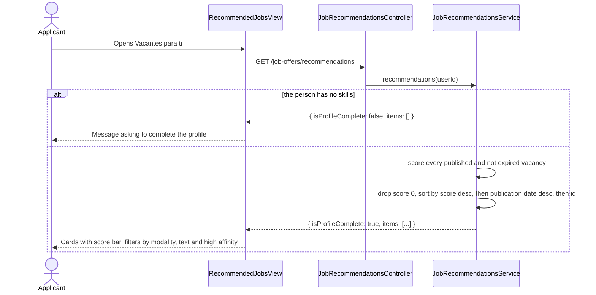
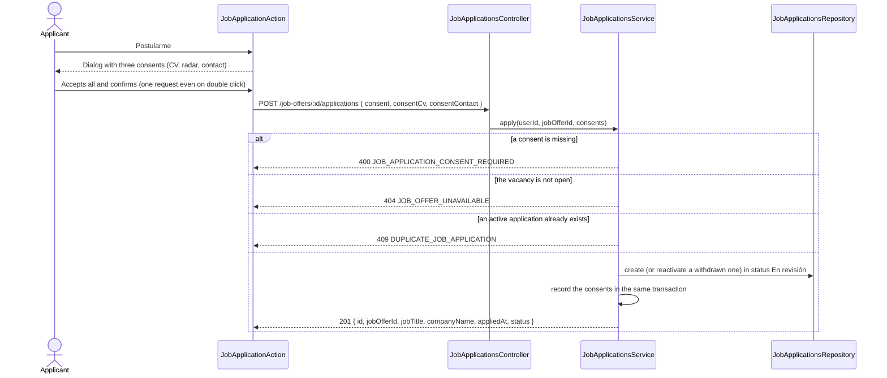
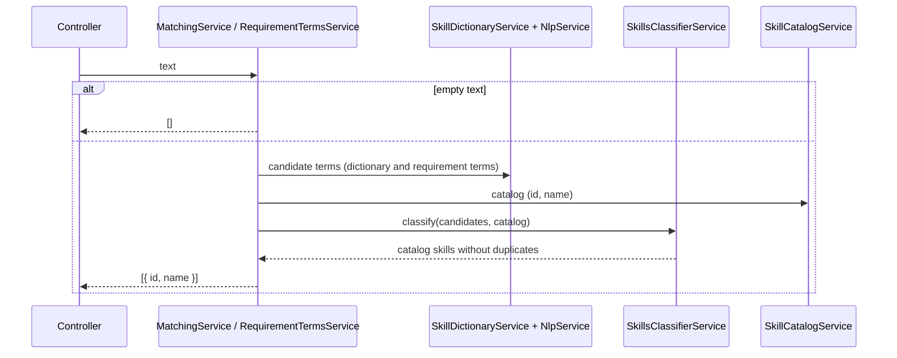

# Matching

## Purpose

Connects applicants with vacancies. It calculates how well a person fits a vacancy (the **affinity**), ranks the published vacancies for them ("Vacantes para ti"), shows which requirements they meet and which are pending, and creates the job application. It also hosts the text analysis that recognizes catalog skills inside free text (work experience descriptions and vacancy requirements).

Owner: group 5. The module is shared in two places: the skill detection pipeline of the profile (module `nlp`) and the recruiter radar views (module `radar-integration`) are owned by other teams and only referenced here.

## Functionality

| Feature                                                                                 | Where                                                           |
| --------------------------------------------------------------------------------------- | --------------------------------------------------------------- |
| Recommended vacancies ordered by affinity, only above 0 %                               | `GET /job-offers/recommendations`, `/vacancies/recommended`     |
| Affinity detail of one vacancy: requirements that are met or pending                    | `GET /job-offers/:id/match`, `/vacancies/recommended/[id]`      |
| Apply to a vacancy with the required consents, one application per person and vacancy   | `POST /job-offers/:id/applications`                             |
| Know whether I already applied to a vacancy                                             | `GET /job-offers/:id/applications/me`                           |
| List the applicants of a vacancy for its company                                        | `GET /companies/:companyId/job-offers/:jobOfferId/applications` |
| Detect catalog skills in a work experience description (preview and persisted analysis) | `POST /work-experiences/:id/skills/preview` and `/analysis`     |
| Detect catalog skills in the requirements text of a vacancy                             | `POST /matching/requirements/terms`                             |

## Architecture

## Key flows

### Affinity of a vacancy

### Recommendations

### Apply to a vacancy

### Skill detection in text

## Business rules

- **Affinity is only about skills today.** The score is the share of required skills the person has, weighted by category. The categories are `skills` (60), `academicRequirements` (25), `experienceRequirements` (10) and `otherRequirements` (5), but only the skills category is filled, and empty categories are left out of the average. Categories without data are skipped, so they do not lower the score. The weights can be changed with the environment variables `MATCH_SCORE_WEIGHT_SKILLS`, `MATCH_SCORE_WEIGHT_ACADEMIC`, `MATCH_SCORE_WEIGHT_EXPERIENCE` and `MATCH_SCORE_WEIGHT_OTHER` (numbers greater than or equal to 0; an invalid value stops the application at startup).
- Required skills of a vacancy are the ones the company selected plus the catalog skills recognized in the vacancy description. Names are compared without case, accents or extra spaces (`buildSkillKey`).
- The score is an integer between 0 and 100. A vacancy without requirements scores 100. It is a guide, not a hiring guarantee (the screen says so).
- Recommendations include only published and not expired vacancies with a score above 0, ordered by score (descending), then publication date (newest first), then id.
- If the person has no skills, recommendations answer `isProfileComplete: false` and an empty list instead of an error.
- "High affinity" in the client means a score of 70 or more.
- Applying needs the three consents (`consent`, `consentCv`, `consentContact`) to be `true`; they are stored in `radar_application_consents` in the same transaction as the application.
- The vacancy must be `Publicada` and not expired. There is one application per `(job_offer_id, user_id)`; applying again after withdrawing reactivates the same row, applying while it is active is a conflict. A simultaneous double click is turned into the same duplicate error when the unique constraint fires.
- `GET /job-offers/:id/applications/me` answers `hasApplied: false` when there is no application or it was withdrawn.
- Skill detection: an empty text gives an empty list, the text is limited to 5000 characters, a term only matches when it equals exactly one catalog skill (if two skills collapse to the same key, only an exact name match is accepted), and symbols are kept (`C++`, `C#`, `Node.js`, `.NET`).
- `POST /work-experiences/:id/skills/preview` never writes anything; `/analysis` replaces the skills detected for that experience. Both check that the experience belongs to the caller.

## Endpoints

| Method | Path                                                        | Roles                          | Description                                   | Success                                            | Errors                                                                                               |
| ------ | ----------------------------------------------------------- | ------------------------------ | --------------------------------------------- | -------------------------------------------------- | ---------------------------------------------------------------------------------------------------- |
| GET    | `/job-offers/recommendations`                               | titulado, estudiante           | Vacancies ranked by affinity                  | 200 `{ isProfileComplete, items[] }`               | 401, 403                                                                                             |
| GET    | `/job-offers/:id/match`                                     | titulado, estudiante           | Score and requirements of one vacancy         | 200 `JobMatchResponse`                             | 404 `JOB_OFFER_NOT_AVAILABLE`                                                                        |
| POST   | `/job-offers/:id/applications`                              | titulado, estudiante           | Applies with consents                         | 201 `JobApplicationResponse`                       | 400 `JOB_APPLICATION_CONSENT_REQUIRED`, 404 `JOB_OFFER_UNAVAILABLE`, 409 `DUPLICATE_JOB_APPLICATION` |
| GET    | `/job-offers/:id/applications/me`                           | titulado, estudiante           | Own application for the vacancy               | 200 `{ hasApplied, application }`                  | 401, 403                                                                                             |
| GET    | `/companies/:companyId/job-offers/:jobOfferId/applications` | empresa (owner of the company) | Applicants of a vacancy                       | 200 `CompanyJobApplicantsResponse`                 | 403, 404 `JOB_OFFER_UNAVAILABLE`                                                                     |
| POST   | `/work-experiences/:id/skills/preview`                      | any signed-in user             | Detects skills in `{ text }` without saving   | 200 `{ experienceId, skills[], processingTimeMs }` | 404 `WORK_EXPERIENCE_NOT_FOUND`                                                                      |
| POST   | `/work-experiences/:id/skills/analysis`                     | any signed-in user             | Detects and saves the skills of an experience | 200 same body                                      | 404 `WORK_EXPERIENCE_NOT_FOUND`                                                                      |
| POST   | `/matching/requirements/terms`                              | any signed-in user             | Catalog skills recognized in `{ text }`       | 200 `[{ id, name }]`                               | 400 text too long or missing                                                                         |

The match and recommendation items include `jobOfferId`, `title`, `companyName`, `modality`, `score`, `publishedAt` and `expiresAt`; recommendations also include `skills`, `matchedSkills` and `locationUrl`, and the match detail adds `description`, `hasPendingRequirements` and the list of requirements with status `Cumple` or `Pendiente`.

## Dependencies

| Direction | Module                                                     | Use                                                                                |
| --------- | ---------------------------------------------------------- | ---------------------------------------------------------------------------------- |
| Uses      | job-offers                                                 | Published vacancies and their selected skills (`JobOffersService`)                 |
| Uses      | skills                                                     | User skills (`UserSkillService`) and the catalog (`SkillCatalogService`)           |
| Uses      | educations, work-experience                                | Candidate profile data: career and years of experience (`CandidateProfileService`) |
| Uses      | profile                                                    | `ProfileNotFoundException` (a missing profile counts as no skills)                 |
| Uses      | radar-integration                                          | Stores the consents of an application (`RadarApplicationConsentsService`)          |
| Uses      | job-connect                                                | `SkillDictionaryService` to extract skills from experience text                    |
| Used by   | [applications](../applications/README.md)                  | `scoresForOffers` for the affinity column                                          |
| Used by   | [job-offers](../job-offers/README.md) (frontend)           | `/matching/requirements/terms` to detect skills while writing requirements         |
| Used by   | [work-experience](../work-experience/README.md) (frontend) | `/skills/preview` for the live chips                                               |

## Data

Reads `job_offers`, `job_offer_skills`, `skills`, `user_skills`, `educations` and `work_experiences`; writes `job_applications` and `radar_application_consents` (see [backend/prisma/README.md](../../backend/prisma/README.md)).

## Frontend

- Routes: `/vacancies/recommended` (`RecommendedJobsView`) and `/vacancies/recommended/[id]` (`JobMatchDetailView`). `JobApplicationAction` is reused by the vacancy detail in [vacancies](../vacancies/README.md).
- The feed has filters by modality and text and a "high affinity" option; "Limpiar" restores the list. Dates use the Bolivia time formatter.
- The module also contains the recruiter views of the radar (candidate list, comparison and CV evidence); their backend is `radar-integration` and they are not described here.
- In the recruiter candidate panel, the "Contactar" button opens or reuses the application conversation with the candidate in the chat side panel. The application is not accepted or rejected from this screen.

## Design decisions

- **One scoring service for every screen.** The feed, the detail and the affinity column of "Mis postulaciones" all call `VacancyScoringService`, so the same vacancy never shows two different percentages.
- **Affinity is calculated, not stored.** It always reflects the current profile and vacancy; the cost is recalculating on each request.
- **Weights are configuration.** The rubric can be tuned per environment without changing code. Categories with no requirements are skipped, so adding academic or experience requirements later only needs filling them in `buildScoreRequirements`.
- **Consents are explicit and all required** to apply, and are saved atomically with the application.
- **Skills must match the catalog.** The classifier never invents skills: free text only yields skills that exist in `skills`, and ambiguous names are discarded.
- **Preview and analysis are separate endpoints** so the form can show live suggestions without writing anything.
- **Other modules are called through their services**, never their tables (backend standard).

## Sprint History

### Sprint 3

- Recommended vacancies ordered by affinity with filters, empty states and the explanation that affinity is a guide.
- Affinity detail of a vacancy with met and pending requirements.
- Apply with consents, duplicate protection and re-application after withdrawing.
- Applicants of a vacancy for the company.
- Skill detection for work experience text and for vacancy requirements, including symbols, accents and case.
- Publication and expiry dates in the recommended vacancies.
- Configurable score weights through environment variables.
- "Contactar" button in the recruiter candidate panel, which opens the application chat.
