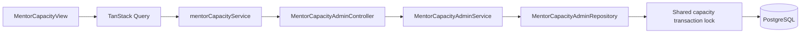
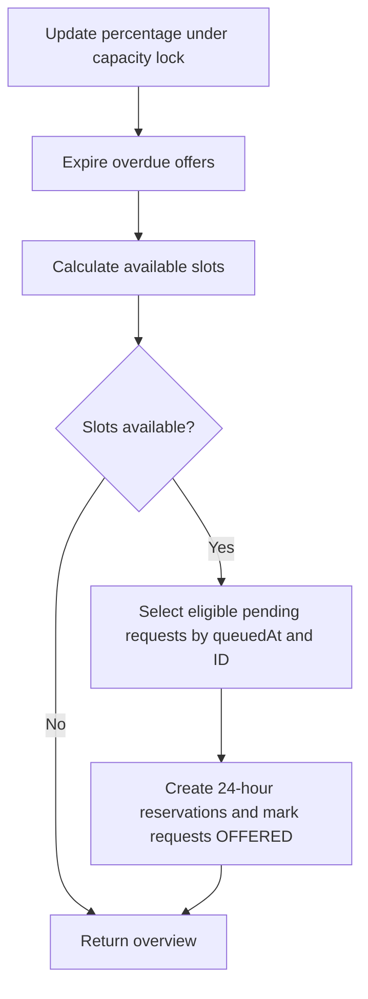
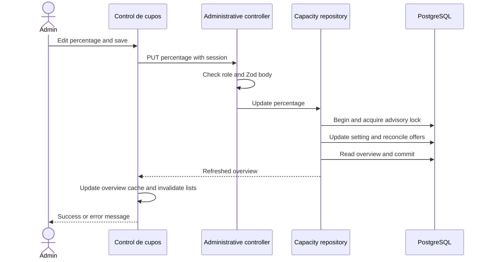

# Mentor capacity

## Purpose and responsibilities

The frontend mentor-capacity module provides “Control de cupos” for administrators. The backend mentors module owns calculation, storage and FIFO allocation. The panel does not assign offers locally. MentorCapacityView uses TanStack Query and mentorCapacityService through the shared HTTP client; requests are authenticated, and the backend requires the administrativo role through JwtAuthGuard and RolesGuard.

## Capacity rules

- Approved graduates: active users with a current nondeleted titulado role and an approved access request.
- Active mentors: active users with a current nondeleted mentor role, independently of scheduling availability.
- Reserved offers: OFFERED rows whose expiresAt is greater than the database clock.
- Percentage: integer from 1 through 100; the calculation falls back to 40 if the setting is null.
- Capacity: `Math.ceil(approvedGraduates * percentage / 100)`.
- Occupied: `activeMentors + reservedOffers`.
- Available: `Math.max(0, capacity - occupied)`.
- Pending requests: count of PENDING requests, not a count of guaranteed eligible future recipients.

Reducing the percentage below occupied capacity is allowed. Existing mentors and valid reservations remain; available becomes zero. The displayed percentage needed to cover current occupancy is informational, not an additional backend validation.

The quantity input finds integer percentages from 1 to 100 that produce the requested capacity with the same ceiling formula. It rejects impossible exact quantities, zero graduates and quantities outside 1..approvedGraduates. Only percentage is persisted. The server uses a strict Zod body with integer percentage in 1..100.

## Architecture and dependencies

The frontend depends on shared API/session infrastructure, institutional UI components and sonner. The backend uses existing mentor SQL helpers, Prisma and authentication guards. See [mentors](../mentors/README.md) for intake, offers and participation responsibilities.

## Endpoints

All paths have the `/api` prefix and require administrative authorization.

| Method and path                       | Contract                                                   |
| ------------------------------------- | ---------------------------------------------------------- |
| GET `/admin/mentor-capacity`          | Capacity fields and pendingRequests                        |
| PUT `/admin/mentor-capacity`          | Body `{ percentage: integer }`; returns refreshed overview |
| GET `/admin/mentor-capacity/requests` | page and limit; PENDING requests in FIFO order             |
| GET `/admin/mentor-capacity/offers`   | page and limit; complete offer history                     |

List parameters are coerced integers: page >= 1, default 1; limit 1..50, default 10. Responses contain items, totalItems, page, limit and totalPages under the shared data envelope. Waiting rows include id, firstName, lastName, email and queuedAt, ordered queuedAt ascending then ID ascending. Offer rows include person information, status, offeredAt, expiresAt and nullable confirmedAt, ordered offeredAt descending then ID descending. OFFERED, CONFIRMED and EXPIRED are displayed as Vigente, Confirmada and Vencida.

## Allocation and concurrency

Percentage update and reconciliation run in one transaction under advisory lock 1436. Reconciliation first expires overdue offers and associated requests. It then selects eligible PENDING requests by queuedAt and ID, locks those rows and creates offers expiring 24 hours later. Eligibility is rechecked, including current roles, approved access, valid selections and absence of another offer. Failure rolls back the transaction. Overview and list GETs perform reads only. A separate existing worker reconciles every 15 seconds and at startup.

## Query state, errors and retry

Queries use `['mentor-capacity', 'overview']`, `['mentor-capacity', 'requests', page]` and `['mentor-capacity', 'offers', page]`. The two lists paginate independently, ten records per page. Saving updates overview cache and invalidates both lists. “Actualizar” invalidates the mentor-capacity prefix. Loading placeholders, empty lists, error messages and per-query retry controls preserve the existing presentation.

Invalid input fails locally or through Zod (400); missing authentication and insufficient permissions remain 401/403. A failed mutation displays an error and allows retry. After an ambiguous network failure the client cannot prove whether a server transaction committed: refresh the overview to establish authoritative state. The error message identifies the last observed percentage and asks the administrator to refresh before retrying.

## Sprint History

### Sprint 3

- Administrative overview of approved graduates, active mentors, reservations, availability and pending requests.
- Percentage editing and exact-capacity preview without changing allocation rules.
- Paginated FIFO waiting list and offer history.
- Query invalidation, retry controls and institutional status presentation.
