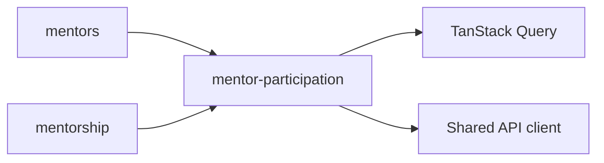
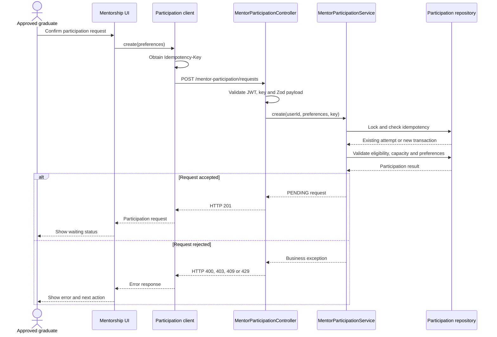

# Mentor participation

## Purpose and architecture

The frontend module owns the participation HTTP client, participation query, technical-selection query/mutation, response types, error helpers and slot-unavailable dialog shared by mentors and mentorship. Catalog requests use the shared API client. It exports a public `index.ts` and has no imports from either view module; existing public exports remain forwarding aliases, not duplicate hooks.

## Participation request sequence

This sequence describes how an approved graduate submits a waiting-list request when direct mentor activation is unavailable. The frontend uses the shared participation client, while the backend validates the request, enforces idempotency, and persists the result.

## Flows and endpoints

`useParticipation` retains `['mentors', 'participation', token]`. `useTechnicalAreas` retains `['mentors', 'technical-areas']`, its concurrent catalog/selection read, disabled retry, access-error handling, save cache update and suggestion/participation/directory/profile invalidations. The preview draft remains a single React context in mentorship. No new backend query or persistence store is introduced.

The client consumes `/mentors/me/participation`, `/mentors/capacity`, `/mentors/offers/:offerId/confirm`, `/mentors/me/leave`, `/mentor-participation/requests` and its `/me` and `/me/history` subroutes, `/technical-areas` and `/mentors/me/technical-areas`. Methods, authentication, idempotency and response rules are documented in [mentors](../mentors/README.md). Editing and preview semantics are documented in [mentorship](../mentorship/README.md).

## Sprint History

### Sprint 3

- Shared existing participation, intake and technical-selection behavior through one public API, removing the dependency back from mentorship to mentors.
