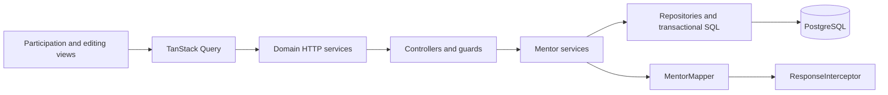
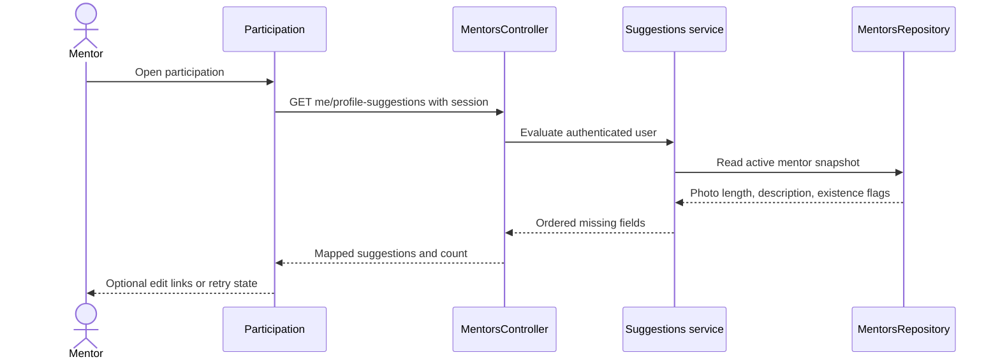
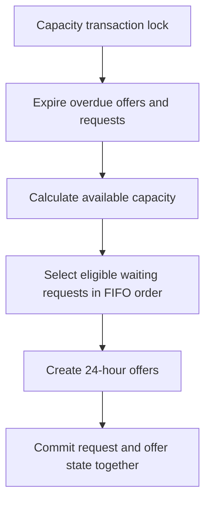
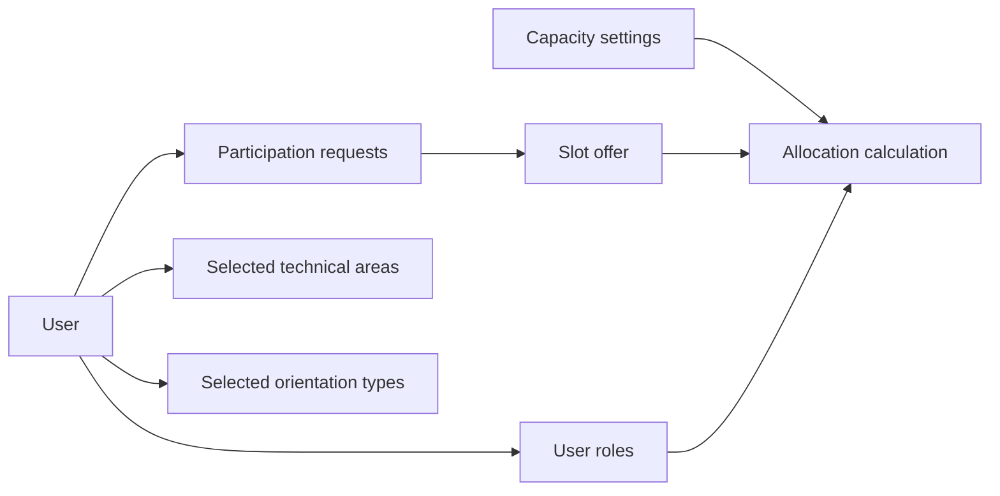

# Mentors

## Purpose and boundaries

The backend `mentors` module owns mentor participation, directory/profile reads, similar recommendations, profile suggestions, capacity and slot offers. The frontend `mentors` module provides participation, request history, technical-area editing and optional profile recommendations. Public browsing and preview belong to [mentorship](../mentorship/README.md); the administrative interface belongs to [mentor-capacity](../mentor-capacity/README.md).

## Architecture and dependencies

Controllers receive requests and session identity. Services coordinate eligibility and response mapping. Repositories persist through Prisma and parameterized SQL. `MentorMapper` builds directory/profile responses and enriches suggestions with titles, benefits, edit references and a count. `ResponseInterceptor` wraps successful JSON results in `statusCode`, `data`, `detail`, and `ok`.

`MentorsModule` imports AuthModule, ProfileModule and SkillsModule. Its public services are MentorsService and MentorProfileSuggestionsService. Frontend services use the shared API client; TanStack Query owns remote state. Profile, education and availability modules supply additional optional recommendations.

## Similar mentors

`findSimilar` first loads the active source mentor. Missing sources raise MentorNotFoundException. Candidate queries exclude that user, require active users and current mentor roles, and match technical areas or active orientation types. Ranking uses shared area count descending, then shared orientation count descending, then ID ascending. Only three IDs are hydrated, with ranking preserved. No matching areas/orientations produces an empty list. This recommendation does not apply the directory's optional availability filter.

## Profile completeness

The authenticated suggestions endpoint evaluates four independent conditions, in order:

| Code | Missing condition | Editing destination |
| --- | --- | --- |
| MISSING_PROFILE_PHOTO | Null or zero-byte photograph | `/profile/personal-info` |
| MISSING_PROFESSIONAL_DESCRIPTION | Null, empty or whitespace-only description | `/profile/presentation` |
| MISSING_SPECIALTY | No technical areas | `/mentors/participation/technical-areas` |
| MISSING_WORK_EXPERIENCE | No work experience | `/profile/trajectory/experience` |

A specialized snapshot selects photo byte length, description and existence flags in one read, without loading photo/document binaries. Suggestions are not persisted and do not block mentoring. Orientation types do not substitute for technical areas. A valid session without active mentor participation receives an empty list: combine this with participation status rather than interpreting it as a complete profile. Participation distinguishes ACTIVE, DEACTIVATED and NEVER; availability is independent of role participation.

Frontend primary suggestions consume the backend metadata. Additional recommendations cover professional headline, education, orientations and upcoming availability. Queries refresh on mount and window focus; technical-area saves invalidate suggestions and participation. Errors retain an explicit retry state and must not imply completeness. The two endpoints are separate reads, not an atomic snapshot.

## Participation, capacity and offers

Capacity is `ceil(approvedGraduates * percentage / 100)`, with fallback percentage 40 when absent. Occupied capacity is active mentors plus OFFERED offers whose expiry is still in the future. Available capacity is `max(0, capacity - occupied)`. Approved graduates require an active user, a current nondeleted titulado role and an approved access request. Mentor counting requires an active user and current nondeleted mentor role.

Intake verifies catalog selections, eligibility and existing participation. Activation and request creation use Idempotency-Key. Waiting requests are accepted when no capacity remains; existing requests or reserved offers prevent bypassing the intake flow. Preference updates and cancellation operate on the authenticated user's PENDING request.

Capacity mutations and reconciliation share PostgreSQL transaction advisory lock 1436, UTC transaction time and ReadCommitted isolation. Reconciliation expires overdue offers and their OFFERED requests, then selects eligible PENDING requests by queuedAt ascending and ID ascending. It revalidates user roles, catalog selections and absence of existing offers, locks selected rows, and reserves available capacity for 24 hours. The worker reconciles at startup and every 15 seconds outside the test environment. Administrative percentage updates also reconcile in the same transaction. GET overview/history endpoints do not reconcile or write business state. Reducing capacity never removes existing mentors or valid offers.

## Models and relationships

The implementation uses users/user_roles/roles, access_requests/access_request_statuses, technical_areas, orientation_types and mentor selection relations. Capacity settings, participation requests, slot offers and intake idempotency records support allocation. Profile suggestions read users, technical-area relations and work experience; they introduce no stored recommendation entity.

Database field definitions, indexes and deletion behavior belong to the Database-owned Prisma documentation.

## Endpoints and authorization

Paths below are relative to `/api`. Session routes derive ownership from CurrentUser; UUID path inputs are validated. Administrative routes also require the administrativo role.

| Method and path | Purpose and access |
| --- | --- |
| GET `/mentors` | Public active mentor list |
| GET `/mentors/directory` | Authenticated filtered directory, pages of six, including affinity ordering |
| GET `/mentors/:userId` | Public active mentor profile |
| GET `/mentors/:userId/similar` | Public similar mentors, maximum three |
| GET `/mentors/me/profile-suggestions` | Authenticated optional completeness suggestions |
| GET `/mentors/me/participation` | Authenticated participation status |
| GET, PATCH `/mentors/me/technical-areas` | Current active mentor's technical selections |
| GET, PATCH `/mentors/me/orientation-types` | Current active mentor's orientation selections |
| GET `/mentors/capacity` | Authenticated capacity snapshot |
| POST `/mentors/activate` | Authenticated idempotent activation |
| POST `/mentor-participation/requests` | Authenticated idempotent waiting request |
| GET `/mentor-participation/requests/me` | Current user's latest relevant request |
| GET `/mentor-participation/requests/me/history` | Current user's history |
| PATCH, DELETE `/mentor-participation/requests/me` | Update pending preferences or cancel |
| POST `/mentors/offers/:offerId/confirm` | Confirm the authenticated user's offer |
| POST `/mentors/me/leave` | Leave mentor participation |
| GET, PUT `/admin/mentor-capacity` | Administrative overview and percentage update |
| GET `/admin/mentor-capacity/requests` | Administrative FIFO waiting list |
| GET `/admin/mentor-capacity/offers` | Administrative offer history |

## History and errors

User history orders by queuedAt descending, then ID descending. Without pagination parameters it preserves the legacy array response. With either parameter it returns items, page, limit, total and totalPages; page defaults to 1 (maximum 1000000), limit to 10 (maximum 100). The frontend loads history only on its tab, includes session and page in the query key, and renders loading, empty, error/retry, pagination and a read-only detail containing selection counts.

Invalid input is rejected before service execution. Authentication/authorization failures remain 401/403; absent mentors and invalid selections retain existing domain exceptions. Intake conflicts retain their existing machine-readable codes and participation navigation. No new HTTP contract is introduced here.

## Sprint History

### Sprint 3

- Similar mentor ranking and profile navigation.
- Read-only completeness suggestions with edit links and refreshed query state.
- Temporary technical-area/orientation preview and explicit save/discard.
- Administrative capacity, FIFO reservations and expiry visibility.
- Paginated authenticated request history and read-only detail.
