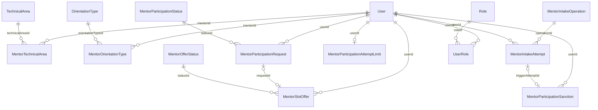

# Database integration proposal

Pending Database approval: insert the following mentor section before Sprint History in `backend/prisma/README.md` after DevOps synchronization. Preserve all Matching, Radar, Surveys and notification documentation already on develop. This proposal does not modify the protected folder. Source: schema and migrations at `49d7b3469ed402891cd8355f6c92419ee8f77137`.

## Mentor network

Prisma optional fields use `?`; arrays use `[]`. Scalar fields below list PostgreSQL types and exact Prisma attributes, including mapped column names, PK, defaults and uniqueness. `uuid()` is generated by Prisma; `dbgenerated` expressions run in PostgreSQL. `@updatedAt` is Prisma-managed, not an implicit database trigger. No audit field is assumed when absent.

The model is not a separate Mentor table: `User` and current `UserRole` rows identify mentors. `User.id` is a UUID PK in `users`; `UserRole.roleId` references `Role.id`. Eligibility additionally reads `AccessRequest.approvedUserId` (nullable unique UUID -> `User.id`, SetNull) and `statusId` (UUID -> `AccessRequestStatus.id`, Restrict). Those are eligibility inputs, not FKs from capacity settings. Profile suggestions read `User.photoUrl` (Bytes/bytea), `aboutMe` (String?/text) and `WorkExperience.userId` (UUID -> User.id, Cascade), without storing suggestions.

### MentorTechnicalArea (`mentor_technical_areas`)

| Field / column                          | Prisma / PostgreSQL           | Definition                                              |
| --------------------------------------- | ----------------------------- | ------------------------------------------------------- |
| `id` / `id`                             | `String` / `uuid`             | `@id @default(uuid()) @db.Uuid`                         |
| `mentorId` / `mentor_id`                | `String` / `uuid`             | `@map("mentor_id") @db.Uuid`                            |
| `technicalAreaId` / `technical_area_id` | `String` / `uuid`             | `@map("technical_area_id") @db.Uuid`                    |
| `createdAt` / `created_at`              | `DateTime` / `timestamptz(6)` | `@default(now()) @map("created_at") @db.Timestamptz(6)` |
| `updatedAt` / `updated_at`              | `DateTime` / `timestamptz(6)` | `@updatedAt @map("updated_at") @db.Timestamptz(6)`      |

| Relation        | Foreign key                             | Cardinality                                  | Delete / update parent              |
| --------------- | --------------------------------------- | -------------------------------------------- | ----------------------------------- |
| `mentor`        | `mentorId` -> `User.id`                 | 1 parent per child; 0..N children per parent | Cascade / Cascade (Prisma default)  |
| `technicalArea` | `technicalAreaId` -> `TechnicalArea.id` | 1 parent per child; 0..N children per parent | Restrict / Cascade (Prisma default) |

Model indexes and composite constraints: `@@unique([mentorId, technicalAreaId])`; `@@index([technicalAreaId])`.

### MentorOrientationType (`mentor_orientation_types`)

| Field / column                              | Prisma / PostgreSQL           | Definition                                              |
| ------------------------------------------- | ----------------------------- | ------------------------------------------------------- |
| `id` / `id`                                 | `String` / `uuid`             | `@id @default(uuid()) @db.Uuid`                         |
| `mentorId` / `mentor_id`                    | `String` / `uuid`             | `@map("mentor_id") @db.Uuid`                            |
| `orientationTypeId` / `orientation_type_id` | `String` / `uuid`             | `@map("orientation_type_id") @db.Uuid`                  |
| `createdAt` / `created_at`                  | `DateTime` / `timestamptz(6)` | `@default(now()) @map("created_at") @db.Timestamptz(6)` |
| `updatedAt` / `updated_at`                  | `DateTime` / `timestamptz(6)` | `@updatedAt @map("updated_at") @db.Timestamptz(6)`      |

| Relation          | Foreign key                                 | Cardinality                                  | Delete / update parent              |
| ----------------- | ------------------------------------------- | -------------------------------------------- | ----------------------------------- |
| `mentor`          | `mentorId` -> `User.id`                     | 1 parent per child; 0..N children per parent | Cascade / Cascade (Prisma default)  |
| `orientationType` | `orientationTypeId` -> `OrientationType.id` | 1 parent per child; 0..N children per parent | Restrict / Cascade (Prisma default) |

Model indexes and composite constraints: `@@unique([mentorId, orientationTypeId])`; `@@index([orientationTypeId])`.

### MentorParticipationRequest (`mentor_participation_requests`)

| Field / column                                | Prisma / PostgreSQL           | Definition                                                                                         |
| --------------------------------------------- | ----------------------------- | -------------------------------------------------------------------------------------------------- |
| `id` / `id`                                   | `String` / `uuid`             | `@id @default(uuid()) @db.Uuid`                                                                    |
| `userId` / `user_id`                          | `String` / `uuid`             | `@map("user_id") @db.Uuid`                                                                         |
| `status` / `status`                           | `String` / `varchar(20)`      | `@default("PENDING") @db.VarChar(20)`                                                              |
| `queuedAt` / `queued_at`                      | `DateTime` / `timestamptz(6)` | `@default(now()) @map("queued_at") @db.Timestamptz(6)`                                             |
| `createdAt` / `created_at`                    | `DateTime` / `timestamptz(6)` | `@default(now()) @map("created_at") @db.Timestamptz(6)`                                            |
| `technicalAreaIds` / `technical_area_ids`     | `String[]` / `uuid[]`         | `@map("technical_area_ids") @db.Uuid`                                                              |
| `orientationTypeIds` / `orientation_type_ids` | `String[]` / `uuid[]`         | `@map("orientation_type_ids") @db.Uuid`                                                            |
| `updatedAt` / `updated_at`                    | `DateTime` / `timestamptz(6)` | `@default(now()) @updatedAt @map("updated_at") @db.Timestamptz(6)`                                 |
| `statusId` / `status_id`                      | `String` / `uuid`             | `@default(dbgenerated("mentor_participation_status('PENDING'::text)")) @map("status_id") @db.Uuid` |

| Relation        | Foreign key                                  | Cardinality                                  | Delete / update parent              |
| --------------- | -------------------------------------------- | -------------------------------------------- | ----------------------------------- |
| `user`          | `userId` -> `User.id`                        | 1 parent per child; 0..N children per parent | Restrict / Cascade (Prisma default) |
| `statusCatalog` | `statusId` -> `MentorParticipationStatus.id` | 1 parent per child; 0..N children per parent | Restrict / Restrict                 |

Model indexes and composite constraints: `@@index([status, queuedAt, id])`; `@@index([userId])`; `@@index([statusId])`.

### MentorSlotOffer (`mentor_slot_offers`)

| Field / column                 | Prisma / PostgreSQL            | Definition                                                                                 |
| ------------------------------ | ------------------------------ | ------------------------------------------------------------------------------------------ |
| `id` / `id`                    | `String` / `uuid`              | `@id @default(uuid()) @db.Uuid`                                                            |
| `userId` / `user_id`           | `String` / `uuid`              | `@map("user_id") @db.Uuid`                                                                 |
| `status` / `status`            | `String` / `varchar(20)`       | `@default("OFFERED") @db.VarChar(20)`                                                      |
| `offeredAt` / `offered_at`     | `DateTime` / `timestamptz(6)`  | `@default(now()) @map("offered_at") @db.Timestamptz(6)`                                    |
| `expiresAt` / `expires_at`     | `DateTime` / `timestamptz(6)`  | `@map("expires_at") @db.Timestamptz(6)`                                                    |
| `requestId` / `request_id`     | `String?` / `uuid`             | `@unique @map("request_id") @db.Uuid`                                                      |
| `confirmedAt` / `confirmed_at` | `DateTime?` / `timestamptz(6)` | `@map("confirmed_at") @db.Timestamptz(6)`                                                  |
| `createdAt` / `created_at`     | `DateTime` / `timestamptz(6)`  | `@default(now()) @map("created_at") @db.Timestamptz(6)`                                    |
| `updatedAt` / `updated_at`     | `DateTime` / `timestamptz(6)`  | `@default(now()) @updatedAt @map("updated_at") @db.Timestamptz(6)`                         |
| `statusId` / `status_id`       | `String` / `uuid`              | `@default(dbgenerated("mentor_offer_status('OFFERED'::text)")) @map("status_id") @db.Uuid` |

| Relation        | Foreign key                                    | Cardinality                                     | Delete / update parent              |
| --------------- | ---------------------------------------------- | ----------------------------------------------- | ----------------------------------- |
| `user`          | `userId` -> `User.id`                          | 1 parent per child; 0..N children per parent    | Restrict / Cascade (Prisma default) |
| `request`       | `requestId` -> `MentorParticipationRequest.id` | 0..1 parent per child; 0..1 children per parent | Restrict / Cascade (Prisma default) |
| `statusCatalog` | `statusId` -> `MentorOfferStatus.id`           | 1 parent per child; 0..N children per parent    | Restrict / Restrict                 |

Model indexes and composite constraints: `@@index([status, expiresAt])`; `@@index([userId])`; `@@index([statusId])`.

### MentorCapacitySetting (`mentor_capacity_settings`)

| Field / column              | Prisma / PostgreSQL           | Definition                                              |
| --------------------------- | ----------------------------- | ------------------------------------------------------- |
| `id` / `id`                 | `Int` / `integer`             | `@id`                                                   |
| `percentage` / `percentage` | `Int` / `integer`             | `@default(40)`                                          |
| `updatedAt` / `updated_at`  | `DateTime` / `timestamptz(6)` | `@default(now()) @map("updated_at") @db.Timestamptz(6)` |

No outgoing foreign keys.

Model indexes and composite constraints: none beyond the PK and field-level unique constraints listed above.

### MentorParticipationAttemptLimit (`mentor_participation_attempt_limits`)

| Field / column                          | Prisma / PostgreSQL            | Definition                                     |
| --------------------------------------- | ------------------------------ | ---------------------------------------------- |
| `userId` / `user_id`                    | `String` / `uuid`              | `@id @map("user_id") @db.Uuid`                 |
| `attemptCount` / `attempt_count`        | `Int` / `integer`              | `@default(0) @map("attempt_count")`            |
| `windowStartedAt` / `window_started_at` | `DateTime?` / `timestamptz(6)` | `@map("window_started_at") @db.Timestamptz(6)` |
| `blockedUntil` / `blocked_until`        | `DateTime?` / `timestamptz(6)` | `@map("blocked_until") @db.Timestamptz(6)`     |

| Relation | Foreign key           | Cardinality                                  | Delete / update parent             |
| -------- | --------------------- | -------------------------------------------- | ---------------------------------- |
| `user`   | `userId` -> `User.id` | 1 parent per child; 0..1 children per parent | Cascade / Cascade (Prisma default) |

Model indexes and composite constraints: none beyond the PK and field-level unique constraints listed above.

### MentorIntakeAttempt (`mentor_intake_attempts`)

| Field / column                       | Prisma / PostgreSQL           | Definition                                                                                       |
| ------------------------------------ | ----------------------------- | ------------------------------------------------------------------------------------------------ |
| `operationId` / `operation_id`       | `String` / `uuid`             | `@default(dbgenerated("mentor_intake_operation('LEGACY'::text)")) @map("operation_id") @db.Uuid` |
| `id` / `id`                          | `String` / `uuid`             | `@id @default(dbgenerated("gen_random_uuid()")) @db.Uuid`                                        |
| `userId` / `user_id`                 | `String` / `uuid`             | `@map("user_id") @db.Uuid`                                                                       |
| `operation` / `operation`            | `String` / `varchar(20)`      | `@db.VarChar(20)`                                                                                |
| `idempotencyKey` / `idempotency_key` | `String` / `uuid`             | `@map("idempotency_key") @db.Uuid`                                                               |
| `payloadHash` / `payload_hash`       | `String` / `varchar(64)`      | `@map("payload_hash") @db.VarChar(64)`                                                           |
| `occurredAt` / `occurred_at`         | `DateTime` / `timestamptz(6)` | `@default(dbgenerated("clock_timestamp()")) @map("occurred_at") @db.Timestamptz(6)`              |
| `counted` / `counted`                | `Boolean` / `boolean`         | `@default(true)`                                                                                 |
| `responseStatus` / `response_status` | `Int` / `integer`             | `@map("response_status")`                                                                        |
| `responseData` / `response_data`     | `Json` / `jsonb`              | `@map("response_data")`                                                                          |

| Relation          | Foreign key                                 | Cardinality                                  | Delete / update parent |
| ----------------- | ------------------------------------------- | -------------------------------------------- | ---------------------- |
| `intakeOperation` | `operationId` -> `MentorIntakeOperation.id` | 1 parent per child; 0..N children per parent | Restrict / NoAction    |
| `user`            | `userId` -> `User.id`                       | 1 parent per child; 0..N children per parent | Restrict / NoAction    |

Model indexes and composite constraints: `@@unique([userId, operation, idempotencyKey], map: "mentor_intake_attempts_identity")`; `@@index([operationId])`.

### MentorParticipationSanction (`mentor_participation_sanctions`)

| Field / column                            | Prisma / PostgreSQL           | Definition                                                |
| ----------------------------------------- | ----------------------------- | --------------------------------------------------------- |
| `id` / `id`                               | `String` / `uuid`             | `@id @default(dbgenerated("gen_random_uuid()")) @db.Uuid` |
| `userId` / `user_id`                      | `String` / `uuid`             | `@map("user_id") @db.Uuid`                                |
| `triggerAttemptId` / `trigger_attempt_id` | `String?` / `uuid`            | `@unique @map("trigger_attempt_id") @db.Uuid`             |
| `startedAt` / `started_at`                | `DateTime` / `timestamptz(6)` | `@map("started_at") @db.Timestamptz(6)`                   |
| `endsAt` / `ends_at`                      | `DateTime` / `timestamptz(6)` | `@map("ends_at") @db.Timestamptz(6)`                      |

| Relation         | Foreign key                                    | Cardinality                                     | Delete / update parent |
| ---------------- | ---------------------------------------------- | ----------------------------------------------- | ---------------------- |
| `user`           | `userId` -> `User.id`                          | 1 parent per child; 0..N children per parent    | Restrict / NoAction    |
| `triggerAttempt` | `triggerAttemptId` -> `MentorIntakeAttempt.id` | 0..1 parent per child; 0..1 children per parent | Restrict / NoAction    |

Model indexes and composite constraints: `@@index([userId, endsAt], map: "mentor_participation_sanctions_active")`.

### MentorIntakeOperation (`mentor_intake_operations`)

| Field / column                | Prisma / PostgreSQL           | Definition                                                         |
| ----------------------------- | ----------------------------- | ------------------------------------------------------------------ |
| `id` / `id`                   | `String` / `uuid`             | `@id @default(uuid()) @db.Uuid`                                    |
| `title` / `title`             | `String` / `varchar(30)`      | `@unique @db.VarChar(30)`                                          |
| `description` / `description` | `String?` / `text`            | `No explicit default or constraints`                               |
| `createdAt` / `created_at`    | `DateTime` / `timestamptz(6)` | `@default(now()) @map("created_at") @db.Timestamptz(6)`            |
| `updatedAt` / `updated_at`    | `DateTime` / `timestamptz(6)` | `@default(now()) @updatedAt @map("updated_at") @db.Timestamptz(6)` |

No outgoing foreign keys.

Model indexes and composite constraints: none beyond the PK and field-level unique constraints listed above.

### MentorParticipationStatus (`mentor_request_statuses`)

| Field / column                | Prisma / PostgreSQL           | Definition                                                         |
| ----------------------------- | ----------------------------- | ------------------------------------------------------------------ |
| `id` / `id`                   | `String` / `uuid`             | `@id @default(dbgenerated("gen_random_uuid()")) @db.Uuid`          |
| `title` / `title`             | `String` / `varchar(20)`      | `@unique @db.VarChar(20)`                                          |
| `description` / `description` | `String?` / `text`            | `No explicit default or constraints`                               |
| `createdAt` / `created_at`    | `DateTime` / `timestamptz(6)` | `@default(now()) @map("created_at") @db.Timestamptz(6)`            |
| `updatedAt` / `updated_at`    | `DateTime` / `timestamptz(6)` | `@default(now()) @updatedAt @map("updated_at") @db.Timestamptz(6)` |

No outgoing foreign keys.

Model indexes and composite constraints: none beyond the PK and field-level unique constraints listed above.

### MentorOfferStatus (`mentor_offer_statuses`)

| Field / column                | Prisma / PostgreSQL           | Definition                                                         |
| ----------------------------- | ----------------------------- | ------------------------------------------------------------------ |
| `id` / `id`                   | `String` / `uuid`             | `@id @default(dbgenerated("gen_random_uuid()")) @db.Uuid`          |
| `title` / `title`             | `String` / `varchar(20)`      | `@unique @db.VarChar(20)`                                          |
| `description` / `description` | `String?` / `text`            | `No explicit default or constraints`                               |
| `createdAt` / `created_at`    | `DateTime` / `timestamptz(6)` | `@default(now()) @map("created_at") @db.Timestamptz(6)`            |
| `updatedAt` / `updated_at`    | `DateTime` / `timestamptz(6)` | `@default(now()) @updatedAt @map("updated_at") @db.Timestamptz(6)` |

No outgoing foreign keys.

Model indexes and composite constraints: none beyond the PK and field-level unique constraints listed above.

### TechnicalArea (`technical_areas`)

| Field / column                | Prisma / PostgreSQL           | Definition                                              |
| ----------------------------- | ----------------------------- | ------------------------------------------------------- |
| `id` / `id`                   | `String` / `uuid`             | `@id @default(uuid()) @db.Uuid`                         |
| `name` / `name`               | `String` / `varchar(80)`      | `@unique @db.VarChar(80)`                               |
| `description` / `description` | `String?` / `text`            | `No explicit default or constraints`                    |
| `createdAt` / `created_at`    | `DateTime` / `timestamptz(6)` | `@default(now()) @map("created_at") @db.Timestamptz(6)` |
| `updatedAt` / `updated_at`    | `DateTime` / `timestamptz(6)` | `@updatedAt @map("updated_at") @db.Timestamptz(6)`      |

No outgoing foreign keys.

Model indexes and composite constraints: none beyond the PK and field-level unique constraints listed above.

### OrientationType (`orientation_types`)

| Field / column                | Prisma / PostgreSQL           | Definition                                              |
| ----------------------------- | ----------------------------- | ------------------------------------------------------- |
| `id` / `id`                   | `String` / `uuid`             | `@id @default(uuid()) @db.Uuid`                         |
| `name` / `name`               | `String` / `varchar(60)`      | `@unique @db.VarChar(60)`                               |
| `description` / `description` | `String?` / `text`            | `No explicit default or constraints`                    |
| `isActive` / `is_active`      | `Boolean` / `boolean`         | `@default(true) @map("is_active")`                      |
| `createdAt` / `created_at`    | `DateTime` / `timestamptz(6)` | `@default(now()) @map("created_at") @db.Timestamptz(6)` |
| `updatedAt` / `updated_at`    | `DateTime` / `timestamptz(6)` | `@updatedAt @map("updated_at") @db.Timestamptz(6)`      |

No outgoing foreign keys.

Model indexes and composite constraints: none beyond the PK and field-level unique constraints listed above.

### Role (`roles`)

| Field / column             | Prisma / PostgreSQL           | Definition                                              |
| -------------------------- | ----------------------------- | ------------------------------------------------------- |
| `id` / `id`                | `String` / `uuid`             | `@id @default(uuid()) @db.Uuid`                         |
| `name` / `name`            | `String` / `varchar(50)`      | `@unique @db.VarChar(50)`                               |
| `createdAt` / `created_at` | `DateTime` / `timestamptz(6)` | `@default(now()) @map("created_at") @db.Timestamptz(6)` |
| `updatedAt` / `updated_at` | `DateTime` / `timestamptz(6)` | `@updatedAt @map("updated_at") @db.Timestamptz(6)`      |

No outgoing foreign keys.

Model indexes and composite constraints: none beyond the PK and field-level unique constraints listed above.

### UserRole (`user_roles`)

| Field / column             | Prisma / PostgreSQL            | Definition                                              |
| -------------------------- | ------------------------------ | ------------------------------------------------------- |
| `id` / `id`                | `String` / `uuid`              | `@id @default(uuid()) @db.Uuid`                         |
| `userId` / `user_id`       | `String` / `uuid`              | `@map("user_id") @db.Uuid`                              |
| `roleId` / `role_id`       | `String` / `uuid`              | `@map("role_id") @db.Uuid`                              |
| `startAt` / `start_at`     | `DateTime` / `timestamptz(6)`  | `@default(now()) @map("start_at") @db.Timestamptz(6)`   |
| `deletedAt` / `deleted_at` | `DateTime?` / `timestamptz(6)` | `@map("deleted_at") @db.Timestamptz(6)`                 |
| `createdAt` / `created_at` | `DateTime` / `timestamptz(6)`  | `@default(now()) @map("created_at") @db.Timestamptz(6)` |
| `updatedAt` / `updated_at` | `DateTime` / `timestamptz(6)`  | `@updatedAt @map("updated_at") @db.Timestamptz(6)`      |

| Relation | Foreign key           | Cardinality                                  | Delete / update parent              |
| -------- | --------------------- | -------------------------------------------- | ----------------------------------- |
| `user`   | `userId` -> `User.id` | 1 parent per child; 0..N children per parent | Cascade / Cascade (Prisma default)  |
| `role`   | `roleId` -> `Role.id` | 1 parent per child; 0..N children per parent | Restrict / Cascade (Prisma default) |

Model indexes and composite constraints: `@@unique([userId, roleId, startAt])`; `@@index([roleId])`; `@@index([userId])`.

### AccessRequestStatus (`access_request_statuses`)

| Field / column                | Prisma / PostgreSQL           | Definition                                              |
| ----------------------------- | ----------------------------- | ------------------------------------------------------- |
| `id` / `id`                   | `String` / `uuid`             | `@id @default(uuid()) @db.Uuid`                         |
| `title` / `title`             | `String` / `varchar(100)`     | `@unique @db.VarChar(100)`                              |
| `description` / `description` | `String?` / `text`            | `No explicit default or constraints`                    |
| `createdAt` / `created_at`    | `DateTime` / `timestamptz(6)` | `@default(now()) @map("created_at") @db.Timestamptz(6)` |
| `updatedAt` / `updated_at`    | `DateTime` / `timestamptz(6)` | `@updatedAt @map("updated_at") @db.Timestamptz(6)`      |

No outgoing foreign keys.

Model indexes and composite constraints: none beyond the PK and field-level unique constraints listed above.

## Relationships

## SQL constraints, catalogs and audit behavior

- Requests: `mentor_participation_requests_preferences_check` requires both UUID arrays to have positive cardinality. Array elements are not SQL FKs to catalogs; services validate selected IDs and uniqueness. Catalog deactivation does not cascade through these arrays.
- `mentor_participation_requests_one_open_per_user` is unique on `user_id` only for PENDING/OFFERED requests. `mentor_requests_legacy_open` repeats that partial rule for compatibility; `mentor_requests_legacy_fifo` indexes status/queued_at/id.
- Slot offers have a nullable unique `request_id`: a request has zero or one offer; legacy offers can have no request. `mentor_offers_legacy_open` enforces one OFFERED offer per user. SQL also retains `mentor_slot_offers_one_offer_per_user` for the same partial condition. `mentor_slot_offers_expiry_check` requires expires_at > offered_at. Expiry is explicit, not a column default of 24 hours.
- `MentorCapacitySetting` is the existing integer singleton, not a UUID entity. SQL restricts `id = 1` and percentage to 1..100. It has no FK, createdAt, or Prisma `@updatedAt`; updates explicitly set its timestamp. Default percentage is 40.
- Request catalog titles: PENDING, OFFERED, ACTIVE, CANCELLED, EXPIRED, ENDED. Offer catalog titles: OFFERED, CONFIRMED, EXPIRED. `status` remains for SQL compatibility; `statusId` is the real catalog FK. Compatibility triggers synchronize/validate both representations. They are not independent sources of state and there is no PAUSED catalog value.
- `mentor_participation_requests_touch_audit` and `mentor_slot_offers_touch_audit` set updated_at with clock_timestamp() on SQL updates, in addition to Prisma @updatedAt. Catalogs expose createdAt/updatedAt as shown above.
- Additional SQL-only rules: `mentor_intake_attempts_window` indexes (user_id, occurred_at) WHERE counted; response_status is constrained to 200..499; sanctions require ends_at = started_at + 72 hours; the legacy attempt-limit counter requires attempt_count >= 0.
- Intake operation catalog values are ACTIVATE, REQUEST and LEGACY; the operation compatibility trigger keeps operation and operationId synchronized. `mentor_intake_attempts_identity` and its legacy compatibility index enforce user/operation/idempotency-key uniqueness. Sanction and attempt legacy records have the exact time fields listed above, not invented createdAt/updatedAt fields.
- Technical/orientation joins have their own UUID PK and unique mentor/catalog pairs; deleting a user cascades selections, but deleting a referenced catalog is restricted. Current role participation is distinct from availability and requests.

Sources for SQL-only constraints and compatibility: `20261026040000_mentor_fifo_offers`, `20261028010000_mentor_intake_compatibility`, `20261029020000_mentor_intake_catalogs`, `20261104120000_index_uncovered_foreign_keys`, and `20261108160000_complete_document_audit_and_mentor_catalogs`. Also inspected: `20261026030000_mentor_eligibility_capacity`, `20261026190000_mentor_participation_attempt_limits` and `20261116150000_mentor_capacity_setting`. Reconcile against the synchronized schema before applying this proposal; no migration was run.

## Sprint History

### Sprint 3

- Add to the existing Sprint 3 list: mentor participation requests, FIFO offers and expiry, capacity singleton, status/operation catalogs, idempotent intake and sanctions, technical/orientation selections, actual audit fields, SQL constraints and deletion behavior.
