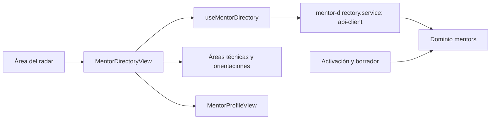
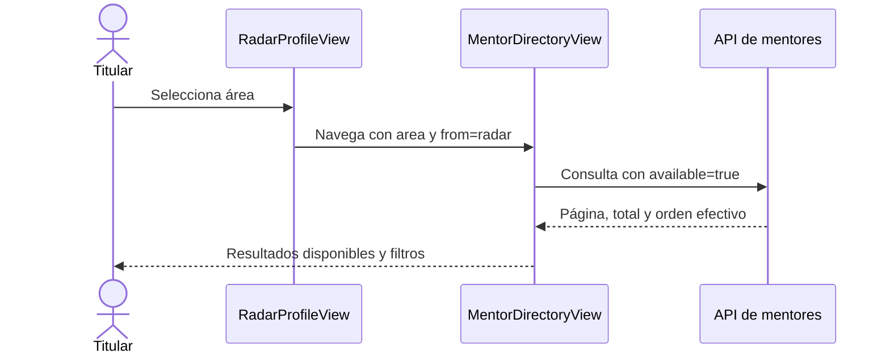

# Mentoría

## Propósito y responsabilidades

`frontend/src/modules/mentorship` ofrece el directorio, perfil público de mentor, activación y configuración de orientaciones. Consume los dominios backend `mentors`, `technical-areas` y `orientation-types`. La integración de HU2 usa las áreas publicadas por el `index.ts` de `radar-chart`, sin importar sus carpetas privadas.

## Arquitectura y dependencias

La navegación usa rutas del servidor que renderizan vistas interactivas. TanStack Query gestiona consultas y errores. El borrador del asistente usa los servicios compartidos de almacenamiento y no abre IndexedDB en componentes.

## Flujos y reglas

La URL conserva búsqueda, área, orientación, disponibilidad, orden y página. Los parámetros se normalizan antes de consultar. Al llegar desde radar se fuerza disponibilidad y se usan sus seis áreas; los estados sin resultados, carga y error se muestran explícitamente. El cliente permite reintentar y no inventa mentores ante un fallo. La simulación de puntuación pertenece al módulo radar y no altera perfiles ni disponibilidad.

La activación envía `Idempotency-Key` mediante el servicio compartido, para evitar duplicar operaciones al reintentar. La configuración de orientaciones se obtiene del catálogo y se actualiza para el mentor autenticado. La autorización definitiva reside en backend.

## Endpoints consumidos

| Método y ruta | Uso |
| --- | --- |
| `GET /mentors/directory` | Directorio con filtros, paginación y orden |
| `GET /mentors/:id` | Perfil de mentor |
| `POST /mentors/activate` | Activación idempotente |
| `GET /technical-areas` | Catálogo de áreas técnicas |
| `GET /orientation-types` | Catálogo de orientaciones |
| `GET /mentors/me/orientation-types` | Orientaciones propias |
| `PATCH /mentors/me/orientation-types` | Actualizar orientaciones propias |

Los servicios extraen `data` del contrato común y usan el cliente HTTP centralizado. Los errores del perfil se traducen a estado no disponible cuando corresponde; los demás se presentan al usuario para reintento.

## Validación

Las pruebas cubren servicios HTTP, navegación y normalización, filtros desde radar, estados de consulta, catálogo, perfil y asistente. Los cambios de HU2 deben conservar el filtro obligatorio de disponibilidad y la correspondencia de áreas.

## Sprint History

### Sprint 3

- HU2 de Épica 3: acceso desde un área del radar al directorio disponible.
- Simulación en radar basada en la consulta real de mentores.
- Adecuación: consumo de áreas mediante la API pública del módulo radar.
