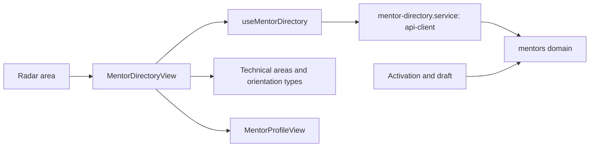
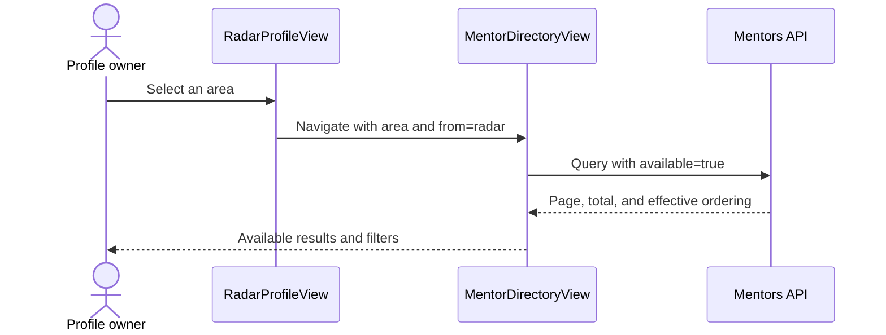

# Mentorship

## Purpose and responsibilities

`frontend/src/modules/mentorship` provides the directory, public mentor profile, activation flow, and orientation settings. It consumes the backend domains `mentors`, `technical-areas`, and `orientation-types`. The radar directory integration uses the areas exported by the `radar-chart` module's `index.ts`, without importing its private folders.

## Architecture and dependencies

Navigation uses server routes that render interactive views. TanStack Query handles queries and errors. The wizard draft uses shared storage services; components do not open IndexedDB.

## Flows and rules

The URL preserves search, area, orientation, availability, ordering, and page. Parameters are normalized before querying. Navigation from radar forces availability and uses its six areas; empty, loading, and error states are explicit. The client allows retrying and does not invent mentors when a query fails. Score simulation belongs to the radar module and does not change profiles or availability.

Activation sends `Idempotency-Key` through the shared service to prevent duplicate operations on retry. Orientation settings come from the catalog and are updated for the authenticated mentor. Backend authorization remains authoritative.

## Radar entry point and simulation boundary

From a selected radar area, **Ver mentores de esta area** opens `/mentorship/mentors?area=<encodedAreaName>&from=radar`. The directory normalizes the area against the radar area names and forces the availability filter for this entry point. The URL retains search, area, orientation, ordering and pagination so filtering and returning to the directory preserve context.

`GET /mentors/directory` receives the selected area and `available=true`; results include `items`, `totalItems`, pagination and effective ordering. The directory handles loading, empty results and errors with retry. It does not substitute demonstration mentors for unavailable data.

The same public `useMentorDirectory` hook is consumed by the Radar simulation dialog with page 1, an empty search and default sort. Its total result count determines whether a projected gain is available; the number of cards in the first page is not treated as the full mentor count.

| Responsibility                                                                | Owning module                                                                |
| ----------------------------------------------------------------------------- | ---------------------------------------------------------------------------- |
| Area selection, projected axis, projected average and clearing the simulation | [radar-chart](../radar-chart/README.md#mentors-by-area-and-score-simulation) |
| Directory filters, pagination, mentor profile navigation and API access       | `mentorship`                                                                 |
| Mentor records and directory authorization                                    | Backend `mentors` domain                                                     |
| Verified skills, persisted scores and publication versions                    | [radar-integration](../radar-integration/README.md)                          |

Finding an available mentor does not schedule a session or persist a new skill. Radar's illustrative gain is at most one point on the selected axis, capped at 10; the directory itself does not calculate or write scores.

## Consumed endpoints

| Method and path                       | Purpose                                          |
| ------------------------------------- | ------------------------------------------------ |
| `GET /mentors/directory`              | Directory with filters, pagination, and ordering |
| `GET /mentors/:id`                    | Mentor profile                                   |
| `POST /mentors/activate`              | Idempotent activation                            |
| `GET /technical-areas`                | Technical area catalog                           |
| `GET /orientation-types`              | Orientation type catalog                         |
| `GET /mentors/me/orientation-types`   | Current mentor's orientation types               |
| `PATCH /mentors/me/orientation-types` | Update the current mentor's orientation types    |

Services extract `data` from the common response contract and use the centralized HTTP client. Profile errors become an unavailable state where appropriate; other errors are presented to the user for retry.

## Validation

Tests cover HTTP services, navigation and normalization, radar filters, query states, catalogs, profiles, and the wizard. Directory integration changes must preserve the mandatory availability filter and area mapping.

## Sprint History

### Sprint 3

- Radar directory integration: navigate from a radar area to the available mentor directory.
- Radar simulation based on actual mentor queries.
- Standards alignment: consume areas through the radar module's public API.
