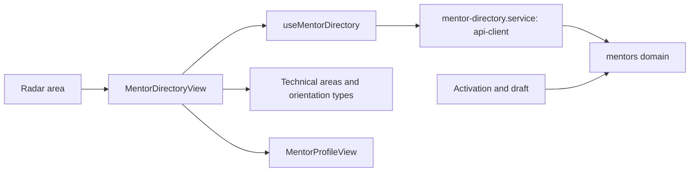
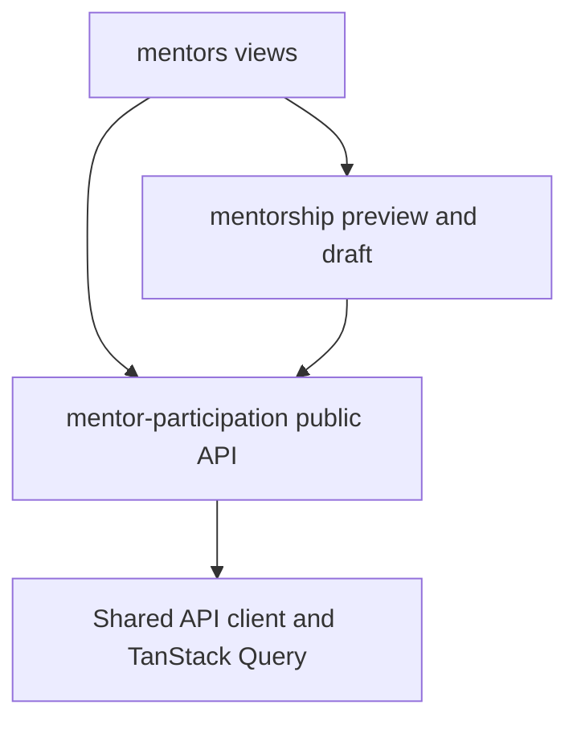
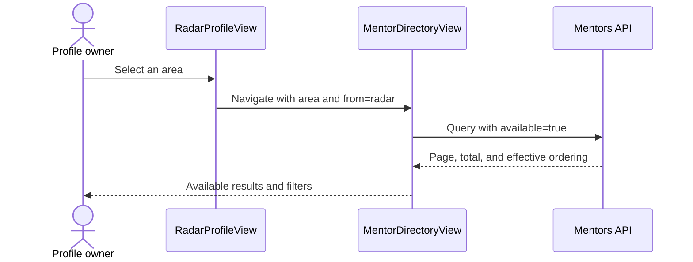
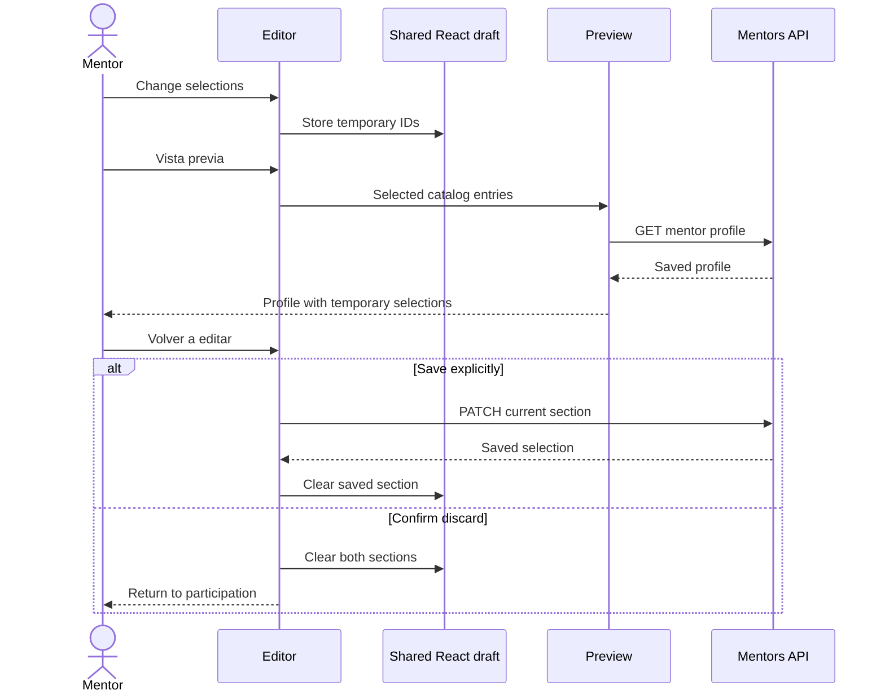

# Mentorship

## Purpose and responsibilities

`frontend/src/modules/mentorship` provides the directory, public mentor profile, activation flow, and orientation settings. It consumes the backend domains `mentors`, `technical-areas`, and `orientation-types`. The radar directory integration uses the areas exported by the `radar-chart` module's `index.ts`, without importing its private folders.

## Architecture and dependencies

Shared participation hooks, HTTP services, error helpers, request types and the slot-unavailable dialog belong to [mentor-participation](../mentor-participation/README.md). Its API has no dependency on either view module. Existing public exports forward to that single implementation. Catalog HTTP access is shared there; catalog persistence remains owned by the backend technical-areas domain. No generic shared module previously owned this domain behavior.

Navigation uses server routes that render interactive views. TanStack Query handles queries and errors. The wizard draft uses shared storage services; components do not open IndexedDB.

## Flows and rules

The URL preserves search, area, orientation, availability, ordering, and page. Parameters are normalized before querying. Navigation from radar forces availability and uses its six areas; empty, loading, and error states are explicit. The client allows retrying and does not invent mentors when a query fails. Score simulation belongs to the radar module and does not change profiles or availability.

Activation sends `Idempotency-Key` through the shared service to prevent duplicate operations on retry. Orientation settings come from the catalog and are updated for the authenticated mentor. Backend authorization remains authoritative.

## Radar entry point and simulation boundary

From a selected radar area, **Ver mentores de esta area** opens `/mentorship/mentors?area=<encodedAreaName>&from=radar`. The directory normalizes the area against the radar area names and forces the availability filter for this entry point. The URL retains search, area, orientation, ordering and pagination so filtering and returning to the directory preserve context.

`GET /mentors/directory` accepts `area` for a single specialty or `areaIds` for a comma-separated list of specialty UUIDs. The two filters are mutually exclusive. With `areaIds`, a mentor matches any listed specialty. The radar entry point resolves the IDs against the technical-area catalog and sends `available=true`. Results include `items`, `totalItems`, pagination and effective ordering. The directory handles loading, empty results and errors with retry.

The Radar dialog can use the public `useMentorDirectory` hook to display availability for the selected area. The result's `totalItems` is the full count for the applied filters. Score projection uses the selected skill and the radar rubric independently of mentor availability.

| Responsibility                                                                | Owning module                                                                |
| ----------------------------------------------------------------------------- | ---------------------------------------------------------------------------- |
| Area selection, projected axis, projected average and clearing the simulation | [radar-chart](../radar-chart/README.md#mentors-by-area-and-score-simulation) |
| Directory filters, pagination, mentor profile navigation and API access       | `mentorship`                                                                 |
| Mentor records and directory authorization                                    | Backend `mentors` domain                                                     |
| Verified skills, persisted scores and publication versions                    | [radar-integration](../radar-integration/README.md)                          |

Finding an available mentor does not schedule a session or persist a new skill. Radar's illustrative gain is at most one point on the selected axis, capped at 10; the directory itself does not calculate or write scores.

## Similar mentors and profile states

The profile includes “También podría interesarte”. `useSimilarMentors` calls the similar-mentors service with an AbortSignal and the key `['mentorship', 'similar', mentorId]`; it is enabled only with a mentor ID and the caller's enable flag. `useMentorProfile` uses `['mentorship', 'profile', mentorId]`. The backend excludes the current mentor, orders by matching areas, orientations and ID, and returns at most three. Loading, empty and failure states are distinct; cards navigate to the selected profile.

## Temporary preview and editing

`MentorProfileDraftProvider` shares temporary technicalAreaIds and orientationTypeIds in React state. Null means use the saved selection; an empty array means an explicitly empty draft. This editing draft is not persisted to IndexedDB. The activation wizard's existing shared-storage draft is a separate flow.

TechnicalAreasView belongs to mentors; OrientationConfigView belongs to mentorship. Both consume the public API of `mentor-participation` for shared participation queries and technical selections. `mentors` consumes preview, orientation and draft exports from `mentorship`; `mentorship` never imports `mentors`. Preview loads the existing profile and overlays the selected catalog entries through props. It suppresses the request action, shows “MODO VISTA PREVIA”, and returns through “Volver a editar”. Preview does not issue a write. Each editor saves its own selection; previewing both selections does not make save an atomic two-section update.

Technical-area saving requires at least one selection and active-mentor access. Orientation saving validates a nonempty selection and opens a confirmation dialog. Cancel with changes opens DiscardChangesDialog; confirmation clears both drafts and navigates to `/mentors/participation`. Successful saves clear only the saved section's draft. A failed save preserves editing state and reports an error.

## Query lifecycle and permissions

Technical-area editing uses `['mentors', 'technical-areas']`, disables automatic retry and distinguishes 401/403/404 access errors from loading errors. Orientation editing uses `['mentorship', 'orientation-config']`; a missing active mentor becomes the activation fallback. Both expose manual retry and mutation loading state.

Saves update selection cache and invalidate participation, directory and profile queries; technical-area saving also invalidates profile suggestions. Similar queries use their own key and the normal query lifecycle; saves currently do not explicitly invalidate that key. Authentication and active-mentor authorization are enforced by the API, independently of UI controls. Catalog ownership stays with technical-areas and orientation-types; profile and work-experience data are displayed without changing those domains' contracts.

## Consumed endpoints

| Method and path                         | Purpose                                          |
| --------------------------------------- | ------------------------------------------------ |
| `GET /mentors/directory`                | Directory with filters, pagination, and ordering |
| `GET /mentors/:id`                      | Mentor profile                                   |
| `POST /mentors/activate`                | Idempotent activation                            |
| `GET /technical-areas`                  | Technical area catalog                           |
| `GET /orientation-types`                | Orientation type catalog                         |
| `GET /mentors/me/orientation-types`     | Current mentor's orientation types               |
| `PATCH /mentors/me/orientation-types`   | Update the current mentor's orientation types    |
| GET `/mentors/:userId/similar`          | Similar profile cards                            |
| GET `/mentors/me/technical-areas`       | Saved technical selections                       |
| PATCH `/mentors/me/technical-areas`     | Explicit save from technical-area editing        |
| `GET /mentors/me/participation`         | Current participation and saved selections       |
| `GET /mentors/capacity`                 | Capacity before intake                           |
| `GET /mentor-participation/requests/me` | Existing request or reservation                  |
| `POST /mentor-participation/requests`   | Idempotent waiting request                       |

Services extract `data` from the common response contract and use the centralized HTTP client. Profile errors become an unavailable state where appropriate; other errors are presented to the user for retry.

## Validation

Tests cover HTTP services, navigation and normalization, radar filters, query states, catalogs, profiles, and the wizard. Directory integration changes must preserve the mandatory availability filter and area mapping.

## Action styling

Cancelling orientation configuration uses the shared outlined style. The confirmation dialog keeps the editor open if the user dismisses it.

## Sprint History

### Sprint 3

- The mentor directory uses equal-width filters and a dedicated action row on phones and tablets. Compact result cards place the mentor name beside the avatar and keep the availability status in the normal reading order.
- Radar directory integration: navigate from a radar area to the available mentor directory.
- Mentor availability for radar areas resolved through the directory.
- Standards alignment: consume areas through the radar module's public API.

- Similar mentor cards with loading, empty and error states.
- Shared temporary selections, preview, return to editing, explicit save and confirmed discard.
- Public module exports for cross-module preview and editing consumers.
