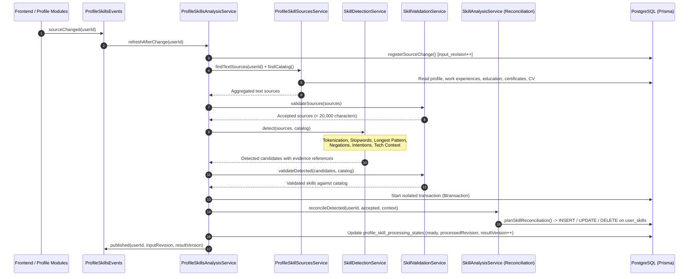
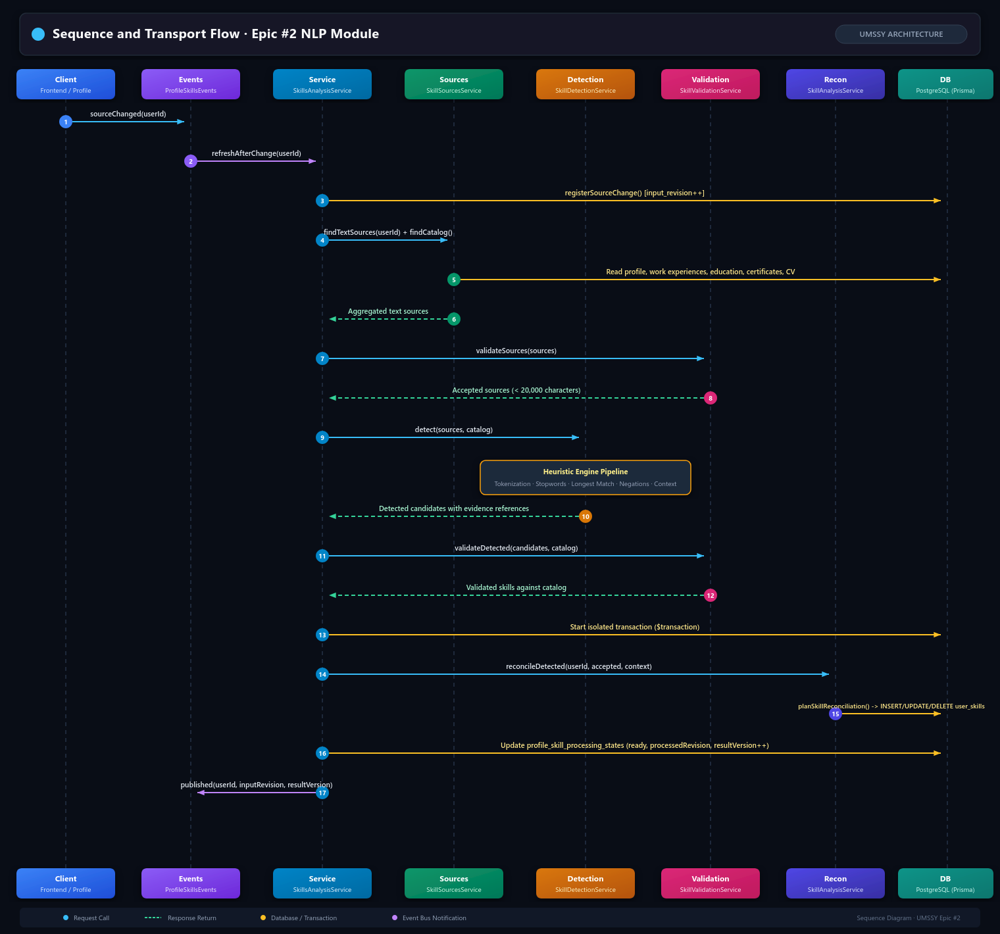

# Natural Language Processing (NLP)

## Purpose and responsibilities

The `nlp` domain is responsible for the automated extraction, normalization, detection, and consolidation of technical skills from the profile text sources (professional headline and summary, work experiences, academic education, certifications, and uploaded CV documents).

Owner: group 2. The module operates reactively to profile mutations, detects catalog skills with evidence references, resolves conflicts between manual and detected skills, and maintains a versioned snapshot of the profile processing state.

## Architecture and data flow

The data flow runs reactively and asynchronously through an internal transactional event bus (`ProfileSkillsEvents`), decoupling UI form updates from the computational cost of the NLP pipeline.

### Sequence and transport flow





### Step-by-step data lifecycle

1. **Event trigger**: Whenever an authenticated owner saves or modifies any profile section (personal details, work experiences, educations, certifications, or backing files), the mutating domain invokes `ProfileSkillsEvents.sourceChanged(userId)`.
2. **Intent registration and revision increment**: In `ProfileSkillResultsRepository`, the `profile_skill_processing_states` record sets `status: pending` and increments `input_revision`.
3. **Source aggregation (`ProfileSkillSourcesService`)**:
   - `presentation`: Professional headline (`headline`) and personal summary (`aboutMe`).
   - `work-experience`: Job position (`position`) and description of duties (`description`).
   - `education`: Academic degree (`degree`) and program description (`description`).
   - `certification`: Certification title (`name`) and issuing entity (`issuingOrganization`).
   - `cv`: Raw text extracted from the user's active CV file.
4. **Source validation**: Each textual unit is validated against a safety threshold (`MAX_NLP_SOURCE_LENGTH = 20,000` characters). Entries exceeding this limit are discarded with the `source-too-long` reason.
5. **Detection and heuristic analysis (`SkillDetectionService`)**:
   - The text is tokenized and broken down into sentence segments.
   - Stopwords are stripped using English and Spanish dictionaries.
   - The alias index is traversed matching longest patterns first.
   - Negations, future intentions, and ambiguous technical context rules are evaluated.
   - Detected mentions are paired with source references (entity type and record ID).
6. **Syntactic and catalog validation (`SkillValidationService`)**:
   - Skills are matched against the canonical `skills` table catalog.
   - Syntactic integrity is enforced (maximum 50 characters, must contain letters, allowed character set, no sequence with more than 3 identical consecutive characters).
7. **Transactional reconciliation (`SkillAnalysisService`)**:
   - Detected skills are compared against existing `user_skills` rows.
   - Inserts, evidence updates, and deletions of stale detections are executed within a Prisma transaction (`$transaction`).
   - `profile_skill_processing_states` is updated with `status: ready`, aligning `processed_revision = input_revision` and incrementing `result_version` only if actual skills or evidences changed.

## Database models and new tables

To support the NLP processing lifecycle, evidence traceability, and concurrent modification safeguards, the following database models are integrated:

### 1. `profile_skill_processing_states` (New table)

Manages processing state and version tracking per profile, preventing race conditions and stale writes:

- `user_id` (`UUID`, PK, FK referencing `users.id` with `ON DELETE CASCADE`).
- `status` (`VARCHAR(20)`): Processing lifecycle state (`pending`, `ready`, `error`).
- `input_revision` (`INT`, default `0`): Incremental counter representing source modification events.
- `processed_revision` (`INT`, nullable): Highest revision successfully analyzed. When `processed_revision < input_revision`, pending processing is indicated.
- `result_version` (`INT`, default `0`): Version of the published skills snapshot. Incremented only when reconciliation results in actual persistence changes.
- `dictionary_version` (`VARCHAR(64)`): Version of the taxonomy and dictionary applied during analysis (e.g., `1.0.0`).
- `updated_at` (`TIMESTAMPTZ`): Timestamp of the last state modification.

### 2. `user_skills` (Extended with NLP metadata)

Associative model between users and skills, enriched with extraction provenance and verification attributes:

- `id` (`UUID`, PK).
- `user_id` (`UUID`, FK referencing `users.id`).
- `skill_id` (`UUID`, FK referencing `skills.id`). Unique constraint: `@@unique([userId, skillId])`.
- `source` (`VARCHAR(20)`): Origin of the association:
  - `manual`: Explicitly selected by the graduate in the UI.
  - `nlp`: Automatically detected by the NLP pipeline from profile text.
- `verification_status` (`VARCHAR(20)`): Verification state (`pending`, `approved`, `rejected`, `revoked`).
- `is_high_relevance` (`BOOLEAN`): Set to `true` when the skill contains active, valid evidence references.
- `evidence_refs` (`JSONB`, default `[]`): Array of evidence pointers referencing the originating records:
  ```json
  [
    { "type": "work-experience", "id": "uuid-experience" },
    { "type": "certification", "id": "uuid-certification" }
  ]
  ```
- `radar_auto_verified` (`BOOLEAN`): Flag indicating automated verification derived from supported sources.

### 3. `skills` (Catalog model)

Standard catalog of technical skills:
- `id` (`UUID`, PK).
- `name` (`VARCHAR`, Unique): Canonical skill name (e.g., `TypeScript`, `Docker`, `PostgreSQL`).
- `is_custom` (`BOOLEAN`, default `false`): Flag for user-defined skills.
- `area_id` (`VARCHAR(50)`, nullable): Reference to technical categorizations.

## Data selection criteria and NLP pipeline

The extraction engine executes a deterministic pipeline designed for high precision without introducing heavy runtime dependencies:

### 1. Text normalization and sanitization
- Text is normalized via `normalizeTerm()`, converting characters to lowercase, removing diacritics (accents), and collapsing consecutive whitespace.
- Technical punctuation characters (`+`, `#`, `.`, `-`) are preserved so technologies such as `C++`, `C#`, `.NET`, and `Node.js` remain identifiable.

### 2. Tokenization and stopword removal
- Text is segmented into lexical tokens and clause units (`splitSegments`).
- Words listed in `NLP_STOPWORDS` (112 common Spanish and English words including prepositions, articles, and pronouns) are filtered out, allowing the matcher to detect multi-word skills even across minor filler words.

### 3. Technical dictionary and alias index (Longest Match First)
- A trie-like alias index is built in memory (`buildAliasIndex`) combining `NLP_SKILL_DICTIONARY` and database catalog entries.
- Patterns are checked matching the longest sequence first (`findLongestPattern`), ensuring compound technologies (e.g., `React Native`) take precedence over shorter substrings (e.g., `React`).

### 4. Negation detection and exception handling
- The 3 tokens preceding a detected mention are scanned for negation cues in `NLP_NEGATION_CUES` (*no, sin, nunca, jamas, ni, tampoco, carezco, desconozco, excepto, not, without, never*). If found, the mention is discarded.
- **Exceptions**: When negation is qualified by words like *solo, solamente, unicamente* ("no solo trabajo con Python..."), the detection is kept.
- **Clause breakers**: Connectors in `NLP_CLAUSE_BREAKERS` (*pero, aunque, sino, sin embargo, but, however*) reset the negation scope across sentence boundaries.

### 5. Learning intention filtering
- The context is checked for future intention or study cues (`NLP_INTENTION_CUES`: *aprender, estudiar, conocer, learn*). When present (e.g., "deseo aprender React"), the mention is discarded, ensuring only applied competencies are extracted.

### 6. Ambiguity resolution and technical context validation
- Shorter aliases matching everyday vocabulary (e.g., `Go`, `R`, `Swift`, `Node`, `Express`, `Angular`) are marked with `isAmbiguous: true`.
- An ambiguous alias is accepted only if:
  1. The text contains at least one general technical keyword from `NLP_TECH_CONTEXT_TERMS` (*programacion, desarrollo, software, backend, frontend, framework, libreria, api, microservicios, codigo, server, language*).
  2. Or if another unambiguous technical skill is detected within the same source.
- Direct false-positive phrases are blocked via `blockedPreviousTerms` (for example, preventing `Angular` when preceded by *piedra*, *momento*, *velocidad*, or *aceleracion*).

## Consolidation, reconciliation, and conflict resolution

The `planSkillReconciliation` algorithm handles coexistence and precedence between manual entries and automated extractions:

| Case | Database Origin | NLP Detection | Action Taken |
|---|---|---|---|
| Manually added skill | `source: 'manual'` | Detected in text | Kept as `manual`. Newly found text references are appended to `evidence_refs`, and `is_high_relevance` is set to `true`. User authorship is preserved. |
| Manually added skill | `source: 'manual'` | Not detected in text | Kept intact in the database with existing metadata. Manual skills are never removed due to lack of text mentions. |
| Existing automatic skill | `source: 'nlp'` | Still present in text | Its evidence references (`evidence_refs`) and relevance flags are updated. |
| Obsolete automatic skill | `source: 'nlp'` | No longer present in text | Unless formally approved by an administrator, the record is removed from `user_skills` (`plan.deleteIds`), keeping the profile synchronized with current text. |
| Brand new detection | Not in profile | Detected in text | A new row is inserted with `source: 'nlp'`, `verification_status: 'pending'`, `is_high_relevance: true`, and associated evidence references. |

## Endpoints

The module exposes its functionality through `ProfileSkillsAnalysisController`, secured via JWT authentication:

| Method | Path | Description |
|---|---|---|
| `GET` | `/profile/me/skills/analysis` | Retrieves the current verified skills snapshot for the authenticated user, along with revision counters (`inputRevision`, `processedRevision`, `resultVersion`) and evidence metadata. |
| `POST` | `/profile/me/skills/analysis` | Triggers immediate, synchronous execution of the NLP analysis pipeline across all active profile sources, returning consolidated outcomes and discarded candidate explanations. |

## Quality metrics and testing

The module includes unit, integration, and quality benchmark tests implemented with Vitest:
- **Code coverage**: Over 80% unit test coverage across analysis services, detection algorithms, and repositories.
- **Detection precision target**: Validated using labeled synthetic datasets (`nlp-development-profiles.json` and `nlp-evaluation-profiles.json`), enforcing:
  $$\text{Precision} \ge 85\% \quad (\text{TARGET\_PRECISION} = 0.85)$$
  measured against at least 20 profile fixtures and more than 100 verified positive relationships.

## Sprint History

### Sprint 2

- Established core architecture and services for NLP processing (`NlpModule`).
- Introduced `profile_skill_processing_states` model for revision control, idempotency, and concurrency management.
- Implemented Spanish and English tokenization, stopword cleaning, and technical dictionary alias matching.
- Added heuristic precision filters: negation detection, learning intention exclusion, and ambiguous alias context validation.
- Implemented the `planSkillReconciliation` algorithm for conflict resolution between manual and automated skills.
- Implemented analysis API endpoints at `/profile/me/skills/analysis`.
- Validated quality metrics on evaluation fixtures exceeding the 85% precision target.

### Sprint 3

- Integrated CV text extraction (`user_cv_file`) as an automated input source for the NLP pipeline.
- Linked verified documents and certificates as direct evidence supporting detected skills.
- Streamlined in-memory event bus (`ProfileSkillsEvents`) for reactive re-analysis on profile mutations.
- Synchronized relevance indicators and evidence persistence in structured JSON format.
